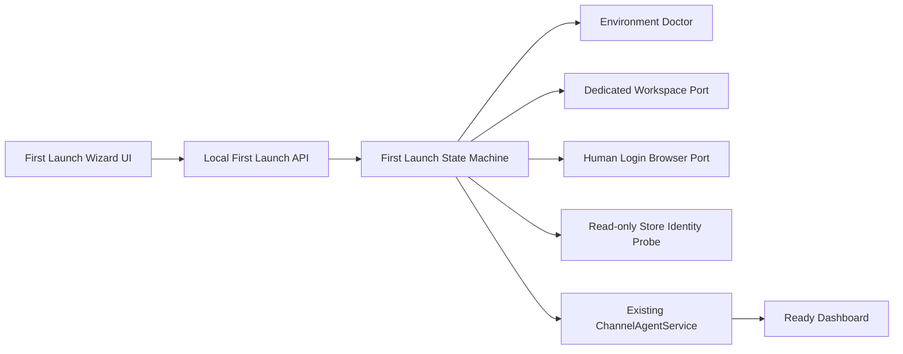
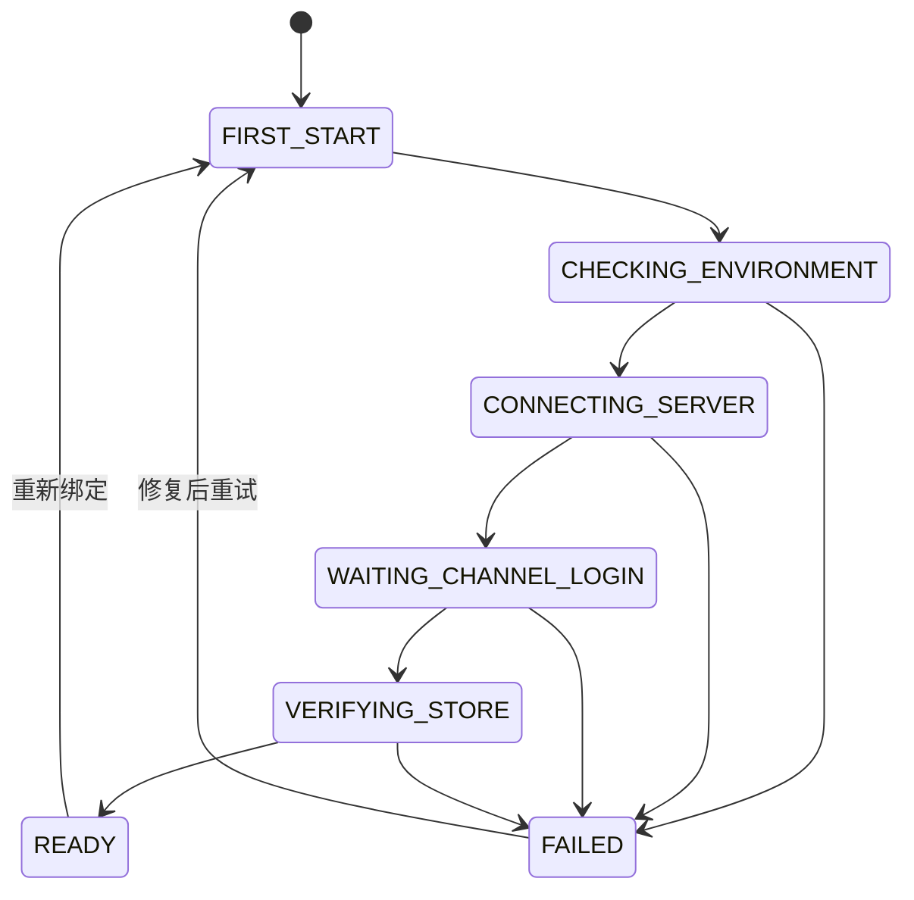

# AI-CS Channel Agent First Launch Experience V1

## 1. 产品目标

First Launch Experience V1 将 Channel Agent 的首次使用流程收敛为一个本地向导：

```text
首次启动
→ Environment Doctor
→ AI-CS 连接检查
→ 创建独立 Workspace
→ 人工扫码登录
→ 只读发现店铺身份
→ 自动生成 StoreBinding
→ Ready Dashboard
```

操作人员不需要编辑配置文件，也不会被要求输入 `store_id`、cookie、token、密码或 credential value。

本版本使用 Fake Browser Login Port 与 Fake Store Identity Probe 验证产品流程，不登录真实 PDD、不读取客户消息、不发送消息、不修改 AI-CS 核心。

## 2. 产品架构



First Launch 是现有 Agent Runtime 上方的产品体验层。它不实现消息、Decision、Approval、Execution 或 Transport 业务逻辑。

## 3. 状态机

状态：

- `FIRST_START`
- `CHECKING_ENVIRONMENT`
- `CONNECTING_SERVER`
- `WAITING_CHANNEL_LOGIN`
- `VERIFYING_STORE`
- `READY`
- `FAILED`

合法转换：



API 状态响应保留 `state_history`，用于验证一次运行确实经过完整链路，而不是直接伪造 Ready。

## 4. Environment Doctor

Doctor 输出 `PASS / WARNING / BLOCKED`，包含以下检查：

| 分类 | 检查 | 失败等级 |
|---|---|---|
| System | Windows | BLOCKED |
| System | Chrome | BLOCKED |
| System | Profile 目录 | WARNING，可由向导创建 |
| System | 网络 | BLOCKED |
| AI-CS | Gateway Health | BLOCKED |
| AI-CS | Server Connection | BLOCKED |
| Channel | Browser Runtime | BLOCKED |
| Channel | Transport Status | 登录前 WARNING |
| Safety | Pilot Mode | BLOCKED |
| Safety | Kill Switch | WARNING，但不能进入 Ready |
| Safety | Manual Approval | BLOCKED |

失败只返回用户可执行的说明，不返回技术堆栈、异常类型或内部路径。

## 5. Store Binding Wizard

向导固定支持 `platform=pdd`，不开放手填身份字段：

1. 创建 `pdd-single-store-workspace`。
2. 使用 Profile 名称 `pdd-pilot-single-store-001`。
3. Browser Port 只负责打开独立窗口和读取登录状态。
4. 登录操作完全由用户完成。
5. Store Identity Probe 只读返回 `store_id / store_name / account_identity`。
6. 服务根据发现结果生成 `StoreBinding`。
7. 若已有绑定与发现身份不同，进入 `STORE_MISMATCH` 并停止，不覆盖原绑定。

API 不包含接受 `store_id`、cookie、token 或密码的请求模型。

## 6. 配置设计

`FirstLaunchSetupConfig` 是系统管理的类型化配置：

- `platform=pdd`
- `workspace_id`
- `profile_name`
- `credential_reference`
- `automatic_login=false`
- `message_read_enabled=false`
- `send_enabled=false`
- `auto_reply=false`
- `approval_required=true`

`credential_reference` 仅为不透明引用，不在状态 API、Timeline 或 UI 中返回。

当现有本地 Agent 处于 `MOCK` 且尚未启动时，向导在内存中应用安全的托管 Pilot 配置：`runtime_mode=PILOT`、`dry_run=true`，并保持 Kill Switch。用户无需编辑 JSON/YAML。

## 7. UI 设计

入口：

- `GET /agent`：未完成首次设置时跳转 `/agent/first-launch/ui`；Ready 后跳转 `/agent/ui`。
- `GET /agent/first-launch/ui`：首次启动向导。

页面包含：

- 六阶段进度条与当前状态。
- 拼多多平台选择卡片。
- Environment Doctor 检查清单。
- Chrome、Profile、Login 等待登录状态。
- “重新打开浏览器”和“检查登录状态”按钮。
- Ready 状态卡：Node、Store、Browser、Session、Channel、AI、Safety、Approval。
- 用户可理解的运行时间线。
- 失败标题、原因和下一步操作。

向导没有文本输入框，没有发送、审批、消息读取或 Cookie 导出操作。

## 8. Local API

```http
GET  /agent
GET  /agent/first-launch/ui
GET  /agent/first-launch/status
GET  /agent/first-launch/doctor
POST /agent/first-launch/start
POST /agent/first-launch/browser/reopen
POST /agent/first-launch/login/check
POST /agent/first-launch/reset
```

所有 POST API 都是无敏感参数的状态动作。越序操作返回：

```json
{
  "detail": {
    "code": "FIRST_LAUNCH_ACTION_UNAVAILABLE",
    "message": "当前步骤不能执行此操作。"
  }
}
```

## 9. Runtime Timeline

Timeline 记录用户可理解事件：

- Agent 启动
- 环境检查通过
- AI-CS 连接通过
- 浏览器已打开
- 等待人工登录
- 人工登录成功
- 店铺绑定成功
- Channel Agent 已就绪
- 安全停止或重置

Timeline 不包含 token、cookie、secret、credential reference、Profile 绝对路径、客户消息或技术堆栈。

## 10. Failure UX

| 错误码 | 用户提示 | 安全结果 |
|---|---|---|
| `GATEWAY_UNAVAILABLE` | 请检查 AI-CS 服务 | 创建 Workspace 前停止 |
| `CHROME_UNAVAILABLE` | 请检查 Chrome 与 Profile 权限 | 不进入登录步骤 |
| `LOGIN_FAILED` | 请重新人工扫码 | 不执行店铺发现 |
| `STORE_IDENTITY_UNAVAILABLE` | 请确认已进入商家聊天页 | 不生成绑定 |
| `STORE_MISMATCH` | 当前店铺与节点绑定不一致 | 停止且保留原绑定 |
| `KILL_SWITCH_ENABLED` | 由授权人员确认安全开关 | 禁止进入 Ready |
| `AGENT_NOT_READY` | 检查运行状态后重试 | 保持 fail-closed |

## 11. 测试结果

新增测试覆盖：

1. 完整首次启动状态历史。
2. Environment Doctor PASS/WARNING/BLOCKED。
3. Gateway 异常。
4. Chrome 异常。
5. 稳定等待人工登录。
6. 登录失败。
7. Store mismatch 并保留已有绑定。
8. Ready 状态与 Dashboard 联动。
9. Kill Switch 阻断 Ready。
10. 重新绑定只删除向导创建的绑定。
11. UI/API、敏感引用扫描与越序操作。

```text
V16 targeted suite: 15 passed, 1 warning
Full regression suite: 279 passed, 1 warning
```

Warning 来自既有 Starlette `TestClient` 的 httpx 兼容层弃用提示，不影响结果。

## 12. 下一阶段真实 Pilot 步骤

1. 用已验证的专用 Chrome Profile Port 替换 Fake Browser Port。
2. 人工扫码，不提供自动登录或凭据输入。
3. 使用 VERIFIED Selector Contract 或已验证只读 API 实现 Store Identity Probe。
4. 先验证 Store Identity，匹配后才保存 StoreBinding。
5. 保持消息读取、发送与自动回复关闭。
6. 完成一次观察证据后，再单独审批启用 Receive-only Transport。
7. Controlled Send 仍需新的任务、人工审批与最多一条限制。

## 13. 完成状态

`CHANNEL_AGENT_FIRST_LAUNCH_READY`
