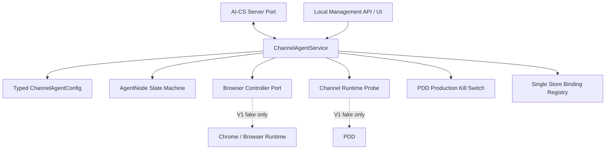
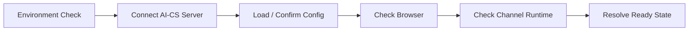

# 《AI-CS Channel Agent Foundation V1》

状态：`CHANNEL_AGENT_FOUNDATION_READY`

版本：`1.0`

日期：2026-08-04

## 1. 结论与产品定位

AI-CS Channel Agent Foundation V1 已完成。现有 Channel Engine 已增加一个面向
Windows 单机节点的产品化外壳，使节点具备统一配置、确定性启停、组件健康聚合、
单店绑定、本地管理 API、基础管理页面和可安装命令入口。

V1 是安全的节点编排基础，不是生产渠道上线授权。本次装配仅使用 fake server
connector、fake browser controller 和 fake channel probe；没有连接真实 AI-CS、
没有启动真实 PDD 会话、没有登录真实店铺，也不存在消息发送 API。

## 2. 整体架构



边界规则：

- `ChannelAgentService` 只负责生命周期、状态与检查，不拥有 send 方法；
- Server、Browser、Channel 以 Protocol 隔离，V1 构造器拒绝标记为 real 的实现；
- Local API 固定由 `127.0.0.1` 启动，不对外网绑定；
- Kill Switch 读取现有 PDD Production Safety 状态，开启时 Channel 状态为
  `BLOCKED`，节点不得进入 `ONLINE`；
- Store 只支持一个绑定，换店必须先停止节点并显式解绑。

## 3. Agent Node 模型

`AgentNode` 是版本化、不可变、禁止额外字段的领域模型：

```text
agent_contract_version = 1.0
node_id
node_name
status
version
last_heartbeat
server_connection
environment
```

### 3.1 Node 状态

| 状态 | 含义 |
| --- | --- |
| `INIT` | 已构造，尚未启动 |
| `OFFLINE` | AI-CS Server 不可达 |
| `CONNECTING` | 正在执行启动/重连检查 |
| `ONLINE` | Server、Browser、Channel 和 Store 全部 ready，且 Kill Switch 关闭 |
| `DEGRADED` | Server 可达，但 Browser、Channel、Store 或安全条件未满足 |
| `STOPPED` | 已主动停止并释放本节点拥有的资源 |

允许的主路径为：

```text
INIT/STOPPED/OFFLINE/DEGRADED
  -> CONNECTING
  -> ONLINE | DEGRADED | OFFLINE
  -> STOPPED
```

非法转换由 `AgentLifecycleError` 拒绝。每次有效检查更新
`last_heartbeat`；Server 断开立即进入 `OFFLINE`，下一次 Check 尝试重连。

### 3.2 Component 状态

Server、Browser、Channel 分别返回：

`UNKNOWN / STARTING / HEALTHY / DEGRADED / UNAVAILABLE / BLOCKED / STOPPED`

每个组件状态包含 `checked_at` 和稳定的 `reason_code`，管理 API 不返回异常堆栈、
credential reference 或 secret value。

## 4. 配置体系

配置入口统一为强类型 `ChannelAgentConfig`，配置版本为 `1.0`。加载器只接受一个
JSON 文档，不读取散落 YAML，限制为 1 MiB，并采用 frozen、strict、
extra-forbid 校验。

```text
ChannelAgentConfig
├── node_id / node_name / agent_version
├── server
│   ├── server_url
│   └── agent_token_reference
├── browser
│   ├── chrome_path
│   └── profile_root
├── channel
│   ├── platform = pdd
│   └── store_binding
└── safety
    ├── runtime_mode = MOCK | STAGING | PRODUCTION
    ├── dry_run
    └── kill_switch
```

校验规则：

- token 字段只能是 `credential-ref://` 或 `secret-ref://` reference；
- URL 不得内嵌 username/password、query 或 fragment；
- MOCK 只允许 loopback AI-CS URL；STAGING/PRODUCTION 要求 HTTPS；
- Chrome 和 profile 路径必须为绝对路径；
- 禁止使用系统 Chrome 默认 `User Data` 目录；
- MOCK/STAGING 强制 `dry_run=true`；
- 状态 API 只返回配置 SHA-256 fingerprint，不返回 token/credential reference。

参考配置：[`deploy/channel-agent.example.json`](../deploy/channel-agent.example.json)。

## 5. Startup Lifecycle

启动事件按以下顺序记录，便于诊断和后续审计接入：



阶段与主要失败行为：

| 阶段 | 成功 | 失败 |
| --- | --- | --- |
| Environment | 配置对象已通过构造校验 | 不创建 Service |
| Server Connect | `CONNECTED` | Node `OFFLINE`，Browser/Channel 不启动 |
| Config Load | 记录当前 config version/fingerprint | 配置加载前 fail closed |
| Browser Check | Browser `HEALTHY` | Node `DEGRADED`，Channel `BLOCKED` |
| Channel Check | Store 绑定、Kill Switch 关闭且 probe healthy | Node `DEGRADED` |
| Ready | Node `ONLINE` | 保留精确 reason code |

Browser 健康检查失败时，Check 会尝试一次受控恢复；Server 恢复后，下一次 Check
重新执行连接和 readiness 判定。停止流程先停止 Browser，再断开 Server，并将所有
组件状态置为 `STOPPED`。

## 6. Store Binding Foundation

`StoreBinding` 字段：

```text
platform = pdd
store_id
store_name
credential_reference
status = BOUND | SUSPENDED
```

V1 明确是一节点一店：

- 未绑定时 Node 可启动，但最终为 `DEGRADED`，Channel 为
  `AGENT_STORE_UNBOUND`；
- `SUSPENDED` 时 Channel 为 `AGENT_STORE_SUSPENDED`；
- 第二个 store ID 不可覆盖现有绑定；
- 绑定、解绑和配置切换只允许在 `INIT` 或 `STOPPED` 状态；
- API 状态只显示 store ID/name，不返回 credential reference；
- 本阶段不执行真实登录，也不验证真实店铺身份。

## 7. Local Management API

| Method | Path | 作用 | 成功状态码 | 拒绝 |
| --- | --- | --- | ---: | --- |
| GET | `/agent/status` | Node 与组件快照 | 200 | — |
| GET | `/agent/health` | readiness/liveness 摘要 | 200 | — |
| POST | `/agent/start` | 启动或安全重入 | 200 | 409 |
| POST | `/agent/stop` | 停止或安全重入 | 200 | 409 |
| POST | `/agent/check` | 心跳、恢复和状态重算 | 200 | 409 |
| PUT | `/agent/store` | 绑定单一 store | 200 | 409/422 |
| DELETE | `/agent/store` | 解绑 store | 204 | 409 |
| GET | `/agent/ui` | 基础本地管理页面 | 200 | — |

`GET /agent/status` 返回：Node、AI-CS Server、Browser、Channel、Store、dry-run、
Kill Switch 和 config fingerprint。`GET /agent/health` 仅在 Node 为 `ONLINE` 时返回
`ready=true`。

管理页面显示 AI-CS、Browser、Channel、Store 和 Safety 状态，并提供“启动、停止、
检查”三个按钮。页面没有文本输入、自动回复或发送按钮。

## 8. Windows 安装与启动

在项目目录中：

```powershell
.\.venv\Scripts\python.exe -m pip install -e . --no-deps
$env:CHANNEL_AGENT_CONFIG_PATH = "C:\path\to\channel-agent.json"
$env:CHANNEL_AGENT_PORT = "18020"
.\.venv\Scripts\channel-agent.exe
```

访问：`http://127.0.0.1:18020/agent/ui`。

命令入口为 `channel-agent = channel_engine.app:run_agent`。未提供配置路径时使用安全
的 MOCK、loopback、dry-run 默认配置。V1 仍是前台进程；Windows Service/installer
封装属于下一阶段。

## 9. Safety 与禁止边界

- 默认 `MOCK + dry_run=true`；
- Local API host 固定为 loopback；
- Agent API 不包含 send、reply、refund、order 或 payment endpoint；
- V1 默认装配全部为 fake port，真实 connector/controller/probe 会在构造时被拒绝；
- Channel readiness 受现有持久化 PDD Kill Switch 控制；
- Kill Switch 开启不会删除历史 Receipt、Event、Outbox 或 Audit；
- Config、API、UI 和日志输出路径不暴露 token/credential value；
- 多店铺、自动回复和绕过 Approval 均不在本模型中。

## 10. 测试结果

新增：

- `tests/unit/test_channel_agent_foundation.py`
- `tests/api/test_channel_agent_api.py`

| 必测场景 | 验证结果 |
| --- | --- |
| Agent 启动 | 生命周期顺序正确并进入 ONLINE |
| 配置加载 | 单一 typed JSON、版本、路径、reference 校验通过 |
| 状态转换 | INIT/CONNECTING/ONLINE/DEGRADED/OFFLINE/STOPPED 受控 |
| Server 断开恢复 | OFFLINE，下一次 Check 重连并恢复 ONLINE |
| Kill Switch 阻断 | Node DEGRADED、Channel BLOCKED，probe 不执行 |
| Browser 不可用 | Node DEGRADED、Channel BLOCKED |
| Store 未绑定 | Node DEGRADED；绑定/解绑与单店约束生效 |
| Local API/UI | 状态、健康、启停、检查、店铺管理均通过 |
| 敏感信息 | API/UI 不包含 token/credential reference |

验证结果：

```text
Channel Agent targeted suites: 11 passed
Full repository suite:         240 passed, 1 warning
Editable package install:      passed
channel-agent command entry:   passed
compileall / pip check:         passed
example config load:           passed
```

唯一 warning 是项目既有 FastAPI TestClient 触发的 Starlette/httpx 弃用提示，与本次
Agent 功能无关。

## 11. Quality Gates

| Gate | 结果 |
| --- | --- |
| AgentNode 与版本化状态模型 | PASS |
| 强类型集中配置 | PASS |
| 确定性启动/停止/恢复 | PASS |
| Local Management API | PASS |
| Basic UI | PASS |
| 单店 Store Binding | PASS |
| Kill Switch 与 Browser/Store fail-closed | PASS |
| 安装与命令入口 | PASS |
| 无真实连接、登录或发送 | PASS |

## 12. 下一阶段计划

以下能力需要新的、明确授权的 Sprint，不包含在本状态中：

1. 为既有 Gateway Contract 增加 Agent 专用、受控的真实 server connector；
2. 将 `BrowserSessionManager` 适配到 Browser Controller Port，但保持禁止自动登录；
3. 将 Observation Runtime 适配到 Channel Probe，仍保持 receive-only；
4. 增加加密配置仓库/系统 secret provider 解析器，继续只在配置中保存 reference；
5. 增加 Windows installer、Service Wrapper、开机策略和升级/回滚机制；
6. 将生命周期事件接入持久化 sanitized Audit 和运维告警；
7. 在独立授权下执行单测试店铺的 dry-run 验证，真实 send 继续关闭。

## 13. Final Status

`CHANNEL_AGENT_FOUNDATION_READY`
