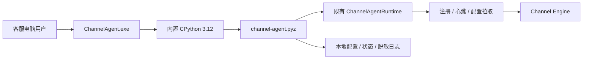

# 《AI-CS Channel Agent Windows Client V1 Completion Report》

## 1. 完成结论

Channel Agent Windows Client V1 已完成可运行基础：Windows x64 原生启动器、内置 CPython 运行时、Agent ZIP 应用、安装/卸载流程、本地配置与状态目录、启动/停止/状态查询、开机自启动开关，以及只读版本检查基础。

最终状态：`CHANNEL_AGENT_WINDOWS_CLIENT_READY`

本次未连接 PDD，未引入浏览器自动化、消息读取、消息发送或自动回复能力；Gateway Contract V1 未修改。

## 2. 客户端架构



Windows 层只负责进程和部署边界，复用现有 Agent Runtime、Heartbeat、Registration 与 Identity Binding，不重新实现 Channel Engine 能力。

## 3. 新增结构

### 3.1 运行代码

- `src/channel_agent/windows.py`：Windows 状态模型、原子状态存储、运行宿主、自启动管理、升级清单检查。
- `src/channel_agent/windows_app.py`：`start`、`run`、`stop`、`status`、`version`、`check-config`、`autostart`、`upgrade-check` 命令入口。
- `pyproject.toml`：增加 `channel-agent-windows` 命令入口。

### 3.2 打包与安装

- `packaging/windows-client-v1/production-composition.json`：生产装配白名单。
- `packaging/windows-client-v1/ChannelAgentLauncher.cs`：原生 Windows EXE 启动器。
- `packaging/windows-client-v1/Install-AI-CS-Channel-Agent.ps1`：安装脚本。
- `packaging/windows-client-v1/Uninstall-AI-CS-Channel-Agent.ps1`：卸载脚本。
- `scripts/build_channel_agent_windows_client.ps1`：可复现 ZIP 构建脚本。
- `deploy/channel-agent-foundation/upgrade-manifest.example.json`：升级清单样例。

### 3.3 测试

- `tests/windows_agent/test_channel_agent_windows_client_v1.py`：Windows 宿主、心跳恢复、自启动、升级检查、安装/卸载、装配边界和原生进程检测。

## 4. 运行方式

构建产物：

- `dist/windows-client-v1/AI-CS-Channel-Agent-1.0.0-windows-x64.zip`
- 版本：`1.0.0`
- ZIP SHA256：`d9b51cf7ce2dee236d85abb1934d7d30461173b594e74e61e287045f78e962d5`
- EXE SHA256：`08d72159cc829d84e457ad1eedee7364c79db455e14fa61b4f6fe64cc8d03419`

安装后命令：

```powershell
ChannelAgent.exe start
ChannelAgent.exe status
ChannelAgent.exe stop
ChannelAgent.exe version
ChannelAgent.exe check-config
ChannelAgent.exe autostart enable
ChannelAgent.exe autostart disable
ChannelAgent.exe upgrade-check --manifest <manifest.json>
```

`start` 启动后台进程并等待明确状态；Channel Engine 不可达时客户端保持 `DEGRADED`，命令返回非零退出码 `2`，不会伪报成功。

## 5. 配置与本地数据

默认安装位置：

- 程序：`%LOCALAPPDATA%\Programs\AI-CS\ChannelAgent`
- 配置与运行数据：`%LOCALAPPDATA%\AI-CS\ChannelAgent`
- 配置：`config\agent.json`
- 状态：`runtime\channel-agent-state.json`
- 日志：`logs\channel-agent.jsonl`

配置只包含 `server_url`、`agent_id`、`device_id`、用户/店铺引用及超时/心跳参数。加载器递归拒绝 Cookie、Token、Password、Secret、Credential 或 Authorization 字段；Server URL 也禁止内嵌用户信息。

## 6. 生命周期与恢复

- Windows 进程状态：`STARTING`、`RUNNING`、`DEGRADED`、`STOPPED`、`FAILED`。
- Agent Runtime 状态继续沿用 Foundation V1。
- 状态文件采用临时文件加原子替换，避免半写入。
- Windows PID 使用 `OpenProcess` 与 `WaitForSingleObject` 只读检测，不向进程发送探测信号。
- `stop` 通过本地停止请求让 Runtime 正常关闭并刷新 `STOPPED` 状态。
- 心跳首次失败后由现有 Runtime 进入降级并继续有限重连；恢复后重新记录 `RUNNING` 与最近心跳。

## 7. 自启动与升级基础

自启动开关通过当前 Windows 用户 Startup 目录中的 `AI-CS-Channel-Agent.cmd` 管理，仅保存 EXE 与数据目录路径，不保存凭证。

升级能力当前为只读基础：校验本地升级清单的语义版本和可选包 SHA256，报告是否存在更高版本。V1 不下载、不替换、不静默安装，也不接触远端升级服务。

## 8. 安全边界

生产装配白名单只包含 `src/channel_agent` 代码和明确列出的 Python 依赖。最终 ZIP 路径扫描未发现以下模块：

- `channel_engine`
- `ai_cs_agent`
- PDD 模块
- 浏览器自动化
- 消息读取或消息发送实现

身份未绑定时 `production_eligible=false`；客户端无权自行绑定身份或提升权限。日志只记录结构化事件和错误类型，敏感字段统一脱敏。

Gateway Contract V1 canonical SHA256 保持：

`e5ac64a82d2a7ccd19d3ece9bcc076242b55b6c205c85626786e8b1b7478f4b5`

## 9. 测试结果

| 验证项 | 结果 | 证据 |
|---|---:|---|
| Windows Client 专项测试 | PASS | 6 passed |
| 全量回归 | PASS | 538 passed，1 条既有依赖弃用警告 |
| Contract / Cross-repo | PASS | 124 passed |
| Security / Agent | PASS | 31 passed |
| Python 编译 | PASS | `compileall` exit 0 |
| 依赖一致性 | PASS | `pip check` 无冲突 |
| 包内文件完整性 | PASS | 1,625 项 SHA/大小全部一致 |
| Package 边界 | PASS | 禁止模块路径 0 项 |

隔离真实安装演练结果：

| 场景 | 退出码/结果 |
|---|---|
| 安装 | 0 |
| 版本查询 | 0，返回 `1.0.0` |
| 配置检查 | 0，`contains_credentials=false` |
| Channel Engine 不可达启动 | 2，状态 `DEGRADED` |
| 降级状态查询 | 2 |
| 正常停止 | 0，状态 `STOPPED` |
| 自启动状态 | `ENABLED` |
| 卸载并移除测试数据 | 0，程序/数据/自启动项均清理 |

演练只使用仓库 `.runtime` 下的临时安装目录与关闭的本地端口，没有连接真实 Channel Engine、PDD 或客户数据。

## 10. 已知限制与下一步

1. 当前安装形态是自包含 ZIP 加 PowerShell 安装器，不是签名 MSI/MSIX。
2. `ChannelAgent.exe` 和 ZIP 尚未做企业代码签名。
3. 升级只做版本与 SHA 清单检查，尚无签名升级源、下载、原子替换和回滚。
4. 本次验证覆盖 Windows 10/11 兼容运行基础，但尚未在干净客服电脑镜像、域策略、杀毒软件与最小权限账户矩阵中认证。
5. ONLINE 生产联机需要可达的 Channel Engine Agent API、管理员完成的 Identity Binding，以及独立的凭证提供机制；这些不是本次 Windows Client 的职责。
6. 后续 PDD 接入仍依赖单独批准的浏览器 Session、Selector、Store Binding 和发送安全 Gate；本客户端不包含这些能力。

## 11. 发布判定

Windows Client V1 的工程基础与隔离部署验证完成，可作为后续企业签名安装包和受控 Channel Engine 联机测试的输入。

Final Status: `CHANNEL_AGENT_WINDOWS_CLIENT_READY`
