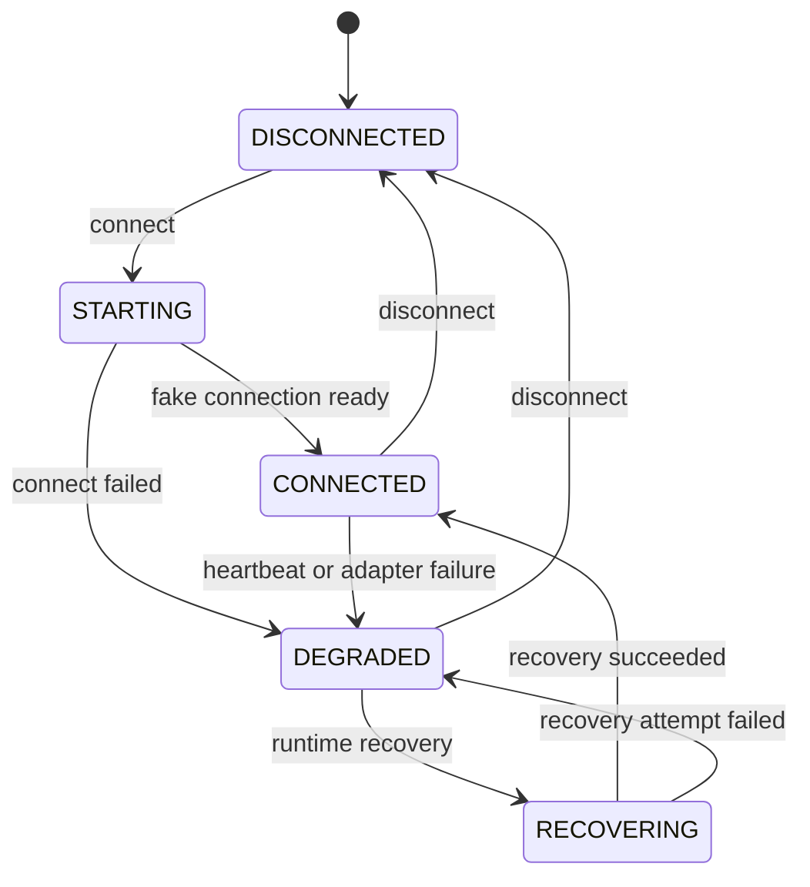
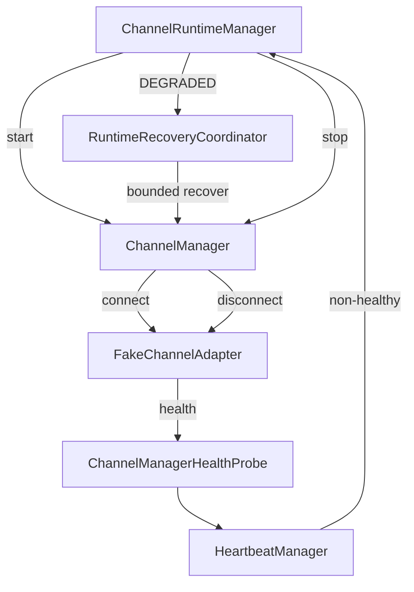

# AI-CS Channel Engine Adapter Layer Foundation V1 完成报告

## 1. 完成结论

Channel Engine 已在不接入真实平台的前提下，从仅有单消息 Fake Channel 的兼容边界升级为具备版本化接口、store-aware 消息、Capability、统一生命周期、Channel Manager、Runtime Heartbeat/Recovery 集成和受控发送边界的 Adapter Layer Foundation。

| Quality Gate | 完成证据 | 状态 |
|---|---|---|
| Gate 1 | `ChannelAdapterV1` Protocol 与受控发送命令 | `CHANNEL_INTERFACE_READY` |
| Gate 2 | `ChannelMessageV1` 七字段标准模型与 Runtime 映射 | `CHANNEL_MESSAGE_MODEL_READY` |
| Gate 3 | 完整 `FakeChannelAdapter`；旧 `FakeChannel` 已由其支撑 | `FAKE_CHANNEL_ADAPTER_READY` |
| Gate 4 | Runtime 启停回调、Channel Heartbeat 与有限 Recovery | `CHANNEL_RUNTIME_ADAPTER_READY` |
| Gate 5 | 专项、兼容和全量回归通过 | `CHANNEL_ENGINE_ADAPTER_FOUNDATION_READY` |

本版本没有连接真实 PDD、没有启动 Playwright、没有登录真实账号、没有发送真实消息，也没有修改 AI-CS。

## 2. Adapter 架构


职责边界：

- Adapter 只负责连接、接收、标准化、健康状态和受控发送。
- Adapter 不包含 RAG、模型、Prompt、Decision 或回复生成方法。
- `ChannelMessageV1.to_runtime_message()` 只进行确定性字段映射。
- AI-CS 仍是唯一 Intelligence Layer。
- Execution 仍必须经过 Decision、Human Approval、Lease 和 Receipt。

为保持已有 Browser/PDD 模拟测试兼容，早期单消息 `ChannelAdapter` 保留为 V0 compatibility protocol；新平台必须实现 `ChannelAdapterV1`。

## 3. ChannelAdapterV1 接口

版本：`adapter_contract_version=1.0`

```text
connect()
disconnect()
receive_messages(limit)
send_message(AuthorizedOutboundMessage)
get_conversation(conversation_id)
health_check()
recover()
```

并要求暴露：

```text
channel
store_id
adapter_name
lifecycle_state
capabilities
```

### 3.1 接口语义

| 方法 | 语义 | 安全规则 |
|---|---|---|
| `connect()` | 建立 Adapter 运行会话 | Foundation 仅改变 Fake 状态 |
| `disconnect()` | 关闭 Adapter 会话 | 幂等、不得删除消息或 Receipt |
| `receive_messages(limit)` | 一次读取 1–100 条标准消息 | 未 CONNECTED 时 fail closed |
| `send_message(command)` | 执行受控发送 | 只接受 `AuthorizedOutboundMessage` |
| `get_conversation()` | 返回标准会话元数据 | 不包含 Cookie、Token、Secret |
| `health_check()` | 返回 Adapter 健康 | 正常降级不泄露堆栈或凭据 |
| `recover()` | 执行一次有限恢复动作 | 由 Runtime Recovery 控制重试预算 |

裸 `OutboundMessage`、裸字符串或缺少 Ledger Verifier 的发送调用均被拒绝。

## 4. Message Normalization

`ChannelMessageV1` 字段：

| 字段 | 约束 |
|---|---|
| `message_id` | 平台范围内稳定的消息标识，1–255 字符 |
| `channel` | 小写规范化渠道名 |
| `store_id` | 当前 Adapter 绑定的店铺标识 |
| `conversation_id` | 平台会话标识 |
| `sender` | 外部发送者标识 |
| `content` | 非空文本，最大 8,000 字符 |
| `timestamp` | 必须包含时区 |

消息唯一键采用：

```text
(store_id, conversation_id, message_id)
```

相同键、相同内容返回幂等 replay；相同键、不同内容触发 `ChannelMessageConflict` 并停止接收该冲突消息。

与现有 Conversation Runtime 的映射：

```text
message_id       → external_message_id
channel          → channel
conversation_id  → conversation_id
sender           → sender
content          → content
timestamp        → timestamp
```

`store_id` 保留在 Adapter V1 边界。当前 Foundation 仍为单渠道单店绑定；多店 Conversation 隔离是接入真实平台前的必做项，详见风险。

## 5. Capability 模型

```json
{
  "adapter_contract_version": "1.0",
  "message_receive": true,
  "send_message": false,
  "image": false,
  "order_query": false
}
```

Capability 是版本化、不可变声明：

- 默认 Fake Adapter 没有 Ledger Verifier，因此为 receive-only，`send_message=false`。
- 只有显式注入 `SendAuthorizationVerifier` 后才声明受控发送能力。
- image 与 order query 在 V1 均关闭。
- Capability 不授予权限，只声明实现能力；实际发送仍必须经过授权验证。

## 6. Channel Manager

`ChannelManager` 负责：

- 按规范化 channel 注册 Adapter；
- 拒绝同一 channel 的重复不同实例；
- 查询已注册渠道；
- 启动单个或全部 Adapter；
- 停止单个或全部 Adapter；
- 隔离 health_check 异常；
- 聚合状态和 Capability；
- 对 DEGRADED Adapter 执行一次 recovery action。

批量启动发生异常时，已启动 Adapter 按相反顺序断开，避免部分启动状态继续运行。

当前注册状态：

```text
registered channels: fake
real platform connected: false
automatic send enabled: false
```

## 7. Adapter Lifecycle

状态：

- `STARTING`
- `CONNECTED`
- `DEGRADED`
- `DISCONNECTED`
- `RECOVERING`



Fake Adapter 保留 transition history 作为测试证据。真实生产 Adapter 后续应将关键 lifecycle event 追加到审计存储。

## 8. Fake Channel 重构

新增 `FakeChannelAdapter`：

- 完整实现 `ChannelAdapterV1`；
- 支持 batch receive；
- store-aware 规范化；
- 重复消息检测；
- 会话元数据；
- CONNECTED 前禁止 receive/send；
- 模拟 connect failure、degradation 和前 N 次 recovery failure；
- 受控发送幂等 Receipt；
- 所有发送结果标记 `real_platform_called=false`、`customer_message_sent=false`。

旧 `FakeChannel` 现在继承该实现并自动连接，只保留 `enqueue()`、`receive()` 等兼容方法。因此旧 Foundation 测试无需改写，但实际实现已统一到新 Adapter 基础。

现有 FakePDD、Browser Observation 等历史模拟组件没有被替换或连接真实平台。

## 9. Runtime 关系



Runtime 集成行为：

1. Runtime STARTING 先调用 `ChannelManager.start_all()`，再启动 Fake Browser。
2. Channel probe 作为统一 Heartbeat 的 CHANNEL 组件来源。
3. Adapter 非健康时 Runtime 从 RUNNING 进入 DEGRADED。
4. 显式 recovery 对 Channel 最多执行 Runtime 配置的有限次数。
5. 完整 Heartbeat 复检通过后 Runtime 才回到 RUNNING。
6. Runtime STOPPING 同时停止 Browser 和所有 Adapter；任一资源停止失败则 fail closed。

Runtime Heartbeat 继续追加到 SQLite；不会启动真实连接。

## 10. 发送边界

```text
Decision APPROVED
        ↓
Approval APPROVED
        ↓
Execution RUNNING + valid lease
        ↓
ExecutionSendAuthorization
        ↓
AuthorizedOutboundMessage
        ↓
ChannelAdapterV1.send_message()
        ↓
ChannelSendReceipt
```

Foundation 默认 Adapter 没有 Verifier，因此不能发送。测试中注入的 Fake Ledger Verifier 只验证接口路径，Receipt 仍明确声明没有真实平台调用和客户消息发送。

Adapter 中没有任何 AI 回复生成方法；`content` 必须来自已经批准的 Execution command。

## 11. API 变化

新增只读接口：

| Method | Path | 内容 |
|---|---|---|
| GET | `/runtime/v1/adapters` | 注册渠道、Adapter lifecycle、health、store、Capability |

Adapter 的启动、停止和恢复仍由 `/runtime/v1/start`、`/runtime/v1/stop`、`/runtime/v1/recover` 统一管理，不暴露绕过 Runtime 的直接控制 API。

## 12. 测试结果

新增 9 个 Adapter Foundation 测试：

- ChannelAdapterV1 接口与生命周期；
- store-aware 消息映射与时区校验；
- batch receive、幂等与冲突；
- Capability 版本化与不可变；
- 裸发送阻断、授权发送与 Receipt 幂等；
- Channel Manager 注册、启停和聚合；
- Adapter RECOVERING/DEGRADED/CONNECTED 轨迹；
- Fake Adapter → Conversation → Decision → Approval → Execution → Receipt；
- Adapter failure → Heartbeat → DEGRADED → bounded Recovery；
- `/runtime/v1/adapters` 生命周期读模型。

其中多个断言归于同一端到端测试用例，因此 pytest 新增用例计数为 9。

验证结果：

```text
Adapter Foundation 专项：9 passed
Channel/Control/Runtime 兼容回归：22 passed
全量回归：299 passed, 1 warning
```

唯一 warning 是 Starlette TestClient 的第三方弃用提示，不影响 Adapter 或 Runtime 行为。

## 13. 异常恢复案例

测试场景：Fake Adapter 配置第一次恢复失败。

1. Runtime 启动，Adapter 经过 STARTING 到 CONNECTED。
2. 测试注入 `FAKE_CHANNEL_CONNECTION_LOST`，Adapter 进入 DEGRADED。
3. Channel Heartbeat 返回 UNHEALTHY，Runtime 进入 DEGRADED。
4. Recovery attempt 1：Adapter `RECOVERING → DEGRADED`。
5. Recovery attempt 2：Adapter `RECOVERING → CONNECTED`。
6. 完整 Channel/Browser/Gateway/Storage Heartbeat 通过。
7. Runtime 返回 RUNNING。

恢复调用次数严格为 2，没有无限循环。

## 14. 真实平台接入前风险

1. `ChannelMessageV1.store_id` 尚未成为 Conversation SQLite 唯一键的一部分；真实多店接入前必须完成 store 级隔离迁移。
2. ChannelManager V1 每个 channel 只允许一个 Adapter，当前适合单店 Pilot，不支持同平台多店。
3. Adapter lifecycle 当前为进程内状态；Runtime 只持久化聚合 Channel Heartbeat，尚未持久化每个 Adapter 的完整事件流。
4. 通用层尚未冻结 cursor、ack、ordering 和 missed-message 协议；真实平台应在 Transport 层补齐后再接入。
5. 真实认证、Session、Credential Provider 没有接入本框架；禁止用配置文件明文补齐。
6. Capability 是声明，不是独立 Policy Engine；除受控 send 外的未来 action 需要逐项增加执行授权。
7. Runtime Heartbeat 尚未有常驻 scheduler/watchdog，需要后续增加周期调度与告警。
8. 真实平台 DOM/API/错误语义仍未知，不能将 Fake Adapter 测试结果等同于生产兼容性。
9. 默认 Fake Adapter 是 receive-only；在真实 Ledger Verifier、店铺绑定、Kill Switch 和 rate limit 全部完成前不得启用 send capability。

## 15. 下一阶段建议

1. 将 store_id 纳入 Conversation、Message 和幂等索引的持久化迁移。
2. 冻结 Adapter Transport Contract：cursor、ack、sequence、retry、backpressure。
3. 为每个 Adapter 增加持久化 lifecycle/audit event 与 health retention。
4. 增加 Adapter Manager 的 operator auth、单渠道 Kill Switch 和 Capability Policy Gate。
5. 建立真实平台 discovery harness，但保持 read-only、人工登录、send disabled。
6. 完成故障注入：认证过期、消息乱序、重复 cursor、网络分区和 SQLite 锁竞争。

## 16. 最终状态

`CHANNEL_ENGINE_ADAPTER_FOUNDATION_READY`
