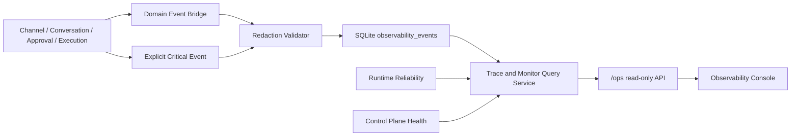

# 《AI-CS Channel Engine Observability Console V1 完成报告》

日期：2026-08-05
最终状态：`CHANNEL_ENGINE_OBSERVABILITY_CONSOLE_READY`

## 1. 完成结论

Channel Engine 已具备单节点、SQLite 持久化的可观测性基础。运行人员现在可以从只读 Console 看到：

- Runtime、Channel、Browser、Gateway、Storage、Worker、Outbox、Policy 的当前状态；
- 一条消息从接收、标准化、Decision、人工审批、Execution 到 Receipt 的完整 Trace；
- 当前停留步骤、停留原因和安全的下一步；
- 等待人工审批的 Decision；
- Execution 状态、尝试次数、错误码、Receipt 与 UNKNOWN 的人工处理要求；
- Channel 连接、Session 变化、Gateway 失败、Execution UNKNOWN 和 Recovery 的持久事件。

本次没有连接真实 PDD、没有调用真实浏览器、没有自动发送、没有修改 AI-CS 或冻结的 Gateway Contract。

## 2. Runtime 架构



设计边界：

- Gateway `Event` 和 transactional outbox 保持冻结，未增加运维字段；
- 运维事件使用独立的 `observability_events` 投影；
- 业务事务内的关键事件与实体状态一并提交；
- Gateway/Intake 失败导致业务事务回滚时，另写一个不可反推客户标识的哈希化停止事件；
- Console 只读，没有批准、执行或发送按钮。

## 3. 新增模块

| 模块 | 职责 |
|---|---|
| `observability/models.py` | V1 Event、Trace、Approval Monitor、Execution Ledger、Runtime Status 模型 |
| `observability/bridge.py` | 将现有 Domain Event 安全映射到运维事件，不改变 Gateway Contract |
| `observability/repository.py` | append-only SQLite 写入、过滤查询、Trace ID 解析、审批与执行读模型 |
| `observability/service.py` | Trace 重建、停止原因、下一步、Runtime/Control Plane 聚合 |
| `observability/api.py` | `/ops` API 和只读 Web Console |
| `storage/orm.py` | 新增 `observability_events` 表及索引 |

同时在以下既有节点增加了事件接入：

- Conversation intake：消息标准化、Decision 请求与回滚失败；
- Repository Domain Event：消息、Decision、Approval、Execution、Receipt；
- Execution Recovery：恢复开始、UNKNOWN、Receipt、恢复完成；
- Runtime Recovery：有限恢复开始、完成、人工介入；
- Channel Runtime：Session 变化和 Channel Connected。

## 4. Event Model V1

统一事件字段：

| 字段 | 含义 |
|---|---|
| `observability_version` | 固定为 `1.0` |
| `event_id` | append-only 事件标识 |
| `event_type` | 关键节点类型 |
| `trace_id` | 一条 Workflow Trace 的根关联 ID |
| `message_id` | 内部消息 ID，可空 |
| `conversation_id` | 内部会话 ID，可空 |
| `request_id` | Gateway 请求 ID，可空 |
| `decision_id` | Decision ID，可空 |
| `approval_id` | Approval ID，可空 |
| `execution_id` | Execution ID，可空 |
| `receipt_id` | Receipt ID，可空 |
| `store_id` | Store 作用域，可空 |
| `timestamp` | 带时区的发生时间 |
| `status` | `INFO / PENDING / SUCCESS / FAILED / UNKNOWN / BLOCKED` |
| `metadata` | 仅允许脱敏、有限深度、有限长度的运维元数据 |

已定义并接入的关键事件：

- `CHANNEL_CONNECTED`
- `MESSAGE_RECEIVED`
- `MESSAGE_NORMALIZED`
- `SESSION_CHANGED`
- `DECISION_REQUEST_SENT`
- `DECISION_CREATED`
- `APPROVAL_REQUIRED`
- `APPROVAL_GRANTED`
- `APPROVAL_REJECTED`
- `EXECUTION_STARTED`
- `EXECUTION_SUCCESS`
- `EXECUTION_FAILED`
- `EXECUTION_UNKNOWN`
- `RECEIPT_CREATED`
- `RECOVERY_STARTED`
- `RECOVERY_COMPLETED`
- `RECOVERY_MANUAL_INTERVENTION`

## 5. Persistence

新增 SQLite 表 `observability_events`，主要特性：

- `event_id` 主键；
- 事件模型版本字段；
- `trace_id + timestamp + event_id` 复合索引；
- event type、status、所有链路 ID、store 和 timestamp 查询索引；
- metadata 使用 JSON 列，只接受通过安全校验的数据；
- 同一 `event_id` 的完全相同内容可作为 replay 返回；
- 同一 `event_id` 的不同内容触发 immutable conflict；
- 不依赖 Console 输出或进程内日志，节点重启后仍可查询。

## 6. Trace System

Trace Chain：

```text
message_id
  -> conversation_id
  -> request_id
  -> decision_id
  -> approval_id
  -> execution_id
  -> receipt_id
```

可使用上述任一 ID 查询同一条 Trace。Trace 响应包含：

- `current_step`：当前所在步骤；
- `why_stopped`：例如 `WAITING_APPROVAL`、`EXECUTION_UNKNOWN`；
- `next_step`：面向运行人员的安全操作说明；
- 从旧到新的完整事件列表；
- 开始时间与最后更新时间。

安全停止规则：

- `WAITING_APPROVAL`：只提示等待人工批准或拒绝；
- `EXECUTION_UNKNOWN`：明确禁止自动重试，要求人工核验渠道侧结果；
- Gateway 请求结果未知：保持不执行，检查 Gateway 后由人工重放；
- Recovery 超出预算：进入人工介入，不无限重试。

## 7. Console API

| 方法与路径 | 用途 |
|---|---|
| `GET /ops/runtime/status` | 聚合 Runtime 与 Control Plane 状态、队列、UNKNOWN、事件新鲜度 |
| `GET /ops/events` | 按 trace、type、status、store、since 过滤，支持 1–500 条 |
| `GET /ops/traces/{id}` | 使用任一链路 ID 重建 Workflow Trace；未找到返回 404 |
| `GET /ops/executions` | 查询 Execution Ledger 和 Receipt 映射 |
| `GET /ops/approvals` | 查询全部或仅等待中的审批 |
| `GET /ops/console/snapshot` | Console 一次刷新所需的只读快照 |
| `GET /ops/console` | 本地 Observability Console |

## 8. Frontend Console

Console 包含：

1. Runtime Dashboard：总体健康、待审批、队列深度、UNKNOWN；
2. Component Health：八个 Runtime/Control Plane 组件及 reason code；
3. Workflow Trace：使用任意链路 ID 查询步骤、原因、下一步；
4. Approval Monitor：只显示待人工处理任务，不提供审批操作；
5. Execution Ledger：状态、Attempt、Receipt 与下一步；
6. Structured Event Timeline：按时间展示最近事件；
7. Freshness：显示数据时间并每 5 秒刷新。

Console 使用本地 API 与 SQLite 作为事实来源，所有动态内容通过 DOM `textContent` 输出，避免把事件内容作为 HTML 注入。

## 9. Security

已实施：

- metadata key 拒绝 Cookie、Token、Password、Secret、Authorization、客户消息、发送者和原始 payload；
- metadata value 拒绝 `Bearer`、Cookie header、token/password/secret 赋值形式；
- 不记录消息正文，只记录 `content_length`；
- Gateway 失败 Trace 对外部 conversation/message ID 做 SHA-256 截断哈希；
- 运维事件不复制 Domain Event 中的 `sender` 或完整 payload；
- metadata 深度、列表数量和字符串长度受限；
- Console 没有写 API，不可批准、创建 Execution 或发送消息。

部署边界：V1 Console 面向当前绑定 `127.0.0.1` 的单节点使用。在允许远程访问前，必须增加身份认证、角色权限和 TLS，不能直接暴露 `/ops`。

## 10. Testing

新增测试覆盖：

- Event 模型版本、冻结和敏感字段拒绝；
- 完整 Message → Decision → Approval → Execution → Receipt 事件链；
- 使用 Receipt ID 反查完整 Trace；
- Gateway 事务回滚后的脱敏停止事件；
- Execution UNKNOWN 日志和 `automatic_retry_allowed=false`；
- Worker lease 过期后的 Recovery started/completed；
- Channel connected 和 Runtime bounded recovery；
- Approval Monitor、Execution Ledger、所有 `/ops` API；
- Console HTML 渲染与只读边界；
- SQLite 运维 metadata 敏感信息扫描。

完整回归命令：

```powershell
$env:PYTHONPATH='.;src'
.venv\Scripts\python.exe -m pytest -q
```

结果：

- `382 passed`
- `1 warning`
- 用时 `28.30s`
- warning 为 Starlette `TestClient` 对 httpx 的弃用提示，不影响功能与安全门。

## 11. 异常恢复案例

### Worker 崩溃

RUNNING lease 过期后：

1. 记录 `RECOVERY_STARTED`；
2. Execution 转为 `UNKNOWN`；
3. 追加不可变 UNKNOWN Receipt；
4. 记录 `EXECUTION_UNKNOWN`、`RECEIPT_CREATED`、`RECOVERY_COMPLETED`；
5. Trace 下一步固定为人工核验，禁止自动重发。

### Browser/Channel Runtime 退化

1. Heartbeat 将 Runtime 标记为 DEGRADED；
2. 人工触发最多 2 次的 bounded recovery；
3. 每次记录 `RECOVERY_STARTED`；
4. 成功记录 `RECOVERY_COMPLETED`；
5. 超出预算记录 `RECOVERY_MANUAL_INTERVENTION`。

### Gateway 请求失败

1. Message/Decision 业务事务回滚，不创建 Execution；
2. 单独持久化哈希化失败 Trace；
3. 不记录正文、sender 或外部 conversation/message ID；
4. Console 显示“Decision 请求结果未知”和“保持不执行”。

## 12. Quality Gates

| Gate | 结果 | 状态 |
|---|---|---|
| Gate 1：Event Model Ready | 版本化、冻结、脱敏模型完成 | PASS |
| Gate 2：Critical Logging Ready | 17 类关键事件已定义并接入 | PASS |
| Gate 3：Trace Ready | 全链路 ID 关联、停止原因和下一步完成 | PASS |
| Gate 4：Console Ready | 五类视图及 `/ops` API 完成 | PASS |
| Gate 5：Observability Complete | SQLite、恢复、UNKNOWN、安全与回归通过 | PASS |

## 13. 风险与下一阶段建议

V1 保留以下已知边界：

- Console 使用 5 秒轮询，不是 SSE/WebSocket 实时流；
- SQLite 适合当前单 Windows 节点，不承担跨节点聚合；
- 尚未实现事件保留期、归档和容量告警；
- `/ops` 尚无独立 RBAC，只允许本机访问；
- Gateway 回滚 Trace 为保护隐私使用独立哈希 ID，不能自动链接到未提交的 Message 实体；
- 当前延迟只显示 Runtime 既有指标，尚未增加 Trace 各阶段耗时分位数。

下一阶段建议按顺序推进：

1. 增加事件保留/归档策略与 SQLite 容量水位；
2. 增加 Console 本地 operator authentication 和只读角色；
3. 增加 SSE 增量事件流，同时保留轮询降级；
4. 增加各 Workflow 阶段 latency 与超时 SLO；
5. 在不改变 Gateway Contract 的前提下，建立跨节点只读聚合出口。

---

Final Status: `CHANNEL_ENGINE_OBSERVABILITY_CONSOLE_READY`
