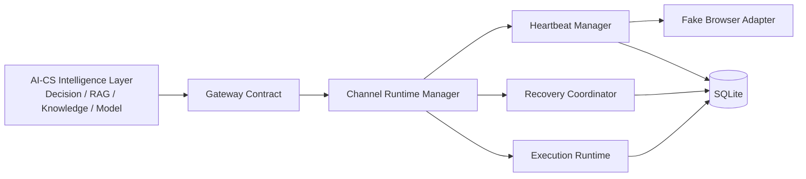
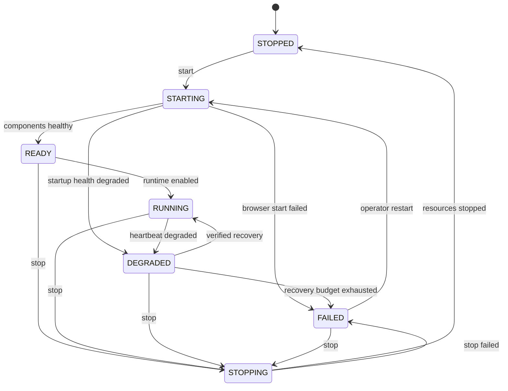
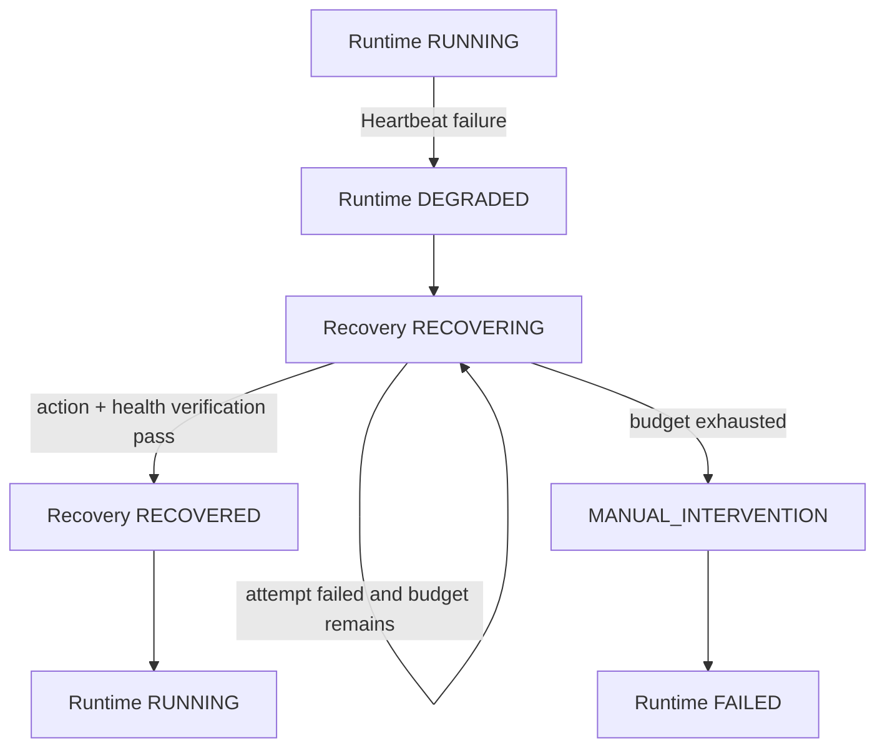

# AI-CS Channel Engine Runtime Reliability V1 完成报告

## 1. 结论

Channel Engine 已从可运行的 Foundation 提升为具备持久化生命周期、统一 Heartbeat、有限恢复、执行安全审计和 Runtime Dashboard API 的单节点可靠运行基础。

质量门状态：

| Quality Gate | 证据 | 状态 |
|---|---|---|
| Gate 1 Runtime Lifecycle | 七状态生命周期、合法迁移、SQLite 快照和追加事件 | `CHANNEL_RUNTIME_READY` |
| Gate 2 Heartbeat | Channel、Browser、Gateway、Storage 四组件统一探测 | `CHANNEL_HEARTBEAT_READY` |
| Gate 3 Recovery | `RECOVERING → RECOVERED / MANUAL_INTERVENTION`，最多两次 | `CHANNEL_RECOVERY_READY` |
| Gate 4 Safety | 审批前置 claim、Worker 二次验证、Receipt、UNKNOWN 禁重试 | `CHANNEL_EXECUTION_SAFETY_READY` |
| Gate 5 Reliability | API、持久化、集成测试与全量回归通过 | `CHANNEL_ENGINE_RUNTIME_RELIABILITY_READY` |

本版本没有连接真实 PDD、真实浏览器或真实客户数据，也没有在 Channel Engine 内生成 AI 回复。

## 2. 架构与边界



边界约束：

- AI-CS 仍是唯一 Intelligence Layer；Channel Engine 不构造回复内容。
- BrowserManager 只定义生命周期抽象；V1 注入 `FakeBrowserAdapter`。
- `real_browser_connected=false` 是模型和测试中的显式不变量。
- Runtime Reliability 不调用渠道发送接口，不读取真实消息。
- 已有 Gateway、Execution、Receipt 和 Control Plane 协议未被修改。

## 3. 新增模块

| 模块 | 职责 |
|---|---|
| `reliability/models.py` | 版本化生命周期、Heartbeat、Recovery、Dashboard 模型 |
| `reliability/browser.py` | `BrowserManager` Protocol 与 Fake 生命周期实现 |
| `reliability/heartbeat.py` | 四组件探测、统一状态、异常隔离、Heartbeat 持久化 |
| `reliability/recovery.py` | 有限次数、人工触发的恢复协调器 |
| `reliability/persistence.py` | Runtime 快照、生命周期事件、Heartbeat、Recovery 与安全计数 |
| `reliability/manager.py` | 启动、停止、状态查询、降级与恢复编排 |
| `reliability/api.py` | `/runtime/v1/*` 本地 Runtime API |

同时增强了 Execution Ledger 的原子 claim 条件：数据库只允许同时满足 `Decision=APPROVED` 与 `Approval=APPROVED` 的 PENDING Execution 获得租约。

## 4. Runtime 生命周期

### 4.1 状态

- `STARTING`
- `READY`
- `RUNNING`
- `DEGRADED`
- `STOPPING`
- `STOPPED`
- `FAILED`

### 4.2 状态机



`start()` 默认依次持久化 `STARTING → READY → RUNNING`。READY 虽是快速过渡状态，仍保存在追加式 lifecycle event 中，便于问题追踪。重复 start/stop 为幂等查询；非法迁移返回冲突，不跳过状态。

每次新的 start generation 加一；revision 用于阻止并发旧快照覆盖新状态。

## 5. Heartbeat

每轮 Heartbeat 为四个组件生成同一个 `cycle_id`，每个结果独立持久化：

| 组件 | 检查内容 | V1 结果字段 |
|---|---|---|
| Channel | 渠道运行可用性 | health、available、reason_code |
| Browser | 进程与页面状态 | health、process_running、page_available、available |
| Gateway | AI-CS 可达性与 health | health、available、reason_code |
| Storage | SQLite `SELECT 1` | health、available、latency_ms |

组件状态为 `HEALTHY / DEGRADED / UNHEALTHY`。任何 probe 异常都被转换为不含堆栈或敏感数据的 reason code；单个 probe 失败不会中断其余组件记录。

RUNNING 或 READY 期间只要 overall 不再 HEALTHY，Runtime 即持久化进入 DEGRADED。DEGRADED 不会因为下一次 Heartbeat 偶然成功而自动回到 RUNNING，必须经过显式恢复和恢复后复检。

## 6. Recovery

恢复状态与 Runtime 生命周期分开记录：



V1 规则：

- 恢复只能从 DEGRADED 触发。
- 默认 `max_attempts=2`，构造时强制范围为 1–10。
- 没有 recovery action 的组件失败关闭，最终进入人工介入。
- Browser 自动恢复仅调用 Fake Adapter 的 `recover()`。
- 恢复动作成功后必须重新运行完整 Heartbeat；只有 overall HEALTHY 才回到 RUNNING。
- 不存在后台无限循环。
- Execution 的 UNKNOWN 不属于 Runtime 自动恢复目标，仍需人工对账。

## 7. Browser 生命周期抽象

`BrowserManager` 定义：

```text
start()
stop()
health_check()
recover()
```

`FakeBrowserAdapter` 支持：

- 正常 start/stop；
- 模拟 Browser 启动失败；
- 模拟 process 存活但 page 不可用；
- 指定前 N 次恢复失败；
- 统计 start/stop/recover 调用次数；
- 始终声明没有连接真实浏览器。

## 8. Execution Safety

发送边界继续保持：

```text
Decision APPROVED
        ↓
Human Approval APPROVED
        ↓
Execution lease
        ↓
Fake Adapter
        ↓
Immutable Receipt
```

安全增强采用三层防护：

1. `ExecutionCoordinator` 只有在 Control Gate 和 ApprovalPolicy 通过后创建 Execution。
2. SQLite 原子 claim 同时校验 Decision 与 Approval 的 APPROVED 状态；未审批记录保持 PENDING，不进入 RUNNING，也不调用 Adapter。
3. Worker 在调用 Adapter 前重新读取 Decision/Approval 并执行策略校验。

终态规则：

- SUCCESS、FAILED、UNKNOWN 均追加且仅追加一个 Receipt。
- Dashboard 计算 `terminal_without_receipt`，非零即 overall UNHEALTHY。
- Dashboard 计算 `unapproved_active`，非零即 overall UNHEALTHY。
- UNKNOWN 不会再次进入 PENDING，`unknown_auto_retry_allowed=false`。
- Worker crash 的过期 RUNNING lease 继续由既有 `ExecutionRecovery` 转成 UNKNOWN Receipt，禁止重发。

## 9. SQLite 持久化

新增版本化表：

| 表 | 语义 |
|---|---|
| `runtime_reliability_state` | 当前状态、generation、revision、启停时间 |
| `runtime_lifecycle_events` | 追加式状态迁移记录 |
| `runtime_heartbeats` | 每周期每组件 Heartbeat |
| `runtime_recovery_events` | RECOVERING、RECOVERED、MANUAL_INTERVENTION 记录 |

继续复用：

- `executions`：Execution 状态、lease 与错误；
- `execution_receipts`：不可变执行结果；
- `runtime_worker_owners`：Worker ownership；
- `transactional_outbox`：事件恢复与去重发布。

Runtime Reliability 存储版本固定为 `1.0`。未知版本 fail closed。新 Heartbeat 结构提供 SQLite additive upgrade，未引入外部数据库。

## 10. Runtime Dashboard API

| Method | Path | 用途 |
|---|---|---|
| GET | `/runtime/v1/status` | Runtime、Channel、Browser、Gateway、Storage、Execution、Approval、Recovery、overall |
| POST | `/runtime/v1/start` | 启动 Fake Runtime 并返回统一状态 |
| POST | `/runtime/v1/stop` | 安全停止并返回统一状态 |
| POST | `/runtime/v1/heartbeat` | 执行并持久化一轮探测 |
| POST | `/runtime/v1/recover` | 对 DEGRADED 组件执行有限恢复 |

恢复请求示例：

```json
{
  "component": "BROWSER"
}
```

`component` 可省略，此时选择本轮第一个非 HEALTHY 组件。非 DEGRADED 状态恢复返回 HTTP 409。

统一状态中的安全字段包括：

- `execution.approval_required=true`
- `execution.receipt_required=true`
- `execution.unknown_auto_retry_allowed=false`
- `approval.execution_without_approval_allowed=false`

## 11. 异常恢复证据

### 11.1 页面崩溃后恢复

1. Runtime 完成 `STARTING → READY → RUNNING`。
2. Fake Browser 模拟 process 存活、page 不可用。
3. Heartbeat 记录 Browser UNHEALTHY，Runtime 进入 DEGRADED。
4. 第一次 recover 失败，记录 RECOVERING。
5. 第二次 recover 成功，记录 RECOVERED。
6. 完整 Heartbeat 复检通过，Runtime 回到 RUNNING。

### 11.2 恢复预算耗尽

1. Runtime 进入 DEGRADED。
2. 两次 Fake Browser recovery 均失败。
3. 不再继续重试。
4. 追加 `MANUAL_INTERVENTION / RECOVERY_BUDGET_EXHAUSTED`。
5. Runtime 进入 FAILED。

### 11.3 进程重启

1. 原 Manager 持久化 RUNNING。
2. 新 Manager 从 SQLite 恢复 RUNNING 快照与 revision。
3. 新进程 Fake Browser 为 STOPPED。
4. 下一轮 Heartbeat 检测 process loss，Runtime 进入 DEGRADED，而不是假定浏览器仍可用。

### 11.4 未审批与 UNKNOWN

- 人工构造的 PENDING Approval/Execution 无法被 Worker claim，Adapter 调用次数为零。
- Fake Adapter 返回 UNKNOWN 时，Execution 产生 UNKNOWN Receipt；后续 Worker 不会再次 claim。

## 12. 测试结果

新增 11 个专项测试：

- lifecycle 合法迁移与持久化；
- Browser 启动失败 fail closed；
- Heartbeat 四组件记录；
- Browser process/page 状态；
- 进程重启与失联检测；
- 有限恢复成功；
- 恢复预算耗尽；
- 未审批 Execution claim 阻断；
- UNKNOWN Receipt 与禁止重试；
- 完整 start/degrade/recover/stop 集成；
- Runtime Dashboard API 与非法恢复冲突。

验证结果：

```text
专项测试：11 passed
Execution/Runtime 相关回归：24 passed
全量测试：290 passed, 1 warning
```

唯一 warning 为 Starlette TestClient 对当前 httpx 集成方式的第三方弃用提示，不影响 Runtime 行为。

## 13. 已知风险

1. Heartbeat V1 由 Runtime 启动、状态 API 或显式 heartbeat 调用触发，尚未实现常驻 scheduler/watchdog。
2. Manager 使用进程内锁与 SQLite revision；当前目标是单节点，不提供多节点 Runtime leader election。
3. SQLite 适合当前单节点规模，高写入 Heartbeat 场景需定义 retention/归档策略。
4. V1 自动 recovery action 只为 Fake Browser 实现；Gateway、Storage、Channel 故障默认转人工。
5. Runtime 控制 API 当前沿用本地节点信任边界；生产前需增加 operator authentication、authorization 与审计。
6. 未通过真实 Browser、PDD 或真实 AI-CS 压力测试，不能据此判定生产渠道可用。

## 14. 下一阶段建议

1. 增加受生命周期管理的 Heartbeat scheduler，并配置频率、jitter 与 missed-heartbeat 告警。
2. 为 Runtime 控制 API 增加本地 operator authentication、RBAC 和审计事件。
3. 增加 Heartbeat/Recovery 记录 retention、导出和空间水位监控。
4. 增加 SQLite 锁竞争、断电和磁盘满的故障注入测试。
5. 将 Worker ownership 与 Runtime generation 关联，阻止旧 generation Worker 继续 claim。
6. 在独立、明确授权的后续阶段接入真实 Browser driver；保持人工登录、只读观察和发送禁用。

## 15. 最终状态

`CHANNEL_ENGINE_RUNTIME_RELIABILITY_READY`
