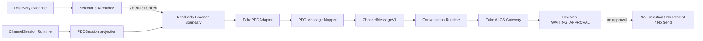

# 《AI-CS PDD Adapter Prototype Foundation V1 完成报告》

- 报告版本：V1
- Prototype Contract：`1.0`
- 完成日期：2026-08-04
- 最终状态：`PDD_ADAPTER_PROTOTYPE_FOUNDATION_READY`
- 运行边界：仅离线合成数据；未连接 PDD、未登录账号、未读取客户消息、无发送能力

## 1. 结论

PDD Adapter 第一版工程骨架已经完成。新增模块覆盖 PDD 专属领域模型、消息映射、Selector 状态治理、只读 Browser Boundary、ChannelSession 生命周期桥接与 FakePDDAdapter。离线集成测试已证明：

1. 合成 PDD 观察消息可映射为 `ChannelMessageV1`；
2. 消息可进入 Conversation Runtime，并由既有 Fake AI-CS Gateway 生成 Decision；
3. Decision 停留在 `WAITING_APPROVAL`，不会创建 Execution；
4. 重复消息被幂等吸收，冲突重复消息 fail-closed；
5. Prototype 公开 API 不存在发送、执行、退款或订单修改入口；
6. 全量回归测试通过。

## 2. 新增目录

```text
src/channel_engine/pdd_adapter/
├── __init__.py
├── _base.py
├── discovery/
│   └── __init__.py
├── session/
│   ├── __init__.py
│   └── runtime.py
├── mapper/
│   ├── __init__.py
│   └── mapping.py
├── selector/
│   ├── __init__.py
│   └── contract.py
├── message/
│   ├── __init__.py
│   └── models.py
├── browser/
│   ├── __init__.py
│   └── boundary.py
└── fake.py

tests/pdd_adapter/
├── __init__.py
├── helpers.py
├── test_domain_mapping.py
├── test_selector_contract.py
├── test_session_runtime.py
└── test_fake_pdd_integration.py
```

`discovery/` 复用并重新导出已经完成的 PDD Discovery Framework；Prototype 代码没有复制或改变 Discovery 的 observe-only 行为。

## 3. Runtime 架构



边界规则：

- PDD Adapter 只做渠道观察、规范化与来源记录，不生成 AI 回复；
- AI Decision 仍由 AI-CS Gateway 边界产生；
- Browser Adapter Protocol 只有 `open_session()`、`health_check()`、`capture_state()`；
- Prototype 没有对外发送接口，也不实现真实 Browser 或网络传输；
- 已有 `ChannelSession Runtime` 仍是 Session 真值来源，`PDDSession` 只是平台投影。

## 4. 模型设计

### 4.1 PDDSession

字段：`session_id`、`store_id`、`status`、`last_seen`、`instance_id`、`failure_code`。

平台状态：

- `CREATED`
- `AUTH_REQUIRED`
- `CONNECTED`
- `DEGRADED`
- `EXPIRED`

映射保持 fail-closed：底层 ChannelInstance 或 ChannelSession 为失败状态时，PDD 投影不会报告 `CONNECTED`。

### 4.2 PDDConversation

字段：`conversation_id`、`external_id`、`store_id`。`external_id` 作为渠道侧会话标识进入 `ChannelMessageV1`，之后继续使用已有的 store-scoped conversation key 进行跨店铺隔离。

### 4.3 PDDMessageEnvelope

字段：`external_message_id`、`sender`、`content`、`timestamp`、`raw_metadata`，并携带映射所需的 `store_id` 与 `conversation_external_id`。

Prototype 强制：

- `sender=customer`；
- `synthetic_test_data=true`；
- `raw_payload_retained=false`；
- `secret_material_captured=false`；
- ID 拒绝换行和 NUL 控制字符；
- 内容只存在于当前合成消息对象，不进入来源记录。

### 4.4 脱敏来源记录

`PDDRawMetadata` 不是任意字典，而是固定白名单模型。来源记录仅保留：

- source kind；
- event、payload、cursor 的 SHA-256 摘要；
- source sequence；
- selector contract id；
- mapping contract id；
- observation timestamp。

不保留 Cookie、Token、Password、HTTP Header、完整网络 Body 或原始平台 Payload。

## 5. Message Mapping 与幂等

固定映射合同：`pdd:merchant_chat:message:v1`。

映射前置条件：

1. Selector Token 来自 `VERIFIED` Contract；
2. Token 具备完整消息观察 purposes；
3. Envelope、Conversation、Adapter 的 `store_id` 一致；
4. Envelope 的 conversation identity 与 PDDConversation 一致；
5. 来源中的 selector/mapping contract 与运行时一致；
6. 当前 Prototype 只接受合成验证证据。

幂等键由 `store_id + conversation_external_id + external_message_id` 的 SHA-256 生成：

- 首次出现：`ACCEPTED`；
- 相同身份、相同标准化内容：`DUPLICATE`；
- 相同身份、不同标准化内容：抛出 `PDDMessageIdentityConflict`，停止处理。

内存 Deduplicator 只保存幂等键和标准化内容摘要，不保存消息正文。

## 6. Selector 治理

状态机被冻结为：

```text
DRAFT -> DISCOVERY -> VERIFIED
```

治理约束：

- 禁止 `DRAFT -> VERIFIED` 跳级；
- `DRAFT` 不允许携带候选项；
- `DISCOVERY` 必须有候选摘要、发现引用和时间；
- `VERIFIED` 必须有完整 evidence，且覆盖登录、页面、店铺身份、会话和消息读取 purposes；
- 候选只保存 locator fingerprint 和 engine hint，不保存或暴露可执行 CSS/XPath；
- Runtime 只消费 `PDDVerifiedSelectorToken`；Token 没有 locate、click 或 run 方法；
- DRAFT/DISCOVERY 被注入 Fake Adapter 时，消息观察立即 fail-closed。

这证明了 Selector 的治理能力，不代表任何真实 PDD Selector 已被发现或验证。

## 7. Browser 与 Session 边界

### Browser

`PDDBrowserAdapter` 是严格只读 Protocol：

- `open_session()`
- `health_check()`
- `capture_state()`

`FakePDDBrowserAdapter` 只模拟 page availability、login observation、generation 和 page revision digest；`real_platform_connected=false`、`write_capability_enabled=false` 固定不可改。

### Session

`PDDPrototypeSessionRuntime` 复用既有 SQLite-backed `ChannelInstanceManager`：

- create；
- start；
- heartbeat；
- recover；
- stop。

Credential 仍只使用 `CredentialReference`。内部生命周期 shim 不配置任何 outbound authorization，因此关闭写能力；该 shim 不作为 PDD Prototype 公共 Adapter 导出。

## 8. FakePDDAdapter 流程

```text
CONNECTED PDDSession
  -> VERIFIED Selector Token
  -> open_session
  -> enqueue synthetic observation
  -> page/session/selector health gate
  -> map PDDMessageEnvelope
  -> deduplicate
  -> ChannelMessageV1
  -> Conversation Runtime
  -> Fake Gateway Decision
  -> WAITING_APPROVAL
```

Fake 支持模拟：

- 合成消息进入；
- Session 状态变化；
- 页面不可用；
- Selector 回退到 DRAFT/DISCOVERY；
- 重复与冲突消息。

它不包含发送、点击提交、执行、退款或订单变更入口。

## 9. 测试证据

执行环境：Windows / Python 3.12 / SQLite / 全部离线 Fake。

### 新增 Prototype 测试

```text
python -m pytest tests/pdd_adapter -q
10 passed in 0.55s
```

覆盖：

- PDD Domain Model 与脱敏来源；
- PDD -> ChannelMessageV1 字段映射；
- 幂等、冲突 fail-closed、store/selector mismatch；
- Selector 禁止跳级与不可执行 Token；
- Session CREATED / AUTH_REQUIRED / CONNECTED / DEGRADED / EXPIRED；
- ChannelSession heartbeat/recovery/stop；
- Fake PDD -> Conversation -> Decision；
- `WAITING_APPROVAL` 前无 Execution；
- 公开 API 与 AST 安全扫描不存在写/退款/订单变更入口。

### 相关模块回归

```text
30 passed in 1.29s
```

范围：Discovery、Session Runtime、Multi-store 与新增 Prototype。

### 全量回归

```text
python -m pytest -q
342 passed, 1 warning in 18.97s
```

唯一 warning 来自 Starlette TestClient 对当前 httpx 集成方式的弃用提示，与本次功能或安全边界无关。

## 10. Quality Gates

| Gate | 状态 | Evidence |
|---|---|---|
| PDD Domain Model | `PDD_DOMAIN_MODEL_READY` | PDDSession、PDDConversation、PDDMessageEnvelope、脱敏元数据 |
| Message Mapping | `PDD_MESSAGE_MAPPING_READY` | Contract 映射、来源记录、幂等与冲突测试 |
| Selector Contract | `PDD_SELECTOR_CONTRACT_READY` | 三阶段状态机、evidence gate、不可执行 token |
| Fake PDD Adapter | `FAKE_PDD_ADAPTER_READY` | session/page/selector/message simulation 与集成测试 |
| Prototype Foundation | `PDD_ADAPTER_PROTOTYPE_FOUNDATION_READY` | 10 个新增测试和 342 个全量测试通过 |

## 11. 距离真实接入仍缺少什么

以下均未实现，不能把本 Foundation 解释为真实接入就绪：

1. 真实 PDD 页面、登录状态、店铺身份和消息入口的只读发现证据；
2. 从真实发现证据产生、复核并验证 Selector Contract 的人工流程；
3. 真实 Browser Runtime port；
4. PDD 平台事件协议、字段含义、时间语义和稳定 message id 的事实确认；
5. 持久化的 PDD source cursor、ACK-before/after-persist 行为验证和 restart recovery；
6. Store identity 与 Session 的真实只读绑定验证；
7. 脱敏、日志、截图和网络 metadata 的真实环境安全审计；
8. 真实 PDD 服务条款、权限和合规审查；
9. 任何 outbound 能力。未来即使新增，也必须继续经过 Decision、Human Approval、Execution、Receipt 及 Safety Gate。

## 12. 风险与下一阶段建议

- 当前 Selector Evidence 全部为 synthetic，不能用于真实页面；
- Prototype Deduplicator 为进程内实现，重启后的真实消息可靠性必须交给持久化 Cursor/ACK Inbox；
- Fake login/page health 不证明真实登录检测策略可靠；
- PDD 原始 payload 尚无已验证事实，不能据此扩展字段或假设网络协议；
- Discovery 到 Runtime 的 promotion 目前是代码级 gate，真实阶段还需要双人复核、evidence retention 和回滚策略。

建议下一阶段仍保持 observe-only：只在独立 Profile 与测试店铺范围内采集最小化、脱敏的页面结构事实，将 Selector 从 `DRAFT` 推进到 `DISCOVERY`；在人工复核、稳定性探测和安全审计完成前，不进入 `VERIFIED`，不增加任何 outbound 方法。

---

Final Status: `PDD_ADAPTER_PROTOTYPE_FOUNDATION_READY`
