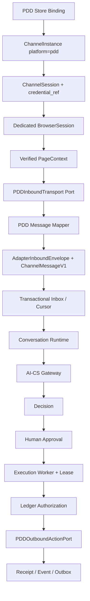

# 《AI-CS PDD Channel Adapter Architecture Design V1》

- 文档版本：V1
- 设计日期：2026-08-04
- 目标实现：`PDDChannelAdapterV1`
- 依赖契约：`ChannelAdapterV1`、`CursorAckChannelAdapterV1`、`Channel Session Runtime 1.0`
- 最终状态：`PDD_CHANNEL_ADAPTER_DESIGN_READY`

## 1. 结论与边界

PDD Channel Adapter V1 的架构、接口、消息映射、Browser/Session 关系、Cursor/ACK 语义、受控执行边界和安全要求已完成设计。

本状态只表示“可以按此方案进入离线实现和只读发现”，不表示真实 PDD 已连接或其页面/协议已经验证。本次没有：

- 登录真实 PDD 账号；
- 启动真实渠道连接；
- 读取真实客户消息；
- 获取或导出 Cookie；
- 发送真实消息；
- 修改订单、退款、打款或执行任何资金动作。

V1 的默认能力等级为 `OFFLINE_CONTRACT`。未来即使完成登录，也必须先进入 `OBSERVE_ONLY`；发送能力需要单独审批，不能因 Adapter 已实现而自动启用。

## 2. 事实、现状与未知项

### 2.1 已确认的 Channel Engine 事实

- `ChannelMessageV1` 已冻结字段：`message_id`、`channel`、`store_id`、`conversation_id`、`sender`、`content`、`timestamp`。
- `ChannelInstance` 以 `(platform, store_id)` 唯一绑定店铺。
- `ChannelSession` 只保存 `credential_ref` 和不透明 lease reference。
- Session Runtime 已实现非破坏读取、事务持久化、source ACK、业务 ACK、Cursor 恢复和重复冲突检测。
- Execution 必须经过 Decision、Human Approval、RUNNING Execution 和有效 worker lease。
- UNKNOWN 禁止自动重试。
- Sandbox Adapter 已验证 ACK 失败、重复投递、Session 过期、Browser 断开、Gateway 超时和崩溃恢复。

### 2.2 可复用但不是“真实 PDD 证据”的资产

- `pdd_observation.py`：离线 observation 抽象和 Fake transport；尚不是 Session Runtime 的最终组合根。
- `pdd_websocket.py`：Fake WebSocket 协议模型；不能据此假设真实 PDD 使用相同 WebSocket、frame、sequence 或 ACK。
- `browser/*`：Browser Session、Observer、Selector、Outbound Action 的抽象与 Fake/本地基础。
- PDD Controlled Send / Safety Gate：可复用授权、安全和 Receipt 规则；不代表真实发送 endpoint 已知。
- `SelectorContract(platform=pdd,page=merchant_chat,version=v1)` 当前只能保持 `DRAFT`，未知 locator 不得激活。

### 2.3 当前明确未知

- PDD 消息实际来源：DOM、页面内部 API、WebSocket、轮询、CDP event 或组合方式。
- 真实 payload 字段、事件类型、conversation/message/store/sender 标识位置。
- 真实 timestamp 的单位、时区和稳定性。
- 平台是否提供 cursor、sequence、业务 ACK，以及 ACK 的副作用。
- 页面 iframe/shadow DOM、导航模型和稳定 locator。
- 登录成功、登录过期和店铺身份的可靠只读证据。
- 发送 endpoint/action、发送触发点和可证明 SUCCESS 的确认信号。

上述未知项只允许通过后续合规、只读、专用测试环境的 Discovery 解决。本设计不填写猜测值。

## 3. 总体架构



依赖方向：

```text
Channel Engine domain/runtime
        ← immutable contracts / ports
PDD Adapter application layer
        ← PDD transport and browser ports
Future real Browser/Transport infrastructure
```

业务层禁止依赖 CSS/XPath、Playwright Page、WebSocket client、Cookie 或 PDD 私有 payload。真实细节只能存在于基础设施实现和版本化 Selector/Mapping Contract 中。

## 4. Adapter 组合根

建议的组合根为 `PDDChannelAdapterV1`，实现现有 `CursorAckChannelAdapterV1`：

```python
class PDDChannelAdapterV1(CursorAckChannelAdapterV1):
    channel: Literal["pdd"]
    store_id: str
    adapter_name: Literal["PDDChannelAdapterV1"]

    def connect(self) -> ChannelAdapterStatus: ...
    def disconnect(self) -> ChannelAdapterStatus: ...
    def receive_messages(self, limit: int = 100) -> tuple[ChannelMessageV1, ...]: ...
    def receive_envelopes(self, limit: int = 100) -> tuple[AdapterInboundEnvelope, ...]: ...
    def acknowledge(self, source_cursor: str) -> AdapterSourceAck: ...
    def resume_from(self, source_cursor: str | None, last_sequence: int) -> None: ...
    def send_message(self, command: AuthorizedOutboundMessage) -> ChannelSendReceipt: ...
    def get_conversation(self, conversation_id: str) -> ChannelConversation | None: ...
    def health_check(self) -> AdapterHealth: ...
    def recover(self) -> ChannelAdapterStatus: ...
```

内部只组合端口：

- `PDDBrowserSessionPort`
- `PDDStoreIdentityPort`
- `PDDInboundTransport`
- `PDDMessageMapper`
- `PDDOutboundActionPort`
- `SelectorRegistry/SelectorProbe`
- `CredentialProvider`
- `LedgerExecutionAuthorizationService`

Adapter 不自行调用 AI-CS，也不创建 Decision。

生产接收链只允许 Session Manager 调用 `receive_envelopes()` 并执行 persist-before-ACK。`receive_messages()` 仅为 Adapter V1 兼容和离线 contract test 保留，不得在真实运行中绕过 Transactional Inbox。

## 5. Message Mapping

### 5.1 原始边界模型

真实字段未发现前，只定义语义模型，不定义 PDD 字段路径：

```text
PDDRawMessageEvidence
  transport_kind
  transport_event_ref
  store_identity_evidence
  conversation_identity_evidence
  message_identity_evidence
  direction_evidence
  content_evidence
  timestamp_evidence
  source_position
  observed_at
  mapping_contract_version
```

Evidence 只能在受控内存或按最小化策略保存；日志和 Audit 不保存客户正文、页面快照或认证信息。

### 5.2 到 ChannelMessageV1 的映射

| ChannelMessageV1 字段 | V1 规则 | Fail-closed 条件 |
| --- | --- | --- |
| `message_id` | 使用已验证、跨重连稳定的 PDD external message identity | 缺失、不稳定、超长或同 ID 内容冲突 |
| `channel` | 固定为 `pdd` | 任何其他平台值 |
| `store_id` | 来自已验证 StoreBinding，并与 ChannelInstance、当前登录身份三方一致 | 仅来自消息 payload、人工 placeholder 或身份不一致 |
| `conversation_id` | 使用店铺内稳定 conversation identity | 仅有显示名称、无法稳定恢复或歧义 |
| `sender` | V1 客户入站统一为 `customer`；不得写客户显示名、手机号等 PII | 无法证明消息方向或属于系统/商家消息 |
| `content` | 提取可见文本语义，统一换行，禁止空白，最大 8,000 字符 | 非文本未支持、截断会改变语义、包含无法安全解析的富媒体 |
| `timestamp` | 将已验证的平台时间转换为 aware UTC，保留原始 evidence reference | 单位/时区未知，或只能用本机 observed_at 冒充平台时间 |

`message_id` 禁止由正文、发送者和时间拼接后作为“真实平台 ID”。如果 Discovery 证明平台无稳定 ID，必须新增独立版本的合成身份方案并完成碰撞/重启验证；在此之前 Observation 保持阻断。

### 5.3 消息类型策略

V1 仅允许：

- customer-originated plain text message；
- 明确属于当前 StoreBinding 和 conversation；
- 具有稳定 message identity 与 timestamp。

V1 不映射：图片、视频、文件、卡片、订单系统事件、退款提示、支付事件、撤回消息或商家自己发送的回显。未知类型进入 `UNSUPPORTED_MESSAGE_TYPE` 证据记录，不进入 AI-CS。

### 5.4 映射契约治理

```text
PDDMessageMappingContract
  contract_id = pdd:merchant_chat:message:v1
  state = DRAFT | DISCOVERY | VERIFIED | QUARANTINED | DEPRECATED
  transport_kind
  source_schema_fingerprint
  field_bindings
  timezone_rule
  supported_event_types
  evidence_reference
  verified_at
```

只有 `VERIFIED` contract 可生成 ChannelMessageV1。source schema/page revision 漂移时立即 `QUARANTINED`。

## 6. Browser Architecture

### 6.1 BrowserAdapter 边界

Browser 只负责本地会话和页面能力，不负责 Conversation、AI Decision 或 Approval：

```python
class PDDBrowserSessionPort(Protocol):
    def start(self, profile_ref: BrowserProfileReference) -> BrowserSession: ...
    def stop(self, session_id: str) -> None: ...
    def login_state(self, session_id: str) -> BrowserLoginState: ...
    def page_context(self, session_id: str) -> BrowserPageContext: ...
    def heartbeat(self, session_id: str) -> BrowserHeartbeat: ...
    def recover(self, session_id: str) -> BrowserSession: ...

class PDDStoreIdentityPort(Protocol):
    def observe_identity(self, page: BrowserPageContext) -> StoreIdentityEvidence: ...

class PDDReadOnlyPagePort(Protocol):
    def observe(self, page: BrowserPageContext, contract: SelectorContract) -> PageObservation: ...

class PDDOutboundActionPort(Protocol):
    def execute(self, authorized: AuthorizedOutboundMessage, context: PDDExecutionContext) -> ActionEvidence: ...
```

Browser 是 V1 的登录、店铺身份和本地 Session 锚点，但这不等于已确认发送必须通过 DOM 点击。`PDDExecutionContext` 提供 Browser session/page generation、store binding 和已验证 transport contract；真正的 trigger 机制由后续 Discovery 选择的 OutboundActionPort 基础设施实现决定。

### 6.2 Lifecycle

```text
CREATED → STARTING → LOGIN_REQUIRED → ACTIVE
                   ↘ DEGRADED
ACTIVE → DEGRADED / CRASHED / EXPIRED
DEGRADED or CRASHED → RECOVERING → ACTIVE
LOGIN_REQUIRED or EXPIRED → 人工登录 → ACTIVE
任意安全状态 → STOPPED
```

规则：

- V1 每个 PDD ChannelInstance 使用独立 browser profile reference；禁止用户默认 Chrome profile。
- V1 推荐每店一个 Browser process/context，先用资源换隔离；跨店共享必须另行设计。
- 登录只能人工完成；禁止自动填写账号、密码、验证码或扫码。
- Profile 中可能存在平台 Session 数据，因此它属于本地敏感资产：使用 OS ACL/加密、禁止日志、禁止上传 AI-CS、禁止导出 Cookie。
- Browser generation 每次崩溃恢复递增；旧 PageContext、observation 和 action authorization 自动失效。

### 6.3 Login 与店铺身份

进入 `ACTIVE` 必须同时满足：

1. Browser process 存活；
2. merchant chat page 唯一且可用；
3. VERIFIED login detector 判定 `AUTHENTICATED`；
4. StoreIdentityPort 得到真实只读身份；
5. 身份与 ChannelInstance.store_id、StoreBinding、credential_ref account scope 一致；
6. Selector/Mapping Contract 均为 VERIFIED；
7. Kill Switch、runtime mode 和 capability policy 允许当前能力。

身份未知或 mismatch 时停止 Observer 和 Outbound，进入人工处理；禁止让操作者手填 store_id 绕过验证。

### 6.4 Heartbeat

聚合信号：

- process running；
- page available / page generation；
- login authenticated；
- store identity matched；
- selector probe healthy；
- inbound transport healthy；
- last observation latency；
- ChannelSession lease valid；
- Gateway health（由 Session Runtime 聚合，不由 Browser 调用）。

任一身份、登录或 selector 信号 UNKNOWN 时 fail closed。Heartbeat 不点击页面、不刷新登录、不发送消息。

### 6.5 Recovery

- 页面丢失：只允许重新打开目标页并重新执行 login/store/selector probes。
- Chrome crash：重建专用 profile context，generation+1，重新绑定 PageContext。
- 登录过期：ChannelSession 进入 EXPIRED/AUTH_REQUIRED，等待人工登录；禁止自动登录。
- store mismatch：停止实例，不自动切换店铺。
- selector drift：Contract QUARANTINED，不自动使用候选 selector。
- 恢复预算耗尽：`MANUAL_INTERVENTION`，禁止无限循环。

## 7. PDD Store、ChannelInstance 与 ChannelSession

### 7.1 映射

```text
Verified PDD StoreBinding
  platform = pdd
  store_id = verified opaque store identity
  credential_ref = reference only
          ↓
ChannelInstance
  platform = pdd
  store_id = same verified identity
  adapter_type = PDDChannelAdapterV1
          ↓ active_session_id
ChannelSession
  credential_ref = same reference
  status / heartbeat / expires_at
          ↓ runtime attachment
BrowserSession + PageContext generation + Mapping/Selector versions
```

### 7.2 状态映射

| Browser/PDD 状态 | ChannelSession | ChannelInstance | 行为 |
| --- | --- | --- | --- |
| Profile 创建、未登录 | CREATED/AUTH_REQUIRED | STARTING/AUTH_REQUIRED | 不接收、不发送 |
| 登录与店铺验证完成 | CONNECTED | CONNECTED | 按 capability 开启 receive-only |
| Browser/transport 暂时异常 | FAILED 或保持 CONNECTED（按故障位置） | DEGRADED | Heartbeat + 有界恢复 |
| 登录/lease 过期 | EXPIRED | AUTH_REQUIRED | 等待人工登录，新建 Session |
| 身份冲突/不可恢复错误 | FAILED | FAILED/DEGRADED | 停止并人工调查 |
| 操作员停止 | EXPIRED | STOPPED | 保存 Cursor/Receipt/事件历史 |

BrowserSession ID 不替代 ChannelSession ID。ChannelSession 是 Engine 的店铺运行租约；BrowserSession 是该租约下的本地基础设施附件。

### 7.3 多店隔离

- Store、ChannelInstance、ChannelSession、profile_ref、Cursor、Inbox、Adapter 对象均一一分区。
- Adapter registry key 使用 instance_id，不能只用 `pdd`。
- 相同 external message/conversation id 在不同店铺允许存在，依赖 Session Runtime store scope 隔离。
- Store A 的登录过期、页面崩溃或 cursor conflict 不改变 Store B 状态。
- V1 禁止一个 PageContext 同时服务多个 StoreBinding。

## 8. Cursor、ACK 与 Deduplication

### 8.1 双层 ACK 语义

`AdapterSourceAck` 表示“Channel Engine 已持久化到本地 Inbox，Adapter 可以提交 source position”，不等同于已确认真实 PDD 一定存在 ACK API。

```text
PDD Transport observe (non-destructive)
        ↓
AdapterInboundEnvelope(message, source_cursor, source_sequence)
        ↓
Session Runtime SQLite transaction
  Inbox + MessageCursor commit
        ↓ 成功后
PDDChannelAdapter.acknowledge(source_cursor)
        ↓
Transport checkpoint commit
  ├─ 若平台有已验证 ACK：此时才调用
  └─ 若平台无 ACK：只推进本地 durable checkpoint
```

平台 ACK 是否存在及其副作用必须由 Discovery 证明。禁止因为现有接口名为 ACK 就猜测、构造或调用 PDD ACK endpoint。

### 8.2 Cursor 设计

Engine 只保存不透明、无认证信息的 cursor token，最大 512 字符。Adapter 内部 token 建议编码：

```text
version
transport_kind
store_scope_digest
browser_generation / transport_session_generation
source_position_reference
source_sequence
mapping_contract_version
```

cursor token 不得包含 Cookie、URL query secret、客户正文或完整页面数据。

真实 source position 的选择优先级必须经 Discovery 验证：

1. 稳定平台 cursor/sequence；
2. 稳定 event/message identity 加可证明 ordering；
3. Browser observation checkpoint。

如果只能得到易变 DOM 顺序，不能宣称无漏读；保持 DISCOVERY/OBSERVE_ONLY 并生成 missed-message risk evidence。

### 8.3 去重与冲突

主身份：`(instance_id, message_id)`。

指纹至少覆盖：

- store_id；
- conversation_id；
- sender category；
- content；
- timestamp；
- mapping contract version；
- source cursor/sequence。

规则：

- 同 identity、同指纹、同 cursor：duplicate，返回原 Inbox/delivery。
- 同 identity 但内容、conversation、store 或 position 不同：`PDD_MESSAGE_ID_CONFLICT`，停止该实例 intake。
- source sequence gap：`PDD_SOURCE_SEQUENCE_GAP`，不 ACK，进入 DEGRADED/人工核对。
- sequence 回退且不是已知 duplicate：`PDD_SOURCE_SEQUENCE_REGRESSION`。
- store mismatch：`PDD_STORE_BINDING_MISMATCH`，不持久化、不 ACK。
- business ACK 只连续推进；乱序处理不能越过未完成消息。

### 8.4 崩溃窗口

| 崩溃点 | 恢复行为 |
| --- | --- |
| observe 前 | 从原 cursor 继续 |
| observe 后、Inbox commit 前 | source 未 ACK，重读 |
| Inbox commit 后、source ACK 前 | 重读相同 envelope，Inbox 幂等返回原记录 |
| source ACK 后、业务 ACK 前 | 从 Inbox 重投，不再依赖平台重读 |
| business ACK 后 | 连续 ACK cursor 推进，不重复进入 Conversation |

## 9. Execution 与发送设计

### 9.1 唯一允许链路

```text
AI-CS Decision (suggestion only)
        ↓ WAITING_APPROVAL
Human Approval
        ↓
Execution PENDING
        ↓ Worker claim + live lease
Execution RUNNING
        ↓
LedgerExecutionAuthorizationService
        ↓ AuthorizedOutboundMessage
PDDChannelAdapterV1.send_message()
        ↓
PDDOutboundActionPort
        ↓
Execution Receipt + Event + Outbox
```

AI-CS、ConversationService、Browser Observer、Dashboard 和 Adapter transport 均不得直接调用发送动作。`send_message(str)`、`execute()` 无 claimed context 或缺少 Approval 必须拒绝。

### 9.2 发送前检查

每次 action trigger 前重新验证：

- Decision state 为 APPROVED；
- Approval state 为 APPROVED 且为人工操作者；
- Execution state 为 RUNNING；
- worker_id、lease_token、lease expiration 与 Ledger 一致；
- action 仅为 `SEND_MESSAGE`，risk 为 LOW；
- ChannelInstance、StoreBinding、Browser store identity 三方一致；
- ChannelSession CONNECTED，BrowserSession ACTIVE；
- Browser session/page generation 未变化；若 action strategy 为 Browser，则 conversation route 和 selector contract 也必须未变化；
- 全局/PDD Kill Switch 均未启用；
- environment、allowlist、rate limit、dry-run policy 允许；
- content 与已批准 Decision 完全一致；
- idempotency key 未绑定其他命令。

### 9.3 Browser Action phases

| Phase | 含义 | Result |
| --- | --- | --- |
| `PREFLIGHT_VALIDATED` | 未写页面，全部授权和页面证据通过 | 失败为 FAILED |
| `COMPOSER_MUTATED` | 已填充但尚未触发不可逆发送 | 失败为 FAILED，清理后需新人工动作 |
| `SEND_TRIGGERED` | 已触发，结果可能已经发生 | 无确认一律 UNKNOWN |
| `SEND_CONFIRMED` | 获得唯一、可关联的发送后证据 | SUCCESS |

trigger 后 timeout、断网、页面崩溃、navigation 或确认歧义必须为 UNKNOWN。UNKNOWN 写 Receipt/Event 并停止自动领取；不得通过自动重发“探测”结果。

### 9.4 Idempotency 与 Receipt

身份组合：

- `execution_id`
- `Decision.id`
- `Execution.idempotency_key`
- approved content fingerprint
- store/conversation binding

完全相同的重复调用返回原 Receipt，不重复触发 action。Receipt 允许保存 external message reference、action phase、page generation、selector/mapping version和 sanitized confirmation evidence reference；禁止保存 Cookie、lease token、客户原始页面或完整认证 header。

## 10. Security、Permission 与 Risk Boundary

### 10.1 Credential

- Engine 数据库只保存 `credential_ref/provider/version/expiration`。
- Credential Provider 返回短期、不透明 lease reference；Adapter 不接收明文 password/token/cookie。
- Browser profile reference 与 credential_ref 分离；profile 是本地敏感资产，不进入 AI-CS、日志或普通 Audit。
- Credential rotation 使旧 ChannelSession 过期，并要求重新验证登录与 store identity。
- Debug dump、screenshot、trace 和 network capture 默认关闭；未来 Discovery 需要时必须单独授权并脱敏。

### 10.2 Permission

V1 capability allowlist：

```text
OBSERVE_CUSTOMER_TEXT
CHECK_HEALTH
DISCOVER_STORE_IDENTITY_READ_ONLY
SEND_MESSAGE_CONTROLLED   # 默认关闭，单独启用
```

永久不属于 PDDChannelAdapterV1 的能力：

- refund / refund approval；
- payment / transfer / payout；
- order modification / cancel / fulfillment mutation；
- coupon、price、inventory 或 account permission mutation；
- 自动登录、绕过验证码；
- AI 直接发送。

遇到未知 action 必须默认拒绝，不能映射为 SEND_MESSAGE。

### 10.3 环境与风险门

- 默认 profile：MOCK 或 DISCOVERY；真实 connection 默认 disabled。
- OBSERVE_ONLY 与 CONTROLLED_SEND 是独立 capability，不能同时因 connect 成功自动开启。
- Store allowlist 必须来源于登录后只读身份验证，不接受 placeholder。
- CONTROLLED_SEND 需要生产安全 Gate、单店/单会话限流、人工 Approval、两级 Kill Switch 和现场接管 Runbook。
- 当前设计阶段所有真实能力均为 disabled。

### 10.4 数据最小化

- 日志只记录 instance/session/event/error/cursor digest，不记录正文、客户身份、Cookie 或 DOM。
- Audit 记录 operator、action、reason、before/after 的 sanitized metadata。
- 客户正文只进入受控 Message/Decision 链路，不进入 Browser/Gateway health。
- Discovery evidence 必须使用专用测试消息或脱敏 fixture；本阶段没有采集任何真实数据。

## 11. Health、错误与恢复策略

### 11.1 Health 输出

`AdapterHealth.details` 建议包含：

```text
adapter_contract_version
pdd_mapping_contract_version/state
selector_contract_version/state
instance_id / store_scope_digest
channel_session_status
browser_session_state / login_state / generation
store_identity_matched
inbound_transport_kind / status
cursor_present / queue_depth / last_observation_latency
send_capability_enabled
human_takeover_required
real_platform_connected
```

不得包含 store credential、profile path、customer message、raw cursor 或 selector locator。

### 11.2 错误分类

| 错误码 | 处理 |
| --- | --- |
| `PDD_LOGIN_REQUIRED` | AUTH_REQUIRED，等待人工登录 |
| `PDD_SESSION_EXPIRED` | 终止旧 Session，新建 Session 前人工处理 |
| `PDD_STORE_BINDING_MISMATCH` | 立即停止实例，禁止自动切店 |
| `PDD_SELECTOR_CONTRACT_UNVERIFIED` | 禁止 observation/action |
| `PDD_MAPPING_CONTRACT_UNVERIFIED` | 禁止生成 ChannelMessageV1 |
| `PDD_SOURCE_SEQUENCE_GAP` | 不 ACK，DEGRADED，人工核对 |
| `PDD_MESSAGE_ID_CONFLICT` | fail closed，隔离该实例/会话 |
| `PDD_BROWSER_CRASHED` | 有界恢复，generation+1 |
| `PDD_TRANSPORT_UNAVAILABLE` | DEGRADED，按预算恢复 |
| `PDD_SEND_PREFLIGHT_FAILED` | FAILED，未触发发送 |
| `PDD_SEND_OUTCOME_UNKNOWN` | UNKNOWN，禁止自动重试 |
| `PDD_ACTION_NOT_ALLOWED` | 安全拒绝并 Audit |

### 11.3 Recovery 原则

- 网络/页面瞬时异常：有限退避和恢复预算。
- Browser crash：重建后必须重新验证 login、store、page、selector 和 cursor。
- Session/登录过期：不自动登录；人工恢复后创建新 ChannelSession。
- source gap、identity conflict、store mismatch、UNKNOWN：人工 reconciliation，不自动恢复为成功。
- 恢复不删除 Inbox、Receipt、Event、Outbox 或 Audit。

## 12. Discovery 与实现阶段

### Stage 0：当前设计完成

- 接口、数据模型和安全边界冻结。
- Selector/Mapping Contract 保持 DRAFT。
- 只运行 Sandbox/Fake contract suite。

### Stage 1：离线实现

- 实现 PDDChannelAdapterV1 组合根，但只注入 Fake Browser/Transport/Action Port。
- 复用 Sandbox failure suite 验证 cursor、ACK、recovery、UNKNOWN。
- 不启动真实 Chrome，不添加真实 endpoint。

### Stage 2：受控只读 Discovery

前置授权完成后，仅使用专用测试店铺和专用 profile：

- 人工登录；
- 只读确认 login/store/page identity；
- 比较候选 transport，确认实际消息来源；
- 生成脱敏 Mapping/Selector evidence；
- `DRAFT → DISCOVERY`，尚不启用发送。

### Stage 3：Observe-only 验证

- Mapping/Selector VERIFIED；
- 只接收专用合成测试消息；
- 验证漏读率、重复率、ordering、Cursor restart recovery；
- send capability 仍为 false。

### Stage 4：受控单次发送

必须另开任务和安全审批。仅允许专用测试 conversation、一次人工 Approval、低限额、现场 Kill Switch；任何 UNKNOWN 立即停止。

## 13. 测试策略

### 13.1 Contract Test

- 完整实现 `ChannelAdapterV1/CursorAckChannelAdapterV1`。
- `channel=pdd`、store binding 强一致。
- 裸发送拒绝、无 Approval/lease 拒绝。
- Mapping/Selector 非 VERIFIED 时 fail closed。
- health 输出无 secret/customer content。

### 13.2 Message/Cursor Test

- customer text mapping；
- sender direction 判定；
- aware UTC timestamp；
- duplicate 同指纹恢复；
- duplicate 不同内容冲突；
- sequence gap/regression；
- persist-before-source-ACK；
- ACK failure 重放；
- restart from cursor；
- 多店相同 message/conversation id 隔离。

### 13.3 Browser/Session Test

- dedicated profile isolation；
- manual login required；
- login expiry；
- store mismatch；
- page/Chrome crash；
- generation invalidation；
- selector drift quarantine；
- Heartbeat DEGRADED → bounded recovery；
- recovery budget exhaustion → manual intervention。

### 13.4 Execution Test

- Decision → Approval → RUNNING lease → send；
- duplicate send 返回原 Receipt；
- pre-trigger failure → FAILED；
- post-trigger timeout → UNKNOWN；
- UNKNOWN 不自动重试；
- kill switch、allowlist、rate limit；
- refund/payment/order mutation 永久拒绝；
- Receipt/Event/Outbox 一致。

### 13.5 设计验收方法

本阶段只进行了现有接口和离线资产的静态兼容审计，没有创建真实 PDD 测试、没有运行浏览器、没有读取客户数据。后续实现必须先让 Fake PDD Adapter 通过当前 Sandbox suite，再申请只读 Discovery。

## 14. Architecture Decision Records

| ADR | 决策 | 原因 |
| --- | --- | --- |
| ADR-PDD-001 | PDDChannelAdapterV1 实现 CursorAckChannelAdapterV1 | 直接复用已验证的 at-least-once Session Runtime |
| ADR-PDD-002 | Transport 类型延迟到 Discovery 决定 | 当前无法证明 DOM/WebSocket/API 中任何一种是真实来源 |
| ADR-PDD-003 | Adapter ACK 与平台 ACK 分层 | 防止把 Engine commit 误当成未知平台 mutation |
| ADR-PDD-004 | store identity 必须只读发现并三方校验 | 防止错店铺和 placeholder 绑定 |
| ADR-PDD-005 | 每店独立 profile/process/context | V1 优先保证 Cookie、Session、页面与故障隔离 |
| ADR-PDD-006 | sender 只保留 `customer` 分类 | 满足映射需求并减少 PII 扩散 |
| ADR-PDD-007 | Mapping 和 Selector 独立版本治理 | payload/schema 与页面 locator 漂移速度和风险不同 |
| ADR-PDD-008 | SEND capability 与 connect/receive 解耦 | 防止观察接入意外开启写操作 |
| ADR-PDD-009 | post-trigger 未确认统一 UNKNOWN | 避免重复发送 |
| ADR-PDD-010 | 资金/订单 mutation 不进入 V1 接口 | 结构性消除高风险越权路径 |

## 15. Quality Gates

| Gate | 结果 |
| --- | --- |
| Message Mapping boundary 定义完成 | PASS |
| Browser lifecycle/login/session/heartbeat/recovery 完成 | PASS |
| PDD Store → ChannelInstance → ChannelSession 映射完成 | PASS |
| Cursor/ACK/deduplicate/crash window 语义完成 | PASS |
| Decision/Approval/Execution/Receipt 边界完成 | PASS |
| Credential/Permission/Risk Boundary 完成 | PASS |
| 未猜测真实 PDD selector、endpoint、payload 或 ACK | PASS |
| 真实连接、登录、客户数据和发送保持禁止 | PASS |

## 16. 最终状态

`PDD_CHANNEL_ADAPTER_DESIGN_READY`
