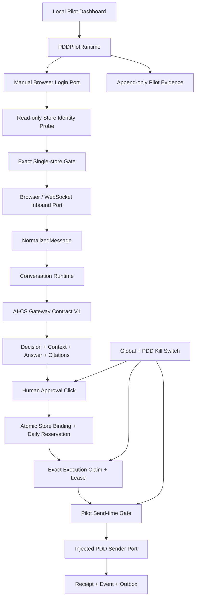

# 《AI-CS PDD Single Store Pilot Runtime V1》

状态：`PDD_SINGLE_STORE_PILOT_READY`

版本：`1.0`

日期：2026-08-04

## 1. 结论与状态定义

PDD Single Store Pilot Runtime V1 已完成。系统现在具备单 Windows 节点、单配置店铺、
人工扫码登录等待、只读店铺身份校验、消息持久化后 ACK、AI-CS Decision Evidence、
人工批准、指定 Execution 精确领取、每日最多 5 个发送名额、持久 Receipt/Evidence、
双层 Kill Switch 和 Pilot Dashboard。

`PDD_SINGLE_STORE_PILOT_READY` 表示 Pilot 软件控制链与离线验收已就绪，允许进入首次
现场接入 Runbook；它不表示真实店铺已经上线。本次没有获得真实 store ID、没有登录
玩趣乐园积木店、没有读取真实客户消息，也没有发送真实消息。真实 PDD 页面/协议仍须
通过现场事实验证后注入现有端口，禁止用 Mock Evidence 冒充实店 Evidence。

## 2. Pilot 架构



关键边界：

- Runtime 没有裸文本 send API；
- UI 的“人工确认并执行”是唯一 Pilot Approval 入口；
- Approval、Execution 和 send reservation 在同一数据库事务创建；
- Worker 使用 `run_execution(execution_id)` 精确领取，不会执行队列中另一条任务；
- Send-time Gate 再次检查 Runtime READY、Kill Switch、credential reference、store、
  conversation 和 reservation；
- UNKNOWN 延续现有规则，不自动重试；
- refund、order modification、payment 不存在于 Pilot action 模型。

## 3. Pilot Configuration

`PilotStoreConfig` 为 frozen、strict、extra-forbid、版本化模型：

```text
pilot_contract_version = 1.0
platform               = pdd
store_id
store_name              = 玩趣乐园积木店
environment             = PILOT
credential_reference
send_limit              = 1..5
approval_required       = true
auto_reply              = false
```

规则：

- `send_limit` 硬上限为 5；
- `approval_required` 只能为 true；
- `auto_reply` 只能为 false；
- credential 只能保存 `credential-ref://` 或 `secret-ref://` reference；
- JSON 之外的散落配置不作为 Pilot 配置入口；
- 当前示例中的 `pdd-store-id-must-be-verified` 是显式占位符，不得用于现场启动。

参考：[pdd-single-store-pilot.example.json](../deploy/pdd-single-store-pilot.example.json)。

## 4. 启动与人工登录流程

```text
Pilot Start
  -> 检查 Kill Switch
  -> 打开 dedicated Chrome profile 和证据提供的 merchant chat URL
  -> WAITING_FOR_LOGIN
  -> 人工扫码（系统不输入账号、不读取二维码、不自动登录）
  -> Browser heartbeat = CONNECTED
  -> read-only Store Identity Probe
  -> store_id + store_name 精确匹配
  -> Inbound health + AI-CS health
  -> READY
```

`PilotBrowserLaunchConfig` 要求现场提供：

- HTTPS merchant chat URL；
- authenticated URL path rule；
- login URL path rule；
- 已验证 Selector Contract version。

`build_manual_login_browser_port()` 使用系统 Chrome、专用 profile 和只读 URL login
detector。代码不硬编码 PDD URL，不使用用户默认 Chrome profile，也不执行自动登录。

状态映射：

| 条件 | Runtime | Browser | Store | Channel |
| --- | --- | --- | --- | --- |
| 未启动 | INIT | DISCONNECTED | UNVERIFIED | BLOCKED |
| 等待人工扫码 | WAITING_FOR_LOGIN | LOGIN_REQUIRED | UNVERIFIED | BLOCKED |
| 登录过期 | WAITING_FOR_LOGIN | EXPIRED | UNVERIFIED | BLOCKED |
| 店铺不一致 | BLOCKED | CONNECTED | MISMATCH | BLOCKED |
| AI/消息端口异常 | DEGRADED | CONNECTED | MATCHED | BLOCKED |
| 全部验证 | READY | CONNECTED | MATCHED | READY |
| Kill Switch | BLOCKED | 任意 | 任意 | BLOCKED |

## 5. 真实节点消息流程

### 5.1 Inbound

```text
PDD Event
  -> PilotInboundPort.receive()
  -> NormalizedMessage
  -> ConversationService.receive()
  -> Message / Decision 持久化
  -> Pilot Evidence 持久化
  -> PilotInboundPort.ack()
```

ACK 只能在 Conversation、Message、Decision 和 Pilot Evidence 成功保存后发生。保存：

- internal message ID；
- external message ID；
- external conversation ID；
- timestamp。

重复消息复用原 Conversation/Message/Decision；相同 external ID 不同内容继续 fail
closed。

### 5.2 AI-CS

`PilotGatewayCapture` 装饰现有、未修改的 Gateway Contract V1。每次 Decision 保存：

- decision ID；
- request context；
- proposed answer；
- `metadata.citations`；
- gateway version。

AI-CS 未返回 citations 时持久化空列表，不生成虚假引用。

### 5.3 Manual Approval 与 Execution

消息进入后 Decision 保持 `WAITING_APPROVAL`，sender 调用数为 0。人工点击确认后：

1. 校验 Pilot READY 和两级 Kill Switch；
2. 创建不可变 Human Approval；
3. 创建 PENDING Execution；
4. 同事务绑定唯一 store/conversation 并预留一个当日额度；
5. Worker 仅领取该 execution ID；
6. 验证 RUNNING、lease、Decision、Approval；
7. send-time Gate 再次检查安全状态；
8. Sender 返回 SUCCESS/FAILED/UNKNOWN；
9. 保存 canonical Receipt、Event、Outbox 和 Pilot Evidence。

重复人工点击返回原 Execution/Receipt，不增加额度，不再次调用 sender。

## 6. Safety 限制

### 6.1 单店与错店保护

配置 store ID、store name 和页面观察身份必须全部一致。任一不一致返回
`PILOT_STORE_MISMATCH`，消息、Approval 和 sender 均被阻断。

V1 不提供第二个 StoreBinding，也不允许运行中换店。

### 6.2 Send Limit

默认 `0/5`。额度按 UTC 日和 store ID 统计，数据库表
`pdd_pilot_execution_reservations` 以 execution ID 唯一约束。

为了 fail closed，Dashboard 的 Today Send 表示“已批准并预留的发送”，不是只统计
SUCCESS。这样进程在 sender 返回前崩溃也不会释放额度或重复发送。超过限制时事务整体
回滚，Decision 保持 `WAITING_APPROVAL`，sender 不被调用。

### 6.3 Kill Switch

Pilot 读取：

- Global Control Plane Kill Switch；
- PDD Channel Kill Switch。

任一开启都会阻止新 Approval、精确 Worker claim 和 send-time authorization。已有
Receipt、Event、Outbox、Audit、Pilot Evidence 不删除。

### 6.4 Real Sender 双重显式授权

`PDDSendTransport` 默认继续拒绝 `real_platform_transport=true`。只有专用
`PDDPilotSendPreflightGate` 同时满足：

```text
dry_run = false
allow_real_platform_transport = true
```

才允许注入经过现场验证的 sender。默认应用装配仍是 Fake sender、dry-run=true、
allow_real=false。仓库没有猜测或实现未知的 PDD HTTP endpoint/body/cookie 解析。

## 7. Pilot Dashboard 与 API

Dashboard：`GET /pilot/ui`。

显示：

- Node；
- Store（玩趣乐园积木店）；
- Browser；
- Message；
- AI；
- Safety（PILOT MODE / KILL SWITCH）；
- Today Send（默认 0/5）。

操作：启动并打开人工登录、检查登录与店铺、手动读取一条消息、停止、人工确认并执行。
没有自动轮询发送、裸文本发送或批量发送按钮。

API：

| Method | Path | 作用 |
| --- | --- | --- |
| GET | `/pilot/status` | Dashboard snapshot |
| POST | `/pilot/start` | 打开 Browser 并进入人工登录流程 |
| POST | `/pilot/check` | 心跳、店铺、消息和 AI readiness |
| POST | `/pilot/stop` | 停止 Pilot |
| POST | `/pilot/messages/poll` | 人工读取一条消息 |
| POST | `/pilot/decisions/{id}/approve` | 人工确认、预留、精确执行 |
| POST | `/pilot/executions/{id}/sync` | 同步 Execution/Receipt Evidence |
| GET | `/pilot/evidence` | 查询持久 Evidence |
| POST | `/pilot/kill-switch/enable` | 立即阻断 |
| POST | `/pilot/kill-switch/disable` | 解除后仍要求重新 Check |

不存在 `/pilot/send`。

## 8. Pilot Evidence

新增 append-only 表 `pdd_pilot_evidence`，按 idempotency key 去重。Evidence 类型：

- STARTUP；
- BROWSER_SESSION；
- STORE_BINDING；
- MESSAGE_RECEIVED；
- DECISION_CREATED；
- APPROVAL_GRANTED；
- EXECUTION_STARTED；
- RECEIPT_RECORDED；
- SEND_BLOCKED；
- KILL_SWITCH_CHANGED。

Evidence 递归拒绝 cookie/token/password/secret/authorization。Credential reference 也
不写入 Evidence。离线验证清单：
[PDD-Single-Store-Pilot-Validation-Evidence-V1.json](../evidence/PDD-Single-Store-Pilot-Validation-Evidence-V1.json)。

## 9. 测试结果

新增：

- `tests/contract/test_pdd_single_store_pilot_v1.py`
- `tests/integration/test_pdd_single_store_pilot.py`

覆盖：

1. Pilot config 与 credential reference-only；
2. Browser LOGIN_REQUIRED → 人工登录 → CONNECTED；
3. Store mismatch fail closed；
4. Runtime/send-time Safety Gate；
5. Manual Approval required；
6. 每日 send limit 与事务回滚；
7. Receipt 和 Evidence 跨 Service 重建；
8. Kill Switch；
9. Message/Decision Evidence 在 ACK 前持久化；
10. Worker 只领取人工选择的 Execution；
11. Duplicate Approval/Send replay；
12. Dashboard/API 不暴露直接 send endpoint；
13. 实际 Browser builder 必须使用证据提供的 HTTPS URL/login rules；
14. Evidence secret leakage rejection。

结果：

```text
Pilot contract + integration: 14 passed
Full repository regression:   254 passed, 1 warning
compileall / diff check:       passed
```

唯一 warning 是项目既有 FastAPI TestClient 的 Starlette/httpx 弃用提示。

## 10. 第一次上线 Runbook

详细步骤见：[PDD Single Store Pilot First Launch Runbook V1](PDD-Single-Store-Pilot-First-Launch-Runbook-V1.md)。

Runbook 分为：

1. 阻断性事实收集；
2. Observation-only；
3. Dry-run Approval/Receipt；
4. 单条真实发送；
5. 最多 5 条的受控窗口；
6. Kill Switch/rollback；
7. Evidence 导出与复盘。

任何一步失败都回到 Observation-only，不自动继续。

## 11. 问题记录

| ID | 问题 | 当前处理 | 是否阻断真实上线 |
| --- | --- | --- | --- |
| PILOT-001 | 未提供玩趣乐园积木店真实 store ID | 示例保留显式占位符；现场双人核验后替换 | 是 |
| PILOT-002 | PDD merchant chat URL/login URL 未提供证据 | Browser builder 要求外部显式输入，未硬编码 | 是 |
| PILOT-003 | 真实页面 Store Identity selector 未验证 | 只定义 read-only probe；错店默认阻断 | 是 |
| PILOT-004 | 真实 WebSocket/页面消息协议未验证 | PilotInboundPort 已就绪；默认 Fake | 是 |
| PILOT-005 | 真实 PDD send endpoint/request/response 未验证 | 真实 sender 需独立实现与显式 Gate；默认 Fake | 是 |
| PILOT-006 | AI-CS citations 是否提供取决于真实响应 metadata | 缺失时保存空列表，不伪造 | 否 |
| PILOT-007 | 尚无真实登录、消息、发送 Evidence | 明确标记 `LIVE_EVIDENCE_NOT_COLLECTED` | 是 |

因此当前不得直接开启真实发送。必须先完成 Runbook 的阻断性事实和 Observation-only
步骤，并由人工批准新的 real transport 装配。

## 12. Final Status

软件控制链：`PDD_SINGLE_STORE_PILOT_READY`

真实店铺激活：`LIVE_EVIDENCE_NOT_COLLECTED`
