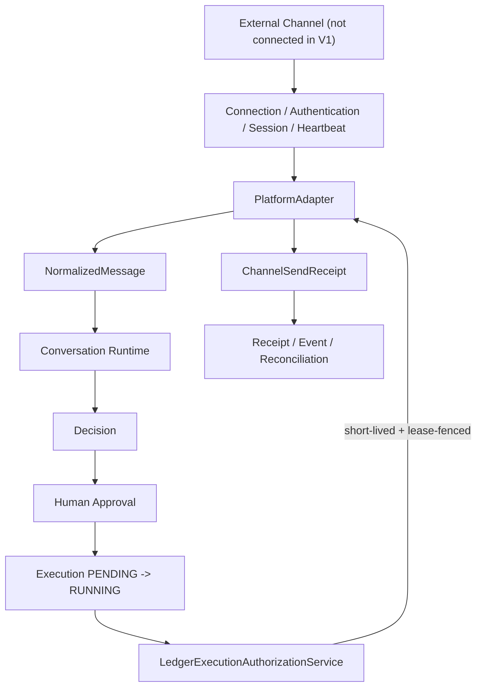

# 《AI-CS Real Channel Adapter Framework Design V1》

## 1. 结论与边界

Real Channel Adapter Framework V1 已完成架构、接口、可执行安全边界、Fake Platform Adapter 和 Adapter Contract Test。V1 是真实渠道适配能力的基础，不包含任何真实平台连接，也没有将发送接口接入 Execution Worker。

最终状态：`REAL_CHANNEL_ADAPTER_FRAMEWORK_READY`

本状态表示：

- 真实 Adapter 的连接、认证、心跳、Session、Health 抽象已冻结；
- 外部消息到 `NormalizedMessage` 的归一化边界已冻结；
- `Decision -> Approval -> RUNNING Execution -> PlatformAdapter` 的执行授权边界已落地；
- Fake Adapter Contract Test 已验证接口和 fail-closed 规则；
- 真实平台 URL、SDK、账号、token、cookie、secret、发送能力均不存在。

本状态不表示：

- 已连接拼多多或任何真实平台；
- 已授权自动发送；
- 已具备退款、订单修改或资金操作能力；
- 可以绕过 Human Approval；
- 可以将当前 Fake Adapter 替换为生产 Adapter 后直接上线。

## 2. 渐进式接入原则

渠道能力必须按以下成熟度推进，每一级都需要独立审批与证据：

| 等级 | 能力 | 允许行为 | V1 状态 |
|---|---|---|---|
| L0 Observe | 观察 | 连接健康、接收、归一化、审计；禁止出站 | Framework 已支持 |
| L1 Assist | 人工辅助 | 生成草稿，由人工在平台外确认；禁止 Adapter 发送 | 当前推荐模式 |
| L2 Controlled Execute | 低风险受控执行 | 仅 `SEND_MESSAGE/LOW`，必须 Decision + Human Approval + RUNNING lease | 仅接口与 Fake 验证 |
| L3 Limited Automation | 有限自动化 | 仅白名单场景、独立风控、熔断、审计与回滚策略 | 不在 V1 |
| L4 Expanded Automation | 扩展自动化 | 需新的 Contract、安全评审和运营治理 | 禁止推定 |

“已实现 send 接口”不等于“允许自动发送”。V1 没有把 `PlatformAdapter` 注册到 Worker，也没有真实 transport。

## 3. 总体架构



V1 组件：

| 组件 | 文件 | 职责 |
|---|---|---|
| Lifecycle | `channel/lifecycle.py` | Connection、Authentication、Session、Heartbeat 状态机 |
| Platform Contract | `channel/platform.py` | `PlatformAdapter`、授权发送命令和验证端口 |
| Execution Boundary | `channel/execution_boundary.py` | 从实时 Ledger 签发并复核短期发送授权 |
| Fake Contract Adapter | `channel/fake_platform.py` | 无网络、无 secret、无真实发送的合同实现 |
| Contract Test | `tests/contract/test_real_channel_adapter_v1.py` | 生命周期、安全、归一化、执行边界和 Receipt 验证 |

## 4. Phase 1 — Adapter Lifecycle

### 4.1 Connection State

`ChannelConnectionState`：

```text
DISCONNECTED
  -> CONNECTING
  -> AUTHENTICATING
  -> CONNECTED

AUTHENTICATING -> AUTHENTICATION_FAILED
CONNECTED <-> DEGRADED
CONNECTED/DEGRADED -> DISCONNECTED
```

状态语义：

| 状态 | 允许接收 | 允许受控发送 | Health |
|---|---:|---:|---|
| `DISCONNECTED` | 否 | 否 | UNHEALTHY |
| `CONNECTING` | 否 | 否 | UNHEALTHY |
| `AUTHENTICATING` | 否 | 否 | UNHEALTHY |
| `CONNECTED` | 是 | 仅有效授权 | HEALTHY |
| `DEGRADED` | 否 | 否 | DEGRADED |
| `AUTHENTICATION_FAILED` | 否 | 否 | UNHEALTHY |

### 4.2 Authentication

Adapter 只保存 `ChannelCredentialReference`：

- `credential_id`：secret manager 中的非秘密定位符；
- `provider`：凭据提供方名称；
- `version`：凭据版本；
- `account_ref`：脱敏平台账号引用；
- `auth_scheme`：`API_TOKEN`、`OAUTH2`、`SIGNED_REQUEST` 或 `MANAGED_SESSION`。

`ChannelAuthenticationBroker` 负责认证。返回值 `ChannelAuthentication` 只含 principal、account、credential version、认证时间和过期时间，不返回 token、cookie、password 或 secret。

### 4.3 Session

`ChannelSession` 是 Engine 可见的脱敏会话快照：

- internal `session_id` / `connection_id`；
- channel / account / principal reference；
- credential ID 与 version；
- established / expires / last heartbeat 时间；
- authenticated 标记。

模型 `extra="forbid"`，不接受临时添加的 token/cookie/secret 字段。Session 过期后 Heartbeat 返回 `SESSION_EXPIRED`，Connection 转为 `DEGRADED`，receive/send 均 fail closed。

### 4.4 Heartbeat

Heartbeat 状态：

- `OK`：会话有效且探针通过，Connection=`CONNECTED`；
- `FAILED`：探针失败，Connection=`DEGRADED`；
- `SESSION_EXPIRED`：会话过期，必须重新认证。

Heartbeat 结果包含检查时间、下一次检查间隔、非敏感错误码以及是否真实触达平台。Fake Adapter 始终报告 `real_platform_contacted=false`。

### 4.5 Health

`health_check()` 聚合：

- Connection state；
- 是否存在 authenticated session；
- credential provider/version；
- `real_platform_connected`；
- `automatic_send_enabled`。

Health 不包含账号原文、token、cookie、签名或 secret。正常降级通过状态返回，不将凭据错误内容写入 details。

## 5. Phase 2 — Message Ingestion

任何平台原始消息必须先转换为冻结的六字段模型：

```python
class NormalizedMessage:
    channel: str
    conversation_id: str
    external_message_id: str
    sender: str
    content: str
    timestamp: AwareDatetime
```

规则：

1. `channel` 是 Adapter 注册键，不接受调用方任意覆盖；
2. `conversation_id` 和 `external_message_id` 保留平台外部稳定引用；
3. `sender` 只表示外部发送人，不能充当内部审批人；
4. `content` 必须非空，最大 8,000 字符；
5. `timestamp` 必须携带时区；
6. `(conversation_id, external_message_id)` 是入站幂等键；
7. 相同 ID、相同内容返回 replay；相同 ID、不同内容立即阻断；
8. Adapter 未连接、认证失败、DEGRADED 或 Session 过期时禁止接收。

V1 Contract Test 使用 `FakePlatformInboundMessage` 模拟平台形状，但不模拟任何真实平台字段、SDK 或协议。

## 6. Phase 3 — Execution Boundary

### 6.1 禁止直接发送

旧 Foundation 的 `OutboundMessage.approved_by` 只能表达 provenance，不能证明当前 Ledger 状态。Real Framework 的 `PlatformAdapter.send_message()` 因此不接受裸 `OutboundMessage`，只接受：

```python
AuthorizedOutboundMessage(
    message=OutboundMessage(...),
    authorization=ExecutionSendAuthorization(...),
)
```

裸消息会触发 `ExecutionBoundaryDenied`。

### 6.2 Ledger Authorization

`LedgerExecutionAuthorizationService.issue()` 只有在以下实时条件全部满足时才签发：

- Decision state=`APPROVED`；
- Decision action=`SUGGEST_REPLY`；
- proposed content 非空；
- Approval state=`APPROVED`；
- Approval 含明确 `decided_by`；
- Execution state=`RUNNING`；
- execution ID / decision ID / approval ID 相互一致；
- worker ID 与当前 lease owner 一致；
- lease token 与当前 fencing token 一致；
- lease 尚未过期。

授权固定为：

- `operation="SEND_MESSAGE"`；
- `execution_risk="LOW"`；
- TTL 默认 30 秒，最大 5 分钟；
- 实际 expiry 不得超过 Execution lease expiry。

### 6.3 Adapter 端二次核验

Adapter 在每次发送前调用 `SendAuthorizationVerifier.verify()`，重新读取 Ledger 并核对：

- Decision、Approval、Execution 状态；
- worker、lease token 和 lease expiry；
- channel、conversation、execution、approver；
- content 与已批准 `proposed_content` 完全一致；
- idempotency key 与 Execution 完全一致。

因此以下行为均被阻断：

- 没有 Decision 的发送；
- 没有 Human Approval 的发送；
- Execution 仍为 `PENDING`；
- 使用过期或伪造 lease；
- Approval 后替换回复内容；
- 将已批准消息改发到另一渠道/会话；
- 复用 idempotency key 发送不同内容；
- 将操作扩大为退款、订单修改或资金操作。

### 6.4 UNKNOWN

真实 transport 如果不能证明平台是否接受消息，必须返回 `UNKNOWN` Receipt：

- 禁止自动重试；
- 保留相同 idempotency key；
- 进入人工平台侧对账；
- 对账前不得签发新的发送授权；
- 不允许把网络异常降级成 `FAILED` 后自动重发。

## 7. Phase 4 — Platform Adapter Interface

```python
@runtime_checkable
class PlatformAdapter(Protocol):
    @property
    def channel(self) -> str: ...

    def receive_message(self) -> NormalizedMessage | None: ...

    def send_message(
        self,
        command: AuthorizedOutboundMessage,
    ) -> ChannelSendReceipt: ...

    def health_check(self) -> AdapterHealth: ...

    def get_session(self) -> ChannelSession | None: ...
```

Lifecycle 的 `connect()`、`heartbeat()`、`disconnect()` 由 Adapter 暴露或由部署侧 Lifecycle Supervisor 驱动；业务代码只依赖以上四个稳定方法。

`ChannelSendReceipt` 必须不可变、幂等并包含：channel、conversation、execution、idempotency key、outcome、external message reference、error code、details、recorded time。

## 8. Phase 5 — Security Design

### 8.1 平台账号

- Engine 只保存 `account_ref`，不保存登录名、手机号或客户可识别账号原文；
- 账号与 tenant/store/channel 绑定关系由部署配置和权限系统管理；
- 一个 Adapter 实例只服务一个明确的 account scope；
- 禁止跨账号复用 Session。

### 8.2 Token / Secret

- 必须存放在批准的 secret manager、KMS 或认证 sidecar；
- 源码、`.env`、数据库、Receipt、Event、Outbox、Health、异常和日志中禁止出现明文；
- Adapter 通过 `ChannelAuthenticationBroker` 获取认证结果，不把原始 secret 暴露给领域层；
- 凭据必须支持 version、轮换、吊销和最小权限；
- 日志必须对 `Authorization`、Cookie、Set-Cookie、token query/body 字段执行结构化脱敏；
- 生产实现必须启用 TLS 校验、hostname 校验、egress allowlist、超时和重定向禁用策略。

### 8.3 Session

- Engine 只持有 opaque、脱敏的 Session metadata；
- 平台 session handle 由 transport/sidecar 私有持有；
- Session 必须有明确 expiry 和 heartbeat；
- 认证失败或过期立即 fail closed；
- disconnect 时移除 Engine 可见 Session；
- 不允许把浏览器 profile、Cookie 文件或 local storage 当作 V1 Session。

### 8.4 审计

上线前必须新增不含秘密的审计事件：connection state、authentication outcome category、heartbeat category、authorization ID、execution ID、receipt outcome。审计不能记录 message content 全文，除非数据治理策略明确授权。

## 9. Phase 6 — Fake Adapter Contract Test

Fake Contract Adapter 的保证：

- 不导入真实平台 SDK；
- 不调用 HTTP、socket、浏览器或外部进程；
- 不建模平台 token/cookie/secret；
- `real_platform_connected=false`；
- `real_platform_called=false`；
- `customer_message_sent=false`；
- `refund_performed=false`；
- `order_modified=false`；
- SUCCESS/FAILED/UNKNOWN 都只是模拟 Receipt。

专项测试覆盖：

1. `PlatformAdapter` runtime contract；
2. Connection/Authentication/Session/Heartbeat lifecycle；
3. Authentication failure fail closed；
4. Heartbeat 降级、恢复与 Session 过期；
5. credential/session/health 无明文 secret；
6. 六字段消息归一化和入站幂等；
7. 裸 `OutboundMessage` 禁止发送；
8. `PENDING` Execution 禁止发送；
9. Approval + RUNNING lease 后才能签发；
10. SUCCESS/FAILED/UNKNOWN Receipt 与发送幂等；
11. content 篡改、伪造 lease、授权过期全部阻断；
12. Fake Adapter 不执行发送、退款或订单修改。

验证结果：

```text
.venv\Scripts\python.exe -m pytest tests\contract\test_real_channel_adapter_v1.py -q
9 passed

.venv\Scripts\python.exe -m pytest -q
120 passed, 1 warning
```

唯一 warning 是 FastAPI TestClient 的上游 `httpx2` 弃用提示，与 Channel Adapter Framework 无关。

## 10. 真实 Adapter 实现前置 Gate

未来实现任一真实平台 Adapter 前，必须单独完成：

- 平台官方 API、服务条款和授权方式评审；
- 数据分类、保存周期、隐私与审计评审；
- Secret manager、轮换、吊销和灾难恢复演练；
- L0 receive-only staging 验证；
- 消息丢失、重复、乱序和 reconnect recovery 测试；
- 平台 rate limit、timeout、retry、idempotency 与 UNKNOWN 对账规则；
- L1 human-assist 试运行；
- L2 低风险发送的独立运营批准；
- kill switch、速率上限、账号级熔断和异常报警；
- 证明 Execution Worker 只能通过 Ledger Authorization Boundary 调用；
- 新增真实平台专属 Contract Test，且不得复用生产账号。

任何一个 Gate 未完成，Adapter 必须保持 receive-only 或 disabled。

## 11. Quality Gates

| Gate | 结果 |
|---|---|
| Adapter Lifecycle | PASS |
| Message Normalization | PASS |
| PlatformAdapter Interface | PASS |
| Decision/Approval/Execution Boundary | PASS |
| Lease fencing / TTL / payload binding | PASS |
| Credential and Session redaction | PASS |
| Fake Adapter Contract Test | PASS |
| No real platform connection | PASS |
| No automatic send | PASS |
| No refund/order/funds capability | PASS |

## 12. Final Status

`REAL_CHANNEL_ADAPTER_FRAMEWORK_READY`
