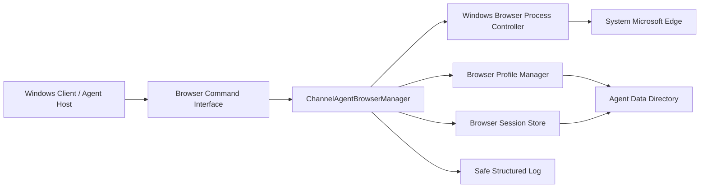
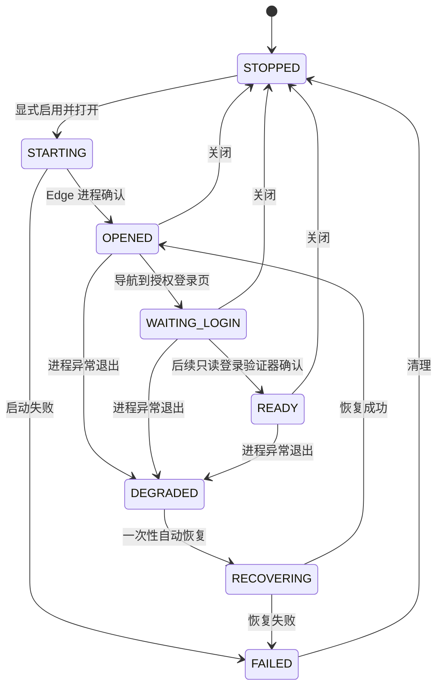

# Channel Agent Browser Control Foundation V1 Completion Report

日期：2026-08-07
产品版本：AI-CS Channel Agent Windows Client `1.2.0`
最终状态：`CHANNEL_AGENT_BROWSER_CONTROL_FOUNDATION_READY`

## 1. 完成结论

Channel Agent 已具备 Windows 客服电脑上的浏览器进程控制基础能力：可在显式启用后启动系统 Microsoft Edge、为每个 Agent 创建独立 Profile、查询进程状态、请求安全 URL 导航、关闭浏览器，并在异常退出后执行一次有界恢复。

本阶段没有引入 PDD 页面逻辑、Playwright、DOM/Selector、消息读取、聊天解析、自动登录或发送接口。浏览器配置默认关闭；所有 Profile 均位于 Agent 数据目录，禁止访问用户个人 Chrome/Edge Profile；Session 和日志不保存 URL、密码、Cookie 或 Token。

## 2. Browser 架构



核心边界如下：

| 模块 | 职责 | 明确不负责 |
|---|---|---|
| `ChannelAgentBrowserManager` | 启动、关闭、状态、导航、一次性恢复 | 页面读取、登录、发送 |
| `WindowsBrowserProcessController` | 受控启动 Edge、PID/镜像校验、进程树关闭 | DOM、CDP、网络拦截 |
| `BrowserProfileManager` | 为 Agent 创建专属 Profile 并验证目录边界 | 读取个人浏览器 Profile、导出 Cookie |
| `BrowserSessionStore` | 原子保存无凭证 Session 状态 | 保存 URL、账号、密码、Cookie、Token |
| `WindowsAgentHost` | 启动时按配置装配 Browser、同步本地状态、停止时清理 | 修改 Agent/Gateway 协议 |

## 3. 新增能力

### 3.1 Browser Process Manager

- 自动发现 Windows 系统 Microsoft Edge；不接受任意可执行文件。
- 启动参数强制包含独立 `--user-data-dir`。
- 记录并校验 Edge PID 对应的实际进程镜像，避免误操作 PID 复用后的其他进程。
- 正常停止失败时仅对已验证 Edge PID 及其子进程执行有界关闭。
- 异常退出进入 `DEGRADED`，每个 Session 最多自动恢复一次；再次失败等待人工处理，禁止无限重试。

### 3.2 Browser Profile Manager

Profile 路径由 Agent 数据目录和 Agent Identity 派生：

```text
<agent-data-root>/browser/profiles/<agent-slug>-<agent-id-hash>/edge
```

- 不读取系统默认 Edge/Chrome User Data。
- 不接受越出 Agent 数据目录的 Profile。
- 不同 Agent 使用不同 Profile 和不同 Session 状态文件。
- Profile 标记只记录所有权、隔离状态与“禁止敏感数据导出”声明。

### 3.3 Browser Session State

本地状态模型包含：

- `browser_id`
- `agent_id`
- `profile_path`
- `status`
- `pid`
- `generation`
- `created_at`
- `last_seen`
- `human_interaction_required`
- `automatic_recovery_attempted`
- `last_error_code`

完整 Profile 路径仅保存在本机 Browser Session 文件；Windows 状态输出只暴露相对于 Agent 数据目录的 `profile_reference`。

### 3.4 Browser Command Interface

Python 接口与 Windows CLI 均提供四个基础命令：

| 接口 | Windows 命令 | 作用 |
|---|---|---|
| `open_browser()` | `browser-open` | 打开隔离 Edge，初始页为 `about:blank` |
| `close_browser()` | `browser-close` | 关闭受管浏览器进程 |
| `browser_status()` | `browser-status` | 返回脱敏 Session 状态 |
| `navigate(url)` | `browser-navigate --url <approved-url>` | 请求 HTTPS 或 loopback HTTP 导航 |

导航目标只在创建 Edge 进程时使用，不写入 Session；日志只记录目标 origin，不记录路径、查询串或片段。包含 URL userinfo、敏感查询参数、fragment、非 HTTPS 公网地址的请求会 Fail Closed。

## 4. 状态模型



`READY` 已在模型中冻结，但本阶段没有登录检测能力，因此不会由 Browser Runtime 自行进入；必须由后续 PDD Adapter 的只读、已验证登录状态检测器驱动。

## 5. 配置方式

Agent 配置新增：

```json
{
  "browser_enabled": false
}
```

规则：

- 默认值为 `false`。
- 只有显式设置 `true` 才允许 `open_browser()`、`navigate()` 和恢复。
- 禁用时状态查询和关闭仍可用，以支持安全检查和孤儿进程清理。
- 配置不接受 `password`、`cookie`、`token`、`secret`、`credential` 等敏感字段。
- 浏览器状态只写入本地 Windows Client State；没有修改 Agent Heartbeat 或 Gateway Contract。

## 6. Windows Agent 集成

当 `browser_enabled=true`：

1. Windows Agent 完成配置检查并启动既有 Agent Runtime。
2. Browser Runtime 创建/校验 Agent 专属 Profile。
3. 打开系统 Edge 的 `about:blank`。
4. Windows Client State 同步 Browser ID、状态、PID、Profile Reference、Generation 和错误码。
5. Edge 异常退出时执行一次恢复；恢复后仍从 `about:blank` 开始，禁止自动重放登录页。
6. Agent 正常停止时同步关闭受管 Edge；Agent 已退出时，`stop` 命令仍尝试清理已记录的孤儿 Edge。

浏览器环境失败映射到 Windows 客户端退出码 `5`，不会伪装成 Gateway 成功或配置成功。

## 7. 安全边界

已验证的安全控制：

- 默认关闭，显式开启。
- 只允许系统 `msedge.exe`。
- Agent Profile 隔离并绑定 Agent Identity。
- 禁止用户个人 Edge/Chrome Profile。
- 不持久化导航 URL。
- 不记录完整 URL、账号、密码、Cookie、Token 或 Secret。
- 无 `read_messages`、`capture_dom`、`click_send`、`send_message`、`auto_login` 接口。
- 无 Playwright、CDP、Selector 或 PDD 依赖。
- 无验证码绕过能力。
- 异常恢复有界，禁止无限自动重试。
- Gateway Contract V1 未修改，Canonical SHA-256 保持：
  `e5ac64a82d2a7ccd19d3ece9bcc076242b55b6c205c85626786e8b1b7478f4b5`。

## 8. 测试结果

| 验证项 | 结果 | 证据 |
|---|---:|---|
| Browser 专项 + Windows Client | 19 passed / 1 skipped | 常规测试中真实 Edge 冒烟为显式项 |
| 真实 Windows Edge 冒烟 | 1 passed | 隔离临时 Profile、`about:blank`、启动/状态/关闭 |
| Agent/Windows/Integration 定向回归 | 66 passed / 1 skipped | Identity、Binding、Heartbeat、Host 状态同步保持兼容 |
| 全仓 Regression | 572 passed / 1 skipped / 1 warning | `44.25s`；跳过项即显式 Edge 冒烟，已单独通过 |
| Security | 18 passed | Credential、安全 Gate 与敏感值检查 |
| compileall | PASS | `src` 与 `tests` 全部可编译 |
| Gateway Contract 跨仓验证 | 10/10 PASS | Schema/HMAC/Decision/401/403/timeout/idempotency 全部 Fail Closed |
| Windows 1.2.0 Package Build | PASS | ZIP 构建、白名单、CLI、配置与能力清单通过 |

Windows 包：

- 文件：`dist/windows-client-v1/AI-CS-Channel-Agent-1.2.0-windows-x64.zip`
- SHA-256：`95740ea2a57f34822ba53503166bd29b442b8a900e09f164a29f03ebb323c8bc`
- 包内命令验证：`version`、`check-config`、`browser-status` 通过。
- 包内 `config_contains_credentials=false`。

唯一警告来自既有 FastAPI/Starlette TestClient 的弃用提示，与 Browser Runtime 无关。

## 9. 修改范围

主要新增/变更：

- `src/channel_agent/browser.py`
- `src/channel_agent/config.py`
- `src/channel_agent/windows.py`
- `src/channel_agent/windows_app.py`
- `src/channel_agent/version.py`
- `packaging/windows-client-v1/production-composition.json`
- `scripts/build_channel_agent_windows_client.ps1`
- `deploy/channel-agent-foundation/agent.example.json`
- `tests/unit/test_channel_agent_browser_control_foundation_v1.py`

未修改：

- Gateway Contract schema
- AI-CS 业务、RAG、Knowledge、Model
- PDD Adapter
- Agent Identity、Enrollment、Binding 或 Heartbeat wire contract
- Channel Engine Execution/Receipt

## 10. PDD Adapter 下一阶段依赖

进入下一阶段前仍需独立实现并验证：

1. PDD 登录页 URL allowlist 和平台级导航策略。
2. 只读登录状态检测，驱动 `WAITING_LOGIN → READY`；禁止自动登录。
3. Store Identity 只读发现与现有 Agent Store Binding 比对。
4. Selector Contract 的 `DRAFT → DISCOVERY → VERIFIED` 治理。
5. 浏览器崩溃后的页面恢复策略；当前仅恢复 Edge 进程，不自动恢复页面或 Session。
6. 观察模式的隐私过滤、Cursor/ACK、去重与证据采集。
7. 所有发送继续由 Decision → Human Approval → Execution → Receipt 链路控制，Browser Runtime 不增加发送接口。

在上述依赖完成前，允许范围仅为 Browser Runtime；PDD 登录、消息读取、页面解析和发送继续保持禁用。

## 11. 最终判定

所有本阶段 Gate 已通过：

- Browser Process Manager：READY
- Browser Profile Isolation：READY
- Browser Session State：READY
- Browser Command Interface：READY
- Default-off Config：READY
- Windows Start/Close/Recovery：READY
- Agent State Sync：READY
- Security Boundary：READY

Final Status：`CHANNEL_AGENT_BROWSER_CONTROL_FOUNDATION_READY`
