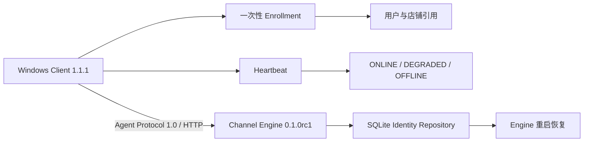

# 《Channel Agent Production Connection Validation V1》

## 1. 结论

Windows Client `1.1.1` 已在受控本机 HTTP 边界完成以下闭环：

`Agent 启动 → Enrollment → 用户/店铺绑定 → Heartbeat → ONLINE/DEGRADED/OFFLINE 状态同步 → Engine/Agent 重启恢复`。

结论为 **PASS**，最终状态为 `CHANNEL_AGENT_PRODUCTION_CONNECTION_READY`。

这里的“Production Connection Ready”指生产形态的 Windows 安装包、真实进程、真实 HTTP 与持久化身份链已验证；不代表已连接真实 PDD、真实客户数据或真实发送能力。

## 2. 验证架构与边界

验证服务仅监听 `127.0.0.1`，RBAC 使用合成管理员会话，身份与店铺均为合成 reference。未引入 PDD、浏览器、消息读取、消息发送或客户数据。

## 3. 实现内容

| 模块 | 变更 | 运行保证 |
|---|---|---|
| `channel_agent.client` | 4xx 拒绝异常携带有界 `status_code` 和 `error_code` | 不保留响应正文或凭证，可区分注册丢失与授权拒绝 |
| `channel_agent.runtime` | Heartbeat 遇到 `404/AGENT_NOT_REGISTERED` 时执行一次重新注册并重试一次 | Engine 重启后可恢复；401、403、冲突等继续 Fail Closed；禁止无限重试 |
| `channel_agent.windows_app` | 规范化 Windows PowerShell 5.1 的 UTF-16/NUL stdin 绑定码 | 自动化安装验证可安全使用一次性绑定码；原有严格格式校验保持不变 |
| Windows package | 版本提升到 `1.1.1`，能力清单增加 Engine 重启恢复和 OFFLINE 同步 | 不覆盖已验证的 `1.1.0` 产物 |
| 验证工具 | 新增受控 loopback Engine 服务与 Windows 安装包验证脚本 | 可重复验证安装、绑定、心跳、断网、重启和卸载 |
| 集成测试 | 调整为先启动未绑定 Agent，再执行 Enrollment | 与本任务指定的真实运行顺序一致 |

## 4. Agent Registration 与 Binding

注册与心跳持续验证以下字段：

| 字段 | 来源 | 规则 | 结果 |
|---|---|---|---|
| `agent_id` | 本地无凭证配置 | V1 identifier；服务端注册键 | PASS |
| `device_id` | 本地无凭证配置 | 必须匹配已注册设备 | PASS |
| `user_id` | 管理员签发 Enrollment Grant | Agent 不可自行选择或提升 | PASS |
| `store_id/store_ids` | 管理员签发 Enrollment Grant | 仅保存 reference；本轮验证 2 个店铺引用 | PASS |
| `binding_revision` | Channel Engine | 每次绑定变更由服务端控制 | PASS |

一次性绑定码只存在于授权与 stdin 传输期间，不写入配置、状态、日志或证据文件。绑定完成后，本地仅持久化公开的用户/店铺引用及 revision。

## 5. Runtime 状态同步

| 场景 | Agent 本地 | Channel Engine Admin View | 结论 |
|---|---|---|---|
| 启动并注册 | `RUNNING / ONLINE` | `ONLINE` | PASS |
| 网络/Engine 不可达 | `DEGRADED` | 服务不可查询 | PASS |
| Engine 重启、注册表丢失 | 单次重新注册后 `RUNNING / ONLINE` | `ONLINE` | PASS |
| Agent 正常停止 | `STOPPED` | `OFFLINE` | PASS |
| Agent 本地进程重启 | 恢复 `RUNNING / ONLINE` | `ONLINE` | PASS |

`DEGRADED` 不会清除本地绑定；只有服务端明确返回 `404/AGENT_NOT_REGISTERED` 时才允许一次重新注册。认证失败、身份禁用、设备冲突和 claim mismatch 不触发自动注册，避免绕过授权。

## 6. Recovery 验证

### 6.1 断网

停止受控 Channel Engine 后，Heartbeat 失败，Windows 状态进入 `DEGRADED`，进程保持运行并等待下一心跳周期。没有创建新身份或更改绑定。

### 6.2 Channel Engine 重启

Engine 的内存注册表重启后为空，但 SQLite 身份仓库保留绑定。Agent 首次 Heartbeat 收到 `AGENT_NOT_REGISTERED`，执行一次注册恢复，再重发 Heartbeat，恢复为 `ONLINE`。绑定 revision 与用户/店铺引用不变。

### 6.3 Agent 重启

Agent 正常停止先上报 `STOPPED`，Admin View 进入 `OFFLINE`。重新启动后读取本地公开 binding reference，注册并恢复 `ONLINE`，未重新 Enrollment。

## 7. Windows 安装包验证

| 项目 | 结果 |
|---|---|
| 安装 / 自动启动配置 | exit `0` |
| 首次启动 | exit `0` |
| Enrollment | exit `0` |
| 正常停止 | exit `0` |
| 重启 | exit `0` |
| 绑定用户 | 匹配 |
| 店铺引用数量 | `2` |
| 断网降级 | PASS |
| Engine 重启恢复 | PASS |
| OFFLINE 同步 | PASS |
| Agent 重启恢复 | PASS |
| 绑定持久化 | PASS |
| 敏感词扫描 | `0` match |

发布候选产物：

- 版本：`1.1.1`
- ZIP：`dist/windows-client-v1/AI-CS-Channel-Agent-1.1.1-windows-x64.zip`
- SHA-256：`baf17b07469a8e5ffd274a473be60412ae22ac04a483d52c8f69a39e48ceb1fa`
- 大小：`22,129,632` bytes
- Manifest 文件数：`1,625`
- 完整性失败：`0`

## 8. 测试结果

| 验证层 | 通过 | 失败 | 警告 | 说明 |
|---|---:|---:|---:|---|
| Full Regression | 553 | 0 | 1 | Starlette TestClient 弃用警告 |
| Gateway/Agent Contract | 20 | 0 | 0 | 冻结 Gateway 与跨仓兼容范围 |
| Security + Identity | 31 | 0 | 0 | 安全、身份与运行绑定 |
| Release Lock | 8 | 0 | 0 | 版本、Contract SHA、安全标志、allowlist |
| Windows + Connection | 30 | 0 | 1 | Windows 客户端与生产连接测试 |

补充检查：

- `compileall`：PASS
- `pip check`：PASS
- Windows package manifest 逐文件 SHA/size：PASS
- Gateway Contract V1 canonical SHA：`e5ac64a82d2a7ccd19d3ece9bcc076242b55b6c205c85626786e8b1b7478f4b5`
- Gateway schema 工作树改动：`0`

上述专项集合存在测试重叠，不能相加作为唯一用例总数；仓库全量口径为 `553 passed`。

## 9. 安全结论

- 本地配置仅保存 `server_url`、`agent_id`、`device_id` 和公开引用，不保存 Cookie、密码或明文 Token。
- Agent 无权签发 Enrollment Grant、选择角色或自行激活身份。
- 绑定码不进入日志、证据 JSON 或持久化状态。
- Engine 重启恢复只识别精确的 `404/AGENT_NOT_REGISTERED`，其他拒绝保持 Fail Closed。
- Gateway Contract V1 未修改，PDD、浏览器、消息读取与发送能力均为 `false`。

## 10. 已知限制与风险

1. 本次网络边界为本机 loopback；尚未覆盖跨主机 TLS、企业代理、防火墙、DNS、证书轮换或真实生产认证提供方。
2. 受控验证服务使用合成管理员会话，只证明 Agent/Engine 协议和 RBAC 边界，不代表生产 IAM 已部署。
3. 单独运行整个 `tests/contract` 目录时，既有 PDD Safety 用例 `test_production_not_enabled_blocks_send_before_fake_sender` 出现审计事件顺序/隔离失败（`122 passed, 1 failed`）；全量回归通过。本任务未修改 PDD 代码，该问题应作为独立测试隔离缺陷处理。
4. Windows/全量测试各有一个第三方 Starlette TestClient 弃用警告，不影响当前运行结果，但应在依赖升级窗口处理。
5. 验证脚本已卸载 Agent 并删除安装/数据目录；环境策略阻止递归删除外层临时证据目录，保留内容仅为合成 SQLite/空启动目录，不含真实数据或凭证。

## 11. 后续建议

1. 在隔离 LAN 节点上验证 TLS、生产身份提供方、代理/防火墙和时钟偏差。
2. 将受控连接验证脚本纳入 Windows RC 发布流水线，并保留 JSON 证据摘要。
3. 单独修复 PDD Safety contract 测试的状态隔离，不在 Agent 连接任务中改动 PDD 行为。
4. 保持 PDD、浏览器、消息读取和发送能力关闭，直至获得独立激活授权。

## Final Status

`CHANNEL_AGENT_PRODUCTION_CONNECTION_READY`
