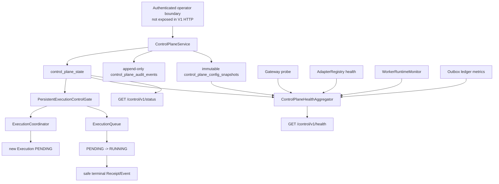

# 《Channel Engine Production Control Plane V1》

## 1. 结论

Channel Engine Production Control Plane V1 已完成。

最终状态：`CHANNEL_ENGINE_CONTROL_PLANE_READY`

本阶段建立了版本化、持久化且默认 fail-closed 的执行控制面，统一提供：

- Runtime Health；
- Adapter Status；
- Global Kill Switch；
- Control Plane Audit Event；
- Immutable Config Snapshot 与版本回滚；
- Operational Metrics；
- Execution 创建与 Worker 领取门禁。

该状态不代表生产上线授权。当前仍然没有真实 PDD 连接、真实客户消息、自动发送、AI-CS 业务修改或 secret storage implementation。

## 2. 控制面设计

### 2.1 架构



### 2.2 实现资产

| 资产 | 路径 | 职责 |
|---|---|---|
| Domain models | `src/channel_engine/control/models.py` | 版本化状态、审计、配置、健康与指标模型 |
| Persistence | `src/channel_engine/control/repository.py` | state CAS、append-only audit、immutable snapshot、metrics |
| Control service | `src/channel_engine/control/service.py` | Kill Switch 与 config command/query transaction |
| Execution gate | `src/channel_engine/control/gate.py` | 创建 Execution 与领取 PENDING 的权威门禁 |
| Health aggregation | `src/channel_engine/control/health.py` | Gateway/Adapter/Worker/Outbox/Policy 聚合 |
| Storage schema | `src/channel_engine/storage/orm.py` | 三张控制面表 |
| Runtime integration | `src/channel_engine/app.py` | 控制服务、gate、worker monitor、只读 API |
| Contract tests | `tests/contract/test_control_plane_v1.py` | 版本、配置、审计、脱敏、schema |
| Runtime tests | `tests/integration/test_control_plane_runtime.py` | Kill Switch、运行中收尾、health 与 metrics |

### 2.3 持久化表

```text
control_plane_state
control_plane_config_snapshots
control_plane_audit_events
```

`control_plane_state` 是 singleton、带 revision 的权威状态。Config Snapshot 和 Audit Event 都只追加，不提供覆盖或删除接口。

## 3. 状态模型

所有对外模型固定：

```text
control_plane_version = 1.0
extra fields = forbidden
models = frozen
```

### 3.1 EngineStatus

| 状态 | 语义 |
|---|---|
| `RUNNING` | 所有必要组件健康，Kill Switch 关闭 |
| `DEGRADED` | 至少一个 Gateway/Adapter/Worker/Outbox 组件降级 |
| `STOPPED` | Global Kill Switch 已启用，执行面受控停止 |

### 3.2 AdapterStatus

Adapter 聚合状态：

```text
CONNECTED
DEGRADED
DISCONNECTED
```

状态包含 adapter name、channel、component health、检查时间和 `real_platform_connected`，不包含会话 credential 或消息正文。

### 3.3 ExecutionPolicyStatus

| Kill Switch | Policy | 新 Execution | PENDING claim | RUNNING finish |
|---|---|---:|---:|---:|
| `DISABLED` | `ENABLED` | 允许 | 允许 | 允许 |
| `ENABLED` | `BLOCKED` | 禁止 | 禁止 | 允许安全结束 |

### 3.4 KillSwitchStatus

包含：

- `ENABLED / DISABLED`；
- 全局 state revision；
- kill-switch 专属更新时间；
- operator；
- categorical reason code。

### 3.5 ConfigSnapshot

只保存非秘密版本引用：

```text
snapshot_id
adapter_config_version
policy_version
gateway_version
created_at
created_by
reason
```

它不保存 adapter credential、Gateway auth、token、cookie、customer payload 或配置文件正文。

## 4. Kill Switch

### 4.1 权威门禁

`PersistentExecutionControlGate` 是 `ExecutionCoordinator` 与 `ExecutionQueue` 的默认 gate，不需要调用方额外启用。

新 Execution 路径：

```text
Decision WAITING_APPROVAL
 -> coordinator transaction
 -> lock/read control_plane_state
 -> Kill Switch DISABLED?
 -> Decision APPROVED + Approval APPROVED + Execution PENDING
```

Kill Switch 为 `ENABLED` 时，transaction 在 Decision 转态前失败：

- Decision 保持 `WAITING_APPROVAL`；
- 不创建 Approval；
- 不创建 Execution；
- 不调用 adapter；
- 返回 `CONTROL_PLANE_KILL_SWITCH_ENABLED` 语义错误。

Worker 领取路径：

```text
Execution PENDING
 -> queue transaction
 -> lock/read control_plane_state
 -> Kill Switch DISABLED?
 -> atomic PENDING -> RUNNING + lease
```

Kill Switch 为 `ENABLED` 时，`claim()` 返回无任务，PENDING 记录保持不变。

### 4.2 已运行 Execution

已经进入 `RUNNING` 并持有 lease 的 Execution 不重新检查“启动门禁”。它继续使用原有安全流程：

```text
renew current lease
 -> ApprovalPolicy validation
 -> Adapter result
 -> SUCCESS / FAILED / UNKNOWN
 -> immutable Receipt
 -> Execution Event + RECEIPT_RECORDED
 -> transactional outbox
```

这样避免在未知副作用边界中强行中断。Kill Switch 不删除、替换或回滚任何历史 Receipt/Event。

### 4.3 恢复

关闭 Kill Switch 后：

- 尚未批准的 Decision 可以重新由人工批准；
- 原有 PENDING Execution 可以被 Worker 领取；
- terminal Execution 不会重新入队；
- `UNKNOWN` 仍然禁止自动重试。

## 5. Health Aggregation

统一只读端点：

```text
GET /control/v1/status
GET /control/v1/health
```

写操作没有暴露为 HTTP API。原因是当前仓库尚无生产 operator authentication/authorization；在该边界完成前，不允许通过网络启停 Kill Switch 或切换配置。

### 5.1 Gateway

```text
HEALTHY
DEGRADED
```

聚合 Gateway reachability、gateway version 与检查时间。Probe exception 被安全转换为 `DEGRADED`，不会把底层认证信息写入结果。

### 5.2 Adapter

AdapterRegistry 中每个 adapter 映射：

| Adapter health | Control status |
|---|---|
| `HEALTHY` | `CONNECTED / HEALTHY` |
| `DEGRADED` | `DEGRADED / DEGRADED` |
| `UNHEALTHY` | `DISCONNECTED / DEGRADED` |

### 5.3 Worker

`WorkerRuntimeMonitor` 提供：

```text
RUNNING
STOPPED
```

Execution Worker 的 `run_forever()` 在启动和 finally 停止路径更新 monitor。应用没有自动启动后台 Worker，因此默认、真实反映为 `STOPPED`。

### 5.4 Outbox

| 条件 | 状态 |
|---|---|
| 无 failed 且未超过 backlog threshold | `HEALTHY` |
| pending + processing 达到 threshold | `BACKLOG` |
| 存在 terminal failed item | `DEGRADED` |

Kill Switch 不停止 outbox publisher；Receipt/Event 的无业务副作用发布仍应继续，保证审计可见性。

### 5.5 Policy

```text
Kill Switch DISABLED -> ENABLED
Kill Switch ENABLED  -> BLOCKED
```

Health 明确输出：

- `new_execution_allowed`；
- `pending_claim_allowed`；
- `running_execution_may_finish=true`；
- active policy version。

## 6. Operational Metrics

Control Plane 从 ledger 聚合以下非敏感计数：

```text
execution_pending
execution_running
execution_success
execution_failed
execution_unknown
receipts_total
outbox_pending
outbox_processing
outbox_published
outbox_failed
audit_events_total
config_snapshots_total
```

指标不使用 customer、conversation、message、operator reason 或 credential 作为 label，避免高基数和敏感数据泄露。

## 7. Audit Event

### 7.1 记录内容

`ControlPlaneAuditEvent` 固定记录：

```text
control_plane_version
audit_event_id
operator
action
timestamp
reason
subject_id
before
after
```

支持的 action：

- `KILL_SWITCH_ENABLED`；
- `KILL_SWITCH_DISABLED`；
- `CONFIG_SNAPSHOT_CREATED`；
- `CONFIG_SNAPSHOT_ACTIVATED`；
- `CONFIG_SNAPSHOT_ROLLED_BACK`。

`before/after` 是强类型 `ControlPlaneAuditState`，只允许：Kill Switch、revision、active snapshot ID 和三类 config version。它不是任意 JSON metadata，不能加入消息或 credential 字段。

### 7.2 脱敏规则

- operator 只能使用受限 identifier；
- reason 必须是大写 categorical reason code，不接受自由文本；
- extra fields 被拒绝；
- `secret/token/password/cookie/authorization/customer_message/message_content/proposed_content/reply_draft` marker 被拒绝；
- Repository 在落库前再次执行 JSON round-trip validation，防止未经验证的 `model_copy` 绕过；
- Audit Event 没有 update/delete repository method。

该控制面 audit 不修改冻结的 AI-CS Gateway Event Contract，也不混入客户业务 Event。未来如需外部审计导出，应使用独立、认证且只追加的 audit sink。

## 8. Config Snapshot

### 8.1 保存与激活

保存 snapshot 只追加一条不可变版本记录，并写入 `CONFIG_SNAPSHOT_CREATED` audit。保存本身不改变运行配置。

激活时：

1. 校验 snapshot 存在；
2. 读取 state revision；
3. 更新 singleton active pointer；
4. revision 原子递增；
5. 追加带 before/after 的 `CONFIG_SNAPSHOT_ACTIVATED` audit。

### 8.2 回滚

回滚不是覆盖旧 snapshot，而是把 active pointer 指向已有 snapshot：

```text
active v2 -> activate existing v1 -> active v1
```

旧 v2 仍然保留，Audit action 为 `CONFIG_SNAPSHOT_ROLLED_BACK`，before/after 完整记录三个版本的变化。

### 8.3 版本边界

V1 Snapshot 仅承担追踪与回滚引用，不包含：

- secret value；
- token/cookie；
- adapter session；
- customer message；
- 完整配置正文。

真实部署系统应通过 snapshot 中的非秘密版本号，从受控 artifact/config registry 解析实际非秘密配置；credential 仍必须独立从 secret manager 获取。

## 9. API 与权限边界

V1 暴露只读：

| API | 返回 |
|---|---|
| `GET /control/v1/status` | Kill Switch、active config、audit count |
| `GET /control/v1/health` | aggregated health、policy、metrics |

Kill Switch 和 Config Snapshot 写操作仅由进程内 `ControlPlaneService` 提供。未来暴露写 API 前必须增加：

- 强认证 operator identity；
- RBAC/ABAC；
- break-glass 流程；
- replay protection；
- request idempotency；
- 双人审批或高风险变更审批；
- 独立 audit sink；
- network allowlist 与 TLS/mTLS。

不得以请求体中的 `operator` 字符串替代身份认证。

## 10. 安全与禁止项验证

当前实现：

- 没有真实 PDD import、transport 或连接；
- 没有自动发送或后台自动回复；
- 没有修改 AI-CS；
- 测试只使用 synthetic message；
- 没有 secret store/provider implementation；
- Control tables 不包含 secret/token/customer content 字段；
- Control health/audit/config 不返回 customer message；
- Kill Switch 不删除 Receipt/Event/Outbox；
- 只读 API 不提供控制写能力。

## 11. 测试结果

覆盖场景：

- 所有 Control Plane model 固定版本 `1.0`；
- Audit before/after 强类型字段集合；
- plaintext secret/token/customer message extra field 拒绝；
- Config Snapshot save/activate/switch/rollback；
- Snapshot immutable；
- 三张控制面表 additive 创建；
- Kill Switch 阻断新的 Execution；
- 被阻断 Decision 保持 `WAITING_APPROVAL`；
- Kill Switch 阻断 PENDING claim；
- 已 RUNNING Execution 在启用 Kill Switch 后安全完成；
- Receipt 保留且 immutable；
- Kill Switch enable/disable audit；
- 敏感 reason 触发事务回滚，不产生 audit；
- Gateway healthy/degraded；
- Adapter connected/disconnected；
- Worker running/stopped；
- Outbox healthy/backlog；
- Policy enabled/blocked；
- Engine running/degraded/stopped；
- Operational Metrics；
- 应用只读 status/health API；
- 应用 Approval path 使用全局 gate。

验证结果：

```powershell
.\.venv\Scripts\python.exe -m pytest -q `
  tests\contract\test_control_plane_v1.py `
  tests\integration\test_control_plane_runtime.py `
  tests\api\test_app.py
# 10 passed

.\.venv\Scripts\python.exe -m pytest -q
# 161 passed, 1 warning
```

唯一 warning 是 FastAPI TestClient 上游关于 `httpx2` 的弃用提示，与 Control Plane V1 无关。

## 12. Quality Gates

| Gate | 结果 |
|---|---|
| Versioned Control Plane model | PASS |
| Persistent global Kill Switch | PASS |
| Block new Execution | PASS |
| Block PENDING claim | PASS |
| Allow RUNNING safe completion | PASS |
| Preserve Receipt history | PASS |
| Gateway health aggregation | PASS |
| Adapter status aggregation | PASS |
| Worker status aggregation | PASS |
| Outbox backlog aggregation | PASS |
| Policy status aggregation | PASS |
| Append-only typed Audit Event | PASS |
| Secret/customer-content redaction | PASS |
| Immutable Config Snapshot | PASS |
| Config version switch and rollback | PASS |
| Operational Metrics | PASS |
| No unauthenticated control write API | PASS |
| No real PDD/automatic send/AI-CS modification | PASS |
| Full regression | PASS |

## 13. Final Status

`CHANNEL_ENGINE_CONTROL_PLANE_READY`
