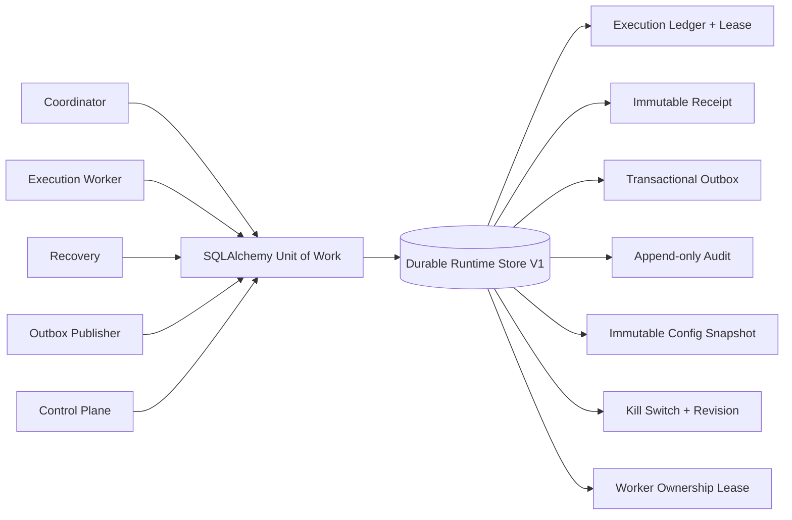

# 《Channel Engine Production Runtime Readiness V1》

## 1. 结论

Channel Engine Production Runtime V1 已完成。运行时的 Execution Ledger、Receipt、Control Plane Audit、Config Snapshot、Kill Switch 和 Transactional Outbox 均落在同一持久化事务边界中，并通过真实数据库文件关闭、重新打开的测试验证恢复能力。

本阶段没有连接真实 PDD、没有自动发送、没有修改 AI-CS，也没有执行资金动作。

最终状态：`CHANNEL_ENGINE_PRODUCTION_RUNTIME_READY`

## 2. 持久化架构



持久化边界由 `SqlAlchemyUnitOfWork` 和两个专用 Repository 组成：

- `ChannelEngineRepository`：Execution、Receipt、Event、Outbox、Worker ownership。
- `ControlPlaneRepository`：Audit Event、Config Snapshot、Kill Switch state。
- 每个业务操作在 Unit of Work 退出时统一提交；异常统一回滚。
- 数据库连接启用 `pool_pre_ping`。SQLite 参考实现启用 foreign key、WAL 和 busy timeout；部署可通过数据库 URL 使用生产关系数据库驱动。

## 3. 存储版本与恢复

运行时存储版本冻结为 `1.0`。

| 数据 | 版本机制 | 写入规则 | 恢复规则 |
| --- | --- | --- | --- |
| Execution Ledger | `runtime_storage_version` | 原子状态更新与租约条件更新 | 从持久化状态继续，不依赖进程内存 |
| Receipt | `runtime_storage_version` | 每个 Execution 仅允许追加一条 | 重启后按 execution_id 恢复 |
| Event / Outbox | `runtime_storage_version` | 与业务状态同事务追加 | PENDING 或过期 PROCESSING 可重新领取 |
| Audit Event | `control_plane_version` | 仅追加 | 重启后完整读取 |
| Config Snapshot | `control_plane_version` | 不可变追加 | active snapshot id 从控制面状态恢复 |
| Kill Switch | `control_plane_version` + revision | CAS 更新 | 重启后保持原状态和 revision |
| Worker Ownership | `runtime_storage_version` | worker_id 唯一、token fencing | 租约过期后才允许接管 |

数据库包含单例 `runtime_storage_metadata` 清单。启动建表阶段会验证持久化版本；遇到未知版本时 fail closed，不允许用不兼容代码继续读写。

SQLite V1 升级为 additive migration：补齐版本列、租约列、Outbox 发布键和索引，不删除历史记录。正式部署应把同等 DDL 纳入受控数据库迁移流程，而不是由业务请求临时迁移。

## 4. Durable Outbox

Outbox 与 Event 在同一事务中创建，避免“业务提交但事件不存在”。

恢复规则：

1. `PENDING` 且到达 `next_attempt_at` 的事件可以领取。
2. Worker/Publisher 崩溃后，租约过期的 `PROCESSING` 事件可以由新 Publisher 领取。
3. 领取通过条件更新完成，并产生新的 lease token；旧 Publisher 无法完成或失败该记录。
4. 指数退避达到上限后进入 `FAILED`，不会无限重试。

每条 Outbox 记录具有不可变且唯一的 `publish_key`，当前值等于 Gateway Event `event_id`。Transport 必须把该值传给支持幂等键或去重键的 Broker/Consumer。

V1 保证 at-least-once，不宣称跨数据库和外部 Broker 的 exactly-once。若 Publisher 在外部 ACK 后、数据库标记 `PUBLISHED` 前崩溃，记录会再次投递；稳定 `publish_key` 使幂等 Transport/Consumer 能消除副作用。测试覆盖了这一 ACK gap，确认实际发布只生效一次。

## 5. Worker 恢复与 UNKNOWN 规则

Execution 的任务级租约包含：

- `lease_owner`
- `lease_token`
- `lease_expires_at`
- `attempt`

Worker 在调用 Adapter 前续租，完成更新必须同时匹配 RUNNING、owner、token 和未过期租约。

进程崩溃后的恢复流程：

```text
RUNNING + expired lease
  -> atomic transition to UNKNOWN
  -> immutable UNKNOWN Receipt
  -> EXECUTION_UNKNOWN Event
  -> RECEIPT_RECORDED Event
  -> transactional Outbox
```

UNKNOWN 不回到 PENDING，不被新 Worker 领取，Receipt 明确记录 `automatic_retry_allowed=false`。只有人工 reconciliation 可以决定后续操作，因此不会因无法判定外部结果而重复发送。

## 6. 分布式安全准备

V1 使用两层 fencing：

- 进程层：`runtime_worker_owners.worker_id` 唯一。相同 worker_id 的第二个活跃进程被拒绝。
- 任务层：每次 Execution 领取产生独立 lease token。即使 worker_id 相同，旧 token 也不能完成已被接管的任务。

Worker ownership 支持续租、主动释放和过期接管。正常 Worker loop 停止时释放所有权；异常退出时依赖租约过期。队列领取仍通过 PENDING 条件更新防止不同 worker_id 同时执行同一 Execution。

## 7. Runtime Metrics

统一 Health 输出增加以下持久化指标：

- `execution_count`
- `execution_pending/running/success/failed/unknown`
- `execution_latency_sample_count`
- `execution_latency_avg_ms`
- `execution_latency_max_ms`
- `queue_depth`
- `adapter_healthy/degraded/disconnected`
- Receipt 总数
- Outbox pending/processing/published/failed
- Audit Event 与 Config Snapshot 总数

Execution latency 以 `completed_at - started_at` 计算，只统计有完整起止时间的样本。Adapter 指标由 Registry health snapshot 聚合，队列深度等于持久化 PENDING Execution 数量。

## 8. 测试证据

新增生产运行时测试覆盖：

- 关闭数据库 Engine 后重新打开，过期 RUNNING 恢复为 UNKNOWN。
- UNKNOWN 不自动重新领取，Adapter 调用次数保持为零。
- 重启后恢复未发布 Outbox。
- 外部 ACK / 数据库确认间隙后的重复投递由稳定 publish key 去重。
- 相同 worker_id 的重复 Worker 被拒绝，租约过期后安全接管。
- Config Snapshot、active config、Audit 和 Kill Switch 跨重启恢复。
- Execution 数量、结果、延迟和 queue depth 指标。
- 不兼容的存储清单版本 fail closed。
- 旧 SQLite Foundation schema 可重复执行 additive upgrade。

验证结果：

```text
Production Runtime targeted tests: 7 passed
Full regression suite:             167 passed
compileall:                         passed
```

完整回归仅有一条既存的 Starlette TestClient/httpx 弃用提示，不影响运行时行为。

## 9. 生产部署约束

- 真实 Transport 必须传递 `publish_key`，下游必须实现同键幂等。
- Worker ownership lease 必须大于健康检查/调度抖动窗口；Execution lease 必须覆盖单次受控 Adapter 调用的超时上限，并在长任务中定期续租。
- 迁移前备份数据库，并在单独 migration job 中验证 `runtime_storage_metadata`。
- 监控 UNKNOWN、Outbox FAILED、lease takeover、queue depth 和 latency。
- 本阶段 Fake Executor 与 Fake Channel 边界保持不变，不能据此启用真实发送。

## 10. Quality Gate

| Gate | 结果 |
| --- | --- |
| Versioned persistent runtime storage | PASS |
| Restart and worker crash recovery | PASS |
| Durable Outbox recovery | PASS |
| Duplicate Worker protection | PASS |
| Config and Kill Switch persistence | PASS |
| Runtime metrics | PASS |
| Forbidden boundary | PASS |

Final Status: `CHANNEL_ENGINE_PRODUCTION_RUNTIME_READY`
