# 《PDD Browser Adapter Architecture Design V1》

## 1. 结论与设计边界

PDD Browser Adapter V1 架构、接口模型、Selector 治理、离线 Mock 和风险恢复方案已完成。

本阶段没有启动 Chrome 或 Playwright，没有登录拼多多，没有操作真实店铺，没有发送消息，没有修改星船或 AI-CS。真实页面读取方式、DOM、页面接口、CDP 使用方式和发送确认机制仍标记为未知，不以推断替代事实。

最终状态：`PDD_BROWSER_ADAPTER_DESIGN_READY`

### 1.1 V1 边界

- Browser Adapter 是 Channel Engine 的本机渠道基础设施，不进入 AI-CS。
- AI-CS 只接收 NormalizedMessage 并返回 Decision，不接收 Chrome profile、Cookie 或 selector。
- Inbound 默认为 `RECEIVE_ONLY`。
- Outbound 只能由 Execution Worker 持有有效 lease 后触发。
- Adapter 本身没有裸文本发送入口。
- 当前只有 Mock Driver、Mock Page、Mock Action Port；没有 Playwright 依赖或真实浏览器实现。

## 2. 事实、推断与未知

### 2.1 已确认事实

| 事实 | 证据 | 可信度 |
| --- | --- | --- |
| 星船是 Windows 本地客户端形态 | 用户上下文、静态审计报告、发行元数据 | 高 |
| 包含 FastAPI/Uvicorn 本机服务 | 用户上下文、静态审计报告、编译依赖 | 高 |
| 包含 Playwright runtime | 用户上下文、发行包依赖目录 | 高 |
| 配置选择系统 Chrome | `config.yaml use_system_chrome: true` | 高 |
| 配置复用 browser context | `config.yaml reuse_context: true` | 高 |
| 页面目标为 PDD merchant chat | `config.yaml initial_url` | 高 |
| 配置包含 30 秒 browser timeout、5 秒 health interval 和 auto recovery | `config.yaml` | 高 |
| 发行物缺少业务源码 | 静态审计报告和 package manifest | 高 |

以上是静态证据，不等于真实运行行为已经验证。

### 2.2 架构推断

- 系统 Chrome persistent context 是第一候选启动策略，因为静态配置明确指向它。
- Page Observer、Message Extractor 和 Browser Action 应独立，因为消息读和写具有不同风险。
- 每个账号必须使用独立 profile reference，避免 Cookie、页面和店铺串用。
- 页面变化必须通过 Selector Contract/Probe 被发现，不能让业务服务散落 selector。

推断只用于定义待验证接口，不用于填写真实 PDD locator。

### 2.3 明确未知

- 消息来自 DOM、MutationObserver、页面内部 API、CDP event、轮询或组合方式。
- PDD DOM 结构、稳定属性、iframe/shadow DOM 情况。
- Playwright 是 launch persistent context、connect-over-CDP 还是混合方式。
- 会话 ID、消息 ID、sender、timestamp 的真实页面字段。
- send 是 DOM input/click、keyboard、页面 API 还是其他机制。
- send success 是否能取得 external message id，以及确认窗口多长。
- 页面侧并发、去重和多工作台 locking 的真实算法。

完整证据快照见：[PDD Browser Adapter Discovery Evidence V1](../evidence/PDD-Browser-Adapter-Discovery-Evidence-V1.json)。

## 3. 整体架构

```mermaid
flowchart LR
    SM["Browser Session Manager"] --> PC["Page Context"]
    PC --> SP["Selector Contract Probe"]
    SP --> PO["Receive-only Page Observer"]
    PO --> EX["Message Extractor"]
    EX --> NM["NormalizedMessage"]
    NM --> CR["Conversation Runtime"]
    CR --> GW["AI-CS Gateway"]
    GW --> D["Decision"]
    D --> HA["Human Approval"]
    HA --> EW["Execution Worker + Lease"]
    EW --> LA["Ledger Authorization"]
    LA --> BA["Browser Action Port"]
    BA --> ER["Execution Receipt + Event"]
```



依赖方向：

```text
Domain / Conversation / Execution
            ↓ protocols and immutable models
Browser Adapter application layer
            ↓ logical selector/action ports
Future Playwright infrastructure adapter
```

只有未来 infrastructure adapter 可以导入 Playwright 或保存具体 locator。Conversation、Execution、Policy、Observer 和 Extractor 不依赖 CSS selector。

## 4. Browser Session 设计

### 4.1 模型

Session 状态：

```text
CREATED -> STARTING -> ACTIVE
                    -> LOGIN_REQUIRED -> human takeover
ACTIVE -> DEGRADED -> RECOVERING -> ACTIVE
ACTIVE -> CRASHED  -> RECOVERING -> ACTIVE
ACTIVE -> EXPIRED  -> human takeover
any safe state -> STOPPED
```

核心对象：

- `BrowserProfileReference`：只保存 `profile-ref://` 引用、account ref 和隔离策略，不保存 Cookie 或真实路径。
- `BrowserSession`：状态、login state、generation、heartbeat 和 failure code。
- `BrowserPageContext`：session、generation、page type、selector contract version、page revision。
- `BrowserHeartbeat`：process/page/login 三类探针结果。

### 4.2 Chrome 启动策略

模型预留：

- `SYSTEM_CHROME_PERSISTENT_CONTEXT`：当前第一候选，尚未实现。
- `PLAYWRIGHT_MANAGED_CHROMIUM`：兼容性实验候选，尚未实现。
- `CDP_ATTACH_EXISTING`：CDP 使用未确认，不作为 V1 默认。
- `MOCK`：本阶段唯一可运行策略。

真实实现前必须通过测试账号实验比较启动、版本兼容、profile lock、进程清理和登录态保留。不得自动导入当前 Windows 默认 Chrome profile；必须为每个允许账号分配专属受控 profile。

### 4.3 Profile 隔离

- `DEDICATED_PER_ACCOUNT` 是唯一允许的 V1 策略。
- `profile_id` 和 `storage_reference` 不得被不同账号复用。
- Profile 只能保存在本机受控目录，使用 OS ACL/加密；不得上传 AI-CS。
- 崩溃恢复复用同一 reference，但 generation 必须递增，旧 Page Context 自动失效。

### 4.4 Login 与 Heartbeat

Login detection 由 Selector Contract 的 authenticated/required marker 完成。若 selector 未验证、marker 冲突或 login expired：

- Session 进入 `LOGIN_REQUIRED` 或 `EXPIRED`。
- Inbound Observer 停止。
- Outbound Executor 拒绝动作。
- `human_takeover_required=true`。
- 系统不得填账号、密码、验证码或执行自动登录。

Heartbeat 建议 5 秒初始值，但必须在测试环境测量页面负载后调整。探针只能读取 process、page 和 login marker，不触发业务 mutation。

## 5. 消息读取设计

### 5.1 Receive-only 链路

```text
ACTIVE BrowserSession
  -> verified Selector Contract
  -> BrowserPageObservationPort
  -> RawBrowserMessage
  -> PDDMessageExtractor
  -> NormalizedMessage
  -> ConversationService.receive
```

输出严格兼容 Channel Engine：

- `channel = pdd`
- `conversation_id`
- `external_message_id`
- `sender`
- `content`
- `timestamp`

Observer 按 timestamp/conversation/message id 排序，并按 `(conversation_id, external_message_id)` 去重。同一 external ID 出现不同 sender/content/timestamp 时 fail closed，进入人工调查。

### 5.2 读取机制 Discovery Plan

在获得合规测试账号和隔离浏览器环境后，按顺序做只读实验：

1. 捕获 sanitized page snapshot，确认 iframe/shadow DOM 和稳定属性。
2. 比较 DOM snapshot polling 与 MutationObserver 的完整性和开销。
3. 只记录页面发起请求的 metadata，判断是否存在稳定只读页面接口；未经授权不复制私有协议。
4. 确认是否需要 CDP event；不因 Playwright 内部使用 CDP 就假设业务依赖 CDP。
5. 对相同消息分别测量 ID 稳定性、ordering、timestamp timezone 和重复行为。

在实验完成前，真实 Contract 保持 `pdd:merchant_chat:v1 / DRAFT / bindings=[]`，不能激活。

## 6. 发送执行设计

### 6.1 强制授权链

```text
Decision APPROVED
  AND Approval APPROVED by human
  AND Execution RUNNING
  AND worker_id/lease_token match
  AND lease not expired
  AND conversation/content/idempotency key match ledger
  AND ACTIVE page is routed to the same conversation
  AND SEND selector capability is VERIFIED
    -> BrowserActionPort
```

`ControlledOutboundBrowserExecutor` 复用 `LedgerExecutionAuthorizationService`，不接受裸消息。没有 claimed context 的 `execute()` 永远拒绝。

### 6.2 Browser Action phases

| Phase | 含义 | 失败分类 |
| --- | --- | --- |
| `VALIDATED` | Ledger、page、selector、conversation 已校验 | FAILED，可重新人工批准 |
| `COMPOSER_FILLED` | 文本已填但未触发 send | FAILED，必须清理 composer 后再处理 |
| `SEND_TRIGGERED` | 已执行不可逆 send trigger | 无确认时 UNKNOWN |
| `CONFIRMED` | 取得页面回显或 external message evidence | SUCCESS |

真实 SUCCESS 必须有确认 evidence；离线 Mock SUCCESS 明确标记 `simulation_only=true` 和 `customer_message_sent=false`。

### 6.3 发送前后检查

未来真实 Action Port 必须：

1. 执行 Selector Probe。
2. 验证当前 page/session generation 未变化。
3. 验证打开的 conversation 与批准对象一致。
4. 验证 composer 无残留内容。
5. 填充后读取回显，确认内容 fingerprint。
6. send trigger 前再次验证 lease/authorization 尚未过期。
7. trigger 后等待唯一确认；超时或页面崩溃转 UNKNOWN。
8. 清理局部状态，但不得用自动重发“探测”结果。

## 7. Selector 治理

Selector Contract identity：

```yaml
platform: pdd
page: merchant_chat
version: v1
state: DRAFT
bindings: []
```

当前 `v1` 只冻结 identity，不包含任何猜测的 PDD selector。

治理规则：

- Logical key 与 locator 分离，例如 `MESSAGE_CONTENT`、`COMPOSER`、`SEND_CONFIRMATION`。
- CSS/role/attribute 等真实 locator 只能存在于 Selector Contract。
- Contract immutable；修改 locator 必须升版本。
- `DRAFT -> VERIFIED -> DEPRECATED`，探针失败立即 `QUARANTINED`。
- VERIFIED 必须包含 capability 所需全部 key、verification timestamp、evidence reference 和 fingerprint。
- 启动、页面 navigation、发送前均执行 probe。
- 缺失、多匹配或 page revision 未覆盖时禁止读写。

## 8. 风险与失败恢复

| 风险 | 检测 | 状态/动作 |
| --- | --- | --- |
| 页面改版/selector drift | Contract Probe missing/ambiguous | Quarantine contract，停止 Observer/Action |
| 登录过期 | login markers/redirect | EXPIRED，人工重新登录 |
| Chrome crash | process/page heartbeat | CRASHED，安全重建 context，generation+1 |
| Profile lock/串账号 | isolation registry/start failure | 禁止启动，人工清理锁 |
| 消息 ID 冲突 | dedupe payload mismatch | 停止该会话 intake，人工调查 |
| 发送前页面不可用 | ACTIVE/page/route preflight | FAILED，不调用 send |
| 填充失败且未触发 | action phase evidence | FAILED，清理 composer |
| trigger 后无确认 | timeout/crash/navigation | UNKNOWN，禁止自动重试 |
| 回显内容不一致 | content fingerprint | UNKNOWN，人工核对 |
| lease 丢失 | live ledger verification | 拒绝 action |

人工接管界面至少显示 account/profile ref、conversation id、execution/receipt id、phase、selector version、page revision 和 reason code；不得显示 Cookie、lease token 或 credential。

## 9. 与 Channel Engine 集成

### 9.1 Inbound

`MockPDDBrowserAdapter.receive_message()` 输出既有 `NormalizedMessage`，可直接交给 `ConversationService.receive()`，无需修改 Gateway Contract 或 AI-CS。

### 9.2 Outbound

`ControlledOutboundBrowserExecutor` 实现既有 claimed execution adapter 形状：

- Execution Worker 提供 `ClaimedExecutionContext`。
- Ledger service 生成短期 `AuthorizedOutboundMessage`。
- Page Router 绑定批准 conversation 与 ACTIVE Page Context。
- Action Result 映射成既有 `ExecutionResult`。
- Worker 事务性追加 Receipt、Event 和 Outbox。
- UNKNOWN 继续遵循 Runtime 的禁止自动重试规则。

### 9.3 Control Plane

后续 Health 聚合应新增：session state、login state、page generation、selector contract/version/state、probe timestamp、observation latency、last action phase 和 human takeover flag。Kill Switch 仍在 Execution 创建与 PENDING claim 两处阻断；已触发但未确认的浏览器动作必须完成 UNKNOWN 收敛。

## 10. 测试策略

### 10.1 本阶段已完成的离线测试

- PDD v1 Draft Selector 不可激活。
- Mock VERIFIED Selector capability 和 fingerprint。
- Session ACTIVE、crash、recovery、login expiry、stop。
- Profile 跨账号复用阻断。
- Receive-only ordering、normalization、dedupe、payload conflict。
- Adapter 裸 send 拒绝。
- Decision/Approval/Execution/lease 授权链。
- SUCCESS/FAILED/UNKNOWN 到 Receipt 的映射。
- UNKNOWN 不自动重新领取。
- pre-trigger failure 不能伪装成 UNKNOWN。

验证结果：

```text
Browser Adapter targeted tests: 9 passed
Full regression suite:           181 passed
compileall / pip check:           passed
```

完整回归仅有一条既存 Starlette TestClient/httpx 弃用提示，不影响 Browser Adapter 设计模型。

### 10.2 后续只读实验

- Sanitized DOM/page snapshot contract fixtures。
- Selector probe regression 和 page revision matrix。
- 断网、navigation、popup、iframe、慢页面和 Chrome crash chaos。
- 登录过期但 Cookie 不导出的恢复测试。
- 24/72 小时 receive-only 稳定性、CPU/内存、消息漏读/重复率。

### 10.3 后续受控写实验前置条件

- 专用测试店铺与测试会话。
- 法务/平台规则和账号授权完成。
- Kill Switch、屏幕人工确认和现场接管人员就绪。
- Verified SEND Selector Contract。
- 发送后确认机制已通过只读证据验证。
- 单次低风险合成消息；不接触真实客户。

当前不满足这些条件，因此不执行浏览器写实验。

## 11. Quality Gates

| Gate | 结果 |
| --- | --- |
| Browser Adapter 边界明确 | PASS |
| Session/Profile/Login/Heartbeat 模型 | PASS |
| Message 与 Channel Engine 兼容 | PASS |
| Execution 与 Ledger/Lease 兼容 | PASS |
| Selector 无猜测、可版本治理 | PASS |
| UNKNOWN 和人工接管方案 | PASS |
| 真实 PDD/Chrome/发送边界 | PASS |

Final Status: `PDD_BROWSER_ADAPTER_DESIGN_READY`
