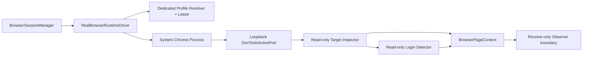

# 《PDD Browser Runtime Foundation V1》

版本：`1.0`
日期：`2026-08-04`
状态：`PDD_BROWSER_RUNTIME_READY`

## 1. 交付结论

PDD Browser Runtime Driver Foundation V1 已完成。Channel Engine 现在具备一个真实系统 Chrome 的运行基础：可启动和跟踪独立 Chrome 进程、为 opaque profile reference 分配专属目录、通过 loopback DevTools 元数据检查页面可用性、只读判断登录状态、执行 heartbeat/stop，并由既有 `BrowserSessionManager` 完成崩溃恢复和 Page Context generation 切换。

本次没有启动 Chrome，没有登录 PDD，没有访问真实店铺或客户数据，没有发送消息，也没有修改 AI-CS。测试中的进程、页面与登录信号全部为本地替身；调试协议测试只使用伪造 opener 验证固定的 `127.0.0.1` 地址。

## 2. 实现范围

| 能力 | 实现 | V1 结果 |
| --- | --- | --- |
| Real driver | `RealBrowserRuntimeDriver` | `start / heartbeat / stop` 完成 |
| Chrome discovery | `SystemChromeExecutableResolver` | 支持显式路径和常见 system Chrome 路径 |
| Process lifecycle | `SystemChromeProcessLauncher` / `SystemChromeProcess` | 无 shell 启动、PID 跟踪、进程树清理 |
| Profile isolation | `DedicatedBrowserProfilePathProvider` | opaque reference 哈希映射到受控根目录 |
| Profile ownership | `DedicatedBrowserProfileLeaseManager` | 原子文件租约，重复 runtime fail closed |
| Page availability | `SystemChromeReadOnlyInspector` | 只读 loopback `/json/list` |
| Login detection | `ReadOnlyUrlLoginDetector` | 显式证据规则；默认 `UNKNOWN` |
| Page Context | 既有 `BrowserSessionManager` | session、generation、page revision、selector version |
| Recovery | 既有 manager + real driver | Chrome crash 后 stop/release/restart，generation + 1 |

实现文件：

- `src/channel_engine/browser/runtime.py`
- `src/channel_engine/browser/__init__.py`
- `tests/unit/test_real_browser_runtime.py`

## 3. 运行架构



依赖方向保持为基础设施实现依赖既有 browser protocol/domain model。Conversation、Decision、Approval、Execution、Receipt 和 AI-CS Gateway 均不依赖 Chrome 命令、PID、profile 路径或调试端口。

## 4. RealBrowserRuntimeDriver

### 4.1 `start`

启动顺序固定为：

1. 只接受 `SYSTEM_CHROME_PERSISTENT_CONTEXT`；其他 strategy 直接拒绝。
2. 解析 system Chrome executable，但不使用 shell。
3. 将 `profile-ref://...` 做 SHA-256 映射，生成受控根目录下的 dedicated profile。
4. 原子取得 `.channel-engine-browser.lock`；同一 profile 已被占用时，在启动 Chrome 前拒绝。
5. 直接启动 Chrome，并记录本次 runtime session 和 PID。
6. 等待只读调试元数据可用；进程提前退出则启动失败。
7. 读取页面 target、生成 page revision，并执行只读登录检测。
8. 返回既有 `BrowserDriverStartResult`，由 manager 构造 `BrowserPageContext`。

默认启动页是 `about:blank`。HTTP(S) 初始页必须通过 `allowed_page_origins` 显式允许；含账号密码、query 或 fragment 的 URL 被拒绝，避免凭据进入进程命令行。V1 不自动导航、不填账号、不填密码、不处理验证码。

### 4.2 `heartbeat`

Heartbeat 检查三个层次：

- Process：目标 PID 是否仍存活；退出时返回 `CRASHED / CHROME_PROCESS_EXITED`。
- Page：loopback DevTools target list 是否可读、是否存在 `type=page`；不可读或缺页返回 `DEGRADED`。
- Login：用显式 URL origin/path 规则分类；没有证据或 detector 失败均返回 `UNKNOWN`。

Heartbeat 不执行页面脚本、DOM mutation、click、keyboard、navigation 或消息发送。

### 4.3 `stop`

Stop 仅处理由当前 runtime 精确记录的进程：

- Windows 使用精确 PID 的 process-tree stop，并在超时后强制清理。
- POSIX 使用启动时创建的独立 process group 做 TERM/KILL 收敛。
- 无论正常退出还是启动失败，均尝试释放本次 profile lease。
- stop 可重复调用。
- profile 数据目录永不由 stop 删除。

## 5. Chrome 与 Profile 生命周期

V1 启动参数固定包含：

```text
--user-data-dir=<dedicated controlled path>
--remote-debugging-address=127.0.0.1
--remote-debugging-port=0
--no-first-run
--no-default-browser-check
--disable-sync
about:blank
```

安全约束：

- 禁止将 profile root 指向用户默认 Chrome `User Data` 目录或其子目录。
- 不使用 `--profile-directory` 复用默认 profile。
- profile path 由 opaque storage reference 哈希生成，路径不暴露 account ref、token 或 secret。
- 调试 HTTP 地址硬编码为 `127.0.0.1`，禁用 proxy，不接受远端 CDP 地址。
- 一个 profile 同时只能持有一个文件租约。
- profile 锁残留时不猜测、不自动删除，保持 fail closed，需运维确认旧进程已清理后处置。

部署时还必须由 OS ACL 限制 profile root；本 Foundation 不实现 secret/cookie 存储、导出或同步。

## 6. 只读登录检测

V1 将“检测机制”和“PDD 事实”分开：

- `ConservativeLoginDetector` 是安全默认值，始终返回 `UNKNOWN`。
- `ReadOnlyUrlLoginDetector` 只接受经过实验证据确认的 origin/path prefix 规则。
- login-required 规则优先于 authenticated 规则，冲突时不会误判已登录。
- 首次检测 `REQUIRED` 时，session 映射为 `LOGIN_REQUIRED`。
- 已认证 session 在 heartbeat 中从 authenticated 页面变为 login-required 页面时，映射为 `EXPIRED`，要求人工接管。
- 未匹配页面映射为 `UNKNOWN`，不会假设已登录。

当前没有冻结任何真实 PDD 登录 URL、DOM marker 或 selector；在隔离测试环境获得证据前，不应添加猜测值。检测模块没有登录动作接口。

## 7. BrowserPageContext

Real driver 返回：

- driver session reference
- page availability
- login state
- page revision
- observed timestamp

`BrowserSessionManager` 将其组合为：

- `session_id`
- `generation`
- `page_revision`
- `selector_contract_version`
- `platform=pdd`
- `page=merchant_chat`

Page revision 是调试 target 元数据的稳定 SHA-256 指纹，不代表 DOM revision，也不能替代 Selector Probe。每次 crash recovery 都创建新 Page Context 并使 generation 递增，旧 context 不得继续用于 observer 或 execution。

## 8. 崩溃恢复与安全状态

```text
ACTIVE
  -> process exits
  -> heartbeat: CRASHED
  -> manager.recover()
  -> stop exact old process / release old lease
  -> relaunch same dedicated profile
  -> generation + 1
  -> ACTIVE | LOGIN_REQUIRED
```

恢复约束：

- 有限 recovery budget，防止无限重启。
- 新进程必须重新完成 page/login 检测。
- profile 可恢复但不跨账号复用。
- 登录过期不自动恢复为已登录，必须人工处理。
- 页面检查异常进入 `DEGRADED`，不产生伪造的 authenticated 状态。
- 本 runtime 没有 outbound browser action 实现，因此不存在自动发送路径。
- 未来 outbound 若在不可逆 send trigger 后崩溃，仍必须由既有 Execution Runtime 记为 `UNKNOWN`，禁止自动重试；本次未扩大该边界。

## 9. 信息最小化

调试 target 的 URL 只在进程内用于登录分类：

- query 和 fragment 在进入 observation 前移除。
- target id 和 page location 标记为不可序列化、不可 repr。
- process snapshot 仅输出 PID、profile id、profile path fingerprint、started time 和 alive 状态。
- 不读取或记录 Cookie、local storage、页面正文、客户消息、token 或 secret。
- Chrome stdout/stderr 不进入 Channel Engine 日志。

## 10. 测试结果

新增 8 个 runtime 测试覆盖：

1. driver start/heartbeat/stop 生命周期。
2. dedicated profile 命令和 process tracking。
3. Chrome crash 后 recovery 与 Page Context generation 递增。
4. authenticated 到 login-required 的过期检测和人工接管。
5. 两个 runtime 对同一 profile 的重复启动阻断。
6. 启动失败后的进程与 profile lease 清理。
7. 外部初始页显式 allowlist、query/fragment 拒绝。
8. loopback target inspector 和页面位置不序列化。

验证结果：

```text
Runtime targeted tests:  8 passed
Full regression suite:   189 passed, 1 existing deprecation warning
compileall:              passed
pip check:               passed (No broken requirements found)
Forbidden-term scan:     no match in runtime implementation/tests
```

现有 warning 来自 FastAPI TestClient 对 Starlette/httpx 的弃用提示，与 browser runtime 无关。

## 11. 当前边界与后续准入条件

本次完成的是 runtime foundation，不是 PDD 接入或生产上线。以下仍未完成，也未被假设：

- system Chrome 与具体部署镜像/桌面版本的兼容性实测。
- 合规隔离测试账号上的人工登录。
- 真实 PDD page identity、登录 marker、DOM、iframe/shadow DOM 证据。
- PDD Selector Contract 的 VERIFIED bindings。
- receive-only observer 的真实页面实现。
- browser outbound action port 的真实实现及发送确认机制。
- OS ACL、endpoint protection、进程 orphan 运维清理和长期稳定性测试。

进入下一阶段前，必须先在隔离 staging 主机、专用测试账号和人工现场接管条件下做 receive-only 验证。不得直接使用用户默认 Chrome profile，不得连接真实客户，不得开放自动发送。

## 12. Quality Gates

| Gate | 结果 | 证据 |
| --- | --- | --- |
| Real driver start/heartbeat/stop | PASS | lifecycle unit test |
| System Chrome + dedicated profile foundation | PASS | argv/profile mapping test |
| Process tracking/page availability | PASS | snapshot + inspector test |
| Read-only login detection | PASS | auth/expired/unknown fail-safe design |
| BrowserPageContext generation | PASS | crash recovery test |
| Profile isolation | PASS | cross-runtime file lease test |
| Crash cleanup/recovery | PASS | failed-start cleanup + recovery test |
| No real PDD/login/send/AI-CS modification | PASS | injected test doubles + boundary scan |

Final Status: `PDD_BROWSER_RUNTIME_READY`
