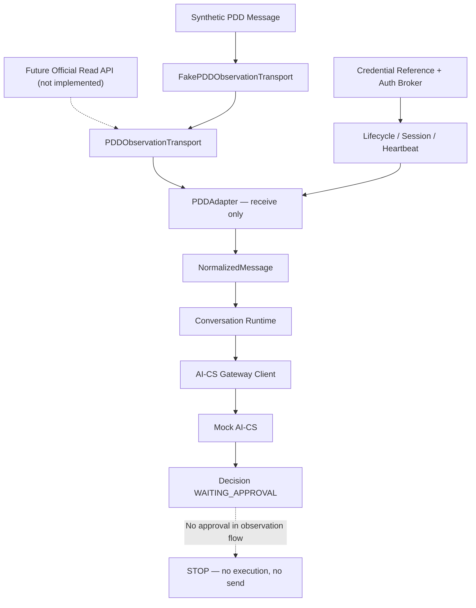

# 《PDD Channel Adapter Observation Foundation V1》

## 1. 结论

PDD Channel Adapter Observation Foundation V1 已完成。当前实现是严格 receive-only 的观察基础：能够建立受控 Session、执行 Heartbeat、读取 Fake Transport 消息、归一化、去重，并将消息送入 Conversation Runtime 和 Mock AI-CS；它没有任何发送、退款、订单修改、浏览器控制或真实账号登录能力。

最终状态：`PDD_CHANNEL_OBSERVATION_READY`

该状态表示 PDD 观察接口、消息映射、Session 生命周期、Fake-to-Real Transport Boundary 和测试已经就绪，不表示已连接真实拼多多。

## 2. 运行边界

当前允许：

- 使用 `ChannelCredentialReference` 表示非秘密凭据引用；
- 使用 Fake Authentication Broker 建立脱敏 Session；
- 使用 Fake PDD Observation Transport 注入合成消息；
- 将消息映射为 `NormalizedMessage`；
- 将归一化消息交给 Conversation Runtime；
- 调用 Mock AI-CS 获得必须人工审批的 Decision；
- 观察 Connection、Heartbeat、Cursor、Duplicate 和 Health。

当前禁止且代码中不存在：

- 登录真实拼多多账号；
- 调用真实拼多多 HTTP、SDK、WebSocket 或私有协议；
- Playwright、Selenium、浏览器 Profile、Cookie 接管；
- `send_message()` 或任何出站消息端口；
- 自动回复；
- 退款、订单修改或资金操作；
- 从观察阶段直接进入 L2 Controlled Execute。

## 3. 架构



实现文件：

| 资产 | 路径 | 职责 |
|---|---|---|
| PDD Observation | `src/channel_engine/channel/pdd_observation.py` | PDDAdapter、wire model、transport port、fake transport |
| Shared Lifecycle | `src/channel_engine/channel/lifecycle.py` | Connection、Authentication、Session、Heartbeat |
| Contract Test | `tests/contract/test_pdd_observation_adapter_v1.py` | 映射、生命周期、Health、断开、重复消息、安全边界 |
| AI Flow Test | `tests/integration/test_pdd_observation_ai_flow.py` | Fake PDD 观察消息进入 Mock AI-CS 并停在审批前 |

## 4. Phase 1 — PDDAdapter

`PDDAdapter` 是独立的观察 Adapter，固定：

```text
channel      = pdd
adapter_name = PDDAdapterObservationV1
mode         = OBSERVATION_FOUNDATION
```

支持的方法：

```python
connect() -> ChannelSession
disconnect() -> None
reconnect() -> ChannelSession
heartbeat() -> ChannelHeartbeat
get_session() -> ChannelSession | None
health_check() -> AdapterHealth
receive_message() -> NormalizedMessage | None
```

刻意不存在：

```text
send_message
send
reply
refund
modify_order
```

`PDDAdapter` 不实现 `PlatformAdapter`，因为 `PlatformAdapter` 包含受控发送端口。Observation Foundation 使用更窄的 `PDDObservationAdapter` Protocol，从类型层阻止观察组件被误接为执行组件。

## 5. Phase 2 — Message Mapping

### 5.1 PDD Observation Wire Model

真实平台边界先冻结为最小、非专有模型：

```python
class PDDObservedMessage:
    platform: Literal["pdd"]
    conversation_id: str
    external_message_id: str
    sender: str
    content: str
    timestamp: AwareDatetime
```

该模型不是对任何真实 PDD API payload 的复制或推测。未来接入官方读取接口时，真实 payload 必须先在 Transport 内部映射到此模型。

### 5.2 Normalized Mapping

| PDD Observation | NormalizedMessage | 规则 |
|---|---|---|
| `platform` | `channel` | 固定 `pdd` |
| `conversation_id` | `conversation_id` | 保留外部稳定会话引用 |
| `external_message_id` | `external_message_id` | 入站幂等主键组成部分 |
| `sender` | `sender` | 外部客户引用，不能作为内部审批人 |
| `content` | `content` | 非空，最大 8,000 字符 |
| `timestamp` | `timestamp` | 必须携带时区 |

Engine 现有统一模型使用字段名 `channel`；本适配器明确执行 `platform -> channel` 映射，没有修改既有 Normalized Contract。

### 5.3 Ordering、Cursor 与 Duplicate

- Transport 每次返回最多 100 条消息；Adapter 配置的 `poll_batch_size` 为 1–100；
- Adapter 保留 Transport 顺序并逐条交付；
- `next_cursor` 只有在整个 batch 完成映射和一致性校验后才提交；
- 入站幂等键为 `(conversation_id, external_message_id)`；
- 同 ID、同内容：计入 duplicate 并跳过；
- 同 ID、不同内容：抛出 `PDDObservationConflict`；
- 冲突时不推进 Adapter cursor，Health 降级为 `PDD_MESSAGE_ID_CONFLICT`；
- poll 失败时记录 `PDD_OBSERVATION_POLL_FAILED`，Health 至少为 DEGRADED；
- V1 fingerprint 与 cursor 仅存于进程内，真实接入前必须迁移到持久化 observation ledger。

## 6. Phase 3 — Session Management

### 6.1 Connect

连接顺序：

```text
DISCONNECTED
 -> CONNECTING
 -> AUTHENTICATING
 -> ChannelAuthenticationBroker
 -> sanitized ChannelSession
 -> PDDObservationTransport.open(session)
 -> CONNECTED
```

Transport 只接收脱敏 `ChannelSession`，不接收明文账号、token、cookie 或 password。`connect()` 幂等：同一有效 Session 不重复打开 Transport。

### 6.2 Heartbeat

`heartbeat()` 通过 Transport 的 receive-only 探针检查观察流：

- 成功：`CONNECTED / OK`；
- 失败：`DEGRADED / FAILED`；
- Session 过期：`DEGRADED / SESSION_EXPIRED`。

DEGRADED 状态禁止 `receive_message()`。Heartbeat 探针异常被转换为失败状态，不向 Health 泄露底层异常文本。

### 6.3 Disconnect 与 Reconnect

`disconnect()`：

1. 调用 `transport.close(session)`；
2. 清除 Engine 可见 Session；
3. 清除当前 Transport session binding；
4. Connection 转为 `DISCONNECTED`；
5. 即使 Transport close 失败，也先完成本地 fail-closed 清理，再返回安全错误。

`reconnect()` 始终先 disconnect 再重新认证和 open，生成新的 `session_id`。已观察 message fingerprint 和 cursor 不因 reconnect 自动清空，避免重连造成重复消费。

### 6.4 Credential Reference

PDDAdapter 只保存：

- credential ID；
- provider；
- version；
- account reference；
- authentication scheme。

模型 `extra="forbid"`。Session 和 Health 不含 token、cookie、password 或 secret。测试中的 `FakeChannelAuthenticationBroker` 没有任何真实凭据值。

## 7. Phase 4 — Fake-to-Real Boundary

未来真实读取实现必须实现以下 receive-only Protocol：

```python
class PDDObservationTransport(Protocol):
    @property
    def transport_name(self) -> str: ...

    def open(self, session: ChannelSession) -> None: ...

    def close(self, session: ChannelSession) -> None: ...

    def heartbeat(self, session: ChannelSession) -> bool: ...

    def poll(
        self,
        session: ChannelSession,
        *,
        cursor: str | None,
        limit: int,
    ) -> PDDObservationBatch: ...
```

Protocol 中没有 send、ack mutation、refund、order 或 browser 方法。未来只能基于经过评审的官方读取能力实现，并必须保持：

- receive-only scope；
- TLS 与 hostname 校验；
- egress allowlist；
- 明确 timeout 和 rate limit；
- secret manager/sidecar 认证；
- payload size limit；
- cursor 持久化；
- raw payload 最小化保存；
- 账号级 kill switch；
- 任何未识别字段或行为 fail closed。

`FakePDDObservationTransport` 只使用内存 deque，网络调用计数始终为零。它用于验证 Transport Contract，不代表真实 PDD API。

## 8. Health Contract

Health 状态：

| 条件 | 状态 |
|---|---|
| 未连接、认证失败、已断开 | `UNHEALTHY` |
| Session 与 observation transport 正常 | `HEALTHY` |
| Heartbeat、poll 或消息一致性异常 | `DEGRADED` |

Health details 包含：

- mode / platform / transport；
- connection state / authenticated session；
- cursor present / pending count；
- observed count / duplicate count；
- last receive error category；
- credential provider/version；
- receive enabled；
- send enabled=`false`；
- automatic reply enabled=`false`；
- real PDD connected=`false`。

Health 不包含消息正文、账号原文、secret、token、cookie 或底层认证异常。

## 9. Observation-to-AI-CS Flow

集成测试验证：

```text
PDDObservedMessage (synthetic)
 -> FakePDDObservationTransport
 -> PDDAdapter.receive_message()
 -> NormalizedMessage(channel=pdd)
 -> ConversationService
 -> AICSGatewayClient
 -> MockAICSServer
 -> Decision WAITING_APPROVAL
 -> STOP
```

实际断言：

- Message=`COMPLETED`；
- Decision=`WAITING_APPROVAL`；
- `requires_approval=true`；
- Mock AI-CS 只计算一次 Decision；
- Approval 不存在；
- Execution 不存在；
- Fake Executor call count=`0`；
- PDDAdapter 没有 `send_message`；
- Transport real platform call count=`0`。

AI 输出仅作为待人工审批 Decision，不会触发自动回复。

## 10. Testing

专项覆盖：

1. receive-only Adapter/Transport Protocol；
2. 无 send/refund/order 能力；
3. PDD 六字段到 NormalizedMessage 映射；
4. 非 PDD platform、无时区 timestamp 拒绝；
5. connect 幂等；
6. Session、Heartbeat、Health；
7. disconnect 与 reconnect 新 Session；
8. Heartbeat 降级与恢复；
9. cursor 与消息顺序；
10. 同内容 duplicate 恢复；
11. 异内容 duplicate fail closed；
12. poll failure Health 降级；
13. credential/session/health 脱敏；
14. PDD Observation 到 Mock AI-CS；
15. 链路停在人工审批前。

测试结果：

```text
.venv\Scripts\python.exe -m pytest \
  tests\contract\test_pdd_observation_adapter_v1.py \
  tests\integration\test_pdd_observation_ai_flow.py -q
9 passed

.venv\Scripts\python.exe -m pytest -q
129 passed, 1 warning
```

唯一 warning 是 FastAPI TestClient 的上游 `httpx2` 弃用提示，与 PDD Observation Foundation 无关。

## 11. 进入真实观察前的 Gate

本 Foundation 完成后仍不得登录真实 PDD。任何真实观察实验前必须额外满足：

- 确认平台官方、合法且允许的只读接口；
- 明确账号授权、数据使用范围与服务条款；
- 使用非生产、无真实客户的 staging/sandbox 账号；
- 完成 privacy、retention、audit、incident response 评审；
- 完成 secret manager、轮换、吊销和 kill switch；
- 持久化 cursor/dedup ledger；
- 完成丢失、重复、乱序、断线和限流测试；
- 确认 Transport 代码不包含任何写操作；
- 独立人工批准真实观察窗口和时间范围；
- 新建任务状态，不得沿用 `PDD_CHANNEL_OBSERVATION_READY` 推定生产授权。

## 12. Quality Gates

| Gate | 结果 |
|---|---|
| PDDAdapter receive-only API | PASS |
| Platform message mapping | PASS |
| Session lifecycle | PASS |
| Heartbeat / reconnect / disconnect | PASS |
| Credential reference security | PASS |
| Cursor / duplicate handling | PASS |
| Fake-to-Real receive port | PASS |
| Mock AI-CS observation chain | PASS |
| No Approval bypass | PASS |
| No execution / send / refund / order operation | PASS |
| No real PDD connection | PASS |

## 13. Final Status

`PDD_CHANNEL_OBSERVATION_READY`
