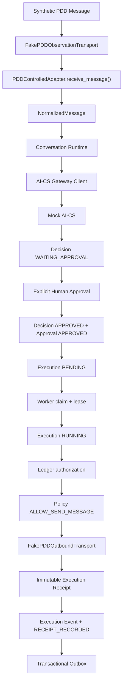

# 《PDD Controlled Execution Foundation V1》

## 1. 结论

PDD Controlled Human Approval Execution Foundation V1 已完成。

本阶段建立了一个仅用于本地验证的受控出站链路：PDD 合成消息经观察适配器进入 Conversation Runtime，由 AI-CS Gateway Contract V1 的本地 Mock 生成 Decision；只有显式人工批准后，Execution Worker 才能在持有有效执行租约时签发短期发送授权，并调用 Fake PDD outbound transport。最终 Execution、不可变 Receipt、Event 与 transactional outbox 在既有运行时规则下落账。

最终状态：`PDD_CONTROLLED_SEND_READY`

该状态只表示“人工批准 + Fake send”基础能力及安全边界通过测试，不表示已连接真实 PDD，也不授予生产发送权限。

## 2. 允许范围与禁止范围

当前允许：

- 读取 `FakePDDObservationTransport` 中的合成 PDD 消息；
- 使用 AI-CS Gateway Contract V1 的本地 Mock 生成待批准 Decision；
- 由明确身份的人工操作员批准 Decision；
- 由 Execution Worker 领取任务并持有有效 lease；
- 签发一次短期、低风险、仅限 `SEND_MESSAGE` 的 ledger authorization；
- 调用 `FakePDDOutboundTransport` 模拟 `SUCCESS`、`FAILED`、`UNKNOWN` 或 timeout；
- 写入 Execution Receipt、Event 与 transactional outbox；
- 使用 `FakeEventPublisher` 验证 outbox 发布。

当前禁止且未实现：

- 真实 PDD 网络连接或真实账号登录；
- 向真实客户发送消息；
- AI 自动回复或批准后自动启动后台发送；
- 裸消息绕过 Decision、Approval、Execution 或 lease；
- Playwright、浏览器接管、cookie/session 注入；
- 退款、订单修改、资金操作；
- 将 `UNKNOWN` Execution 自动重新入队或再次发送。

## 3. 架构与执行链



实现资产：

| 资产 | 路径 | 职责 |
|---|---|---|
| PDD controlled boundary | `src/channel_engine/channel/pdd_controlled.py` | policy、fake outbound、controlled adapter、execution bridge |
| Live ledger authorization | `src/channel_engine/channel/execution_boundary.py` | 从 Decision/Approval/Execution/lease 签发并校验短期授权 |
| Claimed execution context | `src/channel_engine/execution/fake_executor.py` | Worker 向受控 adapter 传递 execution/approval/worker/lease 上下文 |
| Execution Worker | `src/channel_engine/execution/worker.py` | 领取、续租、调用 claimed adapter、最终落账 |
| Contract tests | `tests/contract/test_pdd_controlled_execution_v1.py` | 接口、安全边界、Fake-only 模式 |
| Integration tests | `tests/integration/test_pdd_controlled_execution.py` | 完整成功、失败、超时、UNKNOWN、重复、缺审批链路 |

## 4. Phase 1：Outbound Adapter Boundary

### 4.1 受控接口

`PDDControlledAdapter.send_message()` 只接受 `AuthorizedOutboundMessage`：

```python
class AuthorizedOutboundMessage:
    message: OutboundMessage
    authorization: ExecutionSendAuthorization
```

`OutboundMessage` 包含：

- `channel=pdd`；
- `conversation_id`；
- `execution_id`；
- `approved_by`；
- 已批准的 `content`；
- execution 的 `idempotency_key`；
- `requested_at`。

`ExecutionSendAuthorization` 包含：

- `decision_id`；
- `approval_id`；
- `execution_id`；
- `approved_by`；
- `worker_id`；
- 不可展示的 `execution_lease_token`；
- `issued_at` / `expires_at`；
- 固定 `operation=SEND_MESSAGE`；
- 固定 `execution_risk=LOW`。

裸 `OutboundMessage` 会被 `ExecutionBoundaryDenied` 拒绝。`PDDControlledExecutionAdapter.execute()` 同样拒绝缺少 Worker claimed context 的直接调用；只有 `execute_claimed(command, context)` 是 Worker 可使用的执行入口。

### 4.2 Worker claimed context

Execution Worker 在执行前续租，并构造冻结的 `ClaimedExecutionContext`：

```text
execution_id
decision_id
approval_id
approved_by
worker_id
lease_token
lease_expires_at
```

PDD execution bridge 对比 command 与 claimed context，再从数据库重新读取权威 ledger 签发 authorization。调用方不能通过自报 `APPROVED` 或自造 approval ID 获得发送能力。

## 5. Phase 2：Authorization Validation

发送前按以下顺序 fail closed：

| Gate | 必须满足 | 失败结果 |
|---|---|---|
| Session | PDD adapter 已连接、已认证、未过期且健康 | 拒绝发送 |
| Decision | `state=APPROVED`、`action=SUGGEST_REPLY`、内容非空 | 拒绝发送 |
| Approval | 存在且 `state=APPROVED`、`decided_by` 非空 | 拒绝发送 |
| Execution | `state=RUNNING`，关联同一 Decision/Approval | 拒绝发送 |
| Lease | worker、token 与 ledger 完全匹配，且未过期 | 拒绝发送 |
| Authorization | 未过期、`SEND_MESSAGE`、`LOW` | 拒绝发送 |
| Payload binding | channel、conversation、execution、approver、content、idempotency key 与 ledger 一致 | 拒绝发送 |
| PDD policy | `ALLOW_SEND_MESSAGE` | 拒绝发送 |

V1 policy 只有一个允许分支：

```text
operation = SEND_MESSAGE
execution_risk = LOW
channel = pdd
content = non-blank
=> ALLOW_SEND_MESSAGE
```

任何退款、订单修改、高风险执行、不同内容或不同 execution 身份都不属于该 policy，不能到达 outbound transport。

## 6. Phase 3：Fake PDD Send Adapter

`PDDOutboundTransport` 是未来受控出站实现必须遵守的最小 port：

```python
class PDDOutboundTransport(Protocol):
    @property
    def transport_name(self) -> str: ...

    def send(
        self,
        session: ChannelSession,
        request: PDDOutboundRequest,
        *,
        timeout_seconds: float,
    ) -> PDDOutboundResult: ...
```

本阶段唯一实现是 `FakePDDOutboundTransport`。它只写进程内存，从不解析域名、打开 socket、调用 PDD SDK、操作浏览器或交付客户消息。`real_platform_call_count` 永远为 `0`。

| Fake mode | Channel result | Execution result | error code |
|---|---|---|---|
| `SUCCESS` | `SUCCESS` | `SUCCESS` | `null` |
| `FAILED` | `FAILED` | `FAILED` | `FAKE_PDD_SEND_REJECTED` |
| `UNKNOWN` | `UNKNOWN` | `UNKNOWN` | `FAKE_PDD_SEND_UNKNOWN` |
| `TIMEOUT` | timeout exception | `UNKNOWN` | `PDD_SEND_TIMEOUT_UNKNOWN` |

即使结果为 `SUCCESS`，它也仅表示 Fake transport 接受了模拟请求。Receipt 明确记录：

```text
real_channel_called = false
customer_message_sent = false
automatic_reply = false
refund_performed = false
order_modified = false
```

## 7. Phase 4：Receipt、Event 与 Outbox

执行结果由既有 Worker 终态事务统一写入：

1. `Execution RUNNING -> SUCCESS | FAILED | UNKNOWN`；
2. 追加一个 immutable `Receipt`；
3. 追加对应的 `EXECUTION_SUCCEEDED | EXECUTION_FAILED | EXECUTION_UNKNOWN` Event；
4. 追加 `RECEIPT_RECORDED` Event；
5. 每个 Event 同事务创建 transactional outbox item。

Receipt 以 `execution_id` 数据库唯一约束保证每个 execution 只能追加一次。Pydantic domain model 是 frozen，不能原地修改；Repository 也会拒绝替换已有 receipt。

成功集成测试进一步使用 `FakeEventPublisher` 清空 outbox，并验证全部 item 从 `PENDING` 进入 `PUBLISHED`。该发布仍为进程内模拟，不会访问任何外部事件系统。

## 8. Phase 5：失败与恢复规则

| 场景 | Execution / Receipt | 再次发送 | 说明 |
|---|---|---:|---|
| PDD fake send 明确成功 | `SUCCESS / SUCCESS` | 否 | terminal |
| PDD fake send 明确失败 | `FAILED / FAILED` | 否 | terminal |
| transport timeout | `UNKNOWN / UNKNOWN` | **禁止** | 无法证明外部是否接受 |
| transport 返回 unknown | `UNKNOWN / UNKNOWN` | **禁止** | 等待人工 reconciliation |
| 未知 transport exception | `UNKNOWN / UNKNOWN` | **禁止** | 保守处理副作用不确定性 |
| duplicate send，同 key 同 payload | 返回首次 Channel receipt | 不调用 transport | adapter 内幂等 replay |
| duplicate send，同 key 异 payload | 拒绝 | 否 | idempotency conflict / ledger mismatch |
| approval missing | 无 Execution，不领取、不调用 adapter | 否 | 停在 `WAITING_APPROVAL` |
| forged/expired lease | 拒绝 authorization | 否 | live ledger fencing |

`UNKNOWN` 是终态，不会再次成为 `PENDING`。Worker 的第二次 `run_once()` 返回 `None`，outbound attempt count 保持 `1`。只允许重试 outbox 的无业务副作用事件发布，不允许用 outbox retry 语义重试 PDD send。

## 9. 幂等规则

受控链路包含三层幂等保护：

1. Approval/Execution：同一 Decision 的重复人工批准读取已有 Approval 与 Execution，不创建第二个任务；
2. PDD controlled adapter：以 execution `idempotency_key` 绑定完整 outbound message fingerprint，相同请求返回首次不可变 Channel receipt；
3. Fake transport：再次按相同 idempotency key 与完整 request fingerprint 去重，防止绕过 adapter cache 后重复模拟接受。

同一 idempotency key 绑定不同 payload 时 fail closed。终态 Execution 不再被 Worker 队列领取，因此不会通过正常运行时发起第二次 send。

V1 的 adapter 与 transport replay cache 是进程内基础实现。任何未来真实出站实现必须在共享持久化存储中保存平台 idempotency record，并在真实发送前完成 crash-safe reservation；完成该能力与独立安全评审前不得替换 Fake transport。

## 10. 自动执行隔离

代码没有把 PDD controlled adapter 接入 Web app 后台启动流程，也没有收到消息后自动批准或自动运行 Worker。完整测试必须显式执行三个不同动作：

```text
ConversationService.receive(...)
ExecutionCoordinator.approve_and_enqueue(..., human_operator)
ExecutionWorker.run_once()
```

`receive_message()` 只负责观察与归一化；AI-CS Decision 只进入 `WAITING_APPROVAL`；`approve_and_enqueue()` 只建队列任务，不调用 adapter；发送只能由 Worker 的受控 claimed path 触发。

## 11. 测试结果

专项测试覆盖：

- `PlatformAdapter` contract 与受控 health；
- 仅 Fake outbound、真实平台调用数为零；
- 裸消息拒绝；
- 无 claimed Worker context 的直接执行拒绝；
- PDD policy 只有 `ALLOW_SEND_MESSAGE` 与 `DENY`；
- Fake outbound 的四种模式；
- PDD message -> Mock AI-CS -> Decision -> human Approval -> Worker -> Fake send；
- Decision、Approval、Execution、lease 与 payload 的 live-ledger binding；
- `SUCCESS` / `FAILED` / `UNKNOWN` Execution Receipt；
- timeout 归类为 `UNKNOWN` 且不重试；
- duplicate send 同内容 replay、异内容拒绝；
- approval missing 时零 execution、零 adapter call、零 outbound attempt；
- Execution Event、Receipt Event、transactional outbox 一致；
- Fake outbox publisher 全量发布；
- Receipt frozen 不可修改；
- 全量历史回归。

验证命令与结果：

```powershell
.\.venv\Scripts\python.exe -m pytest -q `
  tests\contract\test_pdd_controlled_execution_v1.py `
  tests\integration\test_pdd_controlled_execution.py
# 14 passed

.\.venv\Scripts\python.exe -m pytest -q
# 143 passed, 1 warning
```

唯一 warning 是 FastAPI TestClient 上游关于 `httpx2` 的弃用提示，与 PDD controlled execution 无关。

## 12. Quality Gates

| Gate | 结果 |
|---|---|
| Outbound adapter boundary | PASS |
| Bare message rejection | PASS |
| Decision `APPROVED` validation | PASS |
| Approval `APPROVED` validation | PASS |
| Execution `RUNNING` + live lease validation | PASS |
| Policy `ALLOW_SEND_MESSAGE` | PASS |
| Fake PDD outbound only | PASS |
| Success / failed / timeout / unknown mapping | PASS |
| Duplicate send idempotency | PASS |
| Immutable Receipt | PASS |
| Event / transactional outbox consistency | PASS |
| UNKNOWN no-auto-retry | PASS |
| No automatic reply | PASS |
| No refund / order mutation | PASS |
| No real PDD connection or send | PASS |
| Full regression | PASS |

## 13. 后续真实发送前置 Gate

本状态不能直接升级为真实 PDD 发送。未来任何真实 transport 工作至少需要新的独立任务与批准，并满足：

- 平台官方、合法、明确允许的发送 API 与账号授权；
- 非生产 sandbox/staging 账号及无真实客户的验证环境；
- 平台级 persistent idempotency ledger 与 crash-safe reservation；
- secret manager、credential rotation、revocation 与 kill switch；
- 严格 egress allowlist、TLS、timeout、rate limit 与 payload limit；
- 人工批准 UI 与审批身份审计；
- send 前二次确认、会话/账号范围校验与内容预览；
- `UNKNOWN` 人工 reconciliation 工具；
- privacy、retention、incident response 与平台条款评审；
- 独立的 staged rollout 和生产变更授权。

## 14. Final Status

`PDD_CONTROLLED_SEND_READY`
