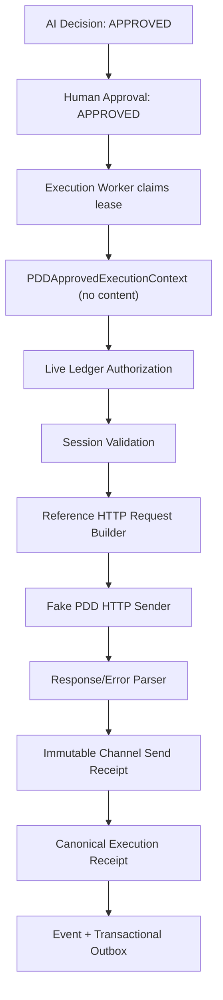

# 《PDD Controlled Send Transport Foundation V1》

状态：`PDD_SEND_TRANSPORT_READY`

版本：`1.0`

日期：2026-08-04

## 1. 结论

PDD 受控发送 Transport V1 已完成。新边界只接受不含正文的
`PDDApprovedExecutionContext`，正文必须由 `LedgerExecutionAuthorizationService`
从当前已批准 Decision 中取得。发送前会重新验证 Human Approval、RUNNING
Execution、worker ownership、lease token、lease expiry 和 session health。

V1 只装配 `FakePDDHTTPSender`。没有真实 PDD URL、HTTP client、账号、cookie
或 token，不具备真实发送能力。

## 2. 范围与不可变安全边界

允许：

- 冻结受控发送接口和 HTTP sender 抽象；
- 使用 fake session reference、fake sender 和 fake HTTP response；
- 把 transport 结果映射为 `SUCCESS`、`FAILED`、`UNKNOWN`；
- 由现有 Execution Worker 记录 canonical Receipt、Event 和 Outbox；
- 对 `execution_id`、`message_id`、`send_key` 执行幂等保护。

禁止且实现中没有提供入口：

- 真实 PDD endpoint 或真实平台连接；
- 真实账号、cookie、token 或 secret value；
- 裸文本发送；
- 无审批发送、自动回复或 UNKNOWN 自动重试；
- 退款、订单修改和任何资金动作。

## 3. 总体链路



任何一条授权事实不成立，链路都会在 fake sender 前 fail closed。

## 4. `PDDSendTransport` 接口

实现位置：`src/channel_engine/channel/pdd_send.py`

```python
class PDDSendTransport:
    def send_message(
        self,
        context: PDDApprovedExecutionContext,
    ) -> ChannelSendReceipt: ...

    def health_check(self) -> AdapterHealth: ...

    def validate_session(self) -> PDDSendSession: ...
```

### 4.1 `send_message()`

唯一输入为 `PDDApprovedExecutionContext`。传入字符串、裸 `OutboundMessage`
或其他未类型化命令会得到 `PDD_APPROVED_EXECUTION_CONTEXT_REQUIRED`，且 sender
调用数保持为零。

Context 字段：

| 字段 | 来源 | 用途 |
|---|---|---|
| `execution_id` | Worker claim | 查询权威 Execution |
| `decision_id` | Worker claim | 与 live Decision 交叉核验 |
| `approval_id` | Worker claim | 与 Human Approval 交叉核验 |
| `approved_by` | Worker claim | 绑定人工审批人 |
| `worker_id` | Worker lease | 验证 worker ownership |
| `lease_token` | Worker lease | fencing token，不写入 Receipt/health |
| `lease_expires_at` | Worker lease | 本地早期拒绝 + ledger 权威复核 |

Context 不包含 `content`，因此调用方不能通过 Transport API 注入待发送正文。

### 4.2 `validate_session()`

仅接受：

- `state == HEALTHY`；
- `expires_at > now`。

`DEGRADED` 或 `EXPIRED` 均在 sender 调用前拒绝。Session 只包含
`session-ref://...` 和 `secret-ref://...` 两类不透明引用，不包含 secret value。

### 4.3 `health_check()`

返回 `AdapterHealth`：

- 健康 session → `HEALTHY`；
- 过期/降级 session → `UNHEALTHY`；
- `real_platform_connected` 永远为 `false`；
- details 不返回 session reference、cookie reference、正文或凭证。

## 5. 发送前授权顺序

Transport 按以下顺序验证：

1. 输入必须是 `PDDApprovedExecutionContext`；
2. lease 的声明过期时间必须仍有效；
3. 从权威 ledger 重新读取 Execution、Decision、Approval、Conversation；
4. Decision 必须为 `APPROVED` 且 action 为 `SUGGEST_REPLY`；
5. Approval 必须为 `APPROVED` 且包含人工审批人；
6. Execution 必须为 `RUNNING`；
7. `worker_id`、lease token 与 ledger 必须一致；
8. ledger lease 必须未过期；
9. Context 与即时授权中的 execution/decision/approval/operator/worker/lease
   必须完全一致；
10. Session 必须健康且未过期；
11. 仅用即时授权中的 approved content 构造 HTTP request。

这使发送路径满足：Decision approved + Approval approved + Execution running +
Lease valid + Session healthy。

## 6. HTTP Sender 抽象合同

### 6.1 Request Builder

`PDDHTTPRequestBuilder`：

```python
def build(
    command: AuthorizedOutboundMessage,
    session: PDDSendSession,
) -> PDDHTTPSendRequest: ...
```

`ReferencePDDHTTPRequestBuilder` 只输出合同对象，不执行网络请求。

`PDDHTTPSendRequest` 字段：

| 字段 | 规则 |
|---|---|
| `contract_version` | 固定 `1.0` |
| `request_id` | `pdd-send:{execution_id}` |
| `endpoint_reference` | 仅允许 `endpoint-ref://...`，不是 URL |
| `session_reference` | 不透明 session reference |
| `cookie_reference` | 不透明 secret/credential reference |
| `execution_id` | 当前 RUNNING Execution |
| `decision_id` | 当前 APPROVED Decision |
| `approval_id` | 当前 APPROVED Approval |
| `message_id` | `pdd-outbound:{decision_id}` |
| `send_key` | Execution 的 frozen idempotency key |
| `body.conversation_id` | 权威 Conversation external ref |
| `body.message_id` | 必须与 request message ID 一致 |
| `body.content` | 只来自批准后的 Decision |

V1 没有硬编码真实请求 path、method、header 或 cookie value。未来真实 HTTP
实现必须实现 `PDDHTTPSender`，但不能改变本合同或绕过 Transport 安全检查。

### 6.2 Sender Port

```python
class PDDHTTPSender(Protocol):
    sender_name: str
    real_platform_transport: bool

    def send(
        self,
        request: PDDHTTPSendRequest,
        *,
        timeout_seconds: float,
    ) -> PDDHTTPSendResponse: ...
```

本次构造器会拒绝 `real_platform_transport == True`，错误码为
`PDD_REAL_SEND_FORBIDDEN`。

### 6.3 Response Parser / Error Mapping

| HTTP/Transport 事实 | Receipt outcome | trigger state | 自动重试 |
|---|---|---|---|
| 确认接受且返回 external ID | `SUCCESS` | `TRIGGERED_CONFIRMED` | 否 |
| 明确拒绝，确认未触发 | `FAILED` | `NOT_TRIGGERED` | 否 |
| 触发前 timeout，确认未触发 | `FAILED` | `NOT_TRIGGERED` | 否 |
| 已触发但确认缺失 | `UNKNOWN` | `TRIGGERED_UNCONFIRMED` | 禁止 |
| 触发后 timeout | `UNKNOWN` | `TRIGGERED_UNCONFIRMED` | 禁止 |
| sender/parser 非预期异常 | `UNKNOWN` | `TRIGGERED_UNCONFIRMED` | 禁止 |

核心规则：只要调用 sender 后不能证明未触发，就保守映射为 `UNKNOWN`。

## 7. Receipt 设计

Transport 返回现有冻结模型 `ChannelSendReceipt`，并由
`PDDControlledSendExecutionAdapter` 转为 `ExecutionResult`。Execution Worker 在
同一持久化事务中完成：

- Execution 终态更新；
- canonical immutable Execution Receipt append；
- Execution outcome Event append；
- Receipt recorded Event append；
- transactional Outbox append。

Transport Receipt details 包含：

- contract version；
- decision/approval/message/send identity；
- result category 与 trigger state；
- sender 与 request builder 名称；
- `automatic_retry_allowed=false`；
- UNKNOWN 时 `reconciliation_required=true`；
- 明确的 `real_platform_called=false`、`customer_message_sent=false`、
  `automatic_reply=false`、`refund_performed=false`、`order_modified=false`。

Receipt 不包含 content、lease token、session/cookie reference 或 secret。

## 8. 幂等规则

V1 使用三个绑定身份：

| 身份 | 值 |
|---|---|
| `execution_id` | Execution 主键 |
| `message_id` | `pdd-outbound:{decision_id}` |
| `send_key` | Execution idempotency key |

规则：

1. 三个身份共同绑定 approved logical payload fingerprint；
2. 完全相同请求返回同一个原始 Receipt（相同 `receipt_id`）；
3. duplicate 不再次调用 sender；
4. 任一身份绑定不同 evidence 时 fail closed；
5. UNKNOWN Receipt 也会被缓存并原样返回，禁止自动重试；
6. process 内使用 append-only `InMemoryPDDSendReceiptStore`；
7. process crash 后由既有 Execution recovery 将失去 lease 的 RUNNING Execution
   收敛到 UNKNOWN，不会自动重发；canonical Execution Receipt 仍由生产持久层负责。

`PDDSendReceiptStore` 已抽象为 port；未来替换 durable implementation 不改变
Transport 或 Worker 合同。

## 9. 错误码

| 错误码 | 结果/动作 |
|---|---|
| `PDD_APPROVED_EXECUTION_CONTEXT_REQUIRED` | 拒绝未类型化/裸发送 |
| `PDD_REAL_SEND_FORBIDDEN` | V1 拒绝真实 sender |
| `PDD_EXECUTION_LEASE_EXPIRED` | sender 前拒绝 |
| `PDD_SEND_AUTHORIZATION_DENIED` | live ledger 授权失败 |
| `PDD_APPROVED_CONTEXT_MISMATCH` | context 与 live authorization 不一致 |
| `PDD_SEND_SESSION_EXPIRED` | `FAILED`，未触发 |
| `PDD_SEND_SESSION_UNHEALTHY` | `FAILED`，未触发 |
| `PDD_SEND_IDEMPOTENCY_CONFLICT` | 身份复用冲突，fail closed |
| `PDD_SEND_IDENTITY_SPLIT_BRAIN` | 三重身份指向不同 Receipt，fail closed |
| `FAKE_PDD_HTTP_REJECTED` | `FAILED`，未触发 |
| `PDD_SEND_PRE_TRIGGER_TIMEOUT` | `FAILED`，明确未触发 |
| `PDD_SEND_TIMEOUT_UNKNOWN` | `UNKNOWN`，禁止自动重试 |
| `FAKE_PDD_CONFIRMATION_MISSING` | `UNKNOWN`，禁止自动重试 |
| `PDD_HTTP_RESPONSE_ID_MISMATCH_UNKNOWN` | `UNKNOWN`，需人工核对 |
| `PDD_SEND_TRANSPORT_EXCEPTION_UNKNOWN` | `UNKNOWN`，需人工核对 |

## 10. Fake Sender

`FakePDDHTTPSender` 模式：

- `SUCCESS`：模拟确认并返回 fake external message ID；
- `FAILED`：模拟明确拒绝；
- `PRE_TRIGGER_TIMEOUT`：模拟触发前 timeout；
- `TIMEOUT`：模拟触发后 timeout；
- `UNKNOWN`：模拟平台已接受 trigger，但确认缺失。

所有模式的 `real_platform_call_count` 固定为零。

## 11. 与 Channel Engine 集成

`PDDControlledSendExecutionAdapter` 实现 `ClaimedExecutionAdapter`：

1. Worker claim PENDING Execution 并更新为 RUNNING；
2. Worker 生成 `ClaimedExecutionContext`；
3. bridge 转成无正文的 `PDDApprovedExecutionContext`；
4. Transport 进行 live authorization、session validation、fake HTTP send；
5. Transport Receipt 映射为 `ExecutionResult`；
6. Worker 按 outcome 更新 Execution 并写 canonical Receipt/Event/Outbox。

`UNKNOWN` 进入 Execution `UNKNOWN` 终态，queue 不会再次 claim。

## 12. 测试结果

新增测试：

- `tests/contract/test_pdd_send_transport_v1.py`
- `tests/integration/test_pdd_send_transport_execution.py`

覆盖：

- context-only interface / bare text rejection；
- real-platform-capable sender constructor rejection；
- reference-only request builder；
- fake sender success / explicit failure；
- duplicate send 返回原 Receipt；
- pre-trigger timeout → FAILED；
- post-trigger timeout → UNKNOWN；
- unconfirmed response → UNKNOWN；
- invalid approval context 在 sender 前拒绝；
- expired session 在 sender 前失败；
- expired lease 在 sender 前拒绝；
- Worker → Receipt → Event → Outbox；
- UNKNOWN terminal / no automatic retry；
- Receipt immutable；
- health output 不泄露 reference/secret。

执行结果：

```text
Targeted suite: 14 passed
Full suite:     216 passed, 1 warning
```

唯一 warning 是项目既有的 Starlette TestClient/httpx 弃用提示，与本次实现无关。

## 13. Quality Gate

| Gate | 结果 | 证据 |
|---|---|---|
| Send Transport interface | PASS | context-only API + three methods |
| HTTP sender abstraction | PASS | builder/sender/parser ports，无真实 URL/client |
| Receipt mapping | PASS | SUCCESS/FAILED/UNKNOWN + trigger semantics |
| Idempotency | PASS | execution/message/send 三重身份，duplicate 原 Receipt |
| Safety | PASS | approval/execution/lease/session live validation |
| Fake sender tests | PASS | success/failure/timeout/unknown |
| Engine integration | PASS | Worker/Receipt/Event/Outbox |
| Forbidden actions | PASS | real platform calls = 0 |

## 14. 明确不代表

`PDD_SEND_TRANSPORT_READY` 只代表受控发送 Transport 基础和 fake HTTP contract
已就绪，不代表：

- 已知真实 PDD endpoint 或 payload；
- 已获得真实账号或 session；
- 已完成真实发送验证；
- 已批准自动回复或生产上线；
- 可以跳过 Human Approval；
- 可以对 UNKNOWN 自动重试。

## 15. Final Status

`PDD_SEND_TRANSPORT_READY`
