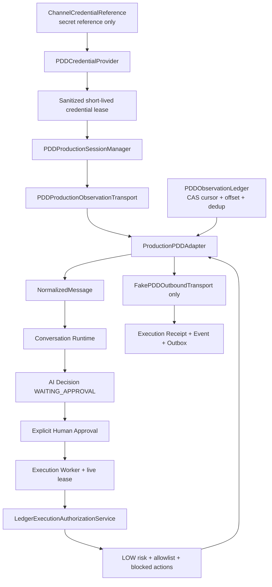

# 《PDD Production Adapter Readiness Report V1》

## 1. 执行结论

PDD Production Adapter Preparation Sprint V1 已完成。

最终状态：`PDD_PRODUCTION_ADAPTER_READY`

该状态的准确含义是：生产形态的 adapter port、secret-reference credential boundary、五态 session lifecycle、可持久化 observation ledger contract、受控发送 policy 和测试基线已经准备完成，可以进入后续“官方接口确认与非生产 staging transport 实现”阶段。

该状态不表示：

- 已登录或连接真实 PDD；
- 已获得 PDD 生产 API 或账号权限；
- 已具备真实客户发送授权；
- 可以自动回复；
- 可以修改订单、退款或打款；
- 可以直接部署到 production。

当前代码在构造阶段拒绝任何声明 `real_platform_transport=true` 的 observation 或 outbound transport。唯一运行实现仍是 Fake transport，真实平台调用计数为零。

## 2. 当前能力

### 2.1 Production adapter architecture

新增 `ProductionPDDAdapter`，支持：

```python
connect()
disconnect()
heartbeat()
reconnect()
health_check()
receive_message()
send_message()
get_session()
rotate_credentials()
```

架构如下：



实现文件：

| 资产 | 路径 | 作用 |
|---|---|---|
| Production preparation module | `src/channel_engine/channel/pdd_production.py` | credential、session、observation、policy、adapter、worker bridge |
| Controlled outbound models | `src/channel_engine/channel/pdd_controlled.py` | outbound request/result/timeout 与 Fake outbound |
| Live ledger authorization | `src/channel_engine/channel/execution_boundary.py` | Decision/Approval/Execution/lease 权威校验 |
| Contract tests | `tests/contract/test_pdd_production_adapter_preparation_v1.py` | lifecycle、credential、recovery、policy、安全开关 |
| Integration tests | `tests/integration/test_pdd_production_preparation.py` | cursor/offset/dedup/order、Worker、Receipt、UNKNOWN |

### 2.2 Send execution boundary

`ProductionPDDAdapter.send_message()` 不接受裸消息，只接受 `AuthorizedOutboundMessage`。发送前依次验证：

1. session 必须为 `ACTIVE` 且未过期；
2. Decision 必须为 `APPROVED`；
3. Approval 必须存在且为 `APPROVED`；
4. Execution 必须为 `RUNNING`；
5. worker、lease token 与 lease expiry 必须匹配 live ledger；
6. message 的 channel、conversation、execution、approver、content 与 idempotency key 必须与批准记录一致；
7. action 必须为 `SEND_MESSAGE`；
8. risk level 必须为 `LOW`；
9. account 与 conversation 必须同时在 allowlist；
10. action 不得属于 blocked actions。

`PDDProductionExecutionAdapter.execute()` 会拒绝任何没有 Worker claimed context 的直接调用。只有 Worker 提供 `ClaimedExecutionContext` 后，execution bridge 才能从 live ledger 签发短期 authorization。

### 2.3 Fake-only safety

当前 preparation runtime：

```text
observation transport = FakePDDProductionObservationTransport
outbound transport    = FakePDDOutboundTransport
credential provider   = FakePDDCredentialProvider
checkpoint ledger     = InMemoryPDDObservationLedger
real platform calls   = 0
```

Fake send 即使返回 `SUCCESS`，也只表示本地模拟接受。Receipt 固定记录：

```text
automatic_reply = false
real_platform_called = false
customer_message_sent = false
refund_performed = false
order_modified = false
payment_performed = false
```

## 3. Credential Management

### 3.1 Secret reference

Engine 只保存 `ChannelCredentialReference`：

- `credential_id`：secret manager 中的 locator；
- `provider`：V1 强制为 `secret-manager`；
- `version`：明确版本；
- `account_ref`：非秘密账号引用；
- `auth_scheme`：认证方式。

模型使用 `extra="forbid"`，因此 `token`、`secret`、`password`、`cookie` 等附加字段会被拒绝。代码、测试、health 和 report 中没有真实 credential value。

### 3.2 Credential Provider contract

`PDDCredentialProvider` 只暴露：

```python
acquire(reference) -> PDDCredentialLease
release(lease) -> None
```

返回的 `PDDCredentialLease` 只有：

- credential identity/version；
- provider/account/principal reference；
- auth scheme；
- issued/expiry 时间；
- 仅供进程内部使用且默认不序列化的 lease ID。

它不包含 token、cookie、password、签名密钥或其他 secret material。真实 provider 将来必须在可信边界内完成 secret 解析，不能把 secret 值返回给 Channel Engine domain、health、log、metric、event 或 receipt。

### 3.3 Rotation 与 expiration

轮换规则：

- 当前 session 必须先进入 `DISCONNECTED` 或 `EXPIRED`；
- replacement 必须保持 credential ID、provider、account 与 auth scheme 不变；
- credential version 必须改变；
- provider 必须先登记新版本并吊销旧版本；
- reconnect 获取新 lease 和新 session generation；
- 旧 lease 被 release，不可跨版本复用。

credential lease 到期后，下一次 heartbeat 或受控操作会把 session 转为 `EXPIRED`，关闭 transport、释放 lease，并拒绝 receive/send。

## 4. Session Lifecycle

### 4.1 五态模型

V1 明确冻结以下状态：

```text
CREATED
   |
   | connect + credential acquire + fake transport open
   v
CONNECTED
   |
   | successful heartbeat
   v
ACTIVE
   |
   +-------------------- heartbeat failure --> CONNECTED
   |
   +-------------------- lease expiry ------> EXPIRED
   |
   +-------------------- disconnect --------> DISCONNECTED

CONNECTED / EXPIRED / DISCONNECTED
   |
   | reconnect = disconnect + connect + heartbeat
   v
ACTIVE with a new session_id and generation
```

只有 `ACTIVE` 可以调用 `receive_message()` 或 `send_message()`。`CONNECTED` 仅表示 credential 与 transport open 已完成，必须通过 heartbeat 才能激活。

### 4.2 Heartbeat 与 recovery

heartbeat 成功：

- `CONNECTED -> ACTIVE`；
- 更新 `last_heartbeat_at`；
- health 为 `HEALTHY`，前提是 observation sync 未失败。

heartbeat 失败：

- session 回到或保持 `CONNECTED`；
- failure code 为 `PDD_SESSION_HEARTBEAT_FAILED`；
- receive/send fail closed；
- health 为 `DEGRADED`。

reconnect recovery：

1. 关闭旧 transport；
2. release 旧 credential lease；
3. acquire 新短期 lease；
4. 创建新 `session_id` 与递增 generation；
5. open Fake transport；
6. heartbeat 成功后进入 `ACTIVE`。

## 5. Observation Reliability

### 5.1 Message wire model

生产形态的观察消息增加单调 offset：

```python
platform: "pdd"
offset: int
conversation_id: str
external_message_id: str
sender: str
content: str
timestamp: aware datetime
```

Transport batch 另带 `next_cursor` 与 `observed_at`。Adapter 映射为现有六字段 `NormalizedMessage`，没有修改 Channel Contract。

### 5.2 Cursor、offset、ordering 与 duplicate

`PDDObservationLedger` contract 要求持久化实现提供：

- stream-scoped cursor；
- committed offset；
- CAS revision；
- message identity fingerprint；
- accepted/duplicate counters；
- last message/sync time；
- sync status 与 sanitized error code。

同步规则：

1. load checkpoint；
2. CAS `NOT_STARTED/IN_SYNC/DEGRADED -> SYNCING`；
3. poll 时携带 cursor 与 `after_offset`；
4. batch offset 必须严格递增；
5. `(conversation_id, external_message_id)` 作为 duplicate identity；
6. 同 identity、同 fingerprint 跳过并计数；
7. 同 identity、异 fingerprint fail closed；
8. 未识别消息不得落在 committed offset 之后的旧位置；
9. cursor、offset、fingerprint 与 counters 原子 CAS commit；
10. 验证或 poll 失败时不推进 cursor/offset。

测试验证了 checkpoint 可被新的 adapter 实例继续使用：新实例首次 poll 从旧 `cursor/offset` 继续，而不是从头同步。

### 5.3 Latency、sync status 与 health

Adapter 记录：

- last message latency，毫秒；
- max message latency，毫秒；
- `NOT_STARTED / SYNCING / IN_SYNC / DEGRADED / FAILED`；
- cursor、offset、revision；
- accepted 与 duplicate count；
- last sync timestamp；
- sanitized last sync error。

Health 判断：

| Session | Sync | Adapter health |
|---|---|---|
| `ACTIVE` | 正常或未开始 | `HEALTHY` |
| `ACTIVE` | `DEGRADED/FAILED` | `DEGRADED` |
| `CONNECTED` | 任意 | `DEGRADED` |
| `CREATED/EXPIRED/DISCONNECTED` | 任意 | `UNHEALTHY` |

## 6. Policy Engine

### 6.1 Allowed action

唯一可能允许的 action：

```text
SEND_MESSAGE
```

并且必须同时满足：

```text
risk_level = LOW
account_ref in allowed_account_refs
conversation_id in allowed_conversation_ids
live Decision = APPROVED
live Approval = APPROVED
live Execution = RUNNING
live Worker lease valid
```

Policy 返回结构化结果：decision、reason code、action、risk level、account allowlist、conversation allowlist 与 blocked-action 标记。

### 6.2 Mandatory blocked actions

以下 action 在 V1 中强制 blocked，配置不能移除：

- `AUTOMATIC_REPLY`；
- `REFUND`；
- `MODIFY_ORDER`；
- `PAYMENT`。

Policy config 如果尝试开放 MEDIUM/HIGH risk，或移除 mandatory blocked action，会在构造阶段校验失败。

### 6.3 UNKNOWN rule

Fake outbound timeout、返回 `UNKNOWN` 或无法分类的 transport exception 均产生：

```text
Execution = UNKNOWN
Receipt = UNKNOWN
automatic retry = forbidden
```

第二次 Worker `run_once()` 不会重新领取该 execution，outbound attempt count 保持为 `1`。需要人工 reconciliation；outbox event retry 与业务 send retry 不得混用。

## 7. 生产接入缺口

以下项目是生产上线 blocker，不属于本 sprint 的完成范围：

| 缺口 | 当前状态 | 上线要求 |
|---|---|---|
| PDD 官方接口与授权范围 | 未确认、未调用 | 完成官方文档、账号权限、服务条款与合规评审 |
| Real observation transport | 不存在 | 只基于批准的官方 API 实现并独立 code/security review |
| Real outbound transport | 不存在 | staging/test-recipient 受控实现，仍走 Approval/Execution |
| Secret manager driver | 只有 protocol 与 Fake provider | 接入组织批准的 secret manager/sidecar，支持轮换/吊销/audit |
| Persistent observation ledger | 只有 protocol 与 in-memory test implementation | 使用 HA 数据库实现 CAS、唯一约束、备份与恢复 |
| Durable inbound inbox/ack | 尚未实现 | checkpoint 与 Conversation intake 建立 crash-safe handoff |
| Distributed adapter ownership | 尚未实现 | account/partition lease，防止多实例同时 poll 同一 stream |
| Persistent send idempotency | 当前 Fake cache 为进程内 | send 前 crash-safe reservation、平台 idempotency key 与 reconciliation |
| Rate limiting/backpressure | 尚未接真实限制 | 账号/接口级限速、队列水位、429 handling 与暂停机制 |
| Metrics/alerts exporter | 仅 health details | 接入受控 observability，禁止消息正文与 secret labels |
| Data governance | 未进行真实数据处理 | privacy、retention、masking、data residency、删除与访问审计 |
| Operational controls | 未部署 | kill switch、manual pause、incident playbook、on-call 与 rollback |

其中 durable inbound handoff、persistent send idempotency、官方 API 授权和 secret manager driver 是进入任何真实 staging 测试前的强制 blocker。

## 8. 安全要求

### 8.1 Credential 与日志

- secret 只能在批准的 secret manager/sidecar 内解析；
- 应用配置只保存 secret reference，不保存值；
- 禁止把 token、cookie、password、签名密钥写入 env dump、CLI 参数、log、metric、trace、event、receipt 或 error；
- lease ID 和 session capability 默认不序列化；
- log 使用结构化 allowlist，不使用任意对象 dump；
- credential rotation/revocation 必须进入独立 audit trail；
- provider 与 adapter 使用最小权限 service identity。

### 8.2 Network 与平台边界

- 默认 egress deny，仅允许经批准的 PDD 官方 host；
- 强制 TLS、hostname verification 与证书验证；
- 固定 connect/read/total timeout；
- 禁止浏览器自动化、cookie profile 接管和未批准私有协议；
- request/response size limit 与 schema validation；
- 平台错误只映射 sanitized category，不把原始敏感 payload 写日志；
- 每个账号有独立 kill switch 与 read/send scope。

### 8.3 Execution safety

- observation 永远不能直接调用 send；
- AI Decision 永远不能自我批准；
- Approval 必须绑定身份、时间、内容和 Decision；
- Worker 必须持有未过期 lease；
- policy 必须默认 deny；
- allowlist 必须显式、最小化、可审计；
- `UNKNOWN` 永不自动重发；
- refund/order/payment 没有 adapter method，也属于 mandatory blocked actions。

## 9. 部署要求

未来 staging 部署应至少拆分：

```text
PDD observation worker
Channel conversation runtime
Human approval service/UI
Execution worker
Outbox publisher
Secret manager/identity sidecar
Persistent observation/idempotency database
Metrics/alerting pipeline
```

部署配置只能包含非秘密引用和安全参数，例如：

```text
PDD_ADAPTER_MODE=staging
PDD_CREDENTIAL_REFERENCE=<secret-manager locator>
PDD_CREDENTIAL_VERSION=<explicit version>
PDD_ACCOUNT_ALLOWLIST=<non-secret account refs>
PDD_CONVERSATION_ALLOWLIST=<test conversations only>
PDD_POLL_BATCH_SIZE=<bounded>
PDD_SEND_TIMEOUT_SECONDS=<less than execution lease>
PDD_ACCOUNT_KILL_SWITCH=enabled
```

不得把 token/secret 作为配置文件值、环境变量值或命令行参数传入。环境、服务账号、数据库和 event topic 必须按 mock/staging/production 隔离；production 默认关闭，不能通过复用 staging 配置启用。

## 10. 真实测试计划

真实测试不是本任务的一部分。后续必须创建独立任务并逐级批准：

### Stage 0：Contract replay

- 使用官方 schema/recorded synthetic fixture；
- 无网络、无账号；
- 验证 field mapping、cursor、rate-limit/error mapping；
- 完成 threat model 和 code review。

### Stage 1：Read-only sandbox

- 仅在 PDD 明确提供且批准的 sandbox/test account；
- receive-only scope；
- 无真实客户数据；
- 验证 connect、heartbeat、expiry、rotation、cursor、offset、duplicate、ordering；
- 验证断线、限流、超时、checkpoint recovery。

### Stage 2：Controlled outbound sandbox

- 仅测试账号与明确 allowlisted test conversation；
- 每次 send 都有独立人工批准；
- Fake Executor 替换为 staging transport 前必须完成 persistent idempotency；
- 验证成功、明确失败、timeout、`UNKNOWN` 与人工 reconciliation；
- 禁止 refund/order/payment。

### Stage 3：Security and resilience

- secret rotation/revocation；
- egress allowlist 与 TLS failure；
- malformed/oversized payload；
- concurrent adapter ownership；
- crash between poll/checkpoint/intake；
- crash before/after outbound side effect；
- load、backpressure、rate-limit 与 kill switch；
- log/trace/metric secret and PII audit。

### Stage 4：Non-customer canary

- 仍然只允许组织控制的测试会话；
- 单账号、单实例、短窗口；
- 人工批准、实时观察、立即 kill switch；
- 独立 go/no-go 评审后才可讨论生产客户试点。

任何阶段失败都必须回退到前一阶段；本报告不能作为 Stage 1–4 的执行授权。

## 11. 上线风险

| 风险 | 严重度 | 主要控制 |
|---|---:|---|
| 重复发送 | Critical | persistent idempotency、execution lease、UNKNOWN no-retry、reconciliation |
| 未审批发送 | Critical | live ledger authorization、claimed context、default-deny policy |
| secret 泄露 | Critical | provider boundary、reference-only config、redacted logging、rotation |
| 错账号/错会话发送 | Critical | account + conversation allowlist、payload binding |
| cursor 回退或消息丢失 | High | CAS checkpoint、offset monotonicity、durable inbox/ack |
| 多实例重复 poll | High | distributed account/partition ownership lease |
| 平台 timeout 后状态不确定 | High | `UNKNOWN` terminal、禁止自动重发、人工核对 |
| 顺序错乱 | High | strict offset ordering、conflict without checkpoint advance |
| 数据与日志合规 | High | minimization、masking、retention、access audit |
| API/平台条款变化 | High | official contract monitoring、version gate、staged rollout |
| 自动化扩大权限 | Critical | mandatory blocked actions、production default-off、change approval |

## 12. 测试结果

新增专项覆盖：

- Adapter 五态 lifecycle；
- connect/heartbeat/active/disconnect；
- credential reference 拒绝 plaintext token；
- session/health 序列化不包含 secret 或 lease capability；
- credential version rotation；
- credential lease expiration；
- heartbeat failure 与 reconnect recovery；
- cursor + offset continuation；
- duplicate detection 与 fingerprint conflict rule；
- strict ordering；
- checkpoint CAS、不推进失败 cursor；
- message latency 与 sync health；
- LOW-risk send policy；
- account/conversation allowlist；
- automatic reply/refund/order/payment blocked actions；
- real transport capability construction-time rejection；
- human Approval + running Execution + Worker lease 后的 Fake send；
- timeout/UNKNOWN terminal no-retry；
- Receipt 安全标记与真实平台调用数为零。

验证结果：

```powershell
.\.venv\Scripts\python.exe -m pytest -q `
  tests\contract\test_pdd_production_adapter_preparation_v1.py `
  tests\integration\test_pdd_production_preparation.py
# 10 passed

.\.venv\Scripts\python.exe -m pytest -q
# 153 passed, 1 warning
```

唯一 warning 是 FastAPI TestClient 上游关于 `httpx2` 的弃用提示，与 PDD Production Adapter Preparation 无关。

## 13. Readiness Gates

| Gate | 结果 |
|---|---|
| ProductionPDDAdapter interface | PASS |
| Decision/Approval/Execution send boundary | PASS |
| Secret-reference Credential Provider contract | PASS |
| Rotation and expiration | PASS |
| Five-state Session lifecycle | PASS |
| Heartbeat and reconnect recovery | PASS |
| Cursor/offset/dedup/ordering contract | PASS |
| Latency/sync/health telemetry | PASS |
| LOW-risk allowlist policy | PASS |
| Mandatory blocked actions | PASS |
| UNKNOWN no-auto-retry | PASS |
| Real transport default denial | PASS |
| No real login/connect/send | PASS |
| No automatic reply | PASS |
| No refund/order/payment | PASS |
| Full regression | PASS |

## 14. Final Status

`PDD_PRODUCTION_ADAPTER_READY`
