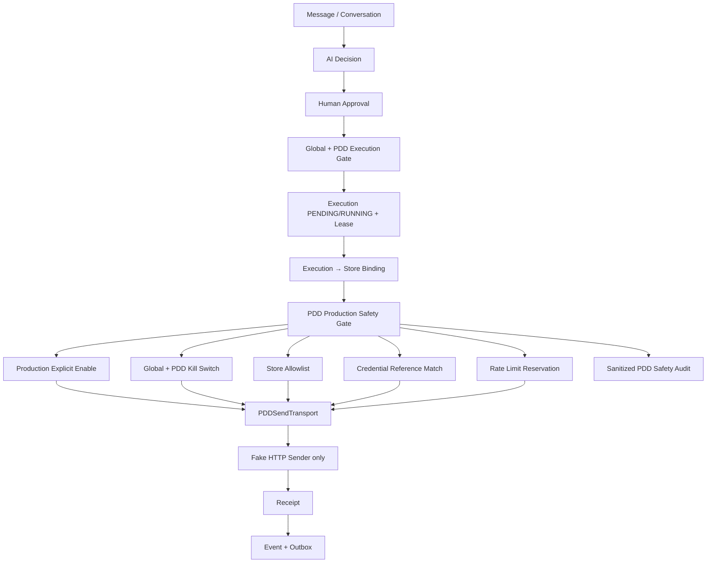
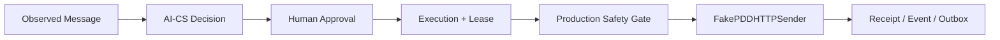

# 《PDD Production Safety Gate Foundation V1》

状态：`PDD_PRODUCTION_SAFETY_GATE_READY`

版本：`1.0`

日期：2026-08-04

## 1. 结论

PDD Production Safety Gate Foundation V1 已完成。系统在 Controlled Send
Transport 前增加持久化、默认拒绝的 PDD 专属安全控制，并与现有 Execution
Worker 和全局 Control Plane 组合。

本次没有连接真实 PDD、没有登录真实账号、没有真实发送，也没有修改 AI-CS
或 Gateway Contract。

## 2. 安全架构



安全控制覆盖两个独立入口：

1. `PDDProductionExecutionGate`：在 Approval 创建 Execution 前以及 Worker claim
   PENDING Execution 前检查 PDD kill switch，并可组合现有全局 Control Plane
   gate；
2. `PDDProductionSafetyGate`：在 `PDDSendTransport` 调用 sender 前再次检查环境、
   两级 kill switch、店铺绑定、白名单、credential reference 和 rate limit。

即使 Execution 已经 RUNNING，send-time gate 仍可立即阻止新发送。

## 3. 环境模型

### 3.1 Profile

`PDDEnvironmentProfile`：

- `MOCK`
- `STAGING`
- `PRODUCTION`

默认持久化状态：

```text
environment        = MOCK
production_enabled = false
dry_run            = true
kill_switch        = DISABLED
```

默认 kill switch 可以为 DISABLED，因为 MOCK + production disabled 本身已经阻止
Production Safety Gate 发送。PDD kill switch 是第二道紧急停止机制。

### 3.2 Production 显式解锁

进入 PRODUCTION profile 必须同时提供：

```text
production_enabled = true
confirmation_phrase = ENABLE_PDD_PRODUCTION_SAFETY_V1
```

确认短语只用于命令验证，不写入状态表或 Audit。错误短语返回
`PDD_PRODUCTION_CONFIRMATION_REQUIRED`，状态保持 MOCK。

`production_enabled=true` 不代表具备真实发送能力。V1 的
`PDDSendTransport` 仍会拒绝任何 `real_platform_transport=true` 的 sender。

## 4. 店铺白名单

### 4.1 StoreAccount

```text
platform
store_id
store_name
credential_reference
environment
status
updated_at
```

状态：

- `ALLOWLISTED`
- `SUSPENDED`
- `DISABLED`

发送必须满足：

1. Execution 存在不可变的 `Execution → Store + Conversation` 绑定；
2. StoreAccount 存在；
3. `platform == pdd`；
4. Store status 为 `ALLOWLISTED`；
5. Store environment 为 `PRODUCTION`；
6. 绑定 conversation 与批准后的 Conversation 完全一致。

缺失绑定、错误店铺、暂停店铺或 conversation mismatch 均在 sender 前拒绝。

### 4.2 错店防护

Execution binding 使用 execution ID 作为主键，因此同一 Execution 不能重新绑定
到另一店铺或 conversation。冲突返回：

`PDD_EXECUTION_STORE_BINDING_CONFLICT`

## 5. Credential 策略

`PDDCredentialReference` 只允许：

```text
credential_ref = credential-ref://... | secret-ref://...
version
expires_at (optional)
```

模型使用 frozen + extra-forbid；不存在 cookie、token、password 或 secret value
字段。StoreAccount 持久化表只保存 reference、version 和 expiration。

发送前要求 StoreAccount reference 与当前 sanitized Session 的 cookie reference
完全一致。Reference mismatch 或 expiration 会 fail closed：

- `PDD_CREDENTIAL_REFERENCE_MISMATCH`
- `PDD_CREDENTIAL_REFERENCE_EXPIRED`

Credential rotation Audit 只保存旧/新 version，不保存 reference。

## 6. Dry Run 流程



Dry Run 仍执行完整 Decision → Approval → Execution → Transport → Receipt 链路，
但 sender 固定为 fake：

- `real_platform_call_count = 0`
- Receipt `dry_run = true`
- Receipt `real_platform_called = false`
- Receipt `customer_message_sent = false`

这样可在未来 observation 输入来自受控测试店铺时验证完整链路，但本次测试输入仍是
fake message，没有真实客户数据。

## 7. Kill Switch

### 7.1 PDD Channel Kill Switch

状态：`ENABLED / DISABLED`。

ENABLED 后：

- `PDDProductionExecutionGate.assert_new_execution_allowed()` 拒绝新 Execution；
- `pending_claim_allowed()` 阻止新 Worker claim；
- `PDDProductionSafetyGate.authorize_send()` 阻止新的 sender 调用；
- 不删除或修改历史 Receipt、Event、Outbox、Audit。

### 7.2 全局 Control Plane

PDD Gate 可组合 `PersistentExecutionControlGate` 和 `ControlPlaneService`：

- 全局 kill switch 阻止新 Execution/claim；
- 已 RUNNING Execution 在 send-time 再次读取全局状态；
- 全局停止返回 `PDD_GLOBAL_KILL_SWITCH_ENABLED`。

因此全局和 PDD kill switch 任意一个开启都会阻止发送。

## 8. Rate Limit

`PDDRateLimitPolicy` 至少支持：

| 维度 | 默认值 | 窗口 |
|---|---:|---|
| 单店 | 2 次 | 滚动 1 分钟 |
| 单 conversation | 1 次 | 滚动 1 分钟 |
| 单店 | 20 次 | 滚动 24 小时 |

Rate reservation 在 sender 前持久化，以 execution ID 去重。超过限制不会自动等待
或自动重试，而是：

- 阻止 sender；
- 写入 `SEND_BLOCKED` Audit；
- 返回 `...REVIEW_REQUIRED` 错误码；
- Worker Receipt 标记 `manual_review_required=true`；
- 交由人工审核。

错误码：

- `PDD_STORE_PER_MINUTE_REVIEW_REQUIRED`
- `PDD_CONVERSATION_RATE_REVIEW_REQUIRED`
- `PDD_STORE_DAILY_REVIEW_REQUIRED`

## 9. 幂等与重复发送

Safety Gate 不改变 Controlled Send Transport V1 已冻结的三重身份：

- `execution_id`
- `message_id = pdd-outbound:{decision_id}`
- `send_key = Execution.idempotency_key`

Transport 在执行 Safety Gate 和 sender 前先读取原 Receipt。完全相同的 duplicate
从持久化 store 返回同一个 Receipt，不增加 rate reservation，不再次调用 sender；
该语义跨 Transport 实例和进程重建保持成立。

如果进程在 rate reservation 后、Receipt 持久化前崩溃，恢复实例会返回
`PDD_SEND_RESERVATION_REVIEW_REQUIRED` 并进入人工核对，不会再次调用 sender。
不同 evidence 复用任一身份继续 fail closed。UNKNOWN 也不会自动重试。

## 10. Audit Event

持久化关键动作：

- `PRODUCTION_ENABLED`
- `PRODUCTION_DISABLED`
- `STORE_ALLOWLISTED`
- `STORE_STATUS_CHANGED`
- `CREDENTIAL_CHANGED`
- `EXECUTION_STORE_BOUND`
- `SEND_AUTHORIZED`
- `SEND_BLOCKED`
- `KILL_SWITCH_TRIGGERED`
- `KILL_SWITCH_DISABLED`

Audit 字段：

```text
audit_event_id
operator
action
timestamp
reason
store_id
execution_id
before
after
```

Audit 模型递归拒绝 cookie/token/password/secret/authorization 字段及类似
`cookie=`、`token=`、`Bearer ...` 的值。Audit 不记录：

- credential reference；
- cookie/token/secret value；
- customer message content；
- approved reply content；
- lease token。

## 11. 持久化模型

新增表：

| 表 | 用途 |
|---|---|
| `pdd_production_safety_state` | 版本化环境、dry-run、kill switch、rate policy |
| `pdd_store_accounts` | 店铺 allowlist 和 credential reference |
| `pdd_execution_store_bindings` | Execution 的店铺/conversation 绑定 |
| `pdd_send_rate_events` | sender 前 rate reservation |
| `pdd_send_transport_receipts` | 跨进程三重幂等 Receipt replay |
| `pdd_safety_audit_events` | append-only sanitized audit |

所有表带 `safety_contract_version=1.0`。未知版本 fail closed。

## 12. Error Codes

| 错误码 | 含义 |
|---|---|
| `PDD_PRODUCTION_CONFIRMATION_REQUIRED` | 缺少精确确认短语 |
| `PDD_PRODUCTION_NOT_ENABLED` | 默认 MOCK / production 未显式开启 |
| `PDD_KILL_SWITCH_ENABLED` | PDD channel kill switch 已开启 |
| `PDD_GLOBAL_KILL_SWITCH_ENABLED` | 全局 Control Plane 已停止执行 |
| `PDD_EXECUTION_STORE_BINDING_MISSING` | Execution 未绑定店铺 |
| `PDD_EXECUTION_STORE_BINDING_CONFLICT` | Execution 尝试重新绑定 |
| `PDD_EXECUTION_CONVERSATION_MISMATCH` | conversation 不匹配 |
| `PDD_STORE_NOT_ALLOWLISTED` | 店铺缺失/暂停/禁用 |
| `PDD_STORE_ENVIRONMENT_MISMATCH` | 店铺环境不是 PRODUCTION |
| `PDD_CREDENTIAL_REFERENCE_MISMATCH` | 当前 Session 不属于白名单店铺 |
| `PDD_CREDENTIAL_REFERENCE_EXPIRED` | credential reference metadata 过期 |
| `PDD_STORE_PER_MINUTE_REVIEW_REQUIRED` | 单店分钟限流 |
| `PDD_CONVERSATION_RATE_REVIEW_REQUIRED` | 单会话限流 |
| `PDD_STORE_DAILY_REVIEW_REQUIRED` | 单店日限流 |
| `PDD_SEND_RESERVATION_REVIEW_REQUIRED` | 崩溃窗口存在预留但无 Receipt |
| `PDD_SAFETY_STATE_CONFLICT` | 并发状态更新冲突 |
| `PDD_SAFETY_VERSION_UNSUPPORTED` | 持久化合同版本不兼容 |

## 13. 与现有 Runtime 集成

Production safety 装配要求：

```python
execution_gate = PDDProductionExecutionGate(
    delegate=PersistentExecutionControlGate()
)

send_gate = PDDProductionSafetyGate(
    pdd_safety_service,
    global_control_plane=control_plane_service,
)

transport = PDDSendTransport(
    authorization_service,
    session_provider,
    fake_sender,
    safety_gate=send_gate,
)
```

同一个 `execution_gate` 必须传入 `ExecutionCoordinator` 和 `ExecutionWorker`。
`send_gate` 必须传入 `PDDSendTransport`。Transport 内原有的 Decision、Approval、
RUNNING、worker、lease token 和 lease expiry 验证保持不变。

## 14. 测试结果

新增：

- `tests/contract/test_pdd_production_safety_gate_v1.py`
- `tests/integration/test_pdd_production_safety_gate.py`

覆盖：

1. 默认 MOCK，生产未开启时发送失败；
2. 错误 production confirmation 不改变状态；
3. 店铺不在白名单/已暂停时发送失败；
4. PDD kill switch 阻止新 Execution 和新发送；
5. 全局 Control Plane kill switch 阻止 PDD 发送；
6. Dry Run 完整 Worker 链路且真实调用为零；
7. Duplicate 返回原 Receipt；
8. 单店分钟限流进入人工审核；
9. 单 conversation 限流；
10. 单店滚动 24 小时限流；
11. credential reference-only 模型；
12. Audit credential leakage scan；
13. Receipt/Event/Outbox/Audit 在 kill switch 后保留；
14. Decision → Approval → Execution 不可绕过。
15. 跨 Transport 实例 duplicate 返回持久化原 Receipt；
16. 预留后崩溃窗口 fail closed，不重复调用 sender。

执行结果：

```text
PDD Production Safety suites: 13 passed
Full repository suite:        229 passed, 1 warning
```

唯一 warning 是项目既有 Starlette TestClient/httpx 弃用提示，与本次改动无关。

## 15. Quality Gate

| Gate | 结果 |
|---|---|
| 默认 MOCK / production explicit enable | PASS |
| Store allowlist + immutable binding | PASS |
| Credential reference only | PASS |
| Dry Run / zero real calls | PASS |
| PDD + global kill switch | PASS |
| Three-dimensional rate limit | PASS |
| Sanitized persistent audit | PASS |
| Worker/Transport/Control Plane integration | PASS |
| Approval/lease/idempotency preservation | PASS |

## 16. 上线前检查清单

以下各项必须全部由人工签字确认；任一项不满足都不得启用真实 sender。

### 环境与变更控制

- [ ] 部署 profile 明确为目标环境，不依赖隐式默认值；
- [ ] 两人复核 production enable 变更单；
- [ ] 精确确认短语仅在受控操作时输入，不持久化；
- [ ] Control Plane 和 PDD kill switch 的 operator 权限已分离；
- [ ] 已现场演练两级 kill switch，停止时间达到要求；
- [ ] 已验证 rollback 后 production 回到 disabled/MOCK。

### 店铺与账号

- [ ] 真实测试店铺 ID、名称由两人核对；
- [ ] StoreAccount 只包含目标测试店铺；
- [ ] 每个 Execution 都绑定 store ID 和 conversation ID；
- [ ] 非测试店铺处于 SUSPENDED/DISABLED 或不存在；
- [ ] credential reference 指向专用低权限测试账号；
- [ ] credential 已设置 rotation 与 expiration；
- [ ] 配置、数据库、日志和 Audit 中不存在明文 cookie/token/secret。

### 发送控制

- [ ] Dry Run 完整链路连续通过；
- [ ] Human Approval UI 明确显示店铺、conversation、正文和风险；
- [ ] 未审批、审批过期、lease 过期测试全部 fail closed；
- [ ] Duplicate send 返回原 Receipt；
- [ ] UNKNOWN 不自动重试并有人工 reconciliation runbook；
- [ ] 单店分钟、单会话分钟、单店日限流设置为低风险值；
- [ ] Rate limit 超限进入人工审核，不自动排队重发；
- [ ] refund、order modification、payment 永久 blocked。

### 可观测与恢复

- [ ] Receipt、Event、Outbox、PDD Audit 可关联 execution ID；
- [ ] SEND_BLOCKED 和 kill switch 告警已接入值班渠道；
- [ ] sender timeout/UNKNOWN 演练完成；
- [ ] worker crash 恢复到 safe state，不自动重发；
- [ ] 真实 sender 接入前完成独立安全评审和新的授权任务。

## 17. 当前仍禁止

本状态不等于真实生产发送授权。当前仍禁止：

- 真实 PDD 连接或账号登录；
- 真实客户消息发送；
- 自动回复上线；
- 退款、订单修改、支付或资金操作；
- 修改 AI-CS 或 Gateway Contract；
- 将 `PDD_SEND_TRANSPORT_READY` 或本状态解释为生产上线批准。

## 18. Final Status

`PDD_PRODUCTION_SAFETY_GATE_READY`
