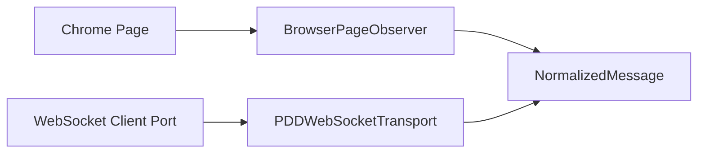

# 《PDD WebSocket Transport Foundation V1》

版本：`1.0`
日期：`2026-08-04`
状态：`PDD_WEBSOCKET_TRANSPORT_READY`

## 1. 交付结论

PDD WebSocket Transport Foundation V1 已完成。系统新增了一个与 Browser Observation 并列、互不替换的 receive-only transport：

```text
Fake / Future WebSocket Client
  -> PDDWebSocketTransport
  -> Canonical WebSocket Event Parser
  -> Durable Inbox + Cursor
  -> NormalizedMessage
  -> explicit ACK
```

本阶段只提供进程内 Fake WebSocket Server/Client，不创建 socket，不包含真实 WebSocket URL，不连接 PDD，不使用真实账号，不发送客户消息，也不修改 AI-CS。`ACK` 仅表示入站协议确认，不是 outbound message send。

## 2. 与 Browser Observation 的关系

两条入站路径保持独立：



- Browser Observation 的 runtime、selector、cursor 和 store 没有被修改或替换。
- WebSocket Transport 不依赖 Chrome、Page Context、Selector Contract 或 Browser Session。
- 两条路径只在 `NormalizedMessage` 模型处汇合。
- 后续若同时启用两条路径，必须在 Channel intake 层继续使用 conversation + external message ID 做跨 transport 幂等。

## 3. Transport Interface

`PDDWebSocketTransportPort` 冻结以下方法：

| 方法 | 行为 |
| --- | --- |
| `connect()` | 从最后 acknowledged cursor/sequence 建立连接 |
| `disconnect()` | 关闭精确 connection ref 并进入 DISCONNECTED |
| `heartbeat()` | 按 interval 执行带 timeout 的 ping |
| `receive()` | 接收、解析并持久化一个事件，输出 `NormalizedMessage` |
| `ack(message)` | 只 ACK 已持久化且顺序正确的消息 |
| `reconnect()` | 断开旧连接，从 acknowledged checkpoint 恢复并重新 heartbeat |

底层 `PDDWebSocketClientPort` 只定义 connect、disconnect、ping、receive 和 ack。Foundation 构造器拒绝 `real_network=true` 的实现，确保本阶段无法误连真实 PDD。

## 4. Connection Lifecycle

状态模型：

```text
DISCONNECTED
  -> CONNECTING
  -> CONNECTED
  -> HEALTHY

HEALTHY / CONNECTED
  -> DEGRADED    disconnect / heartbeat timeout / ACK network failure
  -> FAILED      malformed event / identity conflict / sequence gap

DEGRADED
  -> reconnect
  -> CONNECTED
  -> HEALTHY

any connected state
  -> DISCONNECTED
```

`generation` 在每次成功建立新 connection 时递增。连接异常允许显式或 heartbeat 驱动的 reconnect；协议冲突属于 terminal failure，旧 transport 实例禁止自行 reconnect，必须经人工确认后创建新的受控 session。

## 5. Heartbeat 与 Reconnect

配置项：

- `heartbeat_interval`：默认 15 秒。
- `heartbeat_timeout_seconds`：默认 5 秒。
- `receive_timeout_seconds`：默认 1 秒。
- `auto_reconnect`：默认启用。

Interval 未到时，`heartbeat()` 返回当前健康状态而不额外 ping。到期后：

1. 调用 client ping，并传递精确 timeout。
2. 成功进入 `HEALTHY`。
3. timeout/异常进入 `DEGRADED`。
4. auto reconnect 启用时，关闭旧 connection。
5. 从 durable acknowledged checkpoint 重新 connect。
6. reconnect 后再次 ping；通过才恢复 `HEALTHY`。

Reconnect 不使用最后“已接收”位置，而使用最后“已 ACK”位置，避免尚未 ACK 的 durable inbox message 被跳过。

## 6. Canonical Message Pipeline

V1 定义 adapter-side canonical event envelope：

```json
{
  "websocket_contract_version": "1.0",
  "event_type": "message",
  "sequence": 101,
  "cursor": "opaque-cursor-101",
  "message_id": "external-message-id",
  "conversation_id": "external-conversation-id",
  "sender": "external-sender",
  "timestamp": "2026-08-04T22:00:00Z",
  "payload": {
    "content": "message text",
    "attributes": {}
  }
}
```

解析结果映射为：

| WebSocket Event | NormalizedMessage |
| --- | --- |
| `message_id` | `external_message_id` |
| `conversation_id` | `conversation_id` |
| `sender` | `sender` |
| `timestamp` | `timestamp` |
| `payload.content` | `content` |
| transport identity | `channel=pdd` |

该 envelope 是 Channel Engine 内部 V1 contract，不声称等同于真实 PDD wire schema。未来真实协议只能在独立 mapper 中转换为该 envelope，不能直接让不可信 wire payload 绕过 parser/schema validation。

Malformed JSON、额外字段、错误类型、缺失字段、空 content 或非法 timestamp 均返回 `PDD_WEBSOCKET_MALFORMED_PAYLOAD`，不持久化、不 ACK，transport 进入 `FAILED`。

## 7. Durable Inbox 与 Cursor

新增两张版本化表：

- `pdd_websocket_checkpoints`
- `pdd_websocket_inbox`

Checkpoint 同时保存两个位置：

| 位置 | 含义 |
| --- | --- |
| `cursor / last_sequence` | 已成功写入 durable inbox 的最新事件 |
| `acknowledged_cursor / last_acknowledged_sequence` | 已成功发送协议 ACK 并记录 ACK 状态的最新事件 |

Inbox 保存：

- stream ID
- identity digest
- payload fingerprint
- sequence/cursor
- ACK token
- NormalizedMessage 字段
- `PERSISTED / ACKED` 状态
- persisted/acknowledged timestamp

Cursor、inbox record 和 dedup evidence 使用同一 SQLAlchemy 事务提交，并以 checkpoint revision compare-and-swap 防止并发 writer 覆盖。

## 8. ACK Ordering

强制流程：

```text
wire receive
  -> schema parse
  -> Normalize
  -> persist inbox + cursor transaction
  -> return NormalizedMessage
  -> explicit ack(message)
  -> wire ACK
  -> persist ACK state + acknowledged cursor
```

规则：

- 未找到 durable inbox record：`PDD_WEBSOCKET_ACK_BEFORE_PERSIST`。
- ACK 只能按最小 pending sequence 顺序执行。
- ACK network failure：record 保持 `PERSISTED`，connection 进入 `DEGRADED`。
- Wire ACK 成功但 ACK 状态 CAS 失败：进入 `DEGRADED`；重试 ACK 是安全的。
- 重复调用已 ACK message：返回 idempotent receipt，不再次修改 checkpoint。
- Server 重投已经 ACK 的 duplicate：先确认已有持久化 evidence，再重新发送 ACK，并抑制重复 `NormalizedMessage`。
- ACK token 不进入 receipt、operation log 或模型序列化。

## 9. Dedup 与 Sequence Safety

Identity：

```text
SHA-256(conversation_id + NUL + message_id)
```

Payload fingerprint 基于规范化后的六字段消息生成。

- 相同 identity、payload 和 sequence：duplicate。
- 相同 identity 对应不同 payload 或 sequence：`PDD_WEBSOCKET_IDENTITY_REUSED`，fail closed。
- 首个事件建立 stream sequence baseline。
- baseline 后新的未知事件必须严格等于 `last_sequence + 1`。
- sequence gap：`PDD_WEBSOCKET_SEQUENCE_GAP`，不持久化、不 ACK。
- 重复事件不会前移 persisted cursor，只增加 duplicate count。
- 未 ACK inbox 在重启后从 acknowledged cursor 重投，原消息可再次交付并安全 ACK。

## 10. Fake WebSocket Server

`FakePDDWebSocketServer` 和 `FakePDDWebSocketClient` 提供：

- deterministic connect/resume history
- event/raw-frame queue
- heartbeat success、timeout 和 exception 模拟
- receive disconnect 模拟
- ACK failure/ACK history
- unacknowledged frame reconnect redelivery
- operation ordering evidence

Fake server 完全在进程内运行；没有监听端口、DNS、TLS、HTTP 或 WebSocket 库依赖。

## 11. Failure Handling

| 场景 | Transport 状态 | Cursor/ACK |
| --- | --- | --- |
| Receive disconnect | DEGRADED | cursor 不变，可 reconnect |
| Heartbeat timeout | DEGRADED → reconnect | 从 ACK cursor 恢复 |
| Reconnect success | HEALTHY | generation + 1 |
| Duplicate same payload | HEALTHY | 抑制或重投 pending inbox |
| Duplicate changed payload | FAILED | 不前移、不 ACK |
| Malformed payload | FAILED | 不持久化、不 ACK |
| Missed sequence | FAILED | 不前移、不 ACK |
| ACK before persist | 拒绝 | 不调用 wire ACK |
| ACK out of order | 拒绝 | 不调用 wire ACK |
| ACK network failure | DEGRADED | inbox 保持 PERSISTED |

## 12. 安全要求与当前边界

- Foundation V1 拒绝任何声明 `real_network=true` 的 client。
- 不包含真实 PDD URL、Cookie、token、账号或 wire schema。
- 不包含 customer message send、自动回复、退款、订单或资金动作。
- Browser Observation 代码与存储未被替换。
- AI-CS、Gateway Contract、Decision、Approval 和 Execution 未修改。
- Frame body 和 ACK token 在模型 dump/repr 中排除。
- Operation log 只记录 frame ID/sequence，不记录 content 或 token。
- 测试只使用 synthetic message/customer/conversation。

Durable inbox 必须保存 NormalizedMessage 和待用 ACK token，未来真实部署前必须补充数据库加密、OS ACL、retention/deletion policy、ACK token encryption 和审计脱敏。本 Foundation 没有实现 secret storage，也没有接入真实数据。

## 13. 测试结果

新增 7 个 contract tests：

1. Fake server lifecycle、event pipeline 和 persist-before-ACK。
2. Heartbeat interval、timeout 和 automatic reconnect。
3. Receive disconnect 与 explicit reconnect。
4. Duplicate suppression、re-ACK 和 payload conflict。
5. Malformed payload 与 missed sequence 禁止 ACK。
6. ACK-before-persist 与 ACK sequence ordering。
7. 未 ACK inbox 和 acknowledged cursor 的跨实例恢复。

验证结果：

```text
WebSocket targeted tests: 7 passed
Full regression suite:    202 passed, 1 existing warning
compileall:               passed
pip check:                passed
Forbidden-boundary scan:  no match
```

唯一 warning 是既存 FastAPI TestClient 的 Starlette/httpx 弃用提示，与 WebSocket Transport 无关。

## 14. Quality Gates

| Gate | 结果 |
| --- | --- |
| connect/disconnect/heartbeat/receive/ack/reconnect interface | PASS |
| 六态 connection lifecycle | PASS |
| Heartbeat interval/timeout/reconnect | PASS |
| Canonical Event → NormalizedMessage | PASS |
| Durable persist-before-ACK | PASS |
| ACK ordering/idempotency | PASS |
| Duplicate/malformed/gap failure handling | PASS |
| Cursor and pending-inbox restart recovery | PASS |
| Browser Observation remains independent | PASS |
| No real PDD/account/send/AI-CS modification | PASS |

Final Status: `PDD_WEBSOCKET_TRANSPORT_READY`
