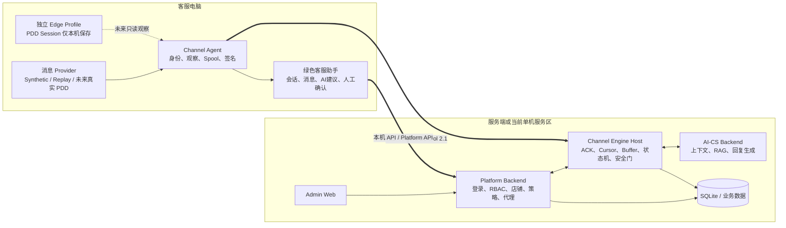
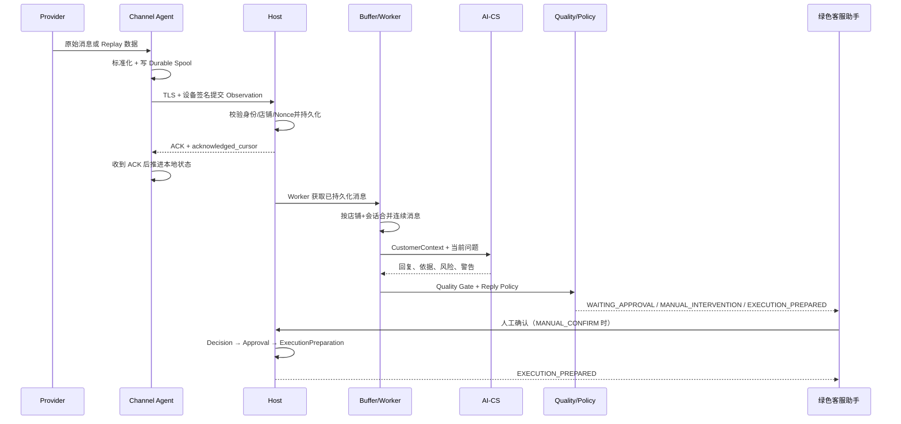

# AI-CS RC5 技术架构入门指南

文档状态：RC5 当前架构说明  
适用读者：新加入的开发、测试、实施、运维，以及技术基础不深但需要理解系统的人  
范围：离线完整链路 + 未来真实 PDD 接入边界  
不包含：真实 PDD 页面 Selector 细节、真实发送实现细节、商业代码签名流程

## 1. 先用一句话理解这个项目

这是一个“把电商平台上的买家消息交给 AI 分析，再由客服确认是否采用回复”的客服系统。

系统当前已经能够用模拟消息完整跑通：

```text
模拟买家消息
→ 客服电脑客户端读取并标准化
→ Host 可靠接收和保存
→ 组织客户、商品、SKU、订单、物流上下文
→ AI-CS 生成回复
→ 质量与风险检查
→ 客服助手展示
→ 人工确认或低风险自动准备
→ EXECUTION_PREPARED（已准备执行，但不真实发送）
```

当前缺少的不是 AI 客服主体，而是真实拼多多页面的最后适配和真实发送验证。

## 2. 只记住这六句话也能理解系统

1. `Channel Agent` 安装在客服电脑上，负责平台边缘读取、设备身份和本地绿色客服助手。
2. `Channel Engine Host` 是可靠性中枢，负责消息持久化、ACK、Cursor、Buffer、状态和执行安全门。
3. `AI-CS Backend` 负责知识检索、业务判断和生成回复，不直接操作拼多多页面。
4. `Platform Backend` 负责员工登录、权限、店铺范围、策略开关，以及把绿色界面请求安全地转给 Host。
5. `Frontend` 是客服看到的绿色工作台；`Admin Web` 是管理员维护账号、知识和配置的后台。
6. 以后接真实 PDD，原则上只替换 Provider/Adapter；AI、状态机、策略和界面不应该重写。

## 3. 项目为什么分成两个代码目录

这不是两个互不相关的项目，而是一个产品的两个技术仓库。

| 代码目录 | 主要内容 | 可以把它理解为 |
| --- | --- | --- |
| `AI-CS-Channel-Execution-Engine` | Channel Agent、Channel Engine Host、可靠消息、执行安全、Windows 客户端 | “渠道接入和安全执行层” |
| `../AI-CS` | AI-CS Backend、Platform Backend、绿色客服前端、Admin Web、共享 Contracts | “AI 业务和产品平台层” |

两边通过冻结的 Gateway Contract 和 Agent Control 协议连接。不要因为目录分开，就在两边各写一套相同业务逻辑。

## 4. 总体架构



在当前“一台电脑离线开发”模式下，这些组件可以运行在同一台电脑上；未来 Pilot 可以把客服电脑与服务端拆成两台电脑。组件职责不因部署位置变化。

## 5. 每个组件到底负责什么

### 5.1 Channel Agent：客服电脑上的边缘客户端

主要代码：`src/channel_agent/`

它负责：

- 保存 Agent Identity、Device Binding 和授权店铺范围；
- 使用独立 Edge Profile，避免碰用户的个人浏览器资料；
- 从 Provider 获取消息，并转换成统一格式；
- 消息先写入本地 Durable Spool，再提交 Host；
- 使用设备凭据对 Host 请求签名，防止伪造和重放；
- 运行本地绿色客服助手静态页面和安全本机 API；
- 在未来接收 Host 授权后的受控执行命令；
- 保存最小诊断状态，不在日志中输出 Cookie、密码或 Token。

它不负责：

- 决定 AI 应该回答什么；
- 管理商品知识库；
- 绕过 Host 直接发送消息；
- 把 PDD Cookie 导出给服务端；
- 在没有授权时自行切换店铺或会话。

关键代码入口：

| 文件 | 作用 |
| --- | --- |
| `windows_app.py` / `windows.py` | Windows 客户端启动、停止、状态、自启动和桌面运行 |
| `config.py` | Agent 安全配置和运行模式 |
| `identity.py` / `binding.py` | 设备身份与绑定 |
| `providers.py` | Synthetic 与 Replay Provider 测试入口 |
| `observation_runtime.py` | “先落盘、后提交、收到 ACK 再推进” |
| `edge_spool.py` | 本地待提交消息的耐久队列 |
| `client.py` / `control_v2.py` | 与 Host 的签名通信 |
| `desktop.py` | 本地绿色客服助手服务 |
| `pdd_readonly_driver.py` | 未来真实 PDD 只读驱动边界 |

### 5.2 Channel Engine Host：全链路的可靠性中枢

主要代码：`src/channel_engine/`

生产入口是 `channel_engine.production_app`。它特意不挂载 Fake、Sandbox、Pilot 和旧 V1 路由。

它负责：

- 验证 Agent 身份、设备签名、Nonce 和店铺权限；
- 先持久化 Observation，再返回 ACK；
- 用 Cursor 和唯一键防止重复、漏处理；
- 把同一客户短时间连续消息放进 Conversation Buffer 合并；
- 生成统一 CustomerContext；
- 调用 AI-CS Gateway；
- 记录每个阶段的 Trace；
- 执行 Quality Gate 和 Reply Policy；
- 保存人工 Approval；
- 生成不可直接等同于发送成功的 `ExecutionPreparation`；
- 将真实执行、Receipt 和 UNKNOWN 对账放在统一安全边界内。

关键模块：

| 模块 | 简单解释 |
| --- | --- |
| `agent/control_v2.py` | Agent 与 Host 的正式协议入口 |
| `agent/control_store.py` | Observation、ACK、Nonce 等控制状态 |
| `agent/observation_worker.py` | 从已保存消息触发后续处理 |
| `customer_assistant/buffer.py` | 合并连续消息并提供恢复租约 |
| `customer_assistant/context.py` | 汇集客户、商品、SKU、订单和物流信息 |
| `customer_assistant/runtime.py` | AI 回复、质量门、策略和准备执行的主流程 |
| `customer_assistant/offline_control.py` | MANUAL_CONFIRM / AUTO_LOW_RISK 状态与审批 |
| `execution/` | 安全执行、队列、恢复和 Receipt |
| `observability/` | Trace、运行状态和诊断 |
| `production_app.py` | 正式 Host Composition |

### 5.3 AI-CS Backend：回复“大脑”

主要代码：`../AI-CS/backend/app/`

它负责：

- 接收结构化 CustomerContext；
- 在店铺、商品和 SKU 范围内检索知识；
- 结合订单、物流、售后状态判断用户问题；
- 生成结构化回复结果；
- 返回引用依据、风险、警告和所需字段；
- 当知识不足、范围不匹配或风险太高时拒绝自动回答。

它输出的是“建议与业务判断”，不是“页面点击”。这条边界很重要：AI 不能拥有发送权限。

### 5.4 Platform Backend：产品权限和界面后端

主要代码：`../AI-CS/platform_backend/app/`

它负责：

- 员工登录与 Session；
- `ADMIN`、`OPERATOR`、`CUSTOMER_SERVICE` 等角色权限；
- 用户可以访问哪些店铺、默认店铺是什么；
- 店铺与平台店铺标识的映射；
- 商品知识、发布状态和运营管理；
- 绿色工作台需要的 Workspace API；
- 将策略变更、人工确认、执行准备请求代理给 Host；
- 写入最小化审计记录。

数据库 Migration 当前 Head 是：

```text
0019_runtime_database_identity_v1
```

普通启动不会自动迁移数据库；数据库路径、内部身份、sidecar 与 `0019` revision 必须全部匹配。不要把测试用的历史 `0013` 数据库误认为当前运行库。

### 5.5 绿色客服助手 Frontend

主要代码：`../AI-CS/frontend/src/`

客服在这里看到：

- 会话列表、客户标识、状态和未处理信息；
- 客户连续消息；
- 商品、SKU、订单和物流上下文；
- AI 回复建议；
- 引用依据、风险等级、警告和缺失字段；
- 当前处理阶段；
- 人工确认按钮；
- `MANUAL_CONFIRM` 与 `AUTO_LOW_RISK` 策略状态。

界面点击“确认”并不代表已经真实发送。当前离线 RC5 的成功终点是 `EXECUTION_PREPARED`。

### 5.6 Admin Web

主要代码：`../AI-CS/admin_web/src/`

管理员使用它维护：

- 用户、角色和店铺绑定；
- 商品知识与发布状态；
- 运营、质量与问题反馈；
- 平台运行配置和管理功能。

Admin Web 不应直接访问 Channel Agent，也不应该绕过 Platform Backend 改数据库。

### 5.7 Contracts：组件之间共同遵守的“说明书”

主要目录：`../AI-CS/contracts/` 和 `schemas/`

Contract 规定字段名称、类型、错误码和兼容规则。当前重要版本：

| 项目 | 当前值 |
| --- | --- |
| Channel Engine | `0.2.0rc3` |
| Channel Agent | `2.0.0rc5` |
| Agent Control | `2.1` |
| Gateway wire | `1.0` |
| Gateway canonical SHA-256 | `e5ac64a82d2a7ccd19d3ece9bcc076242b55b6c205c85626786e8b1b7478f4b5` |
| AI-CS Contracts | `0.14.0` |
| Frontend / Admin package | `1.0.0` |

修改共享协议时必须同时检查生产端、消费端、Schema、版本、Changelog 和兼容性；不能只改一边让另一边运行时再报错。

## 6. 一条消息是怎样走完整条链路的



### 第一步：Provider 只负责“把消息读出来”

Provider 的统一输出是 `NormalizedChannelObservation`。无论输入来自：

- Synthetic 模拟消息；
- Recorded Replay；
- 未来真实 PDD DOM/WebSocket/页面观察；

后面的 Host、AI、质量门和界面都只认识统一 Observation，不应该知道消息是从哪一种技术读出来的。

### 第二步：必须先落盘，再等待 ACK

Agent 不会读取一条消息后直接当成处理成功。正确顺序是：

1. 生成稳定的 Observation ID 和 Cursor；
2. 写入本地 Spool；
3. 提交 Host；
4. Host 完成验证和持久化；
5. Host 返回 ACK；
6. Agent 才推进 Cursor 或清除待提交项。

这解决两个问题：断网时不丢消息，重试时不重复处理。

### 第三步：Buffer 合并连续消息

真实客户经常连续发送：

```text
“你好”
“这个适合几岁？”
“材质安全吗？”
```

系统按 `store_id + conversation_id` 隔离，在短暂 quiet window 后把连续内容组织成一个 AI 处理单元。这样 AI 不会对每个半句话分别回复。

### 第四步：CustomerContext 给 AI 足够信息

上下文可以包含：

```text
客户与会话
店铺
商品
SKU
订单状态
物流状态
售后状态
历史消息
当前问题
```

上下文有明确店铺范围，防止拿 A 店商品知识回答 B 店客户。

### 第五步：AI 输出结构化建议

AI-CS 返回的不只是文本，还包括：

- `action`：建议回复、拒绝、转人工等；
- `reply_content`：建议文本；
- `citations`：商品或知识依据；
- `risk_level`：风险等级；
- `warnings`：警告；
- `required_fields`：缺少的信息。

### 第六步：质量门和策略决定下一状态

常见结果：

| 结果 | 意义 |
| --- | --- |
| `WAITING_APPROVAL` | AI 建议可用，但必须等客服确认 |
| `MANUAL_INTERVENTION` | 高风险、知识不足或质量不合格，必须人工处理 |
| `EXECUTION_PREPARED` | 所有安全条件已满足，形成执行准备；当前仍不代表真实发送 |

## 7. MANUAL_CONFIRM 与 AUTO_LOW_RISK 的区别

### MANUAL_CONFIRM

默认和最安全的模式：

```text
AI 建议通过质量门
→ 界面展示
→ 客服点击确认
→ Host 校验 Decision、会话、店铺、版本和权限
→ 记录 Approval
→ 生成 ExecutionPreparation
```

### AUTO_LOW_RISK

只允许低风险、质量通过、上下文完整的回复自动进入 `EXECUTION_PREPARED`。高风险内容仍然转人工。

当前离线 RC5 即使处于 `AUTO_LOW_RISK`，`real_send_enabled` 仍为 `false`，因此“自动”只表示自动准备，不表示已经在 PDD 页面发出。

## 8. Execution、Preparation 和 Receipt 不要混淆

| 名词 | 意义 |
| --- | --- |
| Decision | 系统建议采取什么动作 |
| Approval | 人工或受控策略明确批准该 Decision |
| ExecutionPreparation | 已验证目标、权限和内容，准备交给发送适配器 |
| Execution | 真正调用发送适配器 |
| Receipt | 执行后的不可变结果事实 |

离线测试成功只能证明到 `ExecutionPreparation`。Synthetic Receipt 必须与真实 Receipt 隔离，不能用模拟成功冒充真实 PDD 发送成功。

如果真实发送返回 `UNKNOWN`，系统不能自动重试，因为第一次可能其实已经发送成功；自动重试会造成重复回复。正确行为是进入人工对账。

## 9. 状态和数据分别保存在哪里

### 客服电脑本地

逻辑数据根目录是 Channel Agent Data Root，主要包含：

```text
config/                 Agent 配置，不保存明文 Cookie/密码
runtime/                Identity、Binding、运行状态、ACK/Spool 等
browser/profiles/       独立 Edge Profile
runtime/pdd-login/      PDD Session 的本地状态边界
logs/                   脱敏诊断日志
```

升级时必须保留 Identity、Device Binding、Profile 和 PDD Session。

### Host

Host 持久化：

- Agent 与设备绑定；
- Observation 与 ACK；
- Cursor/幂等状态；
- Conversation Buffer；
- Pipeline Trace；
- Decision、Approval 和 ExecutionPreparation；
- Execution 与 Receipt（真实发送启用后）。

### Platform

Platform 数据库保存：

- 用户、角色、Session；
- 用户—店铺授权；
- 店铺—平台身份映射；
- 商品、知识、发布与质量状态；
- 最小化审计和工作台数据。

### AI-CS

AI-CS 保存或访问知识索引、提示词配置和 AI 质量相关数据。客户原始敏感文本不应无边界地进入长期知识库。

## 10. 安全设计的核心思路

这个系统不是让 AI 直接控制浏览器，而是把每一步权力拆开。

| 安全边界 | 作用 |
| --- | --- |
| Agent Identity | 确认是哪一个客服客户端 |
| Device Binding | 确认是已批准的电脑 |
| TLS + HMAC 签名 | 防止局域网请求被伪造或篡改 |
| Nonce / Replay 防护 | 防止旧请求被重复利用 |
| Store Scope | 防止不同店铺串数据或错发 |
| Cursor / ACK | 防止丢消息和重复处理 |
| Quality Gate | 阻断低质量、高风险或无依据回答 |
| Reply Policy | 控制必须人工确认还是可低风险自动准备 |
| Kill Switch | 紧急停止自动执行 |
| Execution Gate | 发送前再次检查权限、店铺、会话、版本和授权 |
| Immutable Receipt | 记录实际发生了什么，不靠猜测 |

PDD Profile 和 Session 保留在客服电脑，不通过日志或普通接口导出。

## 11. 当前离线模式与未来真实 PDD 模式

### 当前 RC5 离线模式

```text
SyntheticPDDProvider / RecordedReplayProvider
→ 统一 Observation
→ 后续正式业务链
```

优点是可以在没有真实 PDD 的情况下验证绝大多数产品能力，而且不会误操作真实店铺。

### 未来真实 PDD 模式

```text
RealPDDProvider
→ 同一个 NormalizedChannelObservation
→ 完全相同的 Host / AI / Quality / UI / Execution Gate
```

真实接入需要完成四级 Gate：

1. `REAL_PDD_READ_READY`：只读识别登录、店铺、会话、消息、商品、SKU、订单；
2. `REAL_PDD_AI_READY`：真实消息进入 AI 链，不能漏、重、串店；
3. `REAL_PDD_CONFIRM_READY`：真实消息下人工确认链正确，但仍不自动发送；
4. `REAL_PDD_SEND_READY`：小范围开启真实发送，验证输入框、按钮、Receipt、UNKNOWN、恢复和长时间运行。

只有前三步稳定后才进入真实发送。

## 12. 单电脑开发与双电脑上线的区别

### 当前单电脑

所有服务运行在一台开发电脑上，使用 loopback 和本地 SQLite，方便开发与自动化测试。

### 未来 Pilot

```text
客服电脑：Channel Agent + Edge Profile + 绿色客服助手
服务器：Channel Engine Host + AI-CS + Platform + 数据库 + Admin
网络：局域网 TLS，Agent 使用设备身份连接 Host
```

双电脑只改变部署拓扑，不改变消息协议和业务状态机。此前已经通过的心跳、Identity、Device Binding 和同步方式属于冻结能力，不应为了后续开发反复重做。

## 13. 目录阅读地图

建议按下面顺序看代码，不要一开始钻进所有历史模块。

```text
AI-CS-Channel-Execution-Engine/
├─ src/channel_agent/                  客服电脑客户端
├─ src/channel_engine/production_app.py 正式 Host 入口
├─ src/channel_engine/agent/           Agent 控制、Observation 与 Worker
├─ src/channel_engine/customer_assistant/ 离线 AI 客服主链
├─ src/channel_engine/execution/       执行与 Receipt
├─ schemas/                            Gateway Contract
├─ packaging/windows-client-v2/        Windows 正式包组成
├─ scripts/run_rc5_backend_blackbox_suite.py 最终后端黑盒
└─ tests/                              单元、契约、集成和 E2E 测试

../AI-CS/
├─ backend/app/                        AI-CS Backend
├─ platform_backend/app/               Platform 与 IAM
├─ platform_backend/migrations/        数据库迁移
├─ frontend/src/                       绿色客服助手
├─ admin_web/src/                      管理后台
├─ contracts/                          共享 Schema 与兼容说明
└─ tests/contract/                     跨模块契约测试
```

历史 `channel_engine.app` 内仍保留 Fake/Sandbox/Pilot 测试和兼容代码，但正式运行入口是 `channel_engine.production_app`。看到测试模块存在，不等于它进入了正式 Composition。

## 14. 出问题时如何判断卡在哪一层

| 现象 | 优先检查 |
| --- | --- |
| 客户消息完全没出现 | Provider、Agent observer、页面只读证据 |
| Agent 有消息但 Host 没有 | Edge Spool、TLS、设备签名、Host ACK |
| Host 有消息但没有 AI | Worker、Buffer lease、CustomerContext、AI Gateway |
| AI 有结果但界面没有 | Assistant Snapshot、Platform proxy、前端轮询/事件流 |
| AI 被拦截 | Quality Gate 的 reason code、风险、引用、缺失字段 |
| 点击确认没变化 | Decision revision、店铺权限、Approval、ExecutionPreparation |
| 出现重复回复风险 | Cursor、Observation ID、ACK、Receipt UNKNOWN |
| 不同店铺数据混在一起 | Store Scope、Platform binding、conversation key |

Trace 应能显示以下阶段：

```text
HOST_PERSIST
BUFFERING
CUSTOMER_CONTEXT
AI_GENERATING
QUALITY_GATE
REPLY_POLICY
EXECUTION_PREPARED
```

定位问题时先找最后一个成功阶段，不要直接猜“是 AI 坏了”。

## 15. 哪些能力已经冻结，不要随意重构

- Provider 统一 Observation 入口；
- Agent Identity 与 Device Binding；
- Agent Control 2.1；
- Gateway Contract wire 1.0；
- Persist-before-ACK；
- Cursor、幂等和断点恢复；
- Conversation Buffer 的店铺/会话隔离；
- CustomerContext 基本结构；
- Quality Gate 与高风险转人工；
- `MANUAL_CONFIRM` / `AUTO_LOW_RISK`；
- Execution 安全门；
- Synthetic/Real Receipt 隔离；
- Windows 升级保留 Identity、Binding、Profile、Session；
- 绿色助手的会话、AI 依据、风险和确认基本流程。

下列修改会触发重新验收：

- 改协议字段、签名方式或 Gateway SHA；
- 改 Observation ID、Cursor 或 ACK 推进条件；
- 改店铺/会话隔离键；
- 改风险级别与自动策略判定；
- 改 Execution 授权或 Receipt 语义；
- 改安装数据目录、Profile 或 Session 保留逻辑；
- 让 Fake/Sandbox/Pilot 进入 production Composition。

## 16. 当前完成度

截至 RC5 当前收口验证：

| 能力 | 状态 |
| --- | --- |
| Synthetic / Replay Provider | PASS |
| Agent → Host → ACK/Cursor | PASS |
| Buffer 与连续消息 | PASS |
| CustomerContext | PASS |
| AI 回复、依据、风险 | PASS |
| Quality Gate | PASS |
| MANUAL_CONFIRM | PASS |
| AUTO_LOW_RISK 自动准备 | PASS |
| Decision → Approval → ExecutionPrepared | PASS |
| 多客户、多店铺隔离 | PASS |
| Host/Platform/AI 故障恢复 | PASS |
| Synthetic 与真实 Receipt 隔离 | PASS |
| Windows 安装、升级、卸载、重装 | PASS |
| 当前运行包与源码候选一致 | PASS |
| 真实 PDD 读取 | NOT IN SCOPE |
| 真实 PDD 发送 | NOT IN SCOPE |

这里的 `NOT IN SCOPE` 不是失败，而是为了避免在离线收口阶段误接真实环境。

## 17. 新同学最容易犯的五个错误

1. 在 AI-CS 里直接写浏览器点击逻辑——发送权必须留在 Execution Adapter。
2. 为 Synthetic、Replay、PDD 各写一套后端流程——它们必须共用 Provider Contract。
3. 收到消息就推进 Cursor——必须等 Host 持久化 ACK。
4. 把 `EXECUTION_PREPARED` 当成“已经发送”——真正结果只能由 Receipt 证明。
5. 为了修新问题改动已冻结协议——先看能否通过配置、连接或测试修复。

## 18. 推荐阅读顺序

第一次接触项目，按下面顺序即可：

1. 本文；
2. 根目录 `README.md`；
3. `src/channel_engine/production_app.py`；
4. `src/channel_engine/provider.py`；
5. `src/channel_engine/agent/observation_worker.py`；
6. `src/channel_engine/customer_assistant/runtime.py`；
7. `../AI-CS/contracts/README.md`；
8. `../AI-CS/frontend/src/views/HumanInLoopWorkspace.vue`；
9. `scripts/run_rc5_backend_blackbox_suite.py` 中的场景名称。

读完这些，就能建立“输入—可靠处理—AI—策略—安全执行—界面”的完整心智模型，再根据任务深入具体模块。
