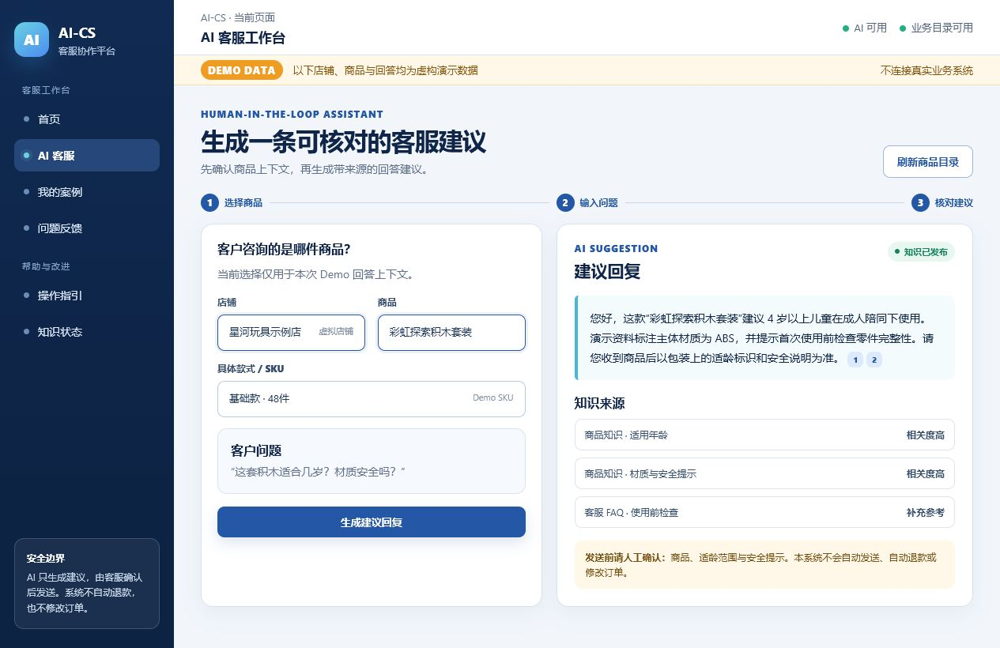
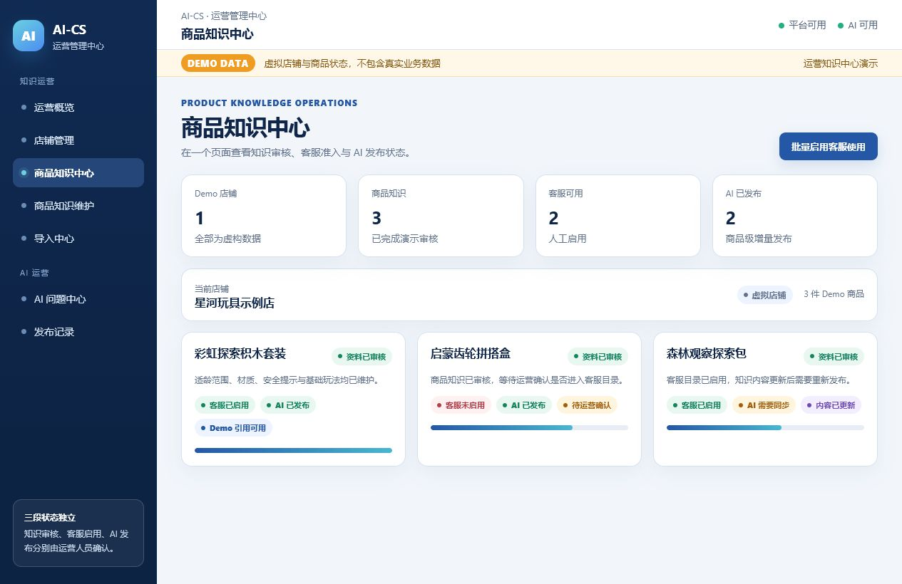
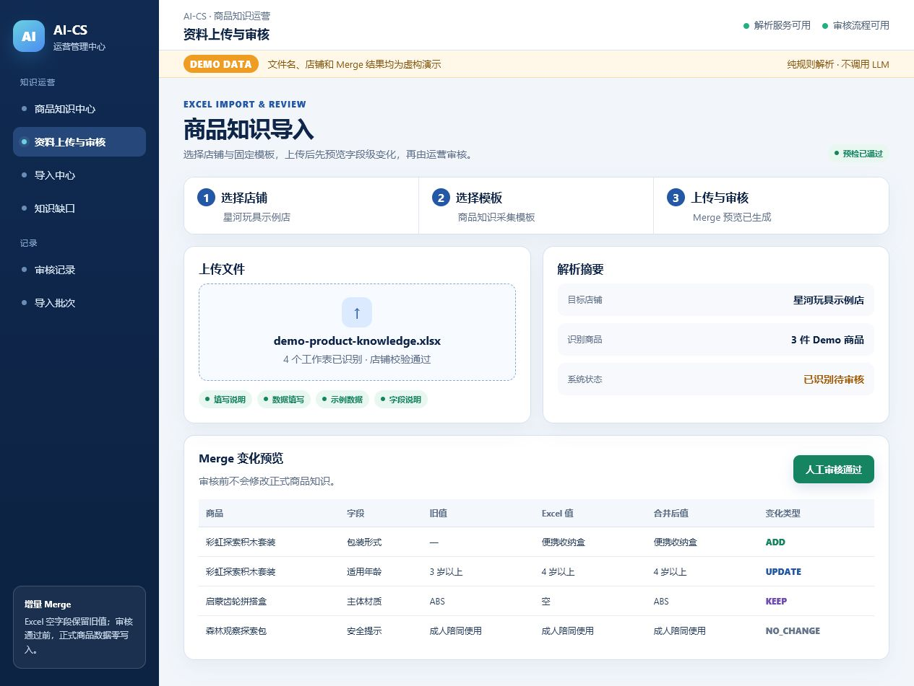
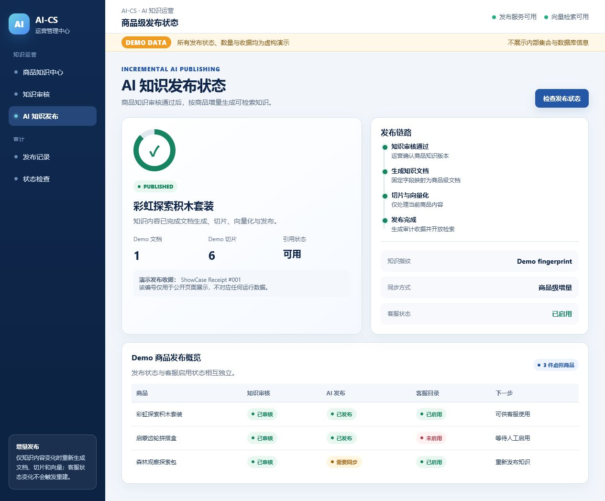
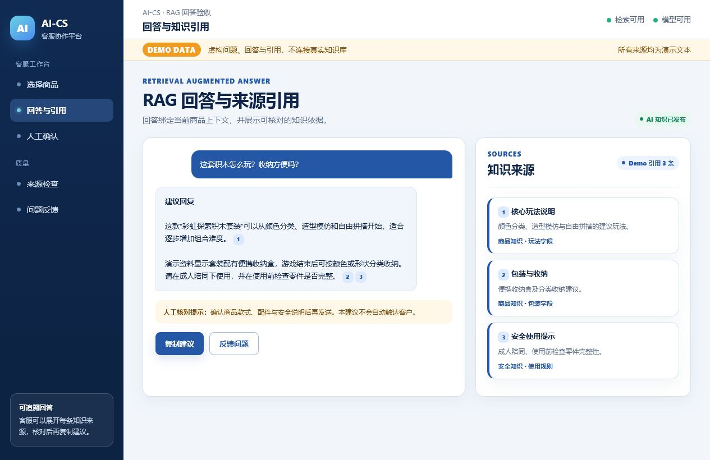
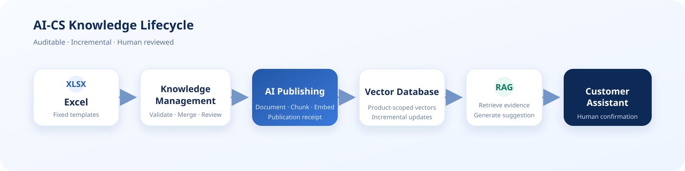
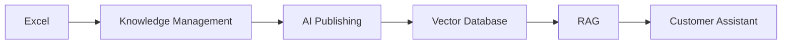

<div align="center">

# AI-CS

### 商品知识驱动的本地 AI 客服与运营协作系统

[](https://github.com/666whatcanisay/AI-Customer-Service-for-Toys/releases/tag/ai-cs-v1.0.0)


AI-CS 将商品资料治理、AI 知识发布、RAG 检索和客服辅助回答连接成一条可审核、可追溯的业务流程。

> AI 只生成建议。所有对客回复必须由客服人工确认；系统不自动发送消息、不自动退款、不修改订单。

</div>

## 项目介绍

AI-CS 面向需要持续维护商品知识的客服与运营团队。运营人员可以通过固定 Excel 模板导入和审核商品知识，按商品增量发布到本地向量检索系统，并控制哪些商品进入客服工作台。客服在选定店铺、商品和 SKU 后获得带来源引用的 AI 回复建议。

项目采用本地优先架构：业务数据、模型和向量数据保留在部署环境中，不随 Git 仓库分发。仓库只包含源代码、共享契约、迁移脚本、测试和脱敏展示材料。

## 核心能力

| 能力 | 说明 |
| --- | --- |
| 商品知识导入 | 固定 Excel 模板解析、店铺校验、字段级 Merge 预览和人工审核 |
| 商品生命周期 | 知识审核、客服启用、AI 发布三个状态独立管理 |
| 客服可用目录 | C 端统一决定客服可用商品，B 端只消费最终投影 |
| AI 知识发布 | 按商品增量生成知识文档、切片、Embedding 和发布收据 |
| RAG 辅助回答 | 基于所选商品检索知识，返回建议回复和可展开来源 |
| 人工安全边界 | 不自动发送、不自动退款、不修改订单，所有业务动作由人员确认 |
| 反馈沉淀 | 记录采用状态和问题反馈，支持后续人工知识优化 |
| 可复现运行 | B、C Admin、A、C API 使用统一版本和标准启停脚本 |

## 产品展示

以下画面全部由虚拟店铺、虚拟商品和 Demo 数据生成，不连接真实业务系统。

### A. AI 客服工作台



### B. 运营知识中心



### C. 商品知识导入流程



### D. AI 知识发布状态



### E. RAG 回答与引用



## 系统架构





| 组件 | 目录 | 职责 |
| --- | --- | --- |
| B 客服工作台 | `frontend/` | 选择业务上下文、生成建议回复、展示引用和人工确认 |
| C 运营前端 | `admin_web/` | 商品、知识、导入、审核、发布和客服启用 |
| A AI 服务 | `backend/` | 本地模型调用、RAG 检索和安全回答 |
| C 平台 API | `platform_backend/` | 业务数据、审核、目录投影、发布与审计收据 |
| 共享契约 | `contracts/` | 跨服务 Schema、版本与兼容性说明 |

## 技术栈

| 层级 | 技术 |
| --- | --- |
| Web | Vue 3、TypeScript、Vite、Element Plus |
| API | Python、FastAPI、Pydantic |
| 数据与迁移 | SQLite、SQLAlchemy、Alembic |
| AI 与检索 | Ollama、Qwen3.5:9B、ChromaDB、Embedding、RAG |
| 质量保障 | Pytest、Vitest、Playwright、Contract Tests |
| 运维 | PowerShell、统一 PID/健康状态记录、标准启停入口 |

## 运行方式

### 1. 获取代码

```powershell
git clone https://github.com/666whatcanisay/AI-Customer-Service-for-Toys.git
cd AI-Customer-Service-for-Toys
git checkout release/ai-cs-v1.0.0
```

### 2. 准备本地依赖

- 按 `backend/requirements.txt` 和 `platform_backend/requirements.txt` 创建独立 Python 环境。
- 按前端 lockfile 安装依赖，不升级冻结版本。
- 安装 Ollama，并准备兼容的本地模型。
- 从示例配置创建本地配置；真实密钥、业务数据库、知识文件和向量数据不得提交 Git。

### 3. 启动、检查与停止

```powershell
.\scripts\windows\start_ai_customer_service.ps1
.\scripts\windows\status_ai_customer_service.ps1
.\scripts\windows\stop_ai_customer_service.ps1
```

标准本地端口：客服工作台 `5173`、运营后台 `5174`、AI 服务 `8000`、平台 API `8011`。跨设备访问前请遵循所在网络的安全策略，只开放必要的客服入口。

## 版本说明

### AI-CS V1.0.0

- **R008**：Runtime 收敛、统一服务身份和标准启停流程。
- **R009**：商品知识 Excel 导入、Merge 预览与人工审核。
- **R006**：Customer Available Catalog 与客服启用控制。
- **R006.1**：商品级 AI 知识增量发布、可见性和发布收据。
- **R006.2**：客服目录焦点刷新、低频检查和批量启用体验优化。
- 支持本地 Qwen3.5:9B 与带来源引用的 RAG 回答。

查看完整说明：[AI-CS V1.0.0 Release](https://github.com/666whatcanisay/AI-Customer-Service-for-Toys/releases/tag/ai-cs-v1.0.0)

## 数据与安全边界

- Git 不包含真实业务数据库、知识源、向量、模型、日志、运行记录或客户数据。
- Demo 截图不包含公司名称、真实店铺、真实商品、客户、订单或内部地址。
- 新知识必须经过人工审核；客服启用和 AI 发布是独立的人工操作。
- AI 回答为建议稿，客服必须核对商品、来源和风险提示后再发送。
- 系统不自动发送消息、不自动退款、不修改订单，也不自动写入外部业务系统。

## 文档入口

- [V1.0.0 Release Notes](docs/control/product-management/Release-Notes-AI-CS-V1.0.0.md)
- [Requirement Registry](docs/control/AI-CS-Requirement-Registry-V1.md)
- [Interface Freeze](docs/control/interfaces/)
- [Showcase assets](docs/showcase/)
