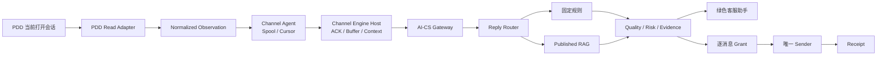

# AI-CS + AI-CE 系统架构

## 总览

项目采用“渠道执行层 + AI 业务层”分离架构。AI-CE 负责可靠读取、上下文组装和受控执行；AI-CS 负责身份、商品知识、回答决策和运营管理。两者通过现有 Observation、Gateway、Decision 与 Approval 契约连接。

## 模块职责

| 模块 | 核心职责 | 不负责 |
| --- | --- | --- |
| PDD Adapter | 读取当前页面、识别消息/角色/商品、生成 Snapshot | 知识推理与长期存储 |
| Channel Agent | 标准化 Observation、持久化 Spool、等待 ACK 后推进 Cursor | 直接绕过 Host 调用 Sender |
| Channel Engine Host | 去重、排序、Buffer、CustomerContext、执行授权与审计 | 商品知识运营 |
| AI-CS A | Reply Router、固定规则、RAG、Quality 与 Evidence | 浏览器控制 |
| AI-CS C | IAM、Store/Product/SKU、知识发布、会话业务投影 | 模型回答逻辑复制 |
| 客服助手 | 展示当前会话、AI 回复、人工状态与运行开关 | 作为事实授权源 |
| Sender | 在最终身份复核后执行一次发送并确认结果 | 长期通配发送权 |

## 核心数据流

1. Adapter 只读取当前打开的 PDD 会话，自动导航默认关闭。
2. Channel Agent 将消息写入本地 Spool；Host 成功持久化并 ACK 后才推进 Cursor。
3. Host 依据 Store、conversation、customer、message 和 sequence 组装 CustomerContext。
4. AI-CS 使用当前 Store/Product/SKU 范围执行 Reply Router、RAG/固定规则和质量门。
5. 回答与 Evidence Hash 返回 AI-CE。符合运行策略的每条客户消息必须生成独立、短期、单次 Grant。
6. 唯一 Sender 再次核对页面、双 Store ID、会话、客户、回复 Hash、输入框和 Kill Switch。
7. 成功、失败或 UNKNOWN 都写终态 Receipt；UNKNOWN 不自动重试。

## 关键一致性约束

- 店铺授权使用 AI-CS `store_id` 与 PDD `platform_store_id` 双 ID，名称仅展示。
- 商品事实只能来自当前消息商品卡、当前会话最近商品卡或当前会话已冻结 Product，不跨会话猜测。
- Cursor 必须晚于 Host ACK。
- 自动回复开关只允许签发 Grant，不等于 Sender 获得长期授权。
- 同一客户消息最多一个成功 Receipt。
- 输入框非空、页面身份漂移、目标不唯一或 Kill Switch 开启时停止发送。

## 本地运行拓扑

| 服务 | 默认端口 | 目录 |
| --- | ---: | --- |
| AI Core | 8420 | `backend/` |
| Platform API | 8421 | `platform_backend/` |
| 客服工作台 | 8422 | `frontend/dist/` |
| Admin | 8423 | `admin_web/dist/` |
| Channel Engine Host | 由 AI-CE Runtime 配置 | `AI-CS-Channel-Execution-Engine/` |

开发配置、数据库、密钥和服务记录都位于 `.runtime/`，不会进入 Git。
