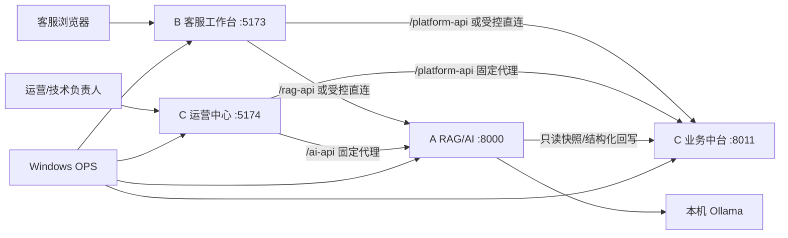

# 架构资产：服务、关系与部署

## 系统架构

## 三端责任

| 端 | 所有路径 | 责任 | 不负责 |
| --- | --- | --- | --- |
| A | `backend/**`、`docs/rag/**` | 本地检索、模型调用、受控评测/分析、AI 状态投影 | C 数据库直连、自动训练、Prompt/知识自动写入。 |
| B | `frontend/**`、`docs/customer/**` | 客服工作流、商品/SKU 上下文、人工复制、案例与反馈采集 | 审核、模型管理、业务自动执行。 |
| C | `platform_backend/**`、`admin_web/**`、`docs/platform/**` | 资料、目录、案例/反馈保存审核、运营后台和只读投影 | AI 决策、模型训练、ERP 写入。 |
| OPS | `scripts/**` 与受管 `.runtime` | 受管启停、PID/版本核验、网络诊断 | 结束未知进程、暴露内部端口、绕过防火墙规则。 |

`contracts/**` 是共享契约区：任何破坏性字段、版本或状态变化必须附 schema、兼容说明、变更记录和受影响线路复核。

## 关键数据流

1. **客服建议**：B 传递已选商品范围和问题给 A；A 通过 C 的测试目录/受控资料范围给出建议与来源；客服人工确认后复制。
2. **经验案例**：B → C 保存为 `NEW`；运营可转 `REVIEWING`、`APPROVED` 或 `REJECTED`；A 仅消费 C 的已批准不可变快照并回写评测证据。
3. **AI 问题**：B → C 保存反馈；C 的生命周期是 `NEW → ANALYZING → ANALYZED`；A 只处理 C 已确认快照并以 revision/hash 回写。
4. **资料质量**：运营上传资料 → C 识别/人工审核 → A 显式分析 → C 展示缺口 → B 只读显示紧凑提醒。`ANALYZED` 不代表 RAG 已发布。

## 服务部署与网络

默认本机模式使用 `127.0.0.1`：A `8000`、C `8011`、B `5173`、Admin `5174`。B 和 Admin 的 Vite 代理只允许固定前缀，分别转到本机 A/C；不提供任意转发。局域网模式的对外客服入口仅应为选定物理网卡的 `5173`；A、C 和 Admin 不应暴露给局域网。Admin 默认保持 `127.0.0.1:5174`。

官方脚本依次启动 C → A → B → Admin，验证 Alembic、测试包、47 条知识同步和真实 Ollama smoke。运行身份由工作目录、Git SHA、受管 PID、监听 PID、命令特征、启动时间和 health 共同核验。
