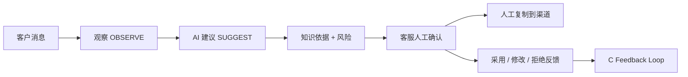
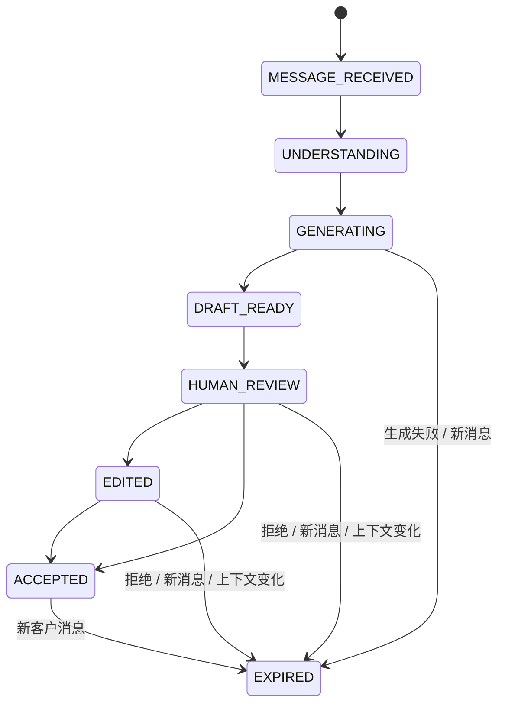

# 《AI-CS Human-in-the-loop Customer Workspace V1 完成报告》

## 0. 执行摘要

本任务把现有 B 客服的“按商品提问 Demo”扩展为可重复验收的 AI 客服副驾驶工作台。实现保持 `OBSERVE + SUGGEST + HUMAN_CONFIRM_SEND`：客户消息先进入会话中心，A 生成带引用和风险的回复草稿，客服采用、修改采用或拒绝后写入既有 C Feedback Loop；系统只提供复制，不存在自动发送、退款或订单修改。

实现位于独立 Worktree：

- Source：`AI-CS@0ff658c63b3a84ba685783aff67277952ecc1924`
- Branch：`codex/human-in-loop-customer-workspace-v1`
- Worktree：`C:\Users\EDY\Documents\Codex\2026-07-21\AI-CS-human-in-loop-workspace-v1`
- 正式 `AI-CS` 目录未修改；Channel Engine `channel-engine-v0.1.0rc1@673ce7e1...` 未修改。
- Gateway Contract 仍为 wire `1.0`，canonical SHA-256 仍为 `e5ac64a82d2a7ccd19d3ece9bcc076242b55b6c205c85626786e8b1b7478f4b5`。

## 1. 产品定位

AI-CS V1 不是无人值守机器人，而是客服副驾驶：



产品边界：AI 负责建议和依据，客服负责事实核对、最终措辞和发送动作；V1 不连接真实 PDD，也不接管 Channel Engine 的 Browser、Session、Execution 或 Receipt。

## 2. Phase 0 真实能力审计

| 模块 | 已有、直接复用 | 本次升级 | 未新增 |
|---|---|---|---|
| B 客服 | 商品目录、SKU、`/api/chat`、引用、采用事件、AI 问题反馈 | 三栏工作台、会话/草稿状态、决策可视化、Mock Message 边界 | 没有真实渠道发送 |
| C Admin | AI 问题中心、反馈优化池、知识缺口、经验案例 | 将四个已有入口收敛到“客服运营” | 没有新 API/表/模块 |
| A | RAG、风险、action、sources、required fields | 零修改，只复用 `/api/chat` | 没有 Prompt/模型/RAG 变化 |
| Gateway | Contract V1 Decision/Health/HMAC | 零修改；仅作为未来 Channel Adapter 边界 | 没有部署或真实 Agent 调用 |
| Channel Engine | Session/Adapter/Gateway/Approval/Receipt RC1 | 零修改；V1 由前端接口隔离 | 没有 PDD 接入 |

## 3. UX 与页面结构

新路由为 `/workspace`，旧 `/ai-chat` 保持有效。首页和主导航进入新工作台，旧书签/API 不受影响。

```text
┌────────────────────┬────────────────────────────────────┬──────────────────┐
│ Conversation Center│ AI Reply Assistant                 │ Decision Center  │
│ 店铺/客户/会话      │ 业务上下文、消息时间线、AI草稿     │ 人工决策状态     │
│ 未读、时间、来源    │ 商品知识/FAQ/安全规则引用           │ 风险/覆盖/动作   │
│ Mock新消息          │ 采用/修改采用/拒绝/重新生成/复制    │ Feedback回执     │
└────────────────────┴────────────────────────────────────┴──────────────────┘
```

设计规则：

- 深色高信息密度工作台；状态与可操作区分离。
- 不伪造置信度：A 当前未提供时明确显示“未提供”。
- 引用按商品知识、FAQ、安全规则解释“为什么这样回答”。
- `Approved` 只代表采用事件已记录，仍需客服人工复制发送。
- Mock Message 明示不连接真实 PDD、不读取真实客户数据。

## 4. 回复草稿状态机



决策状态单独保存为 `WAITING_HUMAN / APPROVED / REJECTED`。新消息到达时旧草稿先归档为 `EXPIRED`，再为新消息创建 `MESSAGE_RECEIVED` 草稿；`EXPIRED` 不会自动重试。

## 5. 组件架构

| 文件 | 职责 |
|---|---|
| `frontend/src/views/HumanInLoopWorkspace.vue` | 编排目录、RAG、Feedback 和三栏 UI |
| `frontend/src/components/humanLoop/ConversationCenter.vue` | 会话列表、未读、消息来源、Mock 新消息 |
| `frontend/src/components/humanLoop/ReplyAssistantPanel.vue` | 上下文、时间线、草稿、引用、人工操作 |
| `frontend/src/components/humanLoop/DecisionCenter.vue` | 风险、知识覆盖、建议动作、决策与回执 |
| `frontend/src/stores/humanLoopWorkspace.ts` | Pinia 状态机和草稿失效规则 |
| `frontend/src/workspace/channelMessageAdapter.ts` | Channel Message 适配接口和内存 Mock 实现 |
| `admin_web/src/views/CustomerOperationsView.vue` | 复用现有质量、Badcase、知识缺口和反馈入口 |

Pinia 固定为 `2.2.4`，与当前 Vue `3.4.x` peer 范围兼容；没有升级 Vue、Axios、Element Plus 或任何后端依赖。

## 6. API 变化

**API 与数据库变化为零。** 本次只消费现有接口：

| Owner | 方法与路径 | 用途 |
|---|---|---|
| C | `GET /api/v1/customer-service/catalog/stores` | 客服可用店铺 |
| C | `GET /api/v1/customer-service/catalog/products` | 客服可用商品 |
| C | `GET /api/v1/customer-service/catalog/products/{product_id}/skus` | SKU |
| A | `POST /api/chat` | 按冻结商品上下文生成建议与引用 |
| C | `POST /api/v1/ai-interaction-events` | `DIRECT_ACCEPT / EDITED_ACCEPT / REJECTED` |

`REJECTED` 继续使用现有 Customer Feedback Loop 生成问题沉淀；没有新 FastAPI route、migration、contract 或 Gateway 字段。

## 7. 完整 Demo 流程

浏览器演示使用去标识化“星光积木演示店 / 创意积木小屋”：

1. Conversation Center 收到客户关于年龄和材质的 Mock Message。
2. 客服绑定 Store/Product，SKU 保持 `null`。
3. 现有 A client 生成建议，并展示商品知识、FAQ、安全规则三类依据。
4. Decision Center 展示低风险、3 条依据、受控答复和 `Waiting Human`。
5. 客服修改措辞并点击“修改后采用”。
6. 现有 C client 产生 `EDITED_ACCEPT` interaction event 与回执。
7. 状态变为 `Approved`；仅出现“复制已确认回复”，不出现发送动作。
8. 新 Mock Message 到达，旧草稿自动失效，新草稿回到 `MESSAGE_RECEIVED`。

浏览器证据位于忽略目录 `.runtime/human-loop-workspace-v1/evidence/`：

- `workspace-edited-accept.png`
- `new-message-expired-old-draft.png`
- `human-loop-browser-result.json`

## 8. 测试结果

| 范围 | 结果 |
|---|---|
| B Vitest | `136 passed`（含状态机、三类人工动作、适配器、组件和既有 40 项 AiChat 回归） |
| B TypeScript | PASS |
| B production build | PASS；Vite 输出既有大 chunk warning |
| C Admin Vitest | `77 passed` |
| C Admin TypeScript | PASS |
| C Admin production build | PASS |
| A pytest | `143 passed, 3 skipped`；skip 为显式真实外部 E2E |
| C pytest | `121 passed` |
| Playwright + system Chrome | PASS；三栏、引用、修改采用、回执、新消息失效、安全边界全部通过 |
| `git diff --check` | PASS |

隔离浏览器使用端口 `15183`，结束后进程和监听已清理。浏览器只拦截已有 A/C API 路径返回去标识化演示 envelope；后端 TestClient 全量回归独立证明真实 API 合同没有被破坏。

## 9. 启动方式与 Runtime 事实

合并到正式 `AI-CS` 后，仍使用原启动方式：

```powershell
cd C:\Users\EDY\Documents\Codex\2026-07-21\AI-CS
.\scripts\windows\start_ai_customer_service.ps1
.\scripts\windows\status_ai_customer_service.ps1
```

标准目标仍为 B `5173`、Admin `5174`、A `8000`、C `8011`。

本任务结束时未切换正式 Runtime。只读 status 证据显示：`5173` 和 `8000` 被**非 AI-CS、无受管身份**的其他进程占用，`5174/8011` 未运行；数据库 revision 仍为 `0012_internal_production_finalization_v1`，Ollama `qwen3.5:9b` 可用。为避免影响用户其他项目，本任务没有停止这些进程，也没有把普通 HTTP 200 误报为 AI-CS 四服务验证。因此标准端口部署须在独立静默窗口先释放冲突端口，再从合并后的 clean SHA 启动。

## 10. 真实 PDD 下一步计划

1. 保持 Channel Engine RC1 不变，在其后续版本实现 `ChannelMessageAdapter` 的生产实现。
2. 先通过 Observe Only Gate，把真实消息转换成相同 `ChannelMessageEnvelope`；不得带 Cookie、Token 或客户直接标识进入浏览器存储。
3. Gateway 仍只负责冻结 Decision Contract；Workspace 不直接控制 Chrome/PDD Session。
4. 人工发送必须发生在 Channel Agent/渠道界面；V1 Workspace 只返回已确认内容和 interaction event。
5. 真实发送前另行冻结 Approval → Execution → Receipt 合同和 Selector VERIFIED 证据；`AUTO_SEND` 保持禁止。

## 11. 剩余风险

- 新工作台尚未合并/部署到正式 5173；当前结论是**实现与隔离验收 READY**，不是 Production Deployment。
- 当前消息来源仅 Mock Adapter；真实 Channel Agent 接入属于后续受控任务。
- A 没有置信度字段，UI 如实显示“未提供”；不得用引用数量伪装概率置信度。
- 前端现有依赖审计报告 9 个已知漏洞（6 moderate、2 high、1 critical），本任务未执行破坏性 `npm audit fix`；上线前应单独做依赖安全治理。
- B 构建包仍有既有 >500 kB chunk warning，属于性能优化项，不影响本 Gate。

---

Final Status: `AI_CS_HUMAN_IN_LOOP_WORKSPACE_READY`
