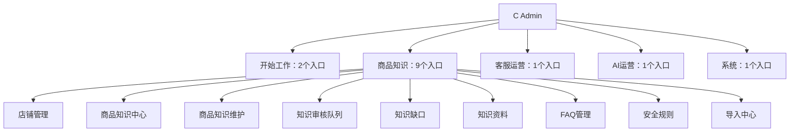
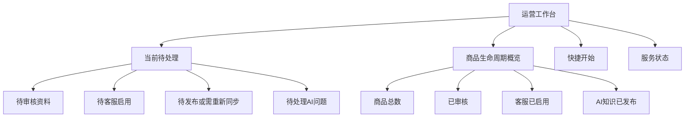
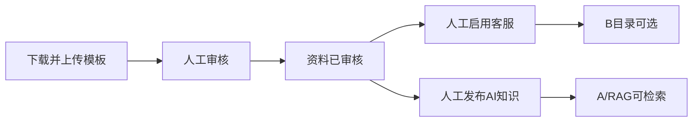

# AI-CS UI Information Architecture Optimization Plan V1

## 0. 结论

当前功能并不缺失，主要问题是“所有能力被同时摊平”：C Admin 有 5 个导航分组、14 个直接入口，其中 9 个集中在“商品知识”；B 客服入口只有 4 个，但 AI 客服首屏同时出现多套流程说明、重复安全提示、业务状态和技术入口。

本计划建议：

- C Admin 默认采用 6 个常用入口：`运营工作台 / 商品 / 知识 / 导入 / 客服运营 / AI 状态`。
- 低频治理入口折叠到“高级功能”，但保留原路由、直接链接和全部业务能力。
- B 客服保留店铺、商品、可选 SKU、提问、核对复制的业务步骤，只合并重复说明，并把技术字段继续放入按需展开区。
- “简洁模式 / 高级模式”只控制导航密度与默认展开状态，不是权限系统，不改变任何审核、发布、启用或安全规则。
- 首页只展示现有接口能证明的真实数据。不能由现有数据证明“今日”的指标，一律命名为“当前待处理”或仅提供快捷入口。

本轮只形成设计，不修改 UI、API、数据库、Runtime 或业务逻辑。

## 1. 审查基线与证据

| 项目 | 真实基线 |
| --- | --- |
| Repository | `C:\Users\EDY\Documents\Codex\2026-07-21\AI-CS` |
| Source SHA | `8fe36b109d533131e11609841f2ce5ec1b2d6f00` |
| C 导航来源 | `admin_web/src/App.vue` |
| C 路由来源 | `admin_web/src/router/index.ts` |
| C 首页 | `admin_web/src/views/OperationsOverviewView.vue` |
| C 商品知识中心 | `admin_web/src/views/KnowledgeCenterView.vue` |
| C 导入中心 | `admin_web/src/views/ImportCenterView.vue` |
| C 资料上传与审核 | `admin_web/src/views/KnowledgeMaterialsView.vue` |
| C AI 控制中心 | `admin_web/src/views/AiCapabilityCenterView.vue` |
| B 导航来源 | `frontend/src/layouts/CustomerWorkbenchLayout.vue` |
| B 客服主流程 | `frontend/src/views/AiChat.vue` |

量化结果：

- C Admin：5 个分组、14 个侧栏直达入口；“商品知识”分组包含 9 个入口。路由表共 30 个 `path` 声明，其中包含详情页、兼容页和受开发开关控制的测试页。
- B 客服：4 个主要入口、2 个“帮助与改进”入口。
- B AI 客服主任务：店铺和商品为必选、SKU 为可选，之后输入问题、生成建议、核对依据、记录采用结果并人工复制。

## 2. 当前信息架构

### 2.1 C Admin 当前结构

主要问题：

1. **能力按实现模块平铺，而不是按运营任务组织。** 新运营需要先理解“知识中心、知识维护、审核队列、知识资料、导入中心”之间的技术边界。
2. **入口名称与页面名称不一致。** 侧栏“AI运营概览”、首页“AI控制中心”和页面标题“AI控制中心”指向同一能力；“知识资料”实际承担 R009 的 Excel 上传与 Merge 审核，名称不足以表达任务。
3. **高频与低频能力同级。** 商品查看、资料导入与 FAQ、安全规则、系统状态同时占据一级导航。
4. **同一生命周期被拆散。** 商品资料审核、客服启用、AI 发布分别在不同页面或卡片中，状态设计正确，但下一步入口不够集中。
5. **首页的“待办感”与数据语义不完全一致。** 当前部分卡片显示的是总记录数，不一定是待处理数，更不能直接称为“今日待处理”。

当前典型运营任务的页面与确认步数如下。这里把“人工确认”单独计算，不把它误当成可以删除的多余点击：

| 运营任务 | 当前最短路径 | 当前负担判断 |
| --- | --- | --- |
| 新增店铺/商品 | 店铺管理 → 新增表单 → 保存 | 动作不多，但“店铺管理”藏在商品知识分组中 |
| 下载 Excel | 导入中心 → 找到模板 → 下载 | 路径清楚，模板卡片信息偏密 |
| R009 商品知识导入 | 知识资料 → 选店铺 → 选模板 → 选文件 → 上传预检 → 逐商品审核 | 审核步骤必要；主要问题是“知识资料”入口名称不清楚 |
| 手工补充知识 | 商品知识维护 → 选范围/类型 → 保存 → 知识审核队列 → 人工审核 | 两个页面符合审计边界，但首次使用者不易理解与 R009 审核的区别 |
| 让新商品完整上线 | 导入审核通过 → 商品知识中心 → 启用客服 → 发布 AI 知识 | 两个独立动作必须保留；需要更清楚的状态与下一步引导 |
| 处理 FAQ/安全规则 | FAQ管理或安全规则 → 查看专项数据 | 一步直达，但属于低频治理，不必常驻默认导航 |

### 2.2 B 客服当前结构

该业务步骤本身合理，不能为了“少一步”删除店铺或商品确认。当前负担主要来自信息重复：

- 顶部 3 步流程条与下方 5 段“客服处理路径”同时完整展示。
- 全局安全横幅、页面红色安全提示、五项安全标签和侧栏边界反复表达同一规则。
- 商品选择后，普通客服会直接看到“发布收据是否生成”等偏治理信息。
- 全局状态、连接详情、商品知识状态、回答技术详情存在多层技术入口，虽大多已折叠，但命名可进一步统一。

## 3. 用户角色与任务

| 角色 | 高频目标 | 应默认看到 | 应按需展开 |
| --- | --- | --- | --- |
| 普通运营 | 管商品、补资料、审核、启用客服、确认 AI 可用 | 待处理任务、商品三状态、下一步动作、失败提示 | FAQ专项治理、安全规则、收据、fingerprint、chunk细节 |
| 运营管理员 | 处理知识质量、客服反馈、发布和系统异常 | 简洁模式全部内容 + 高级功能入口 | 技术诊断字段、完整审计记录 |
| 客服 | 快速选对商品、获得建议、核对依据并人工发送 | 商品上下文、AI可用状态、风险提示、回答依据、复制操作 | 内部ID、模型、耗时、Git/API模式、发布收据 |
| 技术运维 | 排查服务、版本、请求和发布异常 | 服务状态与明确失败原因 | SHA、启动模式、API模式、request ID、collection/fingerprint |

重要边界：当前系统没有把“简洁/高级”与身份鉴权绑定。因此高级模式只能是信息展示偏好，不能用于保护敏感能力或替代 RBAC。

## 4. 新的信息架构

### 4.1 C Admin 简洁模式（默认）

| 一级入口 | 默认落点 | 承载任务 | 保留的现有能力 |
| --- | --- | --- | --- |
| 运营工作台 | `/overview` | 看当前待处理与系统可用性 | 原首页与快捷入口 |
| 商品 | `/store-management` | 店铺、商品档案、客服准入 | 店铺管理、新增商品、启停、收据入口 |
| 知识 | `/knowledge-center` | 看商品三状态并继续审核、启用、发布 | 商品知识中心、商品详情、批量启用、增量发布 |
| 导入 | `/import-center` | 下载固定模板并进入上传审核 | 六模板下载保持不变；R009上传继续进入 `/knowledge-materials` |
| 客服运营 | `/customer-operations` | 查看案例、AI问题和运营建议 | 原客服运营工作台 |
| AI 状态 | `/ai-capabilities` | 判断 AI、知识和评测是否可用 | 原 AI 控制中心的只读能力 |

“商品”入口在视觉上可使用副标题“店铺与商品”，避免用户误以为店铺管理消失；不需要新增页面或改变路由。

### 4.2 C Admin 高级模式

高级模式保留上述 6 个入口，并展开三个低频分组：

| 高级分组 | 现有路由 | 说明 |
| --- | --- | --- |
| 知识治理 | `/knowledge-editor`、`/knowledge-review`、`/knowledge-gaps`、`/knowledge-materials`、`/faqs`、`/safety-rules` | 中文知识维护、独立审核队列、缺口、R009上传审核、FAQ和安全规则 |
| 运营复盘 | `/ai-issues` 及客服运营工作台内现有案例/建议入口 | 问题分析、经验和改进建议；不创建新的业务模块 |
| 系统诊断 | `/system-status` | 平台服务状态和技术排查 |

发布记录和 activation receipt 已经存在于商品/店铺详情中，应作为对象级高级信息展开，不能为了导航完整性虚构一个新的“发布记录模块”。

### 4.3 模式切换规则

- 默认进入简洁模式。
- 切换结果可保存在浏览器本地偏好；不需要数据库或 API。
- 切换只影响侧栏入口数量和详情默认展开状态。
- 原 URL、书签、深链、返回路径继续有效。
- 高级模式不是权限：有页面访问权的用户仍可通过合法深链访问现有页面。
- 测试工具仍由现有 `VITE_ENABLE_TEST_TOOLS` 控制，不能因高级模式而对运营开放。

## 5. 首页优化方案：运营工作台

首页应回答三个问题：现在有什么要处理、商品处于什么阶段、系统是否可用。

### 默认展示

1. **当前待处理**：只显示现有接口能够证明状态的数量；卡片直接进入对应筛选结果。
2. **商品生命周期**：用“资料 → 客服 → AI”展示已审核、已启用、已发布的真实数量。
3. **快捷开始**：下载模板、上传并审核、查看商品知识、处理 AI 问题。
4. **服务状态**：只显示“平台可用 / AI可用 / 存在异常”，提供刷新和进入诊断入口。

### 数据诚信规则

- 现有接口若只返回总量，标题必须写“总数”，不能写“待处理”。
- 现有接口若没有按日期聚合，不能展示“今日新增、今日完成、今日趋势”。V1 先使用“当前待处理”。
- 接口失败必须显示“暂时无法读取”，不能以 `0` 伪装为空。
- 不为首页新增统计 API；无法由现有数据支持的卡片推迟到未来接口治理任务。

## 6. 页面折叠与展开设计

### 6.1 商品知识中心

**默认展示：**

- 店铺筛选。
- 商品名称。
- 三个独立状态：资料审核、客服使用、AI 知识。
- 唯一明确的“下一步动作”，如审核资料、启用客服、同步 AI 知识。
- 当前待客服启用数量及受控批量操作。

**点击商品后展开：**

- 简介、年龄、材质、包装、卖点、FAQ、SKU。
- 覆盖率、可回答主题和缺失主题。

**高级查看：**

- chunk 数、embedding 状态、collection、fingerprint。
- activation/publication receipt、操作人、时间和内部标识。

这样保留全部 R006/R006.1 能力，只改变默认信息优先级。

### 6.2 导入中心

导入中心继续只负责六类固定模板的展示、下载和填写说明，不把批量上传逻辑塞入模板管理。

**默认展示：**

- 六个模板名称、用途、支持状态和下载按钮。
- 一个明确的“进入资料上传与审核”入口。
- 三步使用说明的短版。

**点击展开：**

- 每个模板的字段说明、填写边界和示例注意事项。

**高级/开发环境才显示：**

- 旧版试点数据入口和测试数据包；继续受现有环境开关控制。

当前导入中心和上传页都要求选择店铺，认知上有重复。后续 UI 实施可让模板下载不依赖店铺，并把真正的店铺绑定继续放在 R009 上传页 Step 1；这不改变 R009 校验和审核流程，也不改变导入中心定位。

### 6.3 AI 状态页（当前 AI 控制中心）

由于当前页面不提供模型切换或 Prompt 修改，普通模式建议命名为“AI 状态”，避免“控制中心”暗示可执行控制。

**默认展示：**

- AI 服务是否可用。
- 当前模型是否就绪（使用业务可读名称）。
- 知识是否可检索。
- 最近评测是否通过及覆盖用例。
- 明确的异常处理建议。

**点击展开：**

- 启动后运行指标和评测详情。

**技术详情：**

- 模块标识、Prompt 版本/hash、初始化错误、最近异常摘要。

## 7. B 客服体验优化

### 7.1 必须保留的步骤

- 店铺必选：防止跨店使用资料。
- 商品必选：确定回答上下文。
- SKU 可选：不确定时允许留空，不能猜测。
- 客户问题、AI建议、依据核对、人工复制。
- 人工确认、不自动发送、不自动退款、不修改订单的安全边界。

这些步骤是风险控制，不应以“减少点击”为由删除。

### 7.2 默认首屏

1. 保留一套 3 步进度：`选择商品 → 输入问题 → 核对并复制`。
2. 将现有 5 段“客服处理路径”折叠为“查看处理规范”，避免与进度条重复。
3. 全局只保留一条持续可见的安全提示；在复制前继续显示一次上下文安全提醒。
4. 店铺和商品保持显式；仅当商品确实存在 SKU 时展示 SKU 选择器，否则显示“该商品无款式可选”或隐藏可选控件。
5. 商品选定后显示业务可读状态：`AI知识已发布 / 知识待同步 / 当前无可靠依据`。

### 7.3 应展示的信息

- AI、商品目录是否可用。
- 当前店铺、商品、SKU。
- AI 知识是否可用、可核对依据数量。
- 回答动作建议、风险级别、缺失信息。
- 可读的回答依据和人工复制操作。

### 7.4 默认隐藏的信息

- tenant、store code、product ID、SKU ID。
- Git SHA、启动模式、API 模式、前端版本。
- model、latency、request/event ID。
- publication receipt ID、collection、fingerprint、chunk ID。

这些信息继续保留在“技术排查”抽屉中。普通客服看到“已发布、有 3 条依据”即可，不需要直接看到发布收据。

### 7.5 主任务步数评价

| 任务 | 当前必要动作 | 结论 |
| --- | --- | --- |
| 发起一次咨询 | 选店铺、选商品、可选SKU、输入问题、生成 | 必要步骤合理；主要问题是说明重复，不是动作过多 |
| 核对并发送 | 看风险、看依据、修改、记录采用、复制 | 安全链路应保留；可通过视觉主次减少扫描成本 |
| 切换商品 | 改商品并重新确认上下文 | 必须保留清空旧上下文的行为 |
| 技术排查 | 展开连接/回答技术信息 | 低频，继续按需展开 |

## 8. C 运营体验优化

### 8.1 首次进入路径

首次进入默认落到“运营工作台”，提供三条任务式入口：

1. **我要导入商品资料**：进入导入中心下载模板，再进入现有 R009 上传与审核。
2. **我要让商品给客服使用**：进入商品知识中心并定位“已审核、客服未启用”。
3. **我要检查 AI 能否回答**：进入商品知识中心查看 AI 状态，或进入 AI 状态页检查服务。

这些入口只是现有页面的导航，不合并审核、启用或发布动作。

### 8.2 商品上线任务链

UI 应在每个完成收据后只提示下一步，不自动执行下一步：

- 审核完成：提示“去商品知识中心查看客服与 AI 状态”。
- 客服启用完成：提示“客服工作台刷新目录后即可使用”。
- AI 发布完成：提示“已发布并生成可追溯收据”。

### 8.3 命名统一

| 当前名称 | 建议展示名 | 原因 |
| --- | --- | --- |
| 首页 | 运营工作台 | 表达任务入口而非网站首页 |
| AI运营概览 / AI控制中心 | AI 状态 | 当前主要是只读状态与评测，不提供模型控制 |
| 知识资料 | 资料上传与审核 | 与 R009 页面真实任务一致 |
| 商品知识维护 | 手工补充知识 | 区分 Excel 导入 |
| 知识审核队列 | 手工资料审核 | 区分 R009 在上传页内的 Merge 审核 |

仅改变展示名称，不修改 URL、契约或状态语义。

## 9. 实施优先级

### P0：信息架构冻结

- 冻结 6 个简洁入口与高级分组映射。
- 冻结命名词典和“高级模式不是权限”的边界。
- 建立现有路由到新导航的映射测试。

验收：全部现有生产路由仍可访问；R006/R009 操作步骤和状态不变。

### P1：低风险 UI 收敛

- C 侧栏分为简洁/高级，默认简洁。
- 统一首页、AI 状态、资料上传与审核命名。
- B 合并重复进度说明和安全提示，技术信息保持折叠。
- 商品知识卡片默认突出三状态和下一步动作。

验收：不新增 API；B/C 单元测试、typecheck、build 和核心浏览器流程通过。

### P2：首页与渐进展开

- 用现有真实接口重排运营工作台。
- 折叠商品知识详情、导入说明、AI 技术详情。
- 为审核、启用、发布成功结果提供现有路由的下一步链接。

验收：接口失败不显示假 `0`；无来源数据不标记“今日”；直接链接与返回路径可用。

### P3：未来可选治理

- 只有在另立接口任务后，才考虑真正的“今日”指标或跨页面待办聚合。
- 只有在正式认证/RBAC 建立后，才把角色与页面权限绑定。

P3 不属于本计划授权范围。

## 10. 后续实施验收清单

1. 简洁模式最多显示 6 个一级入口；高级模式可访问全部既有正式能力。
2. 原 14 个侧栏入口对应路由无丢失，旧书签可继续打开。
3. Import Center 仍展示和下载六类模板；R009 上传仍在资料上传与审核页。
4. 商品资料审核、客服启用、AI 发布仍是三个独立人工动作。
5. B 店铺和商品仍必选，SKU 仍可选；切换上下文仍清空旧建议。
6. B 回答依据、风险和人工确认仍默认可见；技术标识默认隐藏但可排查。
7. 所有空态、失败态和部分可用态保持真实语义，不把错误当作空数据。
8. 不新增 API、数据库字段、业务状态或模块。

## 11. 决策与 Gate

- 架构评审结论：`PASS`。
- 计划状态：`UI_ARCHITECTURE_PLAN_READY`。
- 实施状态：`NOT_AUTHORIZED`。
- 下一入口：按 P0/P1 另立“C Navigation Simplification”和“B Progressive Disclosure”两个独立任务，分别由 C/B 所有权实施并做浏览器回归。
