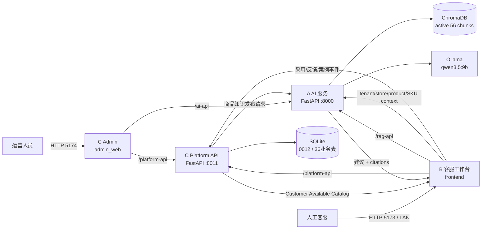

# AI-CS项目交接包 V1.0

> 面向对象：新的 AI-CS 系统架构负责人
> 审计时间：2026-08-03 14:08:59 +08:00
> 正式项目目录：`C:\Users\EDY\Documents\Codex\2026-07-21\AI-CS`
> 审计方式：只读 Git、文件、进程、HTTP/OpenAPI、SQLite 与治理文档核对
> 当前结论：系统正在以单机内网形态运行，四服务同一 SHA，数据库与 RAG 健康；工程能力已达到内部生产使用基线，但完整业务验收、真实反馈闭环、外部网络与正式鉴权仍未关闭。

## 0. 技术摘要

当前 AI-CS 是一个面向商品知识场景的内部 AI 客服系统：C 运营端维护、导入、审核、发布和启用商品知识；B 客服工作台只消费 C 的客服可用目录；A 根据 B 提供的商品上下文从 Chroma 检索知识并调用本地 Ollama 模型生成建议。系统明确保持人工确认边界，不自动发送消息、不自动退款、不修改订单。

审计时的真实运行基线为：

| 项目 | 实际值 |
| --- | --- |
| Repository | `C:\Users\EDY\Documents\Codex\2026-07-21\AI-CS` |
| Branch | `release/product-reliability-hardening-v1` |
| HEAD | `bb16b602ac50a6e554f4e3c42fb10692fff4923f` |
| Git 状态 | 审计开始前 clean |
| Contracts | `0.5.0`，additive |
| Runtime | `standard / LAN`，四服务运行中且身份一致 |
| 数据库 | SQLite，revision `0012_internal_production_finalization_v1` |
| 数据质量 | 36 张业务表；`integrity_check=ok`；0 个外键错误；健康检查 P0/P1/P2 均为 0 |
| RAG | ChromaDB；active collection=`test_knowledge_v031`；56 chunks |
| 模型 | Ollama `qwen3.5:9b`；`ready=true`，`model_configured=true` |
| 主要未关闭项 | R003、R005、R007、BUG-A-004、GitHub Draft PR #78 |

需要特别避免两个误解：

1. `ai-cs-v1.0.0` 标签指向 `429f260...`，当前运行 HEAD 已在其后增加 21 个提交；实际运行身份必须以 `bb16b602...` 为准。
2. R006/R009 的工程能力已经存在，但 R003 的完整业务范围验收与 R005 的真实客服改善闭环仍未关闭。

## 1. 项目当前定位

### 1.1 解决的问题

AI-CS 把“商品业务数据、运营审核、AI 知识发布、客服选择商品、AI 生成建议、客服行为反馈”连接为一条受控内部链路，降低客服查找商品资料和编写答复的成本。

### 1.2 当前已经具备

- B 客服工作台：店铺、商品、SKU 级选择；商品上下文问答；RAG 来源；人工确认；案例、反馈和交互事件沉淀。
- C 运营后台：商品与店铺维护、商品知识中心、六类模板下载、商品知识 Excel 导入与字段级 Merge、审核、客服启停、activation receipt、AI 知识发布与 publication receipt、FAQ、安全规则、知识缺口、AI 问题中心。
- A AI 服务：商品上下文约束、Chroma 检索、本地 Ollama 推理、知识发布、商品级增量向量写入、质量/反馈/案例分析接口。
- C Platform API：SQLite 权威业务数据、R009 导入审核、R006 客服目录投影、R006.1 发布状态、反馈闭环、审计收据。
- OPS：Windows 标准启停、LAN 模式、身份校验、数据库只读健康检查、日志与运行记录。

### 1.3 当前明确不能做

- 不自动发送客服消息。
- 不自动退款，不修改订单，不执行 ERP 或电商平台业务动作。
- 不具备公网、多节点、高可用部署能力。
- 没有正式登录、RBAC 或 API 鉴权；当前操作人字段是业务审计标识，不是可信身份认证。
- R009 只实现“商品知识采集模板”；其余五类模板仍以下载和填写说明为主。
- 不应把内部物理集合名 `test_knowledge_v031` 当成环境状态，也不应为改名而全量重建向量。

### 1.4 目标用户与生产适用性

当前目标用户是内部运营人员和人工客服。按现有网络、单机 SQLite、无正式鉴权的事实，系统适合“受控内网、少量可信用户、人工确认”的内部生产使用；不适合直接开放给外部客户、跨租户团队或高并发企业平台。

## 2. 当前 Git 状态

### 2.1 本地正式仓库

| 字段 | 实际结果 |
| --- | --- |
| 分支 | `release/product-reliability-hardening-v1` |
| Commit | `bb16b602ac50a6e554f4e3c42fb10692fff4923f` |
| Commit 时间 | `2026-08-01T11:45:48+08:00` |
| Commit 标题 | `merge: include C Admin UX polish` |
| Clean 状态 | 审计开始时 `git status --porcelain` 无输出 |
| Worktree | 仅 1 个：正式 `AI-CS` 目录 |
| Origin | `https://github.com/666whatcanisay/AI-Customer-Service-for-Toys.git` |

本交接文档生成后，预期唯一新增项为：

```text
?? docs/control/AI-CS_Project_Handover_Report_V1.md
```

在提交本交接文档前，不能再把工作区描述为完全 clean；代码和 Runtime 本身没有被本次审计修改。

### 2.2 标签与当前运行 SHA 的关系

- `ai-cs-v1.0.0` 和本地保护标签 `ai-cs-v1.0.0-local-protection-429f260` 都解析到 `429f260abd67dd92bcd5ae4039903d11b2adc4fa`。
- 当前 HEAD `bb16b602...` 比 `429f260...` 多 21 个提交，包含 R006 Catalog envelope closure、可靠性/运维加固、数据库健康检查及 C Admin UI 优化。
- 当前 HEAD 没有独立正式版本标签；`git describe` 为 `ai-cs-v1.0.0-local-protection-429f260-21-gbb16b60`。

### 2.3 GitHub 状态

GitHub 仓库当前为 private，默认分支为 `release/ai-cs-v1.0.0`。存在待合并 Draft PR：

| 字段 | 值 |
| --- | --- |
| PR | `#78 AI-CS product reliability hardening update` |
| Head | `codex/github-update-v1@15eb03950e274cd9c9cf70d35dda0c5dbacd9a37` |
| Base | `release/ai-cs-v1.0.0@6727b11e3ca244638b9491e50b0cc0d247247906` |
| 状态 | OPEN / Draft / mergeState=CLEAN |

因此，“本机正在运行的正式代码”和“GitHub 默认分支”目前不是同一个 commit。新负责人应先审查并合并 PR #78，或重新建立一个可核对的正式发布候选，不能直接假设远端等于本机。

## 3. 当前目录结构

```text
AI-CS/
├── admin_web/             # C Admin，Vue 3 + Vite + TypeScript
├── backend/               # A AI 服务，FastAPI + Chroma + Ollama
├── contracts/             # A/B/C 共享 JSON Schema、兼容说明和版本
├── docs/                  # Control、B、C、A、架构、决策与计划文档
├── extension/             # 浏览器扩展占位说明；当前不是核心运行入口
├── frontend/              # B 客服工作台，Vue 3 + Element Plus
├── platform_backend/      # C Platform API，FastAPI + SQLAlchemy + Alembic
├── scripts/               # Windows Runtime、数据库健康检查与运维脚本
├── tests/                 # contracts、数据库健康和 Playwright/E2E 测试
├── .runtime/              # 正式本地运行数据、配置、PID、日志、数据库、向量；Git 忽略
├── logs/                  # 仅 README 被跟踪；运行日志 Git 忽略
├── .github/               # GitHub 工作流/仓库配置
├── README.md
├── AGENTS.md
└── .gitignore
```

### 3.1 模块与入口

| 模块 | 核心入口 | 技术栈 | 当前职责 |
| --- | --- | --- | --- |
| B 客服 | `frontend/src/main.ts`、`frontend/src/router/index.ts`、`frontend/src/views/AiChat.vue` | Vue 3、Vue Router、Element Plus、Axios、Vitest | 客服工作台、目录选择、AI 建议、来源、案例与反馈 |
| C Admin | `admin_web/src/main.ts`、`admin_web/src/router/index.ts`、`admin_web/src/App.vue` | Vue 3、Vue Router、Axios、Vitest | 运营工作台、知识、导入、审核、发布、启停、系统状态 |
| A AI | `backend/app/main.py`、`backend/app/api/routes.py` | FastAPI、ChromaDB、sentence-transformers、Ollama/OpenAI 兼容客户端 | 检索、回答、增量发布、AI 分析 |
| C API | `platform_backend/app/main.py`、各业务域 `routes.py` | FastAPI、SQLAlchemy 2、Alembic、SQLite、openpyxl | 业务主数据、导入审核、目录投影、收据和反馈 |
| Contracts | `contracts/version.json`、`contracts/schemas/` | JSON Schema、Markdown 兼容说明 | 跨 A/B/C 契约，当前 `0.5.0` |
| OPS | `scripts/windows/*.ps1`、`scripts/database-health-check/` | PowerShell、Python | 启停、状态、LAN、备份、数据库只读检查 |
| QA | `tests/e2e/`、各模块 `tests/` | Playwright、Vitest、Pytest | 目录四态、客服日常流、Admin、R009、数据库健康 |

### 3.2 被忽略但运行必需的本地资产

以下资产不在 Git 中，交接时必须单独备份：

- `.runtime/phase-e/data/standard-platform.sqlite3`
- `.runtime/phase-e/standard-rag/vector-db/`
- `.runtime/phase-e/standard-rag/knowledge-base/`
- `.runtime/phase-e/standard-knowledge-materials/`
- `.runtime/phase-e/green-standard/` 下的配置、PID、日志和备份
- `backend/.venv/`、`platform_backend/.venv/`、`frontend/node_modules/`、`admin_web/node_modules/`

`.gitignore` 已覆盖 `.runtime/`、`*.sqlite*`、vector DB、知识源、模型、日志、venv、node_modules 和 dist。

## 4. 当前运行架构



### 4.1 真实调用链

1. 运营通过 C Admin 导入或维护商品知识。
2. C Platform API 在 SQLite 中保存导入批次、Merge 变化与人工审核结果。
3. 运营人工发布 AI 知识；C 向 A 发送受控发布文档，A 增量写入 Chroma，并返回 publication receipt。
4. 运营人工启用 Store/Product；C 保存 `customer_service_status` 并生成 activation receipt。
5. B 只调用 `/api/v1/customer-service/catalog/**`，不使用旧字段判断可信度。
6. 客服选择 Store/Product/SKU 后，B 把上下文与问题发送给 A；A 在该上下文内检索并调用 Ollama。
7. B 展示建议和引用，由人工确认；采用、未采用、案例和反馈事件回写 C。

## 5. 当前端口与启动方式

### 5.1 审计时服务状态

| 服务 | 端口/监听 | 受管 PID | 监听 PID | HTTP/业务状态 | 身份 |
| --- | --- | ---: | ---: | --- | --- |
| B 客服工作台 | `192.168.1.11:5173` | 25296 | 25296 | HTTP 200 | `bb16b602` / standard / LAN |
| C Admin | `127.0.0.1:5174` | 26896 | 28180 | HTTP 200 | `bb16b602` / standard / LAN |
| A AI | `127.0.0.1:8000` | 7104 | 32524 | health 200，ready=true | `bb16b602` / standard / LAN |
| C Platform API | `127.0.0.1:8011` | 27828 | 20872 | health 200 | `bb16b602` / standard / LAN |

只有 B 的 5173 对 LAN 暴露；A、C API、Admin 均保持 loopback。当前网络配置类型由运行记录报告为 `Unknown`，状态脚本没有重新扫描网卡；外部电脑可达性仍需网络侧确认。

### 5.2 标准命令

```powershell
cd C:\Users\EDY\Documents\Codex\2026-07-21\AI-CS

.\scripts\windows\start_ai_customer_service.ps1
.\scripts\windows\status_ai_customer_service.ps1
.\scripts\windows\stop_ai_customer_service.ps1
```

默认配置由 `scripts/windows/common_ai_customer_service.ps1` 解析到：

```text
.runtime/phase-e/config/green-standard.local.ps1
```

当前 `status_ai_customer_service.ps1` 只读检查退出码为 0，单独实测耗时约 7.52 秒。日常不要绕过通用入口直接运行 Vite/Uvicorn，否则 PID、SHA 和 runtimeMode 记录可能失真。

### 5.3 本机运行依赖版本

| 组件 | 当前版本 |
| --- | --- |
| A Python | 3.11.9 |
| C Python | 3.12.13 |
| Node.js | 22.23.1 |
| npm | 10.9.8 |
| pnpm | 11.18.0 |
| Ollama | 0.32.5 |
| 模型 | `qwen3.5:9b` |

## 6. 当前数据库状态

### 6.1 文件与健康

| 字段 | 实际值 |
| --- | --- |
| 数据库 | `.runtime/phase-e/data/standard-platform.sqlite3` |
| 大小 | 1,773,568 bytes |
| SHA-256 | `39BC426DB0BAB826608EFBA065A08EDAA67EF27A6ED96CF4A96D20A4E1EDA4D0` |
| Revision | `0012_internal_production_finalization_v1` |
| SQLite integrity | `ok` |
| foreign_key_check | 0 errors |
| 业务表 | 36；另有 1 张 `alembic_version` |
| 核心数据量 | Store 2、Product 24、SKU 18、FAQ 16、Knowledge Material 1 |
| 审计收据 | Activation 10、Publication 3 |
| 数据质量检查 | P0=0、P1=0、P2=0 |

当前目录投影为 `COMPLETE`：2 个可用 Store、分别投影 5 和 2 个 Product，warnings=0。Product 状态分布为：17 个 `APPROVED+DISABLED`、2 个 `APPROVED+ENABLED`、5 个 `TEST_CONFIRMED+ENABLED`。AI publication ledger 有 3 个 `PUBLISHED` 商品，共 9 个商品级 chunks/embeddings；A 的整个活动集合总计 56 chunks。

### 6.2 Migration 链

| Revision | 主要变化 |
| --- | --- |
| `0001_ct02_ingestion` | 导入批次、导入行、staging Product/SKU |
| `0002_ct02b_test_catalog` | 包、Store、Product、SKU、FAQ、安全规则、来源、评测和冲突目录 |
| `0003_ct05_customer_suggestions` | 客服建议 |
| `0004_mvp_plus_01_experience_cases` | 客服案例、导出与评测 |
| `0005_mvp_plus_02_ai_response_feedback` | AI 回答反馈与分析 |
| `0006_mvp_plus_02_ai_feedback_idempotency` | AI 反馈幂等记录 |
| `0007_target_mode_v2_knowledge_quality_loop` | 知识资料、上传收据、质量评估 |
| `0008_customer_feedback_loop_v1` | AI 交互事件、问题聚合、发生记录、知识优化任务 |
| `0009_product_knowledge_import_v1` | R009 导入字段、change set、field change、review record |
| `0010_customer_available_catalog_v1` | R006 data source、客服状态、activation receipt/幂等/初始化 |
| `0011_product_knowledge_publishing_v1` | R006.1 AI 发布状态、publication receipt、幂等 |
| `0012_internal_production_finalization_v1` | INITIAL_IMPORT 正式化及来源审计表 |

### 6.3 36 张业务表结构总览

| 表 | 行数 | 用途与关键结构 |
| --- | ---: | --- |
| `test_knowledge_packages` | 2 | 包级来源；PK `package_id`；保存 tenant/platform/store/schema/import 审计 |
| `test_catalog_stores` | 2 | Store；PK `id`；`store_code`、`data_source`、`customer_service_status` |
| `test_catalog_products` | 24 | Product；PK `product_id`；FK `package_id`；审核、publishable、客服状态、raw data |
| `test_catalog_skus` | 18 | SKU；PK `sku_id`；FK `product_id`、`package_id`；SKU 继承 Product 客服状态 |
| `test_faqs` | 16 | FAQ；PK `faq_id`；包 FK；逻辑关联 Product/SKU |
| `test_safety_rules` | 8 | 风险与安全规则；PK `rule_id`；包 FK |
| `test_source_evidence` | 58 | 知识来源元数据；PK `source_id`；包 FK；逻辑关联 Product/SKU |
| `test_evaluation_cases` | 28 | 测试/评测用例；PK `case_id`；包 FK |
| `test_conflict_records` | 13 | 数据冲突记录；PK `issue_id`；包 FK |
| `catalog_source_formalizations` | 1 | 0012 来源正式化审计；PK `store_ref`；保留原始/正式来源 |
| `import_batches` | 3 | 导入批次；PK `id`；文件 hash、Store 快照、模板、幂等、统计、状态 |
| `import_rows` | 57 | 原始与规范化行；FK `batch_id`；row hash、校验和商品识别 |
| `staged_product_skus` | 0 | 旧通用 Product/SKU staging；FK `batch_id`；当前保留兼容 |
| `import_change_sets` | 57 | R009 商品级 Merge 候选；FK `batch_id`；old/incoming/merged snapshot |
| `import_field_changes` | 627 | R009 字段级变化；FK `change_set_id`；ADD/UPDATE/KEEP/NO_CHANGE |
| `import_review_records` | 21 | R009 审核收据；FK `batch_id`、`change_set_id`；幂等与前后 hash |
| `catalog_activation_receipts` | 10 | Store/Product 启停审计；多态 `entity_type/entity_ref`，无数据库 FK |
| `catalog_activation_idempotency` | 5 | R006 幂等结果缓存；PK `idempotency_key` |
| `catalog_activation_initializations` | 1 | R006 初始化策略 manifest；PK `policy_version` |
| `product_knowledge_publications` | 3 | Product 当前 AI 发布 ledger；PK/FK `product_id` |
| `product_knowledge_publication_receipts` | 3 | 发布收据；PK `publication_receipt_id`；FK `product_id` |
| `product_knowledge_publication_idempotency` | 3 | 发布幂等结果；PK `idempotency_key` |
| `knowledge_materials` | 1 | 知识资料与人工审核；PK `id`；业务 ID+revision；逻辑关联 Store/Product/SKU |
| `knowledge_material_upload_receipts` | 1 | 上传幂等收据；FK `material_record_id` |
| `knowledge_quality_assessments` | 0 | 知识质量分析；FK `material_record_id` |
| `customer_suggestions` | 2 | 客服建议及处理状态 |
| `customer_experience_cases` | 3 | 客服优秀案例与人工审核 |
| `customer_experience_case_exports` | 0 | 已批准案例导出；FK `case_record_id` |
| `customer_experience_evaluations` | 0 | 案例 AI 评测；FK `case_record_id` |
| `ai_response_feedback` | 0 | AI 回答反馈主记录 |
| `ai_response_feedback_analyses` | 0 | 反馈分析；FK `feedback_record_id` |
| `ai_response_feedback_idempotency` | 0 | 反馈幂等；FK `feedback_record_id` |
| `ai_interaction_events` | 1 | B 采用/修改/未采用事件 |
| `ai_problems` | 0 | AI 问题聚合 |
| `ai_problem_occurrences` | 0 | 事件到问题的多次发生；FK `event_record_id`、`problem_record_id` |
| `knowledge_optimization_tasks` | 0 | 问题到知识任务及复验；FK `problem_record_id` |

### 6.4 ER 关系

```mermaid
erDiagram
    TEST_KNOWLEDGE_PACKAGES ||--o{ TEST_CATALOG_STORES : contains
    TEST_KNOWLEDGE_PACKAGES ||--o{ TEST_CATALOG_PRODUCTS : contains
    TEST_CATALOG_PRODUCTS ||--o{ TEST_CATALOG_SKUS : has
    TEST_KNOWLEDGE_PACKAGES ||--o{ TEST_FAQS : contains
    TEST_KNOWLEDGE_PACKAGES ||--o{ TEST_SAFETY_RULES : contains
    TEST_KNOWLEDGE_PACKAGES ||--o{ TEST_SOURCE_EVIDENCE : contains

    IMPORT_BATCHES ||--o{ IMPORT_ROWS : parses
    IMPORT_BATCHES ||--o{ IMPORT_CHANGE_SETS : proposes
    IMPORT_CHANGE_SETS ||--o{ IMPORT_FIELD_CHANGES : details
    IMPORT_CHANGE_SETS ||--o{ IMPORT_REVIEW_RECORDS : reviewed_by

    TEST_CATALOG_PRODUCTS ||--o| PRODUCT_KNOWLEDGE_PUBLICATIONS : publication_state
    TEST_CATALOG_PRODUCTS ||--o{ PRODUCT_KNOWLEDGE_PUBLICATION_RECEIPTS : publication_audit

    KNOWLEDGE_MATERIALS ||--o{ KNOWLEDGE_MATERIAL_UPLOAD_RECEIPTS : upload_audit
    KNOWLEDGE_MATERIALS ||--o{ KNOWLEDGE_QUALITY_ASSESSMENTS : assessed_by

    CUSTOMER_EXPERIENCE_CASES ||--o{ CUSTOMER_EXPERIENCE_CASE_EXPORTS : exported_as
    CUSTOMER_EXPERIENCE_CASES ||--o{ CUSTOMER_EXPERIENCE_EVALUATIONS : evaluated_by

    AI_RESPONSE_FEEDBACK ||--o{ AI_RESPONSE_FEEDBACK_ANALYSES : analyzed_by
    AI_RESPONSE_FEEDBACK ||--o{ AI_RESPONSE_FEEDBACK_IDEMPOTENCY : idempotency

    AI_INTERACTION_EVENTS ||--o{ AI_PROBLEM_OCCURRENCES : produces
    AI_PROBLEMS ||--o{ AI_PROBLEM_OCCURRENCES : aggregates
    AI_PROBLEMS ||--o{ KNOWLEDGE_OPTIMIZATION_TASKS : creates
```



注意：Store→Product、FAQ/资料→Product/SKU、activation receipt→entity 的部分关系是业务键关系，不全部由 SQLite 外键约束；当前只读健康检查已覆盖孤儿和状态冲突。

## 7. 当前 API 清单

审计直接读取正在运行服务的 `/openapi.json`：A 有 25 个 operation，C 有 86 个 operation。C 的 Swagger/Redoc UI 被关闭，但 OpenAPI JSON 仍可用。

### 7.1 关键契约输入/输出

| 接口 | 输入 | 输出 |
| --- | --- | --- |
| `POST A /api/chat` | `ChatRequest(question/message/context)` | 建议、action、sources 等回答 envelope |
| `POST A /api/admin/ai/knowledge-publications/products` | `ProductKnowledgePublishRequest`：tenant/platform/store/product/fingerprint/document/source/operator/idempotency | `ProductKnowledgePublishReceipt`：receipt、collection、chunks、embeddings、fingerprint |
| `GET C /api/v1/customer-service/catalog/stores` | 无 | `StoreCatalogResponse(status/items/total/warnings)` |
| `GET C /api/v1/customer-service/catalog/products` | `store_code` | `ProductCatalogResponse(status/items/total/warnings)` |
| `GET C /api/v1/customer-service/catalog/products/{id}/skus` | `product_id` | `SkuCatalogResponse(status/items/total/warnings)` |
| `GET C /api/v1/customer-service/catalog/products/{id}/ai-knowledge` | `product_id` | AI 状态、receipt、collection、chunks、embeddings、fingerprint |
| `POST C /api/v1/admin/product-knowledge-imports` | multipart：`store_ref/template_type/file/operator`；必需 `Idempotency-Key` | `ImportAcceptedResponse(batch_id/status)` |
| `GET C .../{batch_id}/preflight` | `batch_id` | Sheet、字段、行和商品识别结果 |
| `GET C .../{batch_id}/merge-preview` | `batch_id/page/page_size` | 商品和字段级 old/incoming/merged/change_type |
| `POST C .../reviews` | `ReviewRequest` + `Idempotency-Key` | `ReviewResponse(review_receipt)` |
| `PUT C .../customer-service-status` | status、confirmed_by、confirmation_note | changed、entity、activation_receipt、server_time |
| `POST C .../customer-service-status:batch` | product_ids、confirmed_by、confirmation_note | items、changed/unchanged/failed counts |

### 7.2 A AI 服务全部 operation

| Method | Path | 作用 |
| --- | --- | --- |
| GET | `/api/health` | 服务健康 |
| GET | `/api/status` | 模型与 ready 状态 |
| POST | `/api/chat` | 主问答 |
| POST | `/api/retrieval/search` | 独立检索 |
| GET | `/api/knowledge/statistics` | 知识统计 |
| GET | `/api/questions/recommended` | 推荐问题 |
| GET/PUT | `/api/config/model` | 读取/更新模型配置 |
| GET | `/api/stats` | 兼容统计 |
| POST | `/api/test-knowledge/sync/{package_id}` | 包级知识同步 |
| POST | `/api/admin/ai/knowledge-publications/products` | 商品知识增量发布 |
| POST | `/api/admin/ai/knowledge-publications/visibility` | 商品知识可见性批查 |
| GET | `/api/admin/ai/control-center/overview` | AI 控制总览 |
| GET | `/api/admin/ai/control-center/product-overview` | AI 商品总览 |
| GET | `/api/admin/ai/modules` | AI 模块列表 |
| GET | `/api/admin/ai/modules/{module_id}` | 模块详情 |
| GET | `/api/admin/ai/modules/{module_id}/prompt` | 模块 Prompt 展示 |
| GET | `/api/admin/ai/modules/{module_id}/evaluations/latest` | 最新评测 |
| POST | `/api/admin/ai/modules/{module_id}/test` | 在线模块测试 |
| POST | `/api/admin/ai/knowledge-quality/run` | 知识质量分析 |
| POST | `/api/admin/ai/feedback-analysis/run` | 反馈分析 |
| POST | `/api/admin/ai/experience-evaluations/run` | 案例评测 |
| POST | `/api/ai/chat` | Java proxy 兼容问答 |
| GET | `/api/ai/status` | Java proxy 兼容状态 |
| GET | `/api/ai/stats` | Java proxy 兼容统计 |

### 7.3 C Platform API operation 分组

| API 组 | 数量 | 路径/职责 |
| --- | ---: | --- |
| `health` | 1 | `GET /health` |
| `customer-service/catalog` | 4 | Store、Product、SKU 最终投影及商品 AI 知识状态 |
| `admin/operations` | 11 | Store CRUD、Product 创建/编辑、单条/批量启停、activation receipt |
| `admin/product-knowledge` | 7 | 概览、列表、详情、缺口、AI 发布/检查/收据 |
| `admin/product-knowledge-imports` | 4 | R009 上传、预检、Merge、审核 |
| `admin/knowledge-materials` | 4 | 资料上传、列表、详情、审核 |
| `admin/knowledge-quality` | 3 | 分析输入、结果、评估 |
| `admin/ai-feedback-loop` | 6 | 事件、问题、知识任务、状态与复验 |
| `admin/ai-optimization` | 4 | 案例列表、导出、评测结果 |
| `admin/ai-quality` | 3 | AI 反馈分析与 badcase 导出 |
| `admin/ai-response-feedback` | 1 | 反馈人工确认 |
| `admin/customer-experience-cases` | 3 | 案例列表、详情、审核 |
| `admin/customer-suggestions` | 2 | 建议列表与处理 |
| `admin/overview` | 1 | 运营总览 |
| `admin/products` | 3 | Product 列表、详情、SKU |
| `admin/stores/faqs/safety-rules/sources/conflicts/import-batches` | 6 | 管理只读视图 |
| `ai-interaction-events` | 1 | B 交互事件写入 |
| `ai-response-feedback` | 2 | 客服 AI 反馈写入/查询 |
| `customer-experience-cases` | 2 | 客服案例写入/查询 |
| `customer-suggestions` | 2 | 建议写入/查询 |
| `customer-knowledge-status` | 1 | 旧知识准备度兼容接口 |
| `import-batches` | 6 | 通用 Product/SKU 导入批次、行、错误与预检 |
| `import-templates` | 1 | Product/SKU 模板下载 |
| `test-catalog` | 3 | 历史目录兼容读取；B 不再依赖 |
| `test-data-packages` | 3 | 测试包列表、预检、导入；正式 UI 默认隐藏 |
| `test-knowledge-packages` | 2 | 评测与 RAG 导出 |

完整路径以运行中 `http://127.0.0.1:8000/openapi.json` 和 `http://127.0.0.1:8011/openapi.json` 为准；新增、删除或改义接口必须同步 contracts、兼容说明和本交接包。

## 8. 当前已经完成的需求

| 需求 | 状态 | 当前代码/运行证据 |
| --- | --- | --- |
| R001 C商品知识运营中心V2 | DONE | C 商品知识域、知识资料、缺口和 Admin 页面存在并运行 |
| R002 AI客服反馈沉淀闭环 | DONE | B interaction/feedback/case 客户端、C 0008 表和接口、Admin AI 问题中心存在 |
| R004 运行版本统一 | DONE | 正式目录只有一个 worktree；四服务同 `bb16b602` |
| R006 Customer Available Catalog | DONE | contracts 0.5.0 保持 R006 契约；0010；C projection/receipt；B 只消费 catalog |
| R006.1 AI知识发布 | DONE | 0011；3 个 PUBLISHED ledger/receipt；A active collection 56 chunks |
| R006.2 客服目录刷新体验 | DONE | B focus + 60 秒低频刷新与 Admin 批量启用体验已进入当前分支 |
| R008 Monorepo/Runtime 收敛 | DONE | 唯一正式 `AI-CS` 目录、标准四端口、Windows 统一入口 |
| R009 商品知识导入 V1 | DONE | 0009；3 批、57 行/changes、627 字段变化、21 review receipts |
| R010 Production Finalization | DONE | contracts 0.5.0、0012、INITIAL_IMPORT 审计、正式安全文案 |
| Reliability / OPS Hardening | 已集成 | Catalog envelope、数据库健康检查、Windows 状态/停止/BAT 加固、E2E 脚本 |
| C Admin UI 优化 | 已集成 | 简洁/高级导航、运营工作台、知识/导入/AI状态与 UX polish；当前 HEAD 即合并点 |

## 9. 当前未完成需求

| 项目 | 状态 | 关闭条件 |
| --- | --- | --- |
| R003 C新增店铺/商品进入B客服 | IN_PROGRESS | 不能只用单商品 Smoke；需完整 PILOT 创建→审核→发布→启用→B选择→A引用→停用回滚验收 |
| R005 Customer Feedback Loop 真实运行验证 | TODO | 使用获准真实客服操作完成“反馈→知识优化→重新提问→改善/未改善”可追溯闭环 |
| R007 第二台客服电脑访问 5173 | BLOCKED | 公司网络/VLAN/防火墙侧确认并完成第二终端访问，不通过业务代码绕过 |
| GitHub 正式同步 | PENDING | 审查并合并 Draft PR #78，建立与实际运行 SHA 对应的正式 tag/release |
| 正式身份与权限 | 未登记治理需求 | 在扩大用户范围前登记 Auth/RBAC/API 权限需求；当前 operator 字段不是认证 |

## 10. 当前 Bug 和风险

### 10.1 已知 Bug

Bug Registry 中没有未关闭 P0/P1。唯一明确 open 项：

| Bug | 等级 | 状态 | 影响 |
| --- | --- | --- | --- |
| BUG-A-004 | P2 | `OPEN_DEFERRED` | 已明确 SKU 时，个别回答仍出现“确认具体款式”的泛化措辞；事实和来源隔离正确 |

BUG-B-001、BUG-B-002、BUG-B-003、BUG-C-001、BUG-RUNTIME-002/003/004、BUG-OPS-001～005 均有 `FIXED_VERIFIED*` 记录。BUG-B-001 的完整业务结果仍由 R003 验收，不应因为缺陷记录关闭而跳过业务 Gate。

### 10.2 架构与交接风险

| 等级 | 风险 | 依据与影响 |
| --- | --- | --- |
| P1 | 本机运行 SHA 与 GitHub 默认分支不一致 | 本机 `bb16b602`；GitHub PR #78 仍为 Draft。机器故障后，远端不能直接证明可复现当前运行状态 |
| P1 | 无正式鉴权/RBAC | 路由未发现 OAuth/JWT/Bearer/RBAC；Admin 页面也说明客服身份不是正式登录。只适用于可信内网 |
| P1 | 单机 SQLite/Chroma/Ollama | 无 HA、备机、自动故障转移；数据库和向量数据只存在被忽略的本地 `.runtime` |
| P1 | 第二终端网络未验收 | 5173 已监听 LAN，但网络类型为 Unknown；公司 VLAN/端口策略仍可能阻断 |
| P2 | 版本命名漂移 | UI/README 的 V1.0.0 标签落后于当前 21 个可靠性与 UI 提交，缺少对应正式 tag |
| P2 | 历史 `test_*` 物理表名/集合名 | 业务已通过 `INITIAL_IMPORT/PILOT` 和投影正式化，但物理命名仍保留历史语义；不影响运行，不能贸然重命名 |
| P2 | 逻辑关联不全由 FK 保证 | Store→Product、资料/FAQ→Product/SKU、receipt→entity 部分靠业务键；当前健康脚本必须保留 |
| P2 | R009 只支持 1 个模板导入 | 其他 5 个模板仍显示/下载，但导入功能未开放，不能向运营承诺已支持 |

## 11. 当前下一阶段建议

按风险和依赖顺序执行：

1. **先完成版本封口。** 审查 GitHub PR #78；从当前实际运行树建立正式 release commit/tag，确保远端可以重建 `bb16b602` 等价能力。不要覆盖本地保护标签。
2. **做一次可恢复备份。** 在任何新开发前，同时备份 SQLite、Chroma、knowledge base、knowledge materials、green-standard 配置和 manifest；验证 hash 与恢复路径。
3. **关闭 R003。** 使用一组受控 PILOT Store/Product 执行完整创建、审核、发布、启用、B选择、A引用和停用回滚，不修改 R006/R009 架构。
4. **关闭 R005。** 用去标识化真实客服样本验证反馈改善闭环，明确记录“改善”和“未改善”。
5. **网络侧关闭 R007。** 使用第二台客服电脑验证 5173；若失败，交由 VLAN/防火墙管理员，不改业务代码。
6. **在扩大使用前建立 R011（建议编号待 Registry 分配）：Auth/RBAC 与审计身份。** 至少区分运营、客服、管理员，保护写接口和模型配置接口。
7. **中期再评估服务化。** 只有并发、多人协作、备份恢复或跨主机成为真实需求时，再评估 PostgreSQL、对象存储、集中日志和进程托管；当前不应为了“企业化”直接重构。

推荐交接 Gate：

```text
GitHub Release 与 Runtime SHA 对齐
  ↓
SQLite + Chroma 可恢复备份验证
  ↓
R003 完整业务验收
  ↓
R005 真实反馈闭环
  ↓
R007 第二终端网络验收
  ↓
Auth/RBAC 立项后再扩大内部用户
```

## 12. 审计方法、限制与证据

### 12.1 本次实际执行的只读检查

- Git：`status`、branch、HEAD、tag、worktree、remote、log、GitHub PR/repo metadata。
- Runtime：端口监听、受管 PID、标准状态脚本、HTTP health、A status、C catalog。
- API：运行中 A/C 的 OpenAPI JSON，而不是只扫描文档。
- 数据库：SQLite URI read-only、`query_only=ON`、integrity、foreign key、表/列/FK/行数、Alembic revision。
- 数据质量：`scripts/database-health-check/Invoke-AICustomerDatabaseHealthCheck.ps1`，退出码 0。
- 需求与 Bug：Requirement Registry、Current Status Summary、Bug Registry 和具体 bug 文件，并与当前代码/数据库交叉核对。

### 12.2 本次没有执行

- 没有修改业务代码、Runtime 配置、数据库或向量库。
- 没有执行 migration、启动、停止或重启服务。
- 没有执行会写业务数据的浏览器流程。
- 没有重新运行全部 Pytest/Vitest/Playwright；测试结论只引用仓库内已有报告，当前健康结论来自实时只读探测。
- 没有证明第二台电脑的网络可达性，也没有验证系统在多用户并发下的容量。

### 12.3 新负责人首先应打开的文件

1. `README.md`
2. `docs/control/AI-CS-Requirement-Registry-V1.md`
3. `docs/control/AI-CS-Current-Requirement-Status-Summary.md`
4. `docs/control/product-management/Bug-Registry-V1.md`
5. `docs/control/AI-CS-Production-Finalization-Report-V1.md`
6. `docs/control/AI-CS-Windows-Runtime-Script-Alignment-Report-V1.md`
7. `contracts/version.json` 与 `contracts/CHANGELOG.md`
8. `platform_backend/migrations/versions/`
9. `scripts/windows/start_ai_customer_service.ps1`
10. 本交接包 `docs/control/AI-CS_Project_Handover_Report_V1.md`

## 13. 仍需新负责人确认的问题

- PR #78 是否直接合并，还是从 `bb16b602` 重新生成一次正式 release？
- 当前 `.runtime` 是否已经有机外备份，还是仅保存在本机？
- 实际内部使用人数、并发量和恢复时间目标是什么？
- R003 验收的受控 PILOT Store/Product 由谁指定？
- 何时提供第二台客服电脑和网络管理员配合关闭 R007？
- 在增加任何外部自动化客户端前，是否先完成服务账户、接口鉴权和审计身份？

---

最终交接状态：`AI_CS_HANDOVER_REPORT_COMPLETE`
