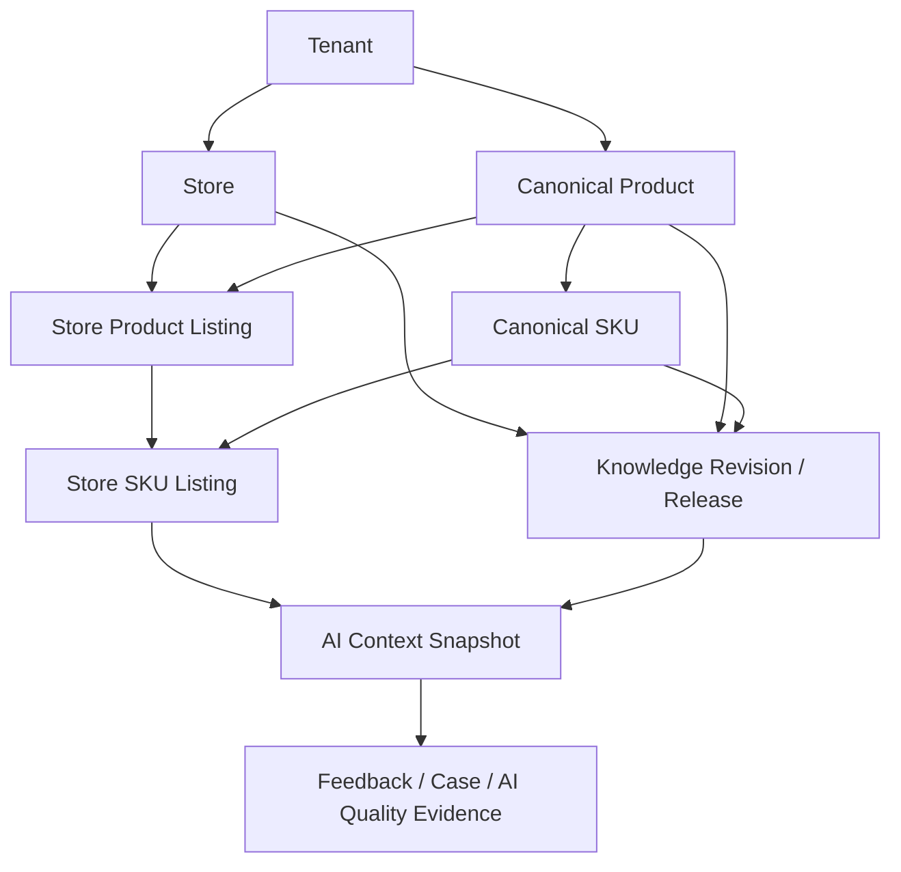
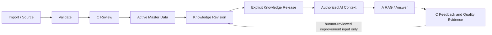

# AI-CS Business Data Architecture ADR V1.1

> **Decision ID:** ADR-BDA-001
> **Version:** 1.1
> **Date:** 2026-07-28
> **Relationship:** 对 `AI-CS-Master-Data-Architecture-ADR-V1` 的业务数据闭环增强与演进说明
> **Decision Status:** `ARCHITECTURE_DECISION_FROZEN`
> **Implementation Gate:** `NOT_READY` / `INTERFACE_FREEZE_REQUIRED`
> **Business Truth Owner:** C — AI 运营中心
> **Scope:** AI 客服平台的商品、知识、AI 上下文和反馈数据基础；不设计 ERP、财务、仓储、库存、订单或任何自动业务执行。

## 阅读边界与证据纪律

本 ADR 只冻结业务数据架构，不创建代码、数据库、迁移或 API 实现。它不能被解读为“正式主数据、鉴权或知识发布已经上线”。

当前工作树为 `e2489ab`，不是用户指定运行基线 `671c9a2` 的后继提交；工作树还包含既有未提交文档修改。因此本文将“当前状态”限制为已核验的源码、项目上下文和既有 ADR 事实，并把目标能力与已实现能力明确分开。

## 1. Decision Summary

Productization V2 已形成 AI 客服、商品选择、RAG、安全回答、案例与 AI 反馈的受控闭环基础。但商品数据仍分散在测试目录、导入暂存行和历史字符串上下文中；知识材料的审核与 A 的 Serving 也未形成可追溯的发布链。

当前问题是：

- **测试目录**可支持当前受控演示，却不能作为多店铺正式业务目录。
- **导入暂存**可校验 Excel 行，却没有形成审核提升后的业务事实。
- **商品字符串关联**使案例、反馈、知识和回答上下文无法稳定验证属于同一 Tenant、Store、Product 与 SKU。
- **知识发布不明确**使“资料已上传/已分析”容易被误解为“RAG 已使用”。

**最终决策：C 是 Business Truth Owner。**

C 负责定义、审核、版本化和发布业务事实；B 仅使用已授权目录；A 仅消费 C 明确发布的最小知识 Serving 快照。该决策保留 B=使用 AI、C=管理业务事实、A=提供 AI 能力的三层边界，不拆分、不新建 ERP 子系统。

本决策的可观察结果是：每次客服商品选择、AI 上下文、RAG 检索、回答生成和反馈分析，都能追溯到同一受控的业务范围与版本。

## 2. Current State

### 2.1 Productization V2 的真实数据形态

| 领域 | 已有能力 | 已核验的当前形态 | 对 AI 闭环的价值 | 当前限制 |
|---|---|---|---|---|
| Store / Product / SKU | C 可提供店铺、商品、SKU 选择；B 可消费目录 | 主要来自隔离的 `test-catalog` 与 `staged_product_skus` 导入暂存行 | 支撑单一测试范围内的商品选择和 RAG scope | 不是 C 管理的正式 Canonical Master；多店铺与跨系统身份不成立 |
| 商品导入 | Excel 预检、解析、行校验、错误报告、暂存审核概念 | `ImportBatch` 与 `StagedProductSku` 保存 `tenant_id/store_code/product_name/sku_name` 等行字段 | 让运营可以先发现模板和字段问题 | 暂存没有 promotion 到正式目录；租户不是由正式身份上下文决定 |
| Knowledge | 测试知识包、知识材料上传、人工审核与质量分析链路 | A RAG 使用测试包；C `knowledge_materials` 是资料/质量分析证据 | 在测试范围内给 A 提供受限检索事实 | 资料审核、质量分析与正式 Serving 发布尚未闭环；`published_to_a_line=false` |
| AI Context / RAG | B 选择商品，A 以 Tenant/Store/Product/SKU 检索并生成建议 | A `FrozenChatContext` 固定为测试 Tenant `TENANT-PDD-SM-TEST` 和 Store `PDD-SM` | 验证范围检索和安全回答行为 | 不支持真实多租户、多店铺或可验证的正式目录上下文 |
| Feedback | B→C 提交、C 人工确认、A 受控分析、C 保存证据 | 反馈具备 revision/content hash/idempotency 与人工确认边界 | 已能形成有限 AI 质量闭环 | Product/SKU 上下文仍是字符串快照，不是正式主数据关系；正式权限未启用 |

可直接核验的实现证据包括：

- C 的 `StagedProductSku` 是导入暂存行，保存 `tenant_id`、`store_code`、`product_name`、`sku_name`，但不是 Store→Product→SKU 正式目录。
- C 的测试包解析器固定 `TENANT-PDD-SM-TEST`、`PDD-SM` 与测试包 ID；B 的目录客户端只调用 `/api/v1/test-catalog/*`。
- A 的 `FrozenChatContext` 对 Tenant 与 Store 使用固定 Literal 值；RAG 检索在测试范围内按 `store_code/product_id/sku_id` 过滤。
- C 的项目上下文明确记录正式权限、自动脱敏与知识发布未启用；知识材料尚未发布给 A。

### 2.2 当前优点

- B/C/A 的职责边界已清晰：B 不做运营审核，C 持久化与人工确认，A 生成回答/分析证据。
- 测试目录和 A 的范围检索已经证明“商品/SKU 选择影响 RAG scope”的基本模式。
- Feedback 已采用不可变 revision、内容哈希和幂等语义，适合未来补齐回答追溯。
- 当前仍禁止自动客户发送、退款、订单变更、ERP 写入、自动 Prompt 修改和自动知识发布。

### 2.3 当前限制

1. **目录不是业务真相。** 测试目录、导入暂存和知识材料各自独立，无法确认同一业务对象。
2. **上下文不稳定。** B/A 使用的商品和 SKU 标识尚未由正式 C 目录与授权范围解析。
3. **知识 Serving 不可证明。** 资料完成审核或质量分析，不代表 A 已消费某一知识版本。
4. **权限不具备生产含义。** 浏览器或请求中的标识不能成为 Tenant 权限证据；当前内部 Admin 也不等同于正式 RBAC。
5. **历史不应被重写。** 现有案例与反馈中的字符串上下文必须保留为历史快照，不能因新主数据上线而按名称自动改写。

## 3. Target State

### 3.1 面向 AI 客服闭环的目标链路

```text
Tenant
  ↓
Store
  ↓
Product
  ↓
SKU
  ↓
Knowledge
  ↓
AI Context
  ↓
Feedback
```

上图表示客服闭环中的业务追溯链，而不是要求把所有实体机械嵌套为一张表。为了支持同一玩具在多个店铺销售，目标物理/逻辑关系采用“规范商品 + 店铺 Listing”的分层：



### 3.2 目标架构决定

- **Tenant** 是数据隔离边界；服务端身份解析其可访问范围。
- **Store** 是客服实际服务的店铺/渠道边界。
- **Canonical Product** 是规范商品事实，`product_name` 是首要业务展示字段，`product_id` 是稳定技术身份。
- **Canonical SKU** 是 Canonical Product 下可区分的真实规格/变体。
- **Store Product Listing / Store SKU Listing** 承载店铺标题、平台商品 ID、平台 SKU ID、上架状态等销售渠道差异，不复制或篡改规范商品身份。
- **Knowledge** 只绑定已验证的 Tenant/Store/Product/SKU/Listing 范围，并通过不可变 revision 与显式 Release 提供给 A。
- **AI Context Snapshot** 是一次回答时经过授权与解析的最小范围快照，不是浏览器任意拼装的 ID 集合。
- **Feedback** 引用回答时的 Context、知识 Release 与模型证据，形成可复盘的 AI 质量闭环。

### 3.3 目标职责边界

| 层 | 提供什么 | 只能消费什么 | 明确禁止 |
|---|---|---|---|
| C — 管理业务事实 | 正式目录、外部映射、知识审核/发布、回答与反馈追溯 | C 内部审核所需的业务资料 | 让 A/B 直接写入业务真相；自动发布知识 |
| B — 使用 AI | 客服商品选择、展示受控来源、显式反馈 | C 返回的已授权目录和 A 的建议回复 | 维护 Product/SKU 关系；以浏览器 `tenant_id` 决定权限 |
| A — 提供 AI 能力 | RAG、回答、风险判断、质量分析证据 | C 发布的最小 Knowledge Release 与 Context | 创建/修改商品；发布知识；自动执行业务动作 |

## 4. Entity-to-AI Closed Loop Mapping

每个 V1.1 实体必须直接服务“商品选择 → AI 上下文 → RAG 检索 → 回答生成 → 反馈分析”，或明确标为 `Future Reserved`。

| 实体 | 商品选择 | AI 上下文 | RAG 检索 / 回答 | 反馈分析 | Owner | V1.1 状态 |
|---|---|---|---|---|---|---|
| Tenant | 限定客服可选的业务空间 | 防止跨租户上下文 | 只检索同 Tenant 已发布知识 | 隔离质量证据与统计 | C；权限范围由服务端认证提供 | Core |
| Store | 客服先选择店铺 | 绑定店铺/渠道规则 | 检索店铺级 FAQ、安全规则 | 按店铺发现质量问题 | C | Core |
| Canonical Product | 以 `product_name` 供客服识别和选择 | 提供稳定 `product_id` | 检索商品事实、FAQ、适龄/安全信息 | 聚合该商品的事实缺失/错误 | C | Core |
| Canonical SKU | 在商品下选择确切规格 | 提供稳定 `sku_id` | 优先检索 SKU 规格、包装、材质和差异事实 | 定位“选错 SKU/缺少规格”问题 | C | Core |
| Store Product Listing | 让客服看到该店实际销售页面 | 解析平台商品身份与销售范围 | 约束店铺级适用知识 | 识别某店标题/映射异常 | C | Core |
| Store SKU Listing | 让客服选到实际销售 SKU | 连接平台 SKU 与 Canonical SKU | 避免把其他店或其他规格的事实回答给客户 | 识别平台 SKU 映射或上下文错误 | C | Core |
| External Identity Mapping | 不直接展示为主身份 | 将已验证平台/ERP ID 解析为内部对象 | 防止导入/同步把知识放到错误商品 | 支持外部 ID 冲突诊断 | C | Core support；只读 ERP 映射 |
| Knowledge Material | 不直接供客服选择 | 作为来源证据候选 | 不直接检索，不直接生成回答 | 支持解释“知识来自何处” | C | Core evidence |
| Knowledge Revision | 不直接供客服选择 | 把范围、版本、有效期带入 Context | 是 A 可检索的受控知识单元 | 回答可追溯到具体事实版本 | C | Core |
| Knowledge Release | 不直接供客服选择 | 将可用知识版本固定为 Serving 快照 | A 只检索已 Release 的范围 | 判断某问题是否由过期/撤回知识导致 | C 发布，A 消费 | Core |
| AI Context Snapshot | 记录客服最终选择 | 是 A 输入的受控业务范围 | 决定检索过滤和回答边界 | 让反馈与一次实际回答精确对应 | C 持久化；B/A 消费最小投影 | Core |
| CustomerExperienceCase / AIResponseFeedback | 不负责选择 | 引用 answer/context trace | 不直接入知识库 | 形成审核、评测和 Badcase 证据 | C | Core |

以下对象不进入 V1.1 的业务事实模型：

| 对象 | 状态 | 原因 |
|---|---|---|
| 财务、结算、发票 | `Future Reserved` | 不服务当前 AI 客服回答闭环 |
| 仓储、库存、可售数量 | `Future Reserved` | 价格/库存会快速变化，若未来需回答必须另行冻结只读实时事实与时效策略 |
| 订单、退款、履约、售后执行 | `Future Reserved` | 涉及客户权益与业务动作；当前只允许建议与人工确认 |
| ERP 完整主数据镜像 | `Future Reserved` | V1.1 仅保留外部身份映射与只读接入前提，不复制 ERP 子系统 |
| 组合套装、拆套、跨商品组件关系 | `Future Reserved` | 不影响当前基本问答闭环；需要时单独冻结范围和检索语义 |

## 5. Target Data Lifecycle for the AI Loop

目标不是“导入后即可问答”，而是让每个阶段都产生一个可验证的下游输入。



冻结规则：

1. 导入仅能创建候选资料，不能创建正式目录或 RAG 内容。
2. C 审核与显式 promotion 后，Product/SKU/Listing 才可用于 B 的正式选择。
3. Knowledge Material、质量分析完成、FAQ 编辑完成均不等于 Knowledge Release。
4. A 只能检索 C Release 的范围，并在回答中返回受控 `answer_trace_id`。
5. Feedback 只产生待审核的质量证据和建议；不得自动改知识、Prompt 或模型。

## 6. Current State → Target State → Migration Path

### Phase 0：基线保护与盘点

**Current State：** 测试目录、导入暂存、知识材料和历史反馈并存；当前工作树与声明运行基线不一致。

**Target State：** 有一份经确认的范围盘点：每条记录被标注为“测试数据”“可精确映射”“人工确认”“不可映射”。

**Migration Path：** 只读盘点，不以名称相似、AI 推断或向量相近自动合并；记录 Pilot 当前读路径、运行版本和回退证据。此阶段不写库、不切流。

### Phase 1：C 建立最小业务真相

**Current State：** `Store/Product/SKU` 在测试目录与暂存行中存在，但没有统一权威关系。

**Target State：** C 管理 Tenant、Store、Canonical Product、Canonical SKU 和 Store Listing；所有关系可验证同 Tenant 和父子归属。

**Migration Path：** 仅增量建立目标模型与审计/版本基础。现有 `store_code/product_id/sku_id` 字符串保留为 legacy snapshot；不重命名旧表，不覆盖历史案例/反馈。

### Phase 2：导入候选人工提升

**Current State：** Excel 解析、校验和暂存存在，但无正式 promotion。

**Target State：** 运营通过 C 的审核流程，把可验证候选提升为正式 Product/SKU/Listing/External Mapping，并保留 promotion 决策。

**Migration Path：** 先按受认证的 Tenant/Store 范围验证，再处理外部 ID 冲突。每次提升必须幂等、可审计；不确定记录停留在 `REVIEW_REQUIRED`，不进入 B 目录。

### Phase 3：目录双读与 B 切换

**Current State：** B 只读取 `test-catalog`，A 也依赖固定测试上下文。

**Target State：** B 从 C 读取授权的正式目录投影；测试 Pilot 继续读取显式标记的 test/legacy 域。

**Migration Path：** 双读按范围确定性路由，而非合并结果：已迁移 Store 只读新目录；测试 Store 只读测试目录；未映射或冲突时返回 `REVIEW_REQUIRED`。B 不得按名称从两边拼接商品。

### Phase 4：知识版本与 A Serving 切换

**Current State：** A 使用测试知识包；C 材料链的 `published_to_a_line=false`。

**Target State：** A 消费 C 发布的 Knowledge Release，且每条检索事实都可追溯到范围、revision、来源和有效期。

**Migration Path：** 先把 Knowledge Material 人工绑定到正式主数据，再创建 Knowledge Revision，最后由 C 显式 Release。A 仅在收到已发布版本后建立/切换 Serving；撤回时只撤回该 Release，不删除历史证据。

### Phase 5：AI Context 与反馈追溯

**Current State：** Feedback 已有 revision/hash，但商品上下文是字符串快照。

**Target State：** 每次回答关联受授权的 Listing/Product/SKU、catalog revision、knowledge release、模型/策略版本与 `answer_trace_id`。

**Migration Path：** 历史反馈保留旧快照；只对人工精确核对成功的记录新增可空主数据引用。新回答在新合约冻结后才写入完整 trace，不能回填猜测值。

### Phase 6：废弃条件与回滚

旧路径仅在下列条件同时满足后才可计划废弃：范围映射完成、B/A Consumer 已切换、权限与数据质量验证通过、迁移/回滚演练通过、Interface Owner 与 QA 同意。

在正式业务事实产生前，可以关闭新路径并保留旧 Pilot 路径。正式事实产生后不使用删除式回滚；通过 `RETIRED`、`WITHDRAWN` 或切回上一已审核 revision 恢复服务，并保留审计链。

## 7. Required Interface and Security Gates

本 ADR 不实现接口，但下列接口冻结是迁移前置条件：

| 冻结项 | Provider | Consumer | 为 AI 闭环解决的问题 |
|---|---|---|---|
| `catalog-master.v1` | C | B | 让商品选择来自授权的正式目录，而不是 test-catalog 或浏览器数据 |
| `catalog-serving-context.v1` | C | A | 把客服选择解析为 A 可验证的最小范围，避免伪造 Tenant/Store 上下文 |
| `knowledge-release.v1` | C | A | 区分资料审核、知识 revision 与 A 实际 Serving |
| `ai-answer-trace.v1` | C/A 共同冻结，C 持久化 | B、C、A、QA | 将回答、检索知识版本和反馈证据关联起来 |
| `catalog-promotion.v1` | C | C Admin、QA | 保证导入候选经人工审核、幂等提升和可回滚审计 |

所有跨线冻结都必须包含 Owner、Provider、Consumer、字段、状态、错误码、幂等、版本、向后兼容、隐私可见性和回滚策略。缺任一项，Gate 为 `INTERFACE_FREEZE_REQUIRED`。

安全边界同时冻结：Tenant/Store 范围必须来自服务端认证；B 不决定权限；A 使用服务身份且不直接访问 C 数据库；C 对发布、撤回、映射和审核记录 actor、时间、原因和 revision。当前提示式脱敏不能作为生产数据授权依据。

## 8. Non-goals and Future Reserved

V1.1 明确不做以下事情：

- 不把 C 演进为 ERP、PIM、OMS、WMS、财务或库存系统。
- 不把价格、库存、订单、退款、物流状态作为可回答的业务事实。
- 不允许 AI 依据置信度自动创建/合并商品、发布知识、修改 Prompt、训练模型或执行客户/订单动作。
- 不要求一次性迁移历史字符串上下文；无法精确验证的历史记录继续保留 legacy snapshot。

未来若确有业务需要，只能通过新的 ADR 和 Interface Owner 冻结引入只读、最小范围的数据投影。任何 ERP 接入首先是外部身份映射和受控只读事实，不是复制 ERP 全量业务域。

## 9. Delivery Dependencies and Acceptance

| 线路 | 后续唯一结果 | 前置依赖 | 验收证据 |
|---|---|---|---|
| Control | 维护 ADR、范围、Interface Owner Gate | 本 ADR | 不把架构冻结误称为实现完成 |
| C Data | 业务真相、promotion、Knowledge Release 与审计 | 认证范围与接口冻结 | 实体关系、版本、映射和撤回可验证 |
| B Customer | 从 C 选择授权商品并提交受控 Context | `catalog-master.v1` | 无本地伪造成功、无跨店目录 |
| A Knowledge | 消费 C Release 并回传 answer trace/质量证据 | serving/release 合约 | 检索范围与知识版本可重放 |
| QA / OPS | 数据、权限、回滚和 Runtime Gate 验收 | B/C/A 受控实现 | 端到端 B→C→A→C、容量与恢复证据 |

集成顺序为：Control 决策 → 接口/权限冻结 → C Provider → A/B Consumer → QA/OPS 验收。B 与 A 可在接口冻结后并行；不得以 Mock、测试目录或本地状态替代 C 的正式 Provider 行为。

## 10. Final Decision Status

**架构决策状态：`ARCHITECTURE_DECISION_FROZEN`。**

V1.1 冻结了一个服务 AI 客服闭环的业务数据方向：C 管理 Business Truth；目录、知识、上下文和反馈通过稳定 ID、版本、范围与审计相连；B 使用、A 消费，不越权管理业务事实。

**实施状态：`NOT_READY`。** 当前尚缺正式主数据、服务端 Tenant 解析/RBAC、C→A 知识发布、回答 trace 合约、迁移与回滚证据、性能与容量验证。故此文档可作为下一阶段接口冻结和分任务依据，但不授权扩大到多店铺生产、ERP 同步、真实敏感知识或自动化业务执行。
