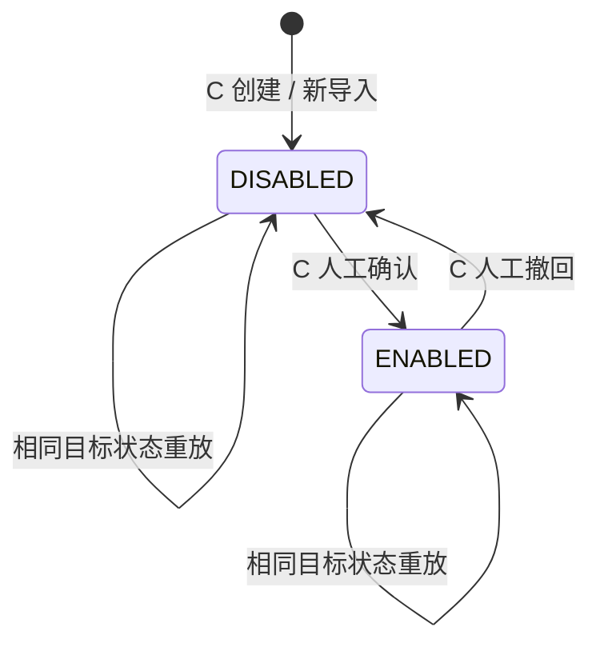

# AI-CS Pilot Business Catalog Interface Freeze Plan V1

> 需求：R006 — Pilot Business Data Activation V1
>
> 基线：`ai-cs-pilot-baseline-v1` / `cbc77ed883cb99e2eff76ccb8eb3193bbddaba38`
>
> 当前共享 contracts：`0.2.0`（本轮不修改）
>
> 冻结接口标识：`pilot-business-catalog.v1`
>
> 文档状态：`INTERFACE_FREEZE_READY`
>
> 日期：2026-07-30

本文件只冻结接口、状态、兼容和验收边界，不实现 Business Data Activation，不修改 UI、A、RAG、数据库或任何运行服务。只有本计划经 Interface Owner 批准后，才可以另建实施任务。

## 1. 问题定义与基线证据

当前跨线关系是：

```text
C Provider（店铺 / 商品 / SKU 的业务数据权威）
    │
    │ 缺少独立、持久、可审计的客服可用状态与消费投影
    ▼
B Consumer（客服工作台）
```

C 已能创建店铺和商品，但 B 仍消费旧的 `/api/v1/test-catalog/**` 测试目录。基线代码中的实际冲突为：

- C 新建店铺写入 `response_mode=HUMAN_CONFIRM_REQUIRED`，同时沿用 `test_data_mode=true`、`production_usable=false`；这不是正式的数据激活语义。
- B 会遍历整批店铺，并要求每条记录满足 `trial_enabled=true`、`test_data_mode=true`、`production_usable=false`、`response_mode=SUGGESTION_ONLY`、`allow_auto_send=false`。任一店铺不匹配，整批目录被拒绝。
- C 新建商品默认 `sales_status=OFF_SALE`、`review_status=REVIEWING`、`publishable=false`；没有独立的“客服可用”确认状态。
- 因而问题不是页面缺入口，而是 C Provider 与 B Consumer 之间缺少业务数据激活协议；一条新建或异常记录还可能污染整批消费结果。

基线证据位于 `platform_backend/app/operation_management/service.py`、`frontend/src/views/AiChat.vue`、`frontend/src/api/platformClient.ts` 和 `frontend/src/api/platformAdapter.ts`。本计划不改这些文件。

## 2. Owner 与职责冻结

| 角色 | Owner | 冻结责任 |
| --- | --- | --- |
| Interface Owner | Control | 冻结字段、枚举、状态流转、失败语义、版本、兼容、回滚和验收 Gate。 |
| Provider / Data Owner | C | 唯一保存并判定 `data_source` 与 `customer_service_status`；只向 B 投影有效、已启用的数据。 |
| Consumer | B | 只消费 C 的客服目录投影；不得使用测试字段、前端常量或自身推断替代 C 权威状态。 |
| A | 不变 | 不修改接口、模型、Prompt 或 RAG。B 继续用既有 `tenant_id/platform/store_code/product_id/sku_id` 调用 A。 |
| QA / OPS | 验证方 | 在同一批准 SHA 上验证契约、服务身份、兼容、失败语义和回滚；不得用 Mock 关闭 Gate。 |

任何字段、枚举、路径、错误码或状态流转变化都必须回到 Interface Owner，不得由 B 或 C 单线临时决定。

## 3. 冻结数据模型

### 3.1 通用规则

- `tenant_id`、`store_code`、`product_id`、`sku_id` 是当前 B→A 上下文所需的既有技术标识。本 V1 只透传它们，不创建 Master Data，也不改变标识生成规则。
- 所有必填字符串在 C 返回前必须去除首尾空白且非空。
- `customer_service_status` 缺失或无法识别时按不可用处理，绝不能由 B 推断为 `ENABLED`。
- Product 与 SKU 继承所属 Store 的 `data_source`，不允许子级声明与父级冲突的数据来源。
- Product 的商品状态和知识状态是业务上下文，不是 B 的激活判断依据；是否进入 B 只由 C 的客服目录投影决定。

### 3.2 Store

| 字段 | 类型 / 枚举 | 必填 | 来源与规则 |
| --- | --- | --- | --- |
| `tenant_id` | non-empty string | 是 | 既有 C 技术标识；仅用于保持 B→A 请求兼容。 |
| `store_code` | non-empty string | 是 | 既有 C 稳定店铺标识；不得用店铺名称替代。 |
| `store_name` | non-empty string | 是 | C 运营维护的店铺名称。 |
| `platform` | `pdd` / `pinduoduo` / `taobao` / `tmall` / `jd` / `douyin` / `offline` / `other` | 是 | 保留既有测试目录的 `pdd` 与 C 运营当前 `pinduoduo`，不得在 B→A 链路中擅自互换；真正未知的旧值由 C 映射为 `other`。 |
| `data_source` | `TEST` / `PILOT` | 是 | C 持久化的来源分类；不得由 B 根据 ID、名称或测试字段推断。 |
| `customer_service_status` | `DISABLED` / `ENABLED` | 是 | C 权威客服可用状态。B 接口正常返回的条目必须为 `ENABLED`。 |

### 3.3 Product

| 字段 | 类型 / 枚举 | 必填 | 来源与规则 |
| --- | --- | --- | --- |
| `product_id` | non-empty string | 是 | 既有 C 稳定商品标识。 |
| `store_code` | non-empty string | 是 | 父级店铺关系，必须指向同一返回范围的 Store。 |
| `product_name` | non-empty string | 是 | 取 C 当前业务展示名。 |
| `product_status` | `ON_SALE` / `OFF_SALE` / `UNKNOWN` | 是 | C 将旧 `ON_SALE/ACTIVE` 映射为 `ON_SALE`，将 `OFF_SALE/INACTIVE` 映射为 `OFF_SALE`；无法识别的旧值映射为 `UNKNOWN`。 |
| `knowledge_status` | `EFFECTIVE` / `PARTIALLY_AVAILABLE` / `MISSING_KNOWLEDGE` / `UNCONFIRMED` | 是 | 复用 C 商品知识运营中心现有 AI 知识状态；缺少可验证结果时为 `UNCONFIRMED`。 |
| `customer_service_status` | `DISABLED` / `ENABLED` | 是 | C 权威客服可用状态。B 不得用 `product_status`、`knowledge_status` 或旧 `publishable` 代替它。 |

`OFF_SALE` 或知识不完整并不自动等于不可服务：客服可能仍需处理售后或资料不完整场景。C 在人工确认后决定是否启用，B 不重新判断可信度。

### 3.4 SKU

| 字段 | 类型 / 枚举 | 必填 | 来源与规则 |
| --- | --- | --- | --- |
| `sku_id` | non-empty string | 是 | 既有 C 稳定 SKU 标识。 |
| `product_id` | non-empty string | 是 | 冻结父级关系；必须指向所属 Product。 |
| `sku_name` | non-empty string | 是 | 取 C 当前业务展示名。 |
| `customer_service_status` | `DISABLED` / `ENABLED` | 是 | C 权威客服可用状态。 |

SKU 不是商品可见的前置条件。商品可以在没有 SKU 时进入 B；存在 SKU 时，只有已启用且父级有效的 SKU 可供选择。

## 4. 状态定义与状态机

### 4.1 `data_source`

| 值 | 含义 | 创建规则 |
| --- | --- | --- |
| `TEST` | 受控测试数据，只用于测试或兼容验证。 | 既有测试包数据经一次性兼容初始化；以后由获准的测试数据入口写入。 |
| `PILOT` | C 运营为受控 Pilot 创建的业务数据。 | C 运营新建店铺时固定写入。 |

`data_source` 创建后不可由 B 修改，也不能作为“可信/不可信”或“可用/不可用”的替代判断。新创建的 TEST 与 PILOT 数据都默认 `DISABLED`。

### 4.2 `customer_service_status`

| 值 | 含义 | B 行为 |
| --- | --- | --- |
| `DISABLED` | 未经客服可用确认、已撤回或父级被停用。 | 不得出现在正常客服目录投影中。 |
| `ENABLED` | C 已完成人工确认，允许 B 展示并由客服人工选择。 | 可以显示和选择；不代表自动发送、自动退款或自动执行业务。 |



层级规则：

1. 启用 Product 前，其 Store 必须为 `ENABLED`。
2. 启用 SKU 前，其 Product 与 Store 必须均为 `ENABLED`。
3. 禁用 Store 时，C 必须在同一事务中把其 Product 与 SKU 的客服可用状态一并置为 `DISABLED`。
4. 禁用 Product 时，C 必须在同一事务中把其 SKU 一并置为 `DISABLED`。
5. 重新启用父级不会自动重新启用子级；每个子级仍需人工确认。
6. `product_status` 和 `knowledge_status` 不触发自动启用或自动禁用；它们只作为 C 人工确认时的业务信息。

### 4.3 废弃核心判断

从 B 切换到本 V1 接口起，以下字段不得再作为客服目录业务判断核心：

- `test_data_mode`
- `production_usable`
- `trial_enabled`
- `publishable`
- 由前端写死的店铺、商品或来源白名单

它们可以在旧测试接口中保留一段兼容期，但不得出现在 `pilot-business-catalog.v1` 的 B Consumer schema 中，也不得决定新 Pilot 数据是否可见。

## 5. 冻结接口

### 5.1 B 只读目录投影（B ← C）

冻结路径：

```text
GET /api/v1/customer-service/catalog/stores
GET /api/v1/customer-service/catalog/products?store_code={store_code}
GET /api/v1/customer-service/catalog/products/{product_id}/skus
```

三条接口统一返回：

```json
{
  "schema_version": "pilot-business-catalog.v1",
  "result_status": "COMPLETE",
  "items": [],
  "total": 0,
  "warnings": []
}
```

规则：

- `result_status` 只允许 `COMPLETE`、`PARTIAL`。
- `COMPLETE + items=[] + total=0` 才表示真实“暂无数据”。
- 单条异常记录必须由 C 隔离，返回其余有效记录并标记 `PARTIAL`；不得因为一条异常记录把整批有效目录投影为空。
- `warnings` 只允许安全技术信息：`code`、`entity_type`、`entity_ref`；不得返回原始 payload、数据库错误、路径、客户数据或知识正文。
- `total` 等于本次返回的有效 `items` 数，不含被隔离条目。
- C 只返回自身状态为 `ENABLED` 且所有父级均为 `ENABLED` 的实体。B 不再二次推断业务可信度。
- B 仍必须校验基本结构和父级关系，但单条解析失败只隔离该条并记录接口错误，不得清空已经成功解析的其他条目。

Store、Product、SKU 的 `items` 分别使用第 3 节模型。B 继续把既有技术标识传给 A，A 的任何请求或响应 schema 均不变。

### 5.2 C 人工确认状态（运营 / 受控调用 → C）

冻结路径：

```text
PUT /api/v1/admin/operations/stores/{store_ref}/customer-service-status
PUT /api/v1/admin/operations/products/{product_id}/customer-service-status
PUT /api/v1/admin/operations/skus/{sku_id}/customer-service-status
```

请求：

```json
{
  "customer_service_status": "ENABLED",
  "confirmed_by": "pilot-operator",
  "confirmation_note": "已核对店铺、商品范围和人工使用边界"
}
```

- `customer_service_status`、`confirmed_by` 必填；`confirmation_note` 可空但必须去除客户隐私。
- `confirmed_by` 只是当前内部 Pilot 的人工确认记录，不代表正式认证或 RBAC。
- 路径使用 C 现有标识：Store 使用运营 `store_ref`，Product/SKU 使用既有 ID；不新建 Master Data ID。
- `PUT` 是设定目标状态的天然幂等操作。相同实体、相同目标状态重放返回 200 和 `changed=false`；不创建重复状态事件。
- C 对同一实体串行提交。冲突请求以 C 最终提交顺序为准，每个响应都返回服务器最终状态与时间；B 不缓存或回写权威状态。
- 客户端不得自动重试状态写入。网络结果不明确时，先 GET/重新读取 C 当前状态，再由人工决定是否重放同一目标状态。

成功 receipt：

```json
{
  "entity_type": "PRODUCT",
  "entity_ref": "C-PRODUCT-...",
  "previous_status": "DISABLED",
  "customer_service_status": "ENABLED",
  "changed": true,
  "confirmed_by": "pilot-operator",
  "confirmed_at": "2026-07-30T10:00:00Z",
  "cascaded_disabled_count": 0
}
```

本接口是业务状态接口，不授权页面改版。本阶段及后续最小实现均可通过受控 API 验收，不要求新增 UI。

## 6. 错误、空结果、超时与重试语义

C 沿用现有安全错误 envelope：

```json
{
  "error": {
    "code": "BUSINESS_CATALOG_PARENT_DISABLED",
    "message": "父级业务数据尚未启用"
  },
  "request_id": "..."
}
```

| Code | HTTP | 语义 | Consumer 行为 |
| --- | ---: | --- | --- |
| `BUSINESS_CATALOG_ENTITY_NOT_FOUND` | 404 | 目标 Store/Product/SKU 不存在。 | 不创建本地替代记录。 |
| `BUSINESS_CATALOG_PARENT_DISABLED` | 409 | 子级启用前父级未启用。 | 保持原状态，提示先处理父级。 |
| `BUSINESS_CATALOG_STATUS_INVALID` | 422 | 状态值、确认人或请求格式无效。 | 不推断默认值。 |
| `BUSINESS_CATALOG_RELATION_INVALID` | 409 | Store→Product→SKU 父级关系不完整或冲突。 | 隔离目标，不影响其他有效条目。 |
| `BUSINESS_CATALOG_ACTIVATION_CONFLICT` | 409 | C 无法完成原子级联或状态已发生冲突。 | 重新读取当前状态，禁止盲重试。 |
| `BUSINESS_CATALOG_PARTIAL` | 200 | 有效条目已返回，同时隔离了异常条目。 | 显示有效条目；记录安全 warning，不显示成全部“暂无数据”。 |
| `BUSINESS_CATALOG_UNAVAILABLE` | 503 | C 无法形成可信目录投影。 | 显示“目录暂不可用”，不得显示“暂无数据”或回退为未确认数据。 |

只读 GET 沿用 B 当前 15 秒超时上限；V1 不增加自动重试，只允许现有人工刷新。写接口不自动重试。HTTP 4xx/5xx、超时、无效 envelope 都不等于空目录。

## 7. 安全边界

数据进入 B 只表示“可由客服看见并人工选择”，必须保持以下边界：

- 每个启用动作必须由人工显式确认并留下 C 侧记录。
- AI 输出必须由客服人工核对；不得自动发送客户消息。
- 不得自动退款、换货、售后、订单修改或申诉。
- 不得自动执行任何业务动作或 ERP 写入。
- 不得因数据激活自动发布知识、同步 RAG、修改 Prompt、切换/训练模型。
- `customer_service_status=ENABLED` 不等于知识已发布、AI 回答正确或商品在售。
- 异常记录必须隔离；不得为了可用性放宽为 B 本地信任或默认启用。

## 8. 兼容策略

### 8.1 旧测试数据

1. 以 `ai-cs-pilot-baseline-v1` 切换前 B 已实际可用的测试目录作为一次性兼容集合。
2. C 在实施时将该集合明确初始化为 `data_source=TEST`、`customer_service_status=ENABLED`，保持原店铺、商品、SKU 技术标识不变。
3. 兼容初始化是一次性的、可复核的数据动作；运行时 B 不再读取 `test_data_mode` 或 `production_usable` 做判断。
4. 切换后新导入的 TEST 数据和新创建的 PILOT 数据都默认 `DISABLED`，必须经过人工确认。

### 8.2 新 Pilot 数据

C 运营创建的 Store 固定为 `data_source=PILOT`、`customer_service_status=DISABLED`。其 Product 与 SKU 继承 `PILOT`，各自默认 `DISABLED`。按 Store → Product → SKU 顺序人工启用后，B 通过新投影读取。

### 8.3 接口与部署兼容

- 现有 `/api/v1/test-catalog/**` 在 Pilot 兼容期保持原样，不能原地改变字段语义。
- 新接口是 additive，不删除或重命名 0.2.0 的任何 schema。
- 实施提交顺序必须为：Contracts `0.3.0` schema/兼容说明 → C Provider → B Consumer → 集成验收文档。
- 部署顺序必须为：C Provider 先上线并通过兼容投影验证 → B 切换 Consumer → 完整冒烟。A 不部署变更。
- 回滚顺序必须为：B 先回到旧测试目录 Consumer → 验证旧测试数据仍可用 → 再回滚 C 新接口。不得先删除兼容数据或旧接口。

## 9. Contracts 版本治理

本轮只生成冻结计划，因此 `contracts/version.json` 继续为 `0.2.0`，不得提前改成已实现。

获准实施后，R006 必须以 additive `contracts 0.3.0` 交付，并至少包括：

- Store/Product/SKU 三个只读投影 schema；
- 客服可用状态写入请求与 receipt schema；
- `contracts/CHANGELOG.md`；
- `contracts/compatibility/pilot-business-catalog-v1.md`；
- 错误码登记；
- C Provider、B Consumer、A 无变更、OPS/QA 的受影响线复核。

任何删除、重命名、枚举语义变化或让 A 直接消费 C 激活状态的方案都不属于 additive V1，必须重新冻结，不能在实施中顺手修改。

## 10. 验收场景

| # | 前置与操作 | 冻结期望 |
| ---: | --- | --- |
| 1 | C 创建 Store。 | `data_source=PILOT`、`customer_service_status=DISABLED`；B 不可见。 |
| 2 | 人工启用该 Store。 | C receipt 为 `ENABLED`；刷新后 B 可见店铺。 |
| 3 | C 在已启用 Store 下创建 Product。 | Product 默认 `DISABLED`；B 商品列表不可见该商品。 |
| 4 | 人工启用 Product。 | C receipt 为 `ENABLED`；B 在正确 Store 下可见商品。 |
| 5 | 启用 SKU。 | 仅当 Store 与 Product 均启用时成功；B 在正确 Product 下可见 SKU。 |
| 6 | 禁用 Product 或 Store。 | 子级状态原子级联为 `DISABLED`；B 刷新后不再显示，重新启用父级不会自动恢复子级。 |
| 7 | 一条 Store/Product/SKU 数据名称缺失或父级异常，其他数据有效。 | C 返回 `PARTIAL` 与有效 items；B 显示有效数据，不能全部显示 `No data`。 |
| 8 | C Provider 超时或 503。 | B 显示目录不可用/现有错误态，不得显示真实空目录，也不得消费未确认数据。 |
| 9 | 旧基线测试目录切换。 | 原可用测试店铺、商品、SKU 标识不变并继续可用；B 不再以测试字段做核心判断。 |
| 10 | B 选择新启用 Product 并请求 AI。 | B 继续发送既有上下文标识；A 请求/响应、模型、Prompt、RAG 均无代码或协议变化。 |

未来验收证据必须包括真实 C API receipt、C 投影 JSON、B Consumer 测试、跨服务真实请求、异常/部分成功场景、同 SHA 运行身份与回滚演练。Mock 或页面静态演示不能关闭 R006/R003。

## 11. 明确禁止范围

- 修改或重新设计 5173 / 5174 UI；
- 修改 A、A 模型、Prompt 或 RAG；
- Master Data、ERP、PostgreSQL、RBAC、Answer Trace；
- 数据库大迁移、替换既有 Store/Product/SKU 主表或重建 ID；
- 自动知识发布、自动训练、自动发送、退款、订单或售后动作；
- 用 `test_data_mode`、`production_usable`、`publishable` 或 B 前端判断长期替代客服可用状态；
- 本冻结计划批准前进入 Business Data Activation 开发。

## 12. Gate 与下一阶段入口

| Gate | 当前结论 |
| --- | --- |
| 基线身份 | PASS：唯一入口为 `ai-cs-pilot-baseline-v1@cbc77ed883cb99e2eff76ccb8eb3193bbddaba38`。 |
| Owner / Provider / Consumer | PASS：Control / C / B 已冻结，A 明确不修改。 |
| 模型、枚举、状态流转 | PASS：Store/Product/SKU、`TEST/PILOT`、`DISABLED/ENABLED` 与父子规则已冻结。 |
| API、错误、幂等、失败语义 | PASS：路径、envelope、部分成功、写入幂等、超时与重试已冻结。 |
| 兼容、版本、部署、回滚 | PASS：旧测试数据继续可用；实施目标 contracts 0.3.0；C→B 部署和 B→C 回滚顺序已冻结。 |
| 安全与范围 | PASS：人工确认、无自动发送/退款/业务执行；无 UI/A/RAG/Master Data/大迁移。 |
| 实现授权 | NOT GRANTED：本文件不包含代码实现授权。 |

下一入口只能是对本计划进行 Interface Owner 审批。审批后如明确授权，再从 `ai-cs-pilot-baseline-v1` 创建 R006 实施工作树，按 Contracts → C → B → QA 的顺序执行；不得把冻结完成误写为 Business Data Activation 已完成。

最终状态：`INTERFACE_FREEZE_READY`
