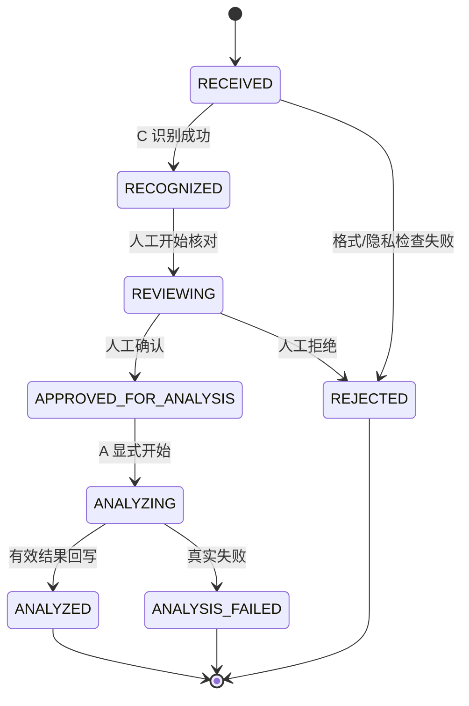

# knowledge-quality-loop.v1

## 1. 目标

本协议冻结“商品资料 → 资料识别 → AI 质量分析 → 运营修正 → 客服提醒”的最小闭环。

它服务内部试运行中的资料运营，不是知识自动发布协议。运营上传或更正资料，不会自动进入 RAG、不会自动改变 Prompt、不会自动训练模型，也不会触发客户消息、订单、退款、售后或 ERP 写入。

## 2. 所有者

| 角色 | 责任 |
| --- | --- |
| Provider | C：保存资料元数据、版本、审核状态、识别结果、AI 分析结果与运营处理状态。 |
| Consumer | A：只读取 C 人工审核后的不可变分析快照；调用已配置的本地模型并回写结构化质量建议。 |
| Consumer | B：只读取与当前店铺/商品范围匹配的紧凑资料状态，用于提示客服人工核对；绝不读取原始资料、AI 分析全文或客户数据。 |
| Data Steward | 提供非客户隐私的商品资料、维护模板与字段说明，人工确认识别结果和修正资料。 |

## 3. 数据模型

### 3.1 KnowledgeMaterial

| 字段 | 说明 |
| --- | --- |
| `material_id` | C 生成、稳定且不可猜测的资料标识。 |
| `revision` | 正整数。每次内容修正创建新 revision，已审核快照永不覆盖。 |
| `store_code` / `product_id` / `sku_id` | 资料业务范围；SKU 可空。 |
| `material_type` | `PRODUCT_SPEC`、`SAFETY_INSTRUCTION`、`ASSEMBLY_GUIDE`、`FAQ_SOURCE`、`OTHER`。 |
| `display_name` | 运营可读名称，不得含客户隐私。 |
| `content_hash` | C 对上传字节或规范化文本计算的 `sha256:<hex>`。 |
| `redaction_version` | 当前固定 `v1-reminder-only`；这不是自动脱敏声明。 |
| `recognition_summary` | C 识别出的文件类型、字段覆盖与可读性摘要；不返回原始内容。 |
| `material_status` | 见状态机。 |
| `reviewed_by` / `reviewed_at` / `review_note` | 人工审核痕迹。 |
| `created_at` / `updated_at` | ISO 8601 时间。 |

原始上传文件是 C 的受控运行时资料，不得提交 Git、打印到日志或由 B 返回。A 只能接收经 C 审核的、去标识化的分析文本快照；本 V1 不处理客户会话、订单、地址、电话、身份证件或支付信息。

### 3.2 KnowledgeQualityAssessment

| 字段 | 说明 |
| --- | --- |
| `assessment_id` | C 生成的分析结果标识。 |
| `material_id` / `revision` / `content_hash` | 必须精确匹配 C 导出快照。 |
| `analysis_run_id` | A 每次显式运行生成的幂等标识。 |
| `model_version` / `prompt_version` | 仅用于追溯。 |
| `overall_status` | `ANALYZED` 或 `FAILED`。 |
| `summary` | 中文、面向运营的非技术摘要。 |
| `gaps` | 结构化缺口列表，见下表。 |
| `created_at` | C 写入时间。 |

每条 `gap` 必须包括：`gap_id`、`gap_code`、`severity`（`LOW`/`MEDIUM`/`HIGH`）、`title`、`description`、`recommended_action`、`status`（`OPEN`/`ACKNOWLEDGED`/`RESOLVED`/`DISMISSED`）。禁止保存模型思维链、完整 Prompt、密钥或未经审核的来源原文。

## 4. API

所有 JSON 成功/错误沿用 C 的既有 envelope。路径下的 `/api/v1/admin/` 是内部运营 API，不构成正式认证或外部公开接口。

### 4.1 运营上传与识别（运营 → C）

`POST /api/v1/admin/knowledge-materials`

请求为 multipart：

```text
file=<受控资料文件>
store_code=PDD-SM
product_id=PRODUCT-001
sku_id=SKU-001             # 可选
material_type=PRODUCT_SPEC
display_name=积木产品规格说明
submitted_by=CSU-001
```

必须带 `Idempotency-Key`。C 校验允许格式、大小、业务范围、重复键和最小隐私提醒后，创建 `RECEIVED` 资料及一个新的 revision。上传成功不等于审核、更不等于发布。

响应：

```json
{
  "material_id": "KMT-001",
  "revision": 1,
  "content_hash": "sha256:...",
  "material_status": "RECOGNIZED",
  "recognition_summary": {
    "readable": true,
    "detected_fields": ["适用年龄", "安全提示"],
    "missing_expected_fields": ["包装清单"]
  }
}
```

`GET /api/v1/admin/knowledge-materials?store_code=&product_id=&material_status=&page=&size=` 返回运营列表和分页；`GET /api/v1/admin/knowledge-materials/{material_id}` 返回单条中文摘要和技术详情元数据，不返回原始二进制。

`POST /api/v1/admin/knowledge-materials/{material_id}/review`

```json
{
  "revision": 1,
  "decision": "APPROVE_FOR_ANALYSIS",
  "reviewed_by": "CSU-001",
  "review_note": "已核对为去标识化商品资料"
}
```

只有 `RECOGNIZED → REVIEWING → APPROVED_FOR_ANALYSIS` 可导出给 A；可转 `REJECTED`。同一资料修正必须经重新上传创建新 revision，而不是覆盖已批准 revision。

### 4.2 A 读取与回写（C ↔ A）

`GET /api/v1/admin/knowledge-quality/analysis-inputs?material_status=APPROVED_FOR_ANALYSIS&page=&size=`

仅返回人工审核的不可变快照：

```json
{
  "items": [
    {
      "material_id": "KMT-001",
      "revision": 1,
      "content_hash": "sha256:...",
      "store_code": "PDD-SM",
      "product_id": "PRODUCT-001",
      "sku_id": "SKU-001",
      "material_type": "PRODUCT_SPEC",
      "analysis_text": "已审核、去标识化的字段和值摘要",
      "recognition_summary": {"detected_fields": ["适用年龄"]}
    }
  ],
  "total": 1
}
```

`POST /api/v1/admin/knowledge-quality/analysis-results`

```json
{
  "material_id": "KMT-001",
  "revision": 1,
  "content_hash": "sha256:...",
  "analysis_run_id": "kqa-run-001",
  "model_version": "qwen3.5:9b",
  "prompt_version": "knowledge-quality.v1",
  "summary": "商品规格可读，但缺少包装清单。",
  "gaps": [
    {
      "gap_code": "MISSING_PACKAGE_CONTENTS",
      "severity": "MEDIUM",
      "title": "缺少包装清单",
      "description": "资料未给出包装内含物。",
      "recommended_action": "补充与商品范围一致的包装清单。"
    }
  ]
}
```

C 必须验证 revision、hash、资料状态及 `analysis_run_id` 幂等性。A 只在实际模型输出通过结构验证后回写；模型不可用或输出不合格时不创建伪造结果。

### 4.3 客服紧凑状态（B ← C）

`GET /api/v1/customer-knowledge-status?store_code=&product_id=&sku_id=`

```json
{
  "status": "NEEDS_REVIEW",
  "summary": "该商品资料仍有待补全项，回复前请人工核对。",
  "last_checked_at": "2026-07-28T10:00:00Z"
}
```

枚举：`READY`、`NEEDS_REVIEW`、`NO_APPROVED_MATERIAL`、`UNAVAILABLE`。B 只能展示该中文摘要，且不得阻断既有 AI 问答、泄露缺口细节或将状态误作 RAG 发布成功。

## 5. 状态机



`ANALYZED` 不代表已发布到 RAG。任何“发布/撤回/失效”必须由未来独立知识生命周期版本定义；本协议明确禁止自动转移到可检索知识。

## 6. 错误码

| Code | HTTP | 含义 |
| --- | --- | --- |
| `KNOWLEDGE_MATERIAL_VALIDATION_FAILED` | 422 | 格式、字段、范围或隐私提醒校验不通过。 |
| `KNOWLEDGE_MATERIAL_UNSUPPORTED_FILE` | 422 | 文件类型不在当前受控白名单。 |
| `KNOWLEDGE_MATERIAL_IDEMPOTENCY_CONFLICT` | 409 | 同一键对应不同资料。 |
| `KNOWLEDGE_MATERIAL_REVISION_MISMATCH` | 409 | 试图审核或回写非当前/非快照 revision。 |
| `KNOWLEDGE_MATERIAL_STATE_INVALID` | 409 | 非法状态流转或未审核导出。 |
| `KNOWLEDGE_QUALITY_INPUT_UNAVAILABLE` | 503 | C 无法提供审核快照。 |
| `KNOWLEDGE_QUALITY_MODEL_UNAVAILABLE` | 503 | A 无法使用已配置模型；不伪造结果。 |
| `KNOWLEDGE_QUALITY_OUTPUT_INVALID` | 422 | A 输出未满足结构与安全校验。 |
| `KNOWLEDGE_QUALITY_WRITEBACK_FAILED` | 502 | A 未能写回 C；资料状态须可追溯。 |
| `CUSTOMER_KNOWLEDGE_STATUS_UNAVAILABLE` | 503 | B 无法读取状态；B 显示明确服务不可用，不显示“暂无数据”。 |

## 7. 幂等与版本兼容

- 上传使用 `Idempotency-Key`，相同键与相同规范化请求返回同一 receipt；不同内容返回冲突。
- A 的 `analysis_run_id` 对同一 `material_id + revision + content_hash` 幂等；同 run ID 但不同 body 返回冲突。
- 新字段只能新增为可选字段；不得重命名、删除或改变枚举含义。破坏性变化必须创建 `knowledge-quality-loop.v2`。
- C 的资料 revision 与 A 的分析结果绑定；运营修正产生新 revision，旧评估保持可追溯。

## 8. A/B/C 影响范围

| 线路 | 允许范围 | 禁止范围 |
| --- | --- | --- |
| C | 资料受控存储、识别、审核、快照、分析结果、运营视图、客服状态投影。 | 自动发布、自动脱敏声明、自动 ERP 写入。 |
| A | 只读已审核快照、真实模型质量分析、结构化回写。 | 直接访问 C 数据库、自动改 Prompt/知识/模型。 |
| B | 只读中文资料状态提示和现有客服人工确认流程。 | 原始资料、自动回答修改、自动发送。 |
| Data | 模板、字段说明、去标识化检查、人工修正说明。 | 直接修改数据库、把客户隐私放进资料包。 |

## 9. 验收证据

最小真实闭环必须保留以下无敏感证据：

1. 一个去标识化资料上传 receipt 与识别摘要；
2. 人工审核后的 immutable revision/hash；
3. A 对该快照的实际模型分析结果及 `analysis_run_id`；
4. C 运营页中的一个 `OPEN` 缺口及一次人工修正后的新 revision；
5. B 只读资料状态提示与一次既有 AI 建议流程。

不得把“上传成功”“分析成功”或“资料已审核”表述为知识已发布或 RAG 已使用。
