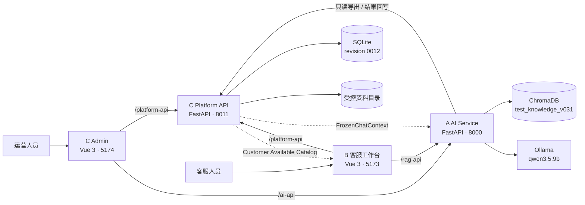
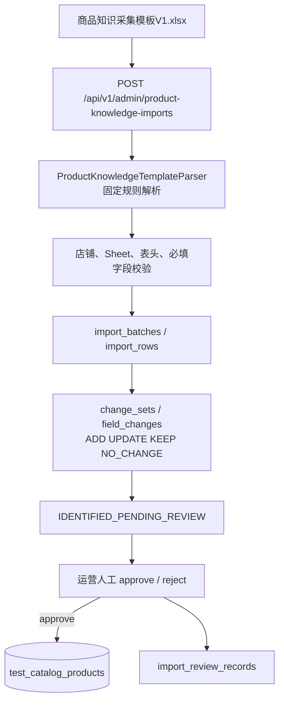
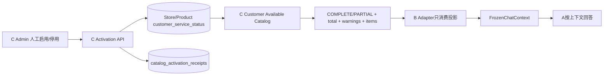
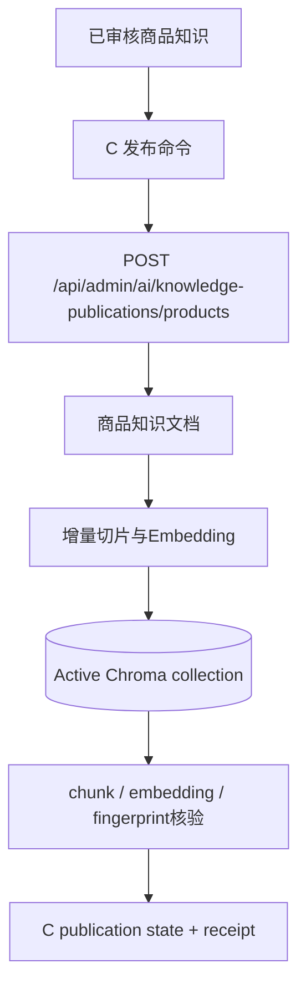
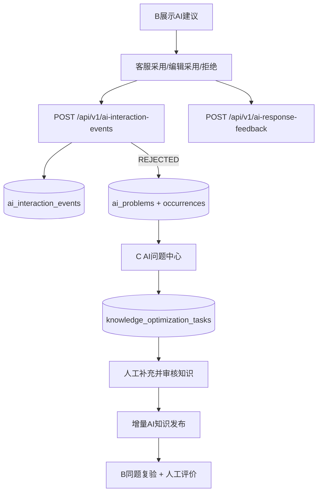

# AI-CS System Architecture Baseline V1

## 1. 系统一句话定位

AI-CS 是一个内部人工确认型 AI 客服系统：C 运营端管理商品与知识并决定客服准入，B 客服端选择 C 已投影的业务上下文，A 在该上下文内使用本地 RAG 与 Qwen 生成建议，所有发送和业务动作仍由人工完成。

## 2. 当前容器架构

代码证据：

- B 两条固定代理：`frontend/vite.config.ts`；
- Admin 两条固定代理：`admin_web/vite.config.ts`；
- A FastAPI 与 `/api` router：`backend/app/main.py:35-101`；
- C FastAPI 与全部 router 注册：`platform_backend/app/main.py:50-110`；
- A→C 分析桥接：`backend/app/service/experience_evaluation.py:21-22`、`feedback_analysis.py:22-23`、`knowledge_quality.py:25-26`。

## 3. 运行组件

| 组件 | 目录 | 技术 | 当前职责 | 持久化 |
|---|---|---|---|---|
| B Customer Client | `frontend/` | Vue 3、Vue Router、Element Plus、Axios、Vite | 选择店铺/商品/SKU、提问、展示AI建议与引用、记录采用/编辑/拒绝及反馈 | 不直接持久化；通过C API写事件 |
| C Admin | `admin_web/` | Vue 3、Vue Router、Axios、Vite | 商品、知识、R009导入审核、R006准入、AI发布、问题与运营治理 | 不直接访问数据库 |
| A AI Service | `backend/` | FastAPI、ChromaDB、sentence-transformers、OpenAI兼容客户端 | 检索、风险约束、提示构造、本地模型调用、引用和知识发布写入Chroma | Chroma与本地知识目录 |
| C Platform API | `platform_backend/` | FastAPI、SQLAlchemy、Alembic、openpyxl | 业务数据Owner、导入审核、Customer Catalog、收据、反馈闭环、AI状态 | SQLite与受控资料目录 |
| Shared Contracts | `contracts/` | JSON Schema | A/B/C共享的加法兼容边界 | Git版本资产 |
| OPS | `scripts/windows/` | PowerShell/Batch | 四服务生命周期、Runtime身份、LAN诊断、备份与状态 | `.runtime/`受管记录 |
| QA | `tests/`及各模块tests | Pytest、Vitest、Playwright | Contract、数据库健康、组件和业务链回归 | 测试隔离数据 |

技术版本来源：`frontend/package.json`、`admin_web/package.json`、`backend/requirements.txt`、`platform_backend/requirements.txt`。

## 4. 真实业务数据流

### 4.1 R009 商品知识导入

实现证据：

- Parser：`platform_backend/app/product_knowledge_import/parser.py:80`；
- 上传、preflight、merge-preview、review路由：`platform_backend/app/product_knowledge_import/routes.py`；
- 店铺一致性与Merge：`platform_backend/app/product_knowledge_import/service.py:577-768`；
- 审核写入：`platform_backend/app/product_knowledge_import/service.py:370-540`；
- 数据表：`platform_backend/app/ingestion/models.py`。

审核前正式商品不由上传动作直接覆盖；候选变化先落到导入审计表，人工通过后才应用正式商品变化。

### 4.2 R006 客服可用目录

边界事实：

- C是Store/Product客服准入Owner：`platform_backend/app/customer_catalog/**`；
- B消费 `/api/v1/customer-service/catalog/**`：`frontend/src/api/platformClient.ts`；
- B保留完整Envelope语义：`frontend/src/api/platformAdapter.ts`；
- A只校验上下文安全与完整性，不判断商品权限：`backend/app/models/chat.py:13-26`；
- SKU继承Product投影，不存在独立SKU启停接口。

### 4.3 R006.1 AI知识发布

实现证据：`platform_backend/app/knowledge_publishing/**`、`backend/app/service/product_knowledge_publisher.py`、`contracts/schemas/ai-product-knowledge-publication.v1.schema.json`。

客服状态变化本身不触发重新Embedding；只有知识内容首次发布或fingerprint变化需要增量发布。

### 4.4 R005 客服反馈闭环

实现证据：`frontend/src/api/aiInteractionEventClient.ts`、`aiResponseFeedbackClient.ts`、`platform_backend/app/customer_feedback_loop/**`、`platform_backend/app/api/customer_ai_feedback_routes.py`。

当前正式库只有1条interaction event，`ai_problems=0`、`knowledge_optimization_tasks=0`、`ai_response_feedback=0`，所以R005仍需真实业务验收，不能用“接口已存在”代替闭环完成。

## 5. AI请求链

1. B从C Customer Catalog取得已准入Store/Product/SKU。
2. B构造包含`tenant_id/platform/store_code/product_id/sku_id`的`FrozenChatContext`。
3. B通过`/rag-api/api/chat`调用A。
4. A按业务上下文对Chroma检索施加Store/Product/SKU过滤。
5. A进行规则判断、风险动作与知识充足度检查。
6. A把检索事实构造成模型上下文，调用Ollama的OpenAI兼容接口。
7. A返回建议、引用、风险和`SUGGESTION_ONLY/AUTO_SEND_DISABLED`边界。
8. 客服人工确认、修改或拒绝；B不会自动发送。

代码证据：`frontend/src/api/ragClient.ts`、`backend/app/service/test_knowledge.py:358-492`、`backend/app/service/rag_service.py:1006-1185`、`backend/app/service/ai_capability.py:102-123`。

当前请求模型不接收历史消息数组，正式数据库也没有聊天会话表；因此不能把当前系统描述为具备服务端长期对话Memory。当前主链也没有Agent编排或Tool Calling执行器。

## 6. 数据与安全边界

| 边界 | 当前事实 |
|---|---|
| 业务主数据Owner | C Platform API / SQLite |
| 客服准入Owner | C Customer Available Catalog |
| AI权限判断 | A不判断商品是否可供客服使用；只使用C/B提供的冻结上下文 |
| AI运行数据 | Chroma、模型调用状态、引用；不直接改业务主数据 |
| 人工确认 | 商品审核、客服启用、AI知识发布、客服发送均需人工动作 |
| 自动业务动作 | 不自动发送、不退款、不修改订单 |
| Git禁入 | `.runtime`、SQLite、Chroma、知识源、模型、日志、依赖、构建物、客户数据 |

## 7. 当前部署方式

- 单机Windows内部部署；
- B通过LAN地址监听5173；
- Admin、A、C只监听服务器loopback；
- 浏览器通过Vite同源代理访问A/C；
- Ollama监听`127.0.0.1:11434`；
- 四服务由PowerShell受管记录保存Repository Root、SHA、source fingerprint、Runtime模式和PID。

详细运行方式见 [Runtime Operations](05_Runtime_Operations_Baseline_V1.md)。

## 8. 当前明确不具备的能力

- 不连接ERP、订单系统或电商平台自动同步；
- 不自动发送客户消息；
- 不自动退款或修改订单；
- 不提供RBAC、企业SSO或公网多租户部署基线；
- 不提供服务端长期会话Memory；
- 不提供通用Agent/Tool Calling业务执行；
- R009只完成商品知识采集模板闭环，其他五类模板没有同等导入实现；
- R003和R005仍需Phase 4.1真实业务验收。
