# AI-CS Database Current State V1

## 1. 正式数据库身份

| 项目 | 当前事实 |
|---|---|
| Engine | SQLite |
| 文件 | `.runtime/phase-e/data/standard-platform.sqlite3` |
| Alembic revision | `0012_internal_production_finalization_v1` |
| 业务表 | 36 |
| 元数据表 | `alembic_version` |
| 文件大小 | 1,773,568 bytes |
| 离线SHA-256 | `39BC426DB0BAB826608EFBA065A08EDAA67EF27A6ED96CF4A96D20A4E1EDA4D0` |
| integrity_check | PASS |
| foreign_key_check | PASS |
| 数据质量P0/P1/P2 | `0 / 0 / 0` |

证据来自正式SQLite只读连接、`scripts/database-health-check/Invoke-AICustomerDatabaseHealthCheck.ps1`与Alembic文件。数据库、WAL、备份和内容不得进入Git。

## 2. 当前ER主关系

```mermaid
erDiagram
    TEST_KNOWLEDGE_PACKAGES ||--o{ TEST_CATALOG_STORES : package_id
    TEST_KNOWLEDGE_PACKAGES ||--o{ TEST_CATALOG_PRODUCTS : package_id
    TEST_KNOWLEDGE_PACKAGES ||--o{ TEST_CATALOG_SKUS : package_id
    TEST_CATALOG_PRODUCTS ||--o{ TEST_CATALOG_SKUS : product_id
    TEST_KNOWLEDGE_PACKAGES ||--o{ TEST_FAQS : package_id
    TEST_KNOWLEDGE_PACKAGES ||--o{ TEST_SAFETY_RULES : package_id
    TEST_KNOWLEDGE_PACKAGES ||--o{ TEST_SOURCE_EVIDENCE : package_id

    IMPORT_BATCHES ||--o{ IMPORT_ROWS : batch_id
    IMPORT_BATCHES ||--o{ IMPORT_CHANGE_SETS : batch_id
    IMPORT_CHANGE_SETS ||--o{ IMPORT_FIELD_CHANGES : change_set_id
    IMPORT_CHANGE_SETS ||--o{ IMPORT_REVIEW_RECORDS : change_set_id
    IMPORT_BATCHES ||--o{ IMPORT_REVIEW_RECORDS : batch_id

    TEST_CATALOG_PRODUCTS ||--o| PRODUCT_KNOWLEDGE_PUBLICATIONS : product_id
    TEST_CATALOG_PRODUCTS ||--o{ PRODUCT_KNOWLEDGE_PUBLICATION_RECEIPTS : product_id

    KNOWLEDGE_MATERIALS ||--o{ KNOWLEDGE_MATERIAL_UPLOAD_RECEIPTS : material_record_id
    KNOWLEDGE_MATERIALS ||--o{ KNOWLEDGE_QUALITY_ASSESSMENTS : material_record_id

    CUSTOMER_EXPERIENCE_CASES ||--o{ CUSTOMER_EXPERIENCE_CASE_EXPORTS : case_record_id
    CUSTOMER_EXPERIENCE_CASES ||--o{ CUSTOMER_EXPERIENCE_EVALUATIONS : case_record_id

    AI_RESPONSE_FEEDBACK ||--o{ AI_RESPONSE_FEEDBACK_ANALYSES : feedback_record_id
    AI_RESPONSE_FEEDBACK ||--o{ AI_RESPONSE_FEEDBACK_IDEMPOTENCY : feedback_record_id

    AI_PROBLEMS ||--o{ AI_PROBLEM_OCCURRENCES : problem_record_id
    AI_INTERACTION_EVENTS ||--o| AI_PROBLEM_OCCURRENCES : event_record_id
    AI_PROBLEMS ||--o| KNOWLEDGE_OPTIMIZATION_TASKS : problem_record_id
```



重要事实：`test_catalog_products`没有直接外键指向`test_catalog_stores.id`，Store/Product业务关联由共同`package_id + store_code`表达；数据库健康脚本对此进行跨字段孤儿检查。Product不能仅按名称跨店匹配。

## 3. 36张业务表

### 3.1 Catalog与业务知识（9表）

ORM证据：`platform_backend/app/test_catalog/models.py`；创建于migration 0002。

| 表 | 行数 | 用途 | 关键字段/关系 |
|---|---:|---|---|
| `test_knowledge_packages` | 2 | 知识/目录包根 | `package_id` PK；tenant/platform/store；保留历史测试标记 |
| `test_catalog_stores` | 2 | 当前Store实体 | `id` PK；`package_id` FK；`data_source`、`customer_service_status` |
| `test_catalog_products` | 24 | 当前Product实体与知识字段 | `product_id` PK；`package_id` FK；Store由store_code关联；review/customer status |
| `test_catalog_skus` | 18 | SKU与Product关系 | `sku_id` PK；`product_id`、`package_id` FK |
| `test_source_evidence` | 58 | 商品/SKU来源元数据 | `source_id` PK；`package_id` FK；文件hash/相对路径 |
| `test_faqs` | 16 | FAQ知识 | `faq_id` PK；package/store/product/sku scope |
| `test_safety_rules` | 8 | Store级安全规则 | `rule_id` PK；风险与来源 |
| `test_evaluation_cases` | 28 | 内部评估用例 | `case_id` PK；package/store/product/sku scope |
| `test_conflict_records` | 13 | 来源冲突记录 | `issue_id` PK；entity/field/status |

这些表名保留历史`test_`前缀，但0012已通过`catalog_source_formalizations`保存原来源到正式初始化来源的转换。不要因为表名误判为“可以删除的测试数据”。

### 3.2 R006客服准入与来源审计（4表）

| 表 | 行数 | Migration | 用途 |
|---|---:|---|---|
| `catalog_activation_receipts` | 10 | 0010 | Store/Product每次实际状态变化的审计收据 |
| `catalog_activation_idempotency` | 5 | 0010 | 激活写请求幂等结果 |
| `catalog_activation_initializations` | 1 | 0010 | 一次性兼容初始化策略与manifest |
| `catalog_source_formalizations` | 1 | 0012 | 原始来源、正式来源与迁移版本审计 |

Activation receipt不以外键绑定Store/Product，而以`entity_type + entity_ref`保存跨类型审计引用；健康脚本负责检查孤儿和最新收据状态一致性。

### 3.3 导入与R009审核（6表）

ORM证据：`platform_backend/app/ingestion/models.py`。`import_batches/import_rows/staged_product_skus`创建于0001；R009变化与审核表创建于0009。

| 表 | 行数 | 用途 | 关键关系 |
|---|---:|---|---|
| `import_batches` | 3 | 上传批次、店铺快照、模板/Parser版本、幂等 | 根表 |
| `import_rows` | 57 | 原始/标准化行、校验状态、商品识别 | `batch_id` FK |
| `import_change_sets` | 57 | 商品级old/incoming/merged候选 | `batch_id` FK |
| `import_field_changes` | 627 | 字段级ADD/UPDATE/KEEP/NO_CHANGE | `change_set_id` FK |
| `import_review_records` | 21 | approve/reject、operator、hash与写入结果 | batch/change_set双FK |
| `staged_product_skus` | 0 | 旧Product/SKU导入staging | `batch_id` FK |

### 3.4 资料与知识质量（3表）

| 表 | 行数 | Migration | 用途 |
|---|---:|---|---|
| `knowledge_materials` | 1 | 0007 | 受控上传资料、scope、状态和审核 |
| `knowledge_material_upload_receipts` | 1 | 0007 | 上传幂等与receipt |
| `knowledge_quality_assessments` | 0 | 0007 | A质量分析结果和版本追踪 |

### 3.5 R006.1商品AI发布（3表）

ORM证据：`platform_backend/app/knowledge_publishing/models.py`；创建于0011。

| 表 | 行数 | 用途 |
|---|---:|---|
| `product_knowledge_publications` | 3 | Product当前AI发布状态、fingerprint、collection和数量 |
| `product_knowledge_publication_receipts` | 3 | 每次成功发布的chunk/embedding/收据 |
| `product_knowledge_publication_idempotency` | 3 | 发布写请求幂等 |

前两表通过`product_id`外键关联`test_catalog_products`。Chroma向量不存放在SQLite；SQLite保存业务可审计状态和收据。

### 3.6 产品意见（1表）

| 表 | 行数 | Migration | 用途 |
|---|---:|---|---|
| `customer_suggestions` | 2 | 0003 | 客服对产品/模块的非AI质量建议 |

### 3.7 客服体验案例（3表）

| 表 | 行数 | Migration | 用途 |
|---|---:|---|---|
| `customer_experience_cases` | 3 | 0004 | 客服人工沉淀的问答案例与审核状态 |
| `customer_experience_case_exports` | 0 | 0004 | 审核后供A读取的固定快照 |
| `customer_experience_evaluations` | 0 | 0004 | A模型评估结果与模型/Prompt版本 |

### 3.8 AI回答问题分类反馈（3表）

| 表 | 行数 | Migration | 用途 |
|---|---:|---|---|
| `ai_response_feedback` | 0 | 0005 | 客服提交的问题类型、回答和确认状态 |
| `ai_response_feedback_analyses` | 0 | 0005 | A分析输出与模型/Prompt版本 |
| `ai_response_feedback_idempotency` | 0 | 0006 | 反馈提交幂等 |

### 3.9 R005 Customer Feedback Loop（4表）

ORM证据：`platform_backend/app/customer_feedback_loop/models.py`；创建于0008。

| 表 | 行数 | 用途 |
|---|---:|---|
| `ai_interaction_events` | 1 | 客服采用、编辑采用、拒绝的不可变事件 |
| `ai_problems` | 0 | REJECTED事件按fingerprint聚合的问题 |
| `ai_problem_occurrences` | 0 | 问题到具体interaction event的追踪 |
| `knowledge_optimization_tasks` | 0 | 人工知识补充和复验任务 |

当前数据说明“接口与表已存在”，但尚未形成一条正式AI问题→知识任务→复验记录，因此R005不能视为业务验收完成。

## 4. Migration链

| Revision | Parent | 新增/主要变化 |
|---|---|---|
| `0001_ct02_ingestion` | root | import_batches、import_rows、staged_product_skus |
| `0002_ct02b_test_catalog` | 0001 | 9张Catalog/FAQ/安全/来源/评估/冲突表 |
| `0003_ct05_customer_suggestions` | 0002 | customer_suggestions |
| `0004_mvp_plus_01_experience_cases` | 0003 | 体验案例、导出、评估 |
| `0005_mvp_plus_02_ai_response_feedback` | 0004 | AI回答反馈与分析 |
| `0006_mvp_plus_02_ai_feedback_idempotency` | 0005 | AI反馈幂等 |
| `0007_target_mode_v2_knowledge_quality_loop` | 0006 | 资料、上传收据、知识质量 |
| `0008_customer_feedback_loop_v1` | 0007 | interaction、AI问题、occurrence、知识任务 |
| `0009_product_knowledge_import_v1` | 0008 | R009 change sets、field changes、review records，并扩展import批次/行 |
| `0010_customer_available_catalog_v1` | 0009 | Store/Product客服状态、activation收据/幂等/初始化 |
| `0011_product_knowledge_publishing_v1` | 0010 | 商品AI发布状态、收据、幂等 |
| `0012_internal_production_finalization_v1` | 0011 | 正式来源标签与catalog_source_formalizations |

代码：`platform_backend/migrations/versions/`。当前执行链单头、revision连续；任何未来迁移必须先做正式SQLite备份、隔离upgrade/downgrade测试和业务计数对比。

## 5. 商品主数据现实模型

当前商品身份为`test_catalog_products.product_id`，SKU身份为`test_catalog_skus.sku_id`。Store使用整数`id`作为管理引用，同时以`tenant_id/platform/store_code/package_id`表达业务scope。

R009匹配现有商品时限定同一Store的`package_id + store_code`并比较标准化商品名称，见`platform_backend/app/product_knowledge_import/service.py:631-680`和`:1081-1086`。名称不是全局唯一键，不能跨Store作为唯一身份。

当前模型支持：

- 多Store：有Store表与tenant/platform/store_code；
- 多Product：Product绑定package/store scope；
- 多SKU：SKU外键到Product；
- 商品知识：核心字段、raw JSON、FAQ、安全规则、来源、知识资料及AI发布状态。

长期注意点：表名`test_catalog_*`及Store/Product弱外键关联是历史演进语义，不在Phase 4.1重构；业务消费者必须通过C服务和Customer Catalog，而不是直读表。

## 6. 状态体系

| 对象 | 字段 | 当前含义 |
|---|---|---|
| Import batch | `status` | 解析/预检/待审核/完成等导入阶段 |
| Import change set | `status` | `IDENTIFIED_PENDING_REVIEW`、应用/拒绝等 |
| Import field | `change_type` | ADD/UPDATE/KEEP/NO_CHANGE |
| Product | `review_status` | 商品知识/初始化审核状态 |
| Store/Product | `customer_service_status` | R006准入：ENABLED/DISABLED |
| Store | `data_source` | INITIAL_IMPORT/PILOT；TEST为兼容transport值 |
| Product publication | `status` | NOT_GENERATED/GENERATING/PUBLISHED/SYNC_FAILED/NEED_RESYNC域 |
| Knowledge material | `material_status` | 资料提交与人工审核状态 |
| AI problem | `status` | NEW/CONFIRMED/PROCESSING/SOLVED/VERIFIED等闭环状态 |
| Knowledge task | `status` | 知识任务执行与复验状态 |
| Experience case | `review_status`、`evaluation_status` | 人工审核与模型评估分离 |
| AI response feedback | `status`、`analysis_status` | 人工确认与AI分析分离 |

旧字段`test_data_mode`、`production_usable`、`publishable`仍为历史兼容数据，但R006 B准入不得使用它们。当前准入Owner字段只有C最终`customer_service_status`及其投影。

## 7. R009正式写入边界

上传阶段：

1. 创建`import_batches`；
2. 固定规则解析Excel；
3. 校验Store、Sheet、表头和字段；
4. 写`import_rows`；
5. 生成`import_change_sets/import_field_changes`；
6. 状态进入`IDENTIFIED_PENDING_REVIEW`。

此时不应用候选变化到`test_catalog_products`。

审核阶段：

- reject：保存`import_review_records`，正式商品不变；
- approve：校验base snapshot hash和version，应用新增/字段级Merge到Product，再保存before/after hash、applied product和字段数；
- Excel空值保持旧值，Excel未出现字段不删除。

实现：`platform_backend/app/product_knowledge_import/service.py`。

## 8. R006投影边界

B不直接读取SQLite。C从Store/Product/SKU表筛选最终可用项，返回`COMPLETE/PARTIAL + items + total + warnings`。Store禁用阻断下游Product投影，但不改写Product自身状态；SKU继承Product，不独立启停。

Activation写入同时更新实体状态、保存receipt和幂等响应。健康检查验证最新receipt与当前实体状态一致。

实现：`platform_backend/app/customer_catalog/service.py`、`repository.py`、`routes.py`，契约：`contracts/schemas/customer-service-catalog*.json`。

## 9. AI数据与业务数据边界

- AI运行向量和Embedding：Chroma，不进入SQLite业务表；
- 商品AI发布状态/收据：SQLite，作为业务可见审计；
- AI回答事件、人工反馈和评估：SQLite独立表，不覆盖Product主数据；
- Prompt正文与模型密钥不写业务表；分析表只保存版本、hash/JSON结果；
- 知识改善必须经既有资料/商品审核流程，不能由AI分析直接写Product。

## 10. 只读健康检查

正式检查命令：

```powershell
.\scripts\database-health-check\Invoke-AICustomerDatabaseHealthCheck.ps1 `
  -DatabasePath '.runtime\phase-e\data\standard-platform.sqlite3' `
  -ExpectedRevision '0012_internal_production_finalization_v1' `
  -Compact
```

检查覆盖：integrity、foreign keys、Store/Product/SKU/FAQ/Knowledge孤儿、状态域、activation receipt、publication一致性和Alembic revision。脚本只报告，不自动修复。
