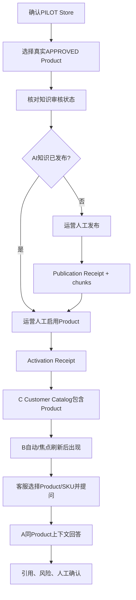

# AI-CS Phase 4.1 Acceptance Manual V1

## 1. 验收目标

Phase 4.1按串行顺序完成两个P0业务Gate：

1. **R003**：证明C创建/审核/发布/启用的PILOT商品能够进入B，并由A基于正确商品知识回答；
2. **R005**：使用一条真实、去标识化的客服问题，证明拒绝反馈能够进入C问题中心、形成知识任务、完成人工知识改善和同题复验。

本手册不授权新增架构、直接改库、修改R006/R009核心逻辑、调整Prompt/模型或全量重建RAG。

## 2. 执行前Gate

业务验收开始前必须重新执行，而不能只引用历史报告：

| Gate | 命令/证据 | 通过条件 |
|---|---|---|
| Git | `git status --porcelain`、`git rev-parse HEAD` | clean；HEAD与四服务record一致 |
| Runtime | `status_ai_customer_service.ps1` | 四服务RUNNING；root/SHA/fingerprint/standard/LAN全部一致 |
| Database | database health check | revision 0012；integrity/FK PASS；P0/P1/P2为0 |
| RAG | status输出 | active collection不变；chunks=56；model ready |
| 数据保护 | SQLite/RAG manifest | 记录执行前revision、关键计数和发布状态 |
| 人工窗口 | Control记录 | 无并发运营写入；参与人和回滚责任明确 |

本工程文档基线的事实采集点为`860d102`且当时Controlled Runtime Gate已通过。由于文档本身是新增Git资产，在正式R003/R005执行前必须先通过单独的docs-only治理任务把文档纳入受控SHA并重新验证Runtime身份；不得带着dirty source开始签署业务验收。

## 3. 角色与人工责任

| 角色 | 必须完成的人工动作 |
|---|---|
| Control/Release | 确认clean基线、静默窗口、证据编号和最终Gate |
| 运营 | 核对Store/Product、审核知识、发布AI知识、启用/停用客服 |
| 客服 | 选择真实商品、提出真实问题、判断采用/拒绝、复验改善 |
| QA | 浏览器记录、接口/数据库只读核对、前后对比 |
| DB/OPS | 保存revision/计数/manifest，发生异常时停止并恢复 |

Playwright可以辅助点击、截图和读取页面，但不能替代业务人员对商品、回答正确性、知识来源和最终改善的判断。不得用API直接写入或SQLite更新模拟人工动作。

## 4. 当前可用验收数据概况

正式SQLite只读汇总：

| 数据 | 当前数量 |
|---|---:|
| Store：INITIAL_IMPORT + ENABLED | 1 |
| Store：PILOT + ENABLED | 1 |
| Product：APPROVED + DISABLED | 17 |
| Product：APPROVED + ENABLED | 2 |
| Product：TEST_CONFIRMED + ENABLED | 5 |
| Product publication：PUBLISHED | 3 |
| Interaction events | 1 |
| AI problems | 0 |
| Knowledge tasks | 0 |
| AI response feedback | 0 |

R003优先从17个`APPROVED+DISABLED`候选中选择一个真实计划上线的PILOT Product。不得为了验收重复导入或虚构商品。

R005必须由客服提供真实badcase；没有真实问题时状态应为`BLOCKED_BY_SAMPLE`，不能制造错误回答强行通过。

## 5. 统一证据编号

开始前创建：

```text
P41-YYYYMMDD-01
```

所有人工操作、截图、receipt ID、batch ID、problem ID、task ID、publication receipt和复验记录使用同一编号。证据中只保留必要业务标识；客户姓名、订单号、联系方式和原始对话必须去标识化。

## 6. R003生产业务验收

### 6.1 验收链



### 6.2 R003执行步骤

| 步骤 | 人工操作 | 系统证据 | 通过条件 |
|---|---|---|---|
| R3-01 | Admin `/store-management`选择PILOT Store | Store详情；C数据库只读核对 | Store为ENABLED；data_source=PILOT |
| R3-02 | `/knowledge-center`选择APPROVED+DISABLED商品 | Product详情 | 资料已审核；客服未启用；AI状态明确 |
| R3-03 | 如AI未发布，点击发布AI知识 | C→A发布请求、publication receipt | 状态PUBLISHED；chunks>0；embedding=chunks |
| R3-04 | 填写真实operator/原因，人工启用Product | activation response/receipt | `changed=true`或已是目标状态；当前Product=ENABLED |
| R3-05 | 只读调用/观察C Product Catalog | `COMPLETE/PARTIAL/items/total/warnings` | items包含目标Product；没有整批No data |
| R3-06 | 保持B页面已打开，重新聚焦或等待低频刷新 | B目录UI、Network | 无需浏览器硬刷新，目标Product最终出现 |
| R3-07 | 选择Product及适用SKU，提问年龄/材质/玩法 | B请求中的FrozenChatContext | tenant/store/product/sku与目标一致 |
| R3-08 | 核对A回答和引用 | A response、B来源展示 | 事实正确；引用属于目标商品；无跨商品污染 |
| R3-09 | 核对安全边界 | B页面/response | `SUGGESTION_ONLY`、`AUTO_SEND_DISABLED`；人工发送 |
| R3-10 | 按预定最终状态保留或人工停用 | activation receipt、B目录 | 停用后B不可见；知识与publication保留 |

### 6.3 R003关键接口

- Store/Product启停：`PUT /api/v1/admin/operations/.../customer-service-status`
- 批量Product启用：`POST /api/v1/admin/operations/products/customer-service-status:batch`
- C目录：`GET /api/v1/customer-service/catalog/stores|products|products/{id}/skus`
- AI知识状态：`GET /api/v1/customer-service/catalog/products/{id}/ai-knowledge`
- AI发布：`POST /api/v1/admin/product-knowledge/products/{id}/ai-publications`
- A回答：`POST /api/chat`

浏览器验收应通过Admin和B完成，接口只用于Network/只读证据核对。

### 6.4 R003异常场景

| 场景 | 期望 |
|---|---|
| Store DISABLED、Product ENABLED | Store阻断下游投影；Product自身状态保持 |
| Product DISABLED | Product不进入B；其他Product不受影响 |
| 单条异常数据 | C返回PARTIAL和warnings；有效items继续可用 |
| `PARTIAL+total=0` | B显示“商品目录暂时异常”，不显示真实空目录提示 |
| SKU异常 | 隔离坏SKU，不清空同Product全部有效SKU/全目录 |
| AI知识未发布 | Product可按准入显示；AI区域明确知识未同步，不编造 |

### 6.5 R003 PASS标准

以下全部满足才可把R003标记DONE：

1. 真实PILOT商品在启用前不进入B；
2. 人工发布后存在publication receipt、fingerprint和正数chunks；
3. 人工启用后存在activation receipt，C最终投影包含商品；
4. B只消费C投影，目标商品最终出现；
5. A使用正确Product/SKU上下文并返回同商品来源；
6. 禁用回滚不删除商品知识或AI发布记录；
7. 单条异常不影响全目录；
8. 全程不自动发送、不退款、不修改订单；
9. 数据库/RAG基线除预期业务收据与商品状态外无非预期变化。

若没有真实新Store创建证据，Store创建场景可以记录为`CONDITIONAL_PASS`，但不得伪造Store；是否能关闭R003由Requirement Owner根据既有真实Store证据决定。

## 7. R005真实反馈闭环验收

### 7.1 样本准入

必须满足：

- 来自真实客服工作或真实运营已知问题；
- 删除姓名、订单号、电话、地址和其他客户识别信息；
- 绑定R003已经通过的同一Store/Product/SKU；
- 事先记录正确事实清单和预期回答边界；
- 不为了测试故意诱导模型出错。

### 7.2 R005执行步骤

| 步骤 | 人工操作 | 系统/数据证据 | 通过条件 |
|---|---|---|---|
| R5-01 | B选择已验收商品并提出真实问题 | A response、context、引用 | 保存改善前回答与事实差距 |
| R5-02 | 客服选择“未采用”，填写真实原因 | `POST /api/v1/ai-interaction-events` receipt | action=REJECTED；status=RECORDED |
| R5-03 | 如需分类，提交AI问题反馈 | ai-response-feedback receipt | 幂等写入；不能代替interaction event |
| R5-04 | Admin `/ai-issues`查看问题 | `ai_problems/occurrences` | 目标问题出现并绑定event |
| R5-05 | 运营核对事实，人工确认问题 | problem status更新 | operator、note和时间可审计 |
| R5-06 | 创建知识优化任务 | knowledge task ID | 问题进入PROCESSING，任务绑定同一Product |
| R5-07 | 通过既有知识维护/R009审核链补充事实 | old/new、review receipt | 不直接改库；审核前正式知识不变 |
| R5-08 | 人工发布更新后的AI知识 | publication receipt | fingerprint变化；增量发布；chunks/embeddings有效 |
| R5-09 | B对同一问题、同一Product/SKU复验 | 改善后response与引用 | 新知识被检索；其他商品上下文不污染 |
| R5-10 | 客服/QA人工评价 | verification记录 | `IMPROVED`或`NOT_IMPROVED`如实保存 |

### 7.3 Interaction与问题形成规则

- `DIRECT_ACCEPT`：保存interaction，不形成AI问题；
- `EDITED_ACCEPT`：必须保存最终人工答案，保存interaction，不形成AI问题；
- `REJECTED`：保存interaction，并按业务scope和问题摘要聚合/创建`ai_problems`与`ai_problem_occurrences`；
- `Idempotency-Key`重复且请求一致：返回同一结果；请求内容冲突必须报错；
- 可选`ai_response_feedback`用于问题类型，不代替`ai_interaction_events`主事件。

实现：`platform_backend/app/customer_feedback_loop/service.py:98-245`，Contract：`contracts/schemas/ai-interaction-event-*.json`。

### 7.4 改善判定

| 维度 | 改善前后比较 |
|---|---|
| 事实准确 | 是否覆盖人工确认的缺失事实 |
| 商品隔离 | 引用和回答是否仍绑定同一Product/SKU |
| 来源 | 是否出现更新后商品知识的可核对引用 |
| 风险 | 是否继续保留人工确认和禁止自动动作 |
| 不确定性 | 无证据时是否拒答/追问，而非编造 |

R005验证的是“可追溯改善闭环”，不保证模型一定改善。如果新知识已审核发布但回答仍未改善，必须记录`NOT_IMPROVED`，知识任务保持开放，R005不能关闭；不得通过修改Prompt、模型或RAG架构强行通过。

### 7.5 R005 PASS标准

1. 真实去标识化badcase已批准用于验收；
2. REJECTED interaction真实持久化并返回receipt；
3. C问题中心出现对应问题和occurrence；
4. 人工确认、知识任务和状态变化具有operator/time；
5. 知识变化经过人工审核；
6. 新fingerprint增量发布并生成publication receipt；
7. 同题复验使用相同业务scope；
8. 人工评价为IMPROVED，并保存verification；
9. 无自动发送、退款、订单修改或非预期数据污染。

## 8. 执行后数据核对

允许发生的预期变化：

- Product/Store客服状态及activation receipt；
- 商品知识审核产生的正式字段变化和review receipt；
- Product publication fingerprint、counts和receipt；
- interaction event、problem、occurrence、knowledge task与verification；
- 可选AI response feedback及其确认/分析记录。

不允许发生：

- revision变化或新增migration；
- 非目标Product/Store状态变化；
- 全量Chroma清空/重建；
- 其他Product chunks丢失；
- R009批次被绕过审核直接写正式商品；
- Runtime SHA、source fingerprint或运行模式漂移。

执行后重新运行database health和Runtime status，并对比执行前关键计数/manifest。

## 9. 失败与回滚

| 失败点 | 处置 |
|---|---|
| Runtime/Git身份失败 | 立即停止业务操作；恢复clean受控Runtime |
| 激活后C目录不含商品 | 停止；记录Store/Product/receipt/投影断点，不让B自行兜底 |
| 发布失败 | 保留上一发布版本；记录SYNC_FAILED；不全量重建 |
| B目录PARTIAL异常 | 保留warnings和Network响应；不签署R003 |
| 反馈事件未持久化 | 不继续知识任务；记录R005断点 |
| 知识更新后未改善 | 记录NOT_IMPROVED，任务保持开放 |
| 非目标数据变化 | 停止验收并由DB Owner根据备份/manifest处置 |

如果验收结束要求恢复商品不可见，应通过Admin人工DISABLE并保存新的activation receipt；禁止删除Product、知识、publication receipt或向量。

## 10. 最终交付物

### R003报告必须包含

- 基线SHA、PID、database revision、RAG状态；
- Store/Product/SKU及三状态矩阵；
- publication与activation receipt；
- C Catalog envelope；
- B商品可见性与A回答引用；
- 禁用/回滚验证；
- 异常场景和最终状态。

### R005报告必须包含

- 去标识化样本批准记录；
- 改善前回答、事实缺口和引用；
- interaction receipt、problem ID、occurrence和task ID；
- 知识审核与publication receipt；
- 改善后回答、引用及人工评价；
- IMPROVED/NOT_IMPROVED结论；
- 数据库/RAG/Runtime执行后健康。

Phase 4.1只有在两个P0报告均PASS时才能进入：

```text
AI_CS_PHASE_4_1_PRODUCTION_VALIDATION_COMPLETE
```

任一P0失败则保持：

```text
AI_CS_PHASE_4_1_VALIDATION_BLOCKED
```
