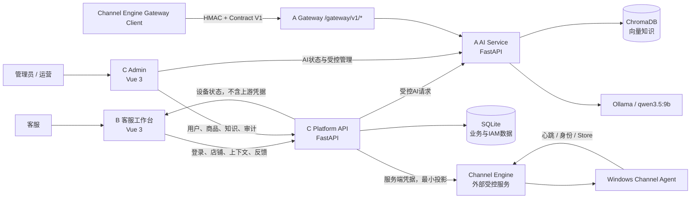
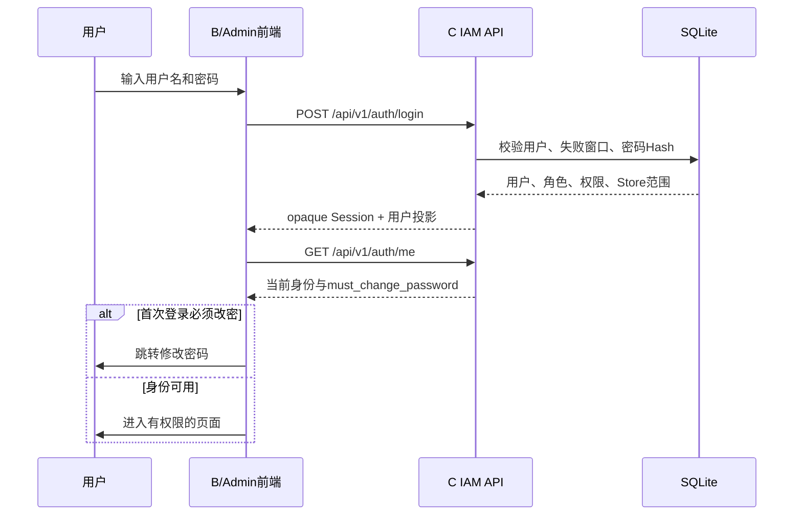
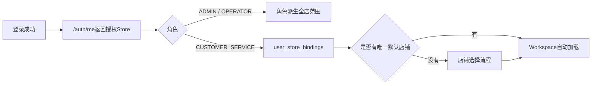
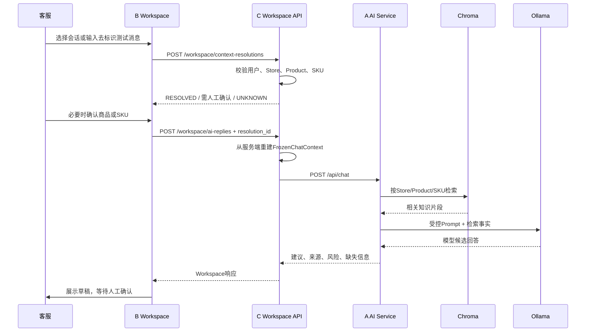
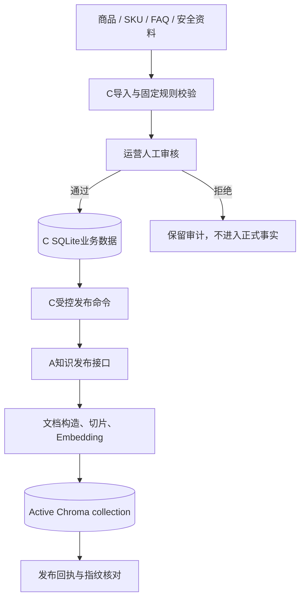
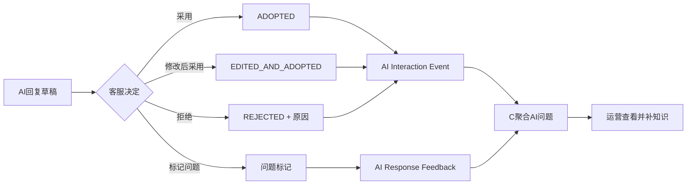
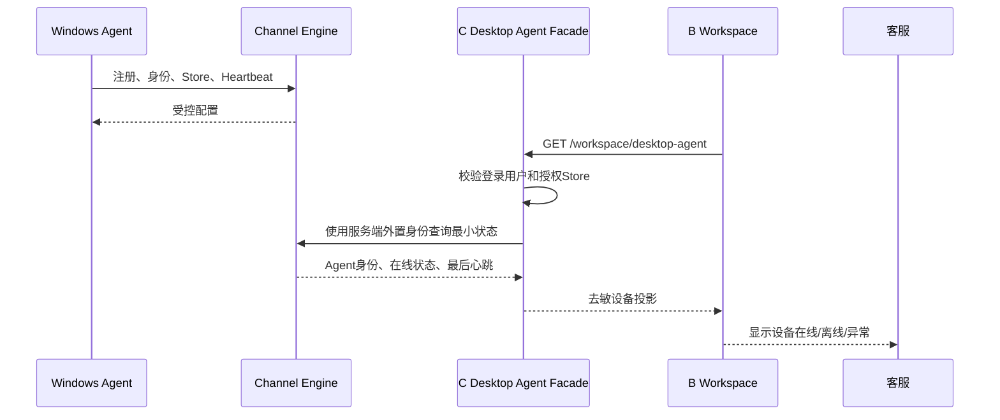
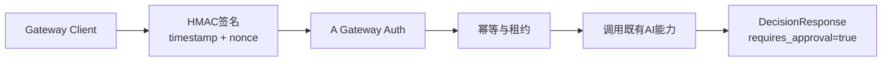

# AI-CS 初学者代码研究说明书 V1

> 面向读者：第一次接触本项目，能看懂一些代码，但还不熟悉大型前后端项目的人。
> 文档快照：2026-08-11（Asia/Shanghai）。
> 稳定源码基线：`584f20219bc12d6caacc384579f43f20786f7459`。
> 重要提醒：当前工作区还叠加了一批未提交的 Channel Agent 桌面端候选代码。本文会把稳定能力和候选能力分开写，不能把“磁盘上看得到”理解成“已经生产发布”。

---

## 0. 先记住三种“当前”

研究这个项目时，最容易犯的错误是把下面三件事混为一谈：

| 名称 | 它回答的问题 | 本文中的事实 |
| --- | --- | --- |
| Git稳定提交 | 已经受控保存的代码是什么？ | `584f202...` |
| 当前工作区 | 开发者磁盘上正在编辑什么？ | 稳定提交之上还有未提交的Agent桌面、主机配对、店铺平台绑定、0017/0018迁移候选 |
| Runtime | 电脑现在实际跑的是哪套代码和数据？ | 由Windows启动脚本、Runtime记录、端口和数据库revision共同决定，不能只看编辑器 |

所以：

- `git show 584f202:<文件>`看到的是稳定版本；
- 直接打开文件看到的是当前工作区版本；
- 浏览器页面展示什么，还取决于服务是否从同一SHA启动、用了哪份配置和数据库。

旧的`docs/engineering/01`—`06`记录的是更早的0012工程基线，适合查历史，不应覆盖本文描述的稳定层和候选层。

---

## 1. 一句话认识AI-CS

AI-CS是一个“AI先给建议、客服再人工确认”的内部电商客服系统。

它不是一个会自己操作店铺的机器人。它当前最重要的原则是：

> AI负责检索知识和生成建议；身份、权限、店铺、商品与审计由平台控制；真正发送前必须经过人工确认。

可以把整个系统想成一家公司的几个岗位：

| 代号 | 类比 | 真正职责 |
| --- | --- | --- |
| B 客服前端 | 客服的工作桌 | 登录、选择店铺、看会话、展示AI建议、人工确认和反馈 |
| C Platform API | 业务主管兼档案室 | 用户、角色、店铺权限、商品/SKU、知识审核、上下文解析、反馈与审计 |
| C Admin | 运营管理后台 | 给管理员和运营提供用户、店铺、商品、知识及AI问题页面 |
| A AI Service | AI分析员 | RAG检索、风险判断、模型调用、回答和知识引用 |
| Gateway | 对外接单窗口 | 让Channel Engine按冻结Contract和HMAC调用AI决策，不替代B现有链路 |
| Channel Agent | 客服电脑上的驻场程序 | 上报设备状态、接收受控配置；稳定层目前不读取或发送真实PDD消息 |
| Channel Engine | Agent的控制中心 | 独立项目；AI-CS只通过受控接口读取Agent身份、绑定和心跳 |

---

## 2. 总体架构图

### 2.1 稳定层



你可以从图中得到四个结论：

1. 浏览器不直接访问SQLite、Chroma或Channel Engine管理凭据。
2. C是用户、权限和业务数据的权威；A不保存用户密码，也不决定客服能看哪个店铺。
3. B的Workspace调用C，C再构造安全上下文调用A；这和Gateway是两条独立入口。
4. Agent显示ONLINE只证明设备控制链可用，不等于PDD消息已经读取或发送。

### 2.2 端口为什么有时不一样

代码和历史文档常用的逻辑默认端口是：

| 服务 | 常见默认端口 |
| --- | ---: |
| A AI Service | 8000 |
| B 客服工作台 | 5173 |
| C Platform API | 8011 |
| C Admin | 5174 |

R027隔离验收环境使用的是8420—8423：

| 服务 | R027端口 |
| --- | ---: |
| A | 8420 |
| B | 8421 |
| C | 8422 |
| Admin | 8423 |

不要把端口写死在你的理解里。真正端口来自传给Windows脚本的Runtime配置；研究运行问题时先执行状态脚本。

---

## 3. 仓库目录地图

```text
AI-CS/
├─ backend/             A：AI、RAG、/api/chat、Gateway
├─ frontend/            B：客服工作台
├─ platform_backend/    C：业务API、IAM、数据库、审计
├─ admin_web/           C Admin：运营与管理员页面
├─ contracts/           跨模块共享契约和JSON Schema
├─ scripts/windows/     Windows启动、状态、停止、备份和检查
├─ tests/               跨模块Contract与E2E测试
├─ docs/                架构、状态、交接和报告
└─ .runtime/            本机运行资产，禁止进入Git
```

### 3.1 每个目录先看什么

| 想研究的内容 | 第一个入口 | 再往下看 |
| --- | --- | --- |
| A如何启动 | `backend/app/main.py` | `backend/app/api/routes.py`、`backend/app/service/rag_service.py` |
| Gateway | `backend/app/gateway/routes.py` | `auth.py`、`contract.py`、`service.py`、`store.py` |
| 客服页面怎么切换 | `frontend/src/router/index.ts` | `views/`、`components/`、`stores/`、`api/` |
| Workspace如何生成回复 | `frontend/src/views/HumanInLoopWorkspace.vue` | `stores/humanLoopWorkspace.ts`和对应API Adapter |
| 登录和权限 | `platform_backend/app/iam/routes.py` | `dependencies.py`、`service.py`、`models.py` |
| 店铺/商品识别 | `platform_backend/app/workspace/routes.py` | `workspace/service.py`、`store_context/` |
| 设备在线状态 | `platform_backend/app/desktop_agent/routes.py` | `service.py`、`upstream.py`、B的Desktop Agent Adapter |
| 运营后台页面 | `admin_web/src/router/index.ts` | `views/`和`api/client.ts` |
| 数据库如何升级 | `platform_backend/migrations/versions/` | 对应模块的`models.py` |
| 四服务如何运行 | `scripts/windows/start_ai_customer_service.ps1` | `common_ai_customer_service.ps1`和status/stop脚本 |

### 3.2 常见后端文件名是什么意思

| 文件名 | 初学者理解 |
| --- | --- |
| `routes.py` | HTTP入口：接收请求、做依赖检查、调用Service、返回响应 |
| `schemas.py` | API数据格式：请求和响应允许有哪些字段 |
| `service.py` | 业务规则：真正决定“能不能做”和“怎么做” |
| `models.py` | SQLAlchemy数据库表映射 |
| `dependencies.py` | FastAPI依赖，例如当前用户、权限、数据库Session |
| `upstream.py` | 调用另一个服务的适配器，同时限制错误和数据边界 |
| `migration` | 数据库结构的版本升级/回滚脚本 |

### 3.3 哪些区域不能随手改

| 区域 | 为什么危险 | 正确做法 |
| --- | --- | --- |
| `contracts/` | A/B/C或Channel Engine可能同时依赖 | 先做Contract影响分析、版本、changelog和兼容说明 |
| `platform_backend/migrations/` | 错误迁移会破坏正式数据 | 只在备份副本做升级/回滚演练 |
| `.runtime/`、SQLite、Chroma | 这是运行数据，不是源码 | 不提交Git，不手工覆盖运行中的数据库 |
| Gateway HMAC | 关系到跨机身份、签名和重放保护 | 不复用普通登录Token，不绕过认证 |
| Runtime secret文件 | 是服务身份，不是普通配置 | 只允许外置受限文件，不能打印、复制到文档或提交 |
| RAG知识源和向量 | 重建可能改变回答基线 | 先备份、比对集合和指纹，再做受控发布 |

---

## 4. 六条核心调用链

## 4.1 登录、Session、RBAC与首次改密



关键点：

- 前端路由守卫只是用户体验层；真正权限检查在C的FastAPI依赖中。
- Session是opaque值，浏览器不需要也不应该解析它。
- ADMIN、OPERATOR、CUSTOMER_SERVICE最终都会在页面显示成中文，但后端仍使用固定角色码。
- 密码永远只保存Hash；首次密码更新后旧Session会被撤销。

## 4.2 客服店铺范围和默认店铺



稳定层规则：

- 一个客服可以被授权多个店铺，但持久化时只能有一个默认店铺。
- 客服不能切换到未授权店铺。
- ADMIN和OPERATOR的全店范围来自角色，不需要伪造大量绑定记录。
- Workspace以C返回的有效Store为准，不能相信浏览器自己提交的`store_id`。

## 4.3 客户消息到AI建议



商品识别规则：

- 唯一候选：可以自动解析；
- 多个候选：必须人工确认；
- 没有候选：返回UNKNOWN，不允许猜商品；
- 无SKU：可以是`null`；多个SKU同样需要人工确认。

失败时不要只看HTTP：

- 401通常是登录或Session问题；
- 403通常是角色、权限、首次改密或Store范围问题；
- 409通常是当前状态冲突或并发保护；
- 422通常是请求字段不符合Schema；
- 502/503通常是C到A、RAG或模型暂时不可用。

## 4.4 商品与知识从运营端进入RAG



这里有两个不同状态：

1. 商品允许客服使用；
2. 商品知识已经发布进AI集合。

它们不能互相替代。商品“已启用”不保证RAG里已经有知识；知识“已发布”也不代表商品一定允许客服使用。

## 4.5 客服采用、修改、拒绝与Feedback



关键安全语义：

- “采用”表示客服认可建议，不等于渠道已经发送成功。
- 人工直接输入的回复不应伪装成AI采用数据。
- Feedback写入使用幂等键，网络重试不应生成重复记录。
- 不应在日志或审计表保存完整客户原文。

## 4.6 Windows Agent到Workspace设备在线



稳定R030已经验证本机Agent ACTIVE/ONLINE、Heartbeat和Workspace在线投影。但仍要理解：

- 浏览器不持有Channel Engine管理身份；
- 一次性绑定码只用于人工绑定，不应写入日志和文档；
- ONLINE不表示PDD已登录；
- ONLINE不表示消息读取、浏览器控制或真实发送已经启用。

---

## 5. Gateway为什么是另一条路

Workspace主链是：

```text
B浏览器 -> C鉴权与Store Context -> A /api/chat
```

Gateway主链是：

```text
Channel Engine Gateway Client -> HMAC -> A /gateway/v1/decisions
```

Gateway稳定入口只有：

- `GET /gateway/v1/health`
- `POST /gateway/v1/decisions`

Gateway负责HMAC、timestamp、nonce、防重放、幂等、Error Envelope和DecisionResponse。它不会替换B，也不会让浏览器拿HMAC secret。



如果以后修改Gateway字段，必须同时检查`contracts/`、A实现和Channel Engine消费者，不能只改一个Pydantic类。

---

## 6. 带注释的关键代码导读

以下代码是为了理解而写的等价伪代码，不是要求粘回源码。

### 6.1 A FastAPI如何装配

入口：`backend/app/main.py`

```python
def create_app(settings=None, rag_factory=None):
    active_settings = settings or get_settings()   # 1. 读取外置配置
    configure_logging(active_settings)             # 2. 初始化去敏日志

    async def lifespan(app):
        app.state.ready = False                    # 3. 默认未就绪
        if active_settings.gateway_enabled:
            app.state.gateway_server = GatewayServer(...)  # 4. Gateway显式启用
        start_rag_in_background()                   # 5. 后台加载模型和向量库
        yield
        close_rag_and_gateway()                     # 6. 退出时释放资源

    app = FastAPI(lifespan=lifespan)
    app.include_router(api_router, prefix="/api")  # 7. 普通AI接口
    app.include_router(gateway_router)              # 8. 独立Gateway接口
    return app
```

阅读时重点看：

- 为什么RAG未ready时不能假装成功；
- 为什么Gateway默认关闭；
- 为什么普通API和Gateway错误处理不同；
- 为什么请求ID由中间件统一生成和返回。

### 6.2 C如何成为业务总入口

入口：`platform_backend/app/main.py`

```python
application.include_router(iam_router)              # 登录、用户、角色
application.include_router(workspace_router)        # Store Context和AI回复
application.include_router(desktop_agent_router)    # 设备状态facade
application.include_router(knowledge_router)        # 商品知识
application.include_router(feedback_router)         # 反馈闭环
application.include_router(admin_router)            # 运营查询
```

Router通常只做四件事：

1. 用Schema接收请求；
2. 用`Depends(...)`验证用户、权限和数据库Session；
3. 调用Service；
4. 把业务错误转成明确HTTP状态和Error Envelope。

如果你在Router里看到大量数据库操作或复杂状态判断，通常说明业务逻辑可能放错层了。

### 6.3 C的权限为什么不能靠前端按钮

入口：`platform_backend/app/iam/dependencies.py`

```python
def require_permission(permission_name):
    principal = require_authenticated_session()
    if principal.must_change_password:
        raise PASSWORD_CHANGE_REQUIRED
    if permission_name not in principal.permissions:
        raise PERMISSION_DENIED
    return principal
```

即使用户通过地址栏进入隐藏页面，C仍会拒绝没有权限的API请求。因此：

- Vue路由守卫负责“别让用户走错路”；
- C依赖负责“绝对不允许越权”。

### 6.4 Vue路由守卫如何决定下一页

入口：`frontend/src/router/index.ts`

```ts
router.beforeEach(async (to) => {
  if (to.meta.public) return true                 // 登录页等公开页面
  if (!await auth.restore()) return '/login'      // 恢复服务端Session
  if (user.must_change_password) return '/change-password'
  if (customerServiceHasNoDefaultStore()) return '/store-selection'
  if (!auth.hasPermission(required)) return '/forbidden'
  return true
})
```

当前工作区候选还会在Channel Agent桌面模式下检查设备和当前Store是否完成，未完成时跳到`/device-setup`。这是候选行为，不属于`584f202`稳定路由。

### 6.5 Workspace状态管理怎么读

入口：`frontend/src/stores/humanLoopWorkspace.ts`

建议按下面顺序寻找函数，而不是从第一行读到最后一行：

```text
加载授权Store
  -> 加载/选择会话
  -> 请求Context Resolution
  -> 处理唯一/多个/未知Product和SKU
  -> 请求AI Reply
  -> 展示draft、sources、risk
  -> adopt / edit / reject / flag
  -> 提交Interaction Event或Feedback
```

看每个异步函数时问四个问题：

1. 请求前需要哪些状态？
2. 成功后改了哪些`ref`或store字段？
3. 失败后草稿是否被错误地当成成功？
4. 重试时幂等键是否复用？

### 6.6 Admin API Client如何统一处理登录失效

入口：`admin_web/src/api/client.ts`

```ts
const apiClient = axios.create({ baseURL: '/platform-api' })

apiClient.interceptors.request.use((request) => {
  request.headers.Authorization = authorizationHeader()
  return request
})

apiClient.interceptors.response.use(
  response => response,
  error => {
    if (error.response?.status === 401) clearSession()
    return Promise.reject(error)
  }
)
```

这层只负责HTTP公共行为；“谁能创建用户”“谁能发布知识”仍由C服务端权限判断。

### 6.7 Windows启动脚本不是简单的四个start命令

入口：`scripts/windows/start_ai_customer_service.ps1`

```powershell
加载受控配置
检查Repository Root和工作树策略
解析当前Git SHA与源码指纹
检查数据库revision、Runtime目录和端口
按顺序启动A、C、B、Admin
等待health/readiness
写入受管PID、监听PID、SHA、runtimeMode、networkMode
失败时清理本轮已启动组件
```

因此不要用任务管理器随便结束一个看起来像Python的进程后就认为系统已停止。包装进程PID和真正监听端口的PID可能不同，应使用status/stop脚本。

---

## 7. 当前未提交候选：它们想解决什么

截至本文快照，工作区存在一批未提交候选。下面只解释意图，不宣称完成。

### 7.1 独立Agent桌面构建

- `frontend/package.json`增加`build:agent`；
- `frontend/vite.config.ts`根据`channel-agent` mode注入`VITE_CHANNEL_AGENT_DESKTOP=true`；
- `ChannelAgentDesktopLayout.vue`提供Agent、PDD、当前店铺和安全退出状态栏；
- 目标是让同一套Workspace既能作为普通Web页面，也能嵌入本地Agent桌面壳。

### 7.2 `/local-api`边界

候选`frontend/src/api/channelAgentDesktopClient.ts`访问本机Agent提供的`/local-api/v1/*`，例如：

- bootstrap和CSRF；
- Doctor诊断；
- 配置查看、校验、保存；
- 设备enrollment；
- 主机发现与配对；
- 当前Store选择；
- 安全停止。

这些请求访问本机Agent，不是C Platform API。写操作还要求本地CSRF和明确的人工意图Header。

### 7.3 Device Setup和主机配对

候选`DeviceSetupView.vue`把首次使用拆成：

1. 找到可信主机；
2. 输入12位主机连接码；
3. 再完成设备/账号绑定；
4. 同步授权Store；
5. 进入Workspace。

主机连接码和设备绑定码是不同用途，不能混用，也不能写入日志或文档。

### 7.4 Store与PDD店铺号独立绑定

候选`store_platform_bindings`模块和`0018_store_platform_bindings_v1.py`想把：

```text
AI-CS内部Store
  <-> platform=pinduoduo
  <-> platform_store_id
```

变成显式、可审计、可撤销的关系，而不是继续从Store的`raw_data_json`临时猜测。

`0018`还要求同一个活动平台店铺身份只能绑定一个AI-CS Store。迁移发现重复时会fail closed，要求人工处理，而不是自动选一个。

### 7.5 0017审计原因

`0017_host_pairing_rotation_audit.py`为桌面工作流审计增加`reason`，用于记录为什么轮换主机配对码。

### 7.6 研究候选代码时的规则

- 文件存在不代表migration已经部署；
- 测试文件存在不代表全量Gate已经通过；
- `dist-agent/`是构建物，不应当作源码；
- 未提交工作区不得作为可复现版本交给其他电脑；
- 不要为了“试一下”在正式数据库执行0017/0018。

---

## 8. “我要改某功能”速查表

| 目标 | 通常先看 | 还必须检查 |
| --- | --- | --- |
| 修改客服页面布局 | B的`views/components` | 对应Vitest；不能靠隐藏按钮做权限 |
| 修改登录跳转 | B/Admin Router | C IAM错误码、首次改密和Session规则 |
| 修改角色权限 | C IAM Service/Dependencies | 角色权限映射、负面权限测试、两个前端 |
| 修改店铺选择 | C IAM/Workspace Service | 唯一默认索引、Store scope、B路由守卫 |
| 修改商品识别 | C Store Context | 授权Store限制、唯一/多个/未知测试 |
| 修改AI回答 | A RAG Service | Prompt、引用、风险、RAG回归；不要顺带改Gateway |
| 修改知识发布 | C Publishing + A Publisher | 并发租约、fingerprint、Chroma增量与回滚 |
| 修改Feedback | B Adapter + C Feedback Service | 幂等、审计、隐私和运营投影 |
| 修改设备状态 | C Desktop Agent facade | Channel Engine接口、Store过滤、B错误提示 |
| 修改Gateway | Contracts + A Gateway | HMAC向量、幂等、Error Envelope、Engine兼容 |
| 修改启动方式 | Windows scripts | clean SHA、PID/端口Owner、LOCAL/LAN安全边界 |

---

## 9. 常见故障怎么定位

| 用户看到的现象 | 第一检查点 | 不要立即做什么 |
| --- | --- | --- |
| 登录失败 | C health、账号状态、失败冷却、Session | 不要直接改密码Hash或数据库 |
| 一直要求改密 | `must_change_password`和改密后的重新登录 | 不要在前端绕过守卫 |
| 要求选择店铺 | 客服是否有唯一默认绑定 | 不要把第一个Store自动当默认 |
| 商品识别不出 | 当前Store、消息是否有商品线索、候选状态 | 不要猜商品ID |
| AI没有建议 | A health、RAG集合、模型、C到A错误 | 不要把失败包装成空成功 |
| 设备离线 | Agent进程、Engine、Heartbeat时间、C配置 | 不要关闭鉴权或伪造ONLINE |
| 页面403 | 当前角色、permission、Store scope | 不要只显示按钮后假定有权限 |
| Gateway 401 | client/key、timestamp、nonce、signature | 不要恢复匿名Gateway |
| 状态脚本显示PID不同 | 受管PID与监听PID是否都可解释 | 不要按单个PID强杀 |

Windows本地首先使用：

```powershell
.\scripts\windows\status_ai_customer_service.ps1
```

状态命令是只读入口；启动和停止应分别使用标准start/stop脚本。

---

## 10. 推荐学习路线

### 第一阶段：先从页面追到HTTP

1. 打开`frontend/src/views/HumanInLoopWorkspace.vue`，只看template的大区块。
2. 找它使用了哪些store、component和事件。
3. 到`frontend/src/router/index.ts`理解登录、改密、店铺选择和Workspace顺序。
4. 到`frontend/src/api/`找到请求URL、请求体和错误处理。

完成标准：你能回答“点击生成AI建议后，浏览器请求的是谁”。

### 第二阶段：学习C的标准后端分层

1. 从`platform_backend/app/main.py`找到Router注册。
2. 从Workspace或IAM的`routes.py`进入。
3. 看`Depends(...)`如何拿当前用户、权限和Session。
4. 进入`service.py`找业务规则。
5. 最后看`models.py`和migration理解持久化。

完成标准：你能区分Router、Service、Schema和Model的责任。

### 第三阶段：理解A和RAG

1. 从`backend/app/main.py`理解ready和lifespan。
2. 从`backend/app/api/routes.py`找到`/api/chat`。
3. 跟到`rag_service.py`的query流程。
4. 记录检索过滤、知识充足度、风险、模型和引用分别在哪一步产生。

完成标准：你能解释“模型回答”和“知识引用”为什么不是同一个东西。

### 第四阶段：学习系统级保护

1. 读`contracts/version.json`和一个JSON Schema。
2. 读0013—0016 migration，理解IAM、Context、Desktop Audit和Hardening如何叠加。
3. 读start/status/stop脚本，理解源码身份和Runtime身份。
4. 从一个测试文件反向理解需求，而不是只读实现。

完成标准：你能判断一个修改是否需要Contract、Migration或跨线回归。

---

## 11. 安全的只读练习

下面的练习不会要求修改数据库或运行secret：

1. 使用`rg "include_router" backend/app platform_backend/app`列出后端入口。
2. 使用`rg "path:" frontend/src/router admin_web/src/router`列出页面路由。
3. 选择一个B API Client，写出URL、方法、输入、输出、401处理。
4. 选择一个C Route，画出Route→Dependency→Service→Model箭头。
5. 对比`git show 584f202:frontend/src/router/index.ts`与当前文件，找出候选Device Setup差异。
6. 阅读Desktop Agent安全测试，列出匿名、错误身份、Store越权应该返回什么。

不要把真实密码、Session、绑定码、服务身份、客户消息或知识原文复制进学习笔记。

---

## 12. 当前能力边界总表

| 已实现并有稳定证据 | 当前工作区开发中 | 尚未具备或未完成生产Gate |
| --- | --- | --- |
| 用户登录、Session、首次改密 | 独立`build:agent`桌面构建 | 真实PDD生产接入 |
| ADMIN/OPERATOR/CUSTOMER_SERVICE RBAC | Agent桌面专用Layout | 正式Message Listener |
| 客服多店授权和唯一默认店铺 | Device Setup和Doctor/Repair UI | 正式Browser Control |
| Store Context与Product/SKU解析 | 主机发现、12位配对和本地CSRF | 真实Send Executor |
| Workspace AI建议、依据、风险和人工确认 | Store与PDD店铺号显式绑定 | 自动发送；当前明确禁止 |
| 商品、SKU、FAQ和知识发布基础 | 0017主机配对轮换原因审计 | 自动退款、补发或订单修改 |
| Feedback与AI问题基础 | 0018 Store Platform Binding迁移 | 多电脑生产推广与完整重启恢复Gate |
| Gateway Contract V1、HMAC、幂等和Error Envelope | 候选Agent安全退出与当前Store切换 | 未签名Client的正式分发批准 |
| Windows本机Agent绑定、Heartbeat、Workspace ONLINE | 候选代码的全量冻结、提交与Release Gate | 公网开放；当前不允许 |

最后再强调一次：

> “已实现”不等于“可以自动操作PDD”；“设备在线”不等于“消息已读取”；“客服采用”不等于“渠道已发送”。当前生产安全边界仍是人工确认和禁止自动发送。

---

## 13. 读代码时可以固定问的十个问题

1. 这个模块是A、B还是C的责任？
2. 输入来自浏览器、另一个服务还是数据库？
3. 当前用户是谁，服务端在哪里验证？
4. 当前Store是谁，是否经过授权范围校验？
5. 失败应该返回什么HTTP状态和错误码？
6. 重试会不会生成重复数据？
7. 日志里会不会泄露密码、Token、客户原文或secret？
8. 这是稳定提交里的代码，还是当前未提交候选？
9. 修改是否影响Contract、Migration、RAG或Runtime？
10. UI显示成功时，服务端是否真的完成并留下可核对证据？

只要养成这十个问题的习惯，你就已经在用架构师的方式读代码了。
