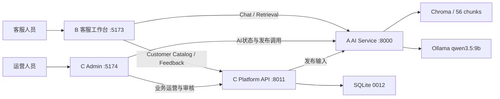

# AI-CS Engineering Documentation Baseline Report V1

## 1. 结论

已基于当前正式项目的真实代码、运行中 OpenAPI、正式 SQLite 只读检查结果和 Runtime 身份记录，建立 AI-CS 工程文档基线。

本轮只新增 `docs/engineering/**` 文档，没有修改业务代码、API 行为、数据库、RAG 数据或 Runtime 配置，也没有执行 migration、服务重启或 Git 提交。

基线身份：

| 项目 | 实际值 |
|---|---|
| Repository | `C:\Users\EDY\Documents\Codex\2026-07-21\AI-CS` |
| Branch | `release/product-reliability-hardening-v1` |
| 审计起点 HEAD | `860d102059cab00ee946512478807f8a8d6efae9` |
| Runtime mode | `standard` |
| Network mode | `LAN` |
| Database revision | `0012_internal_production_finalization_v1` |
| Active Chroma collection | `test_knowledge_v031` |
| Active chunks | `56` |
| Model | `qwen3.5:9b` |

## 2. 交付文档

| 文档 | 解决的问题 | 主要事实来源 |
|---|---|---|
| [工程文档索引](README.md) | 新开发者从哪里开始阅读 | 本目录文档及当前代码结构 |
| [系统架构基线](01_System_Architecture_Baseline_V1.md) | B/C/A、数据库、RAG 如何协作 | `backend/app/**`、`frontend/src/**`、`platform_backend/app/**`、`admin_web/src/**`、Runtime |
| [模块责任基线](02_Module_Responsibility_Baseline_V1.md) | 模块 Owner、写入边界、依赖边界 | 应用入口、router、service、前端 API client |
| [API 现状](03_API_Current_State_V1.md) | 当前可调用接口和兼容边界 | 运行中 A/C `/openapi.json` 与前端消费代码 |
| [数据库现状](04_Database_Current_State_V1.md) | 36 张业务表、关系、migration 和写入边界 | 正式 SQLite、ORM、Alembic `0001`—`0012` |
| [Runtime 运维基线](05_Runtime_Operations_Baseline_V1.md) | 如何安全启动、检查、停止和定位故障 | `.runtime` 身份记录、Windows 脚本、健康接口 |
| [Phase 4.1 验收手册](06_Phase_4_1_Acceptance_Manual_V1.md) | 如何执行 R003 与 R005 真实业务闭环验收 | 当前 UI、API、正式状态机和数据基线 |

## 3. 真实系统摘要

责任边界已经在文档中固化：

- C 是 Store、Product、SKU、审核状态、客服准入、收据和反馈闭环的业务数据 Owner。
- B 只消费 C 的 Customer Available Catalog envelope，不读取数据库，也不自行判断旧准入字段。
- A 根据 B 提交的冻结业务上下文进行检索和回答，不决定商品是否允许客服使用。
- R009 审核前正式商品数据零写入；审核通过才执行字段级 Merge。
- 客服启用与 AI 知识发布是两个独立状态；启用不等于已发布，发布不等于已启用。

## 4. 证据与一致性检查

### 4.1 Git 与目录

审计开始时 Git 为 clean，HEAD 为 `860d102059cab00ee946512478807f8a8d6efae9`。代码目录实际包含：

- `frontend`：B 客服 Vue 3 工作台。
- `admin_web`：C Admin Vue 3 运营后台。
- `backend`：A FastAPI AI/RAG 服务。
- `platform_backend`：C FastAPI 业务数据服务。
- `contracts`：A/B/C 共享契约，当前 `0.5.0/additive`。
- `scripts/windows`：标准 Windows Runtime 运维入口。
- `tests`：契约、集成、E2E 和治理检查。

### 4.2 OpenAPI

从运行中服务读取而非依据旧设计文档：

| 服务 | Paths | Operations | Schemas | SHA-256 |
|---|---:|---:|---:|---|
| A | 24 | 25 | 30 | `C41659C1DEA9AC8DBCEC5B9F6D6DDE04C160FF04F98C427618086FE684CF0EBE` |
| C | 78 | 86 | 212 | `1CE6DDEF638EAD9C5E37E92C289865463CAA6B3048BB489E78557F5C55E7FB8F` |

API 文档以 operation 分组列出全部现状，并明确 `/api/ai/**`、`/api/v1/test-catalog/**` 等兼容接口不是新业务主链。

### 4.3 数据库

正式数据库只读检查：

- Alembic revision：`0012_internal_production_finalization_v1`。
- 业务表：36 张，另有 `alembic_version`。
- SQLite `integrity_check`：PASS。
- `foreign_key_check`：PASS。
- 数据质量检查：P0/P1/P2 均为 0。
- 正式库离线快照 SHA-256 证据：`39BC426DB0BAB826608EFBA065A08EDAA67EF27A6ED96CF4A96D20A4E1EDA4D0`。

数据库文档逐表记录用途、实际行数、关键外键和创建 migration，并标明历史 `test_catalog_*` 名称仍被正式 C 投影封装使用，不能仅凭命名删除。

### 4.4 Runtime 与 RAG

受控 Runtime 基线的四服务均来自同一 Repository 与 SHA：

| 服务 | 端口 | 绑定 | 身份记录 PID / 监听 PID | 状态 |
|---|---:|---|---|---|
| B | 5173 | `192.168.1.11` | `19912 / 19912` | HTTP 200 |
| Admin | 5174 | `127.0.0.1` | `29648 / 26192` | HTTP 200 |
| A | 8000 | `127.0.0.1` | `25564 / 19624` | ready |
| C | 8011 | `127.0.0.1` | `8284 / 30440` | healthy |

Windows Runtime 的 PowerShell 包装进程与真实监听进程可能不同，因此运维文档明确要求同时核对身份记录和端口 Owner，不能仅按单一 PID 判断。

RAG 基线为 `test_knowledge_v031`、56 chunks，`qwen3.5:9b` configured/ready。`documents` collection 为 0，但不是 active collection，不能作为启动失败依据。

## 5. Phase 4.1 可执行性

验收手册已经把 Phase 4.1 分成两个受控闭环：

1. R003：C 中已审核商品 → 人工启用客服 → Customer Catalog → B 可选择商品。
2. R005：B 生成建议 → 客服采用/修改采用/拒绝 → C 事件记录 → 拒绝聚合为 AI 问题 → 创建知识任务 → 完成人工复验。

手册包含准备数据、人工步骤、页面与 API 双重证据、数据库只读证据、PASS/FAIL 标准及恢复原则。它不把“HTTP 200”误判为业务闭环通过，也不要求修改数据库来制造验收结果。

## 6. 文档治理规则

- 新功能先更新 Requirement Registry，再更新受影响的工程文档。
- API 变化必须重新采集运行中 OpenAPI，并同步 contracts version/changelog/compatibility notes。
- migration 变化必须同步数据库表清单、ER、状态字段和回滚边界。
- Runtime 配置变化必须同步启动方式、绑定地址、数据路径和身份验证方法。
- 历史设计文档只作为决策背景，不可覆盖真实代码、OpenAPI、数据库和 Runtime 证据。
- 文档中的 `.runtime` 路径只描述本机运行位置，不得把运行数据、数据库、向量库、日志或真实配置提交 Git。

## 7. 当前边界与后续动作

本轮新增文档使当前工作树形成预期的 `docs/engineering/**` docs-only 未提交变化。正式运行进程仍是审计起点 SHA，且本轮没有重启或修改任何运行数据；但在下一次 Phase 4.1 正式验收前，应另行执行一次受控 docs-only 提交并在授权静默窗口重启，使 Git clean、Runtime SHA 与 source fingerprint 再次一致。

该后续动作属于 Release Governance，不在本次技术文档任务授权范围内。本轮不通过改写运行记录或绕过 fingerprint 检查来伪造 clean 基线。

## 8. Gate 结果

| Gate | 结果 | 证据 |
|---|---|---|
| 文档来源真实 | PASS | 代码、运行中 OpenAPI、正式 SQLite 与 Runtime 身份记录 |
| 代码与文档一致 | PASS | 路由、前端 client、ORM、migration 和运行状态交叉核对 |
| 目录结构清晰 | PASS | `docs/engineering/README.md` 统一索引 |
| 后续开发可直接阅读 | PASS | 六份主题文档及 Phase 4.1 可执行手册 |
| 业务代码/数据库/Runtime 零修改 | PASS | 变化范围仅 `docs/engineering/**` |

最终状态：`AI_CS_ENGINEERING_DOCUMENTATION_BASELINE_READY`
