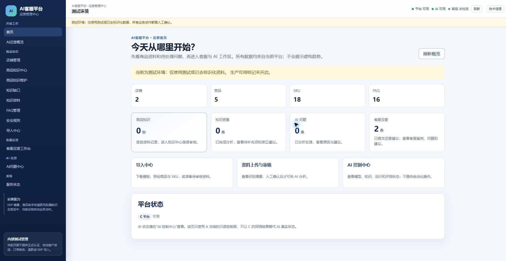
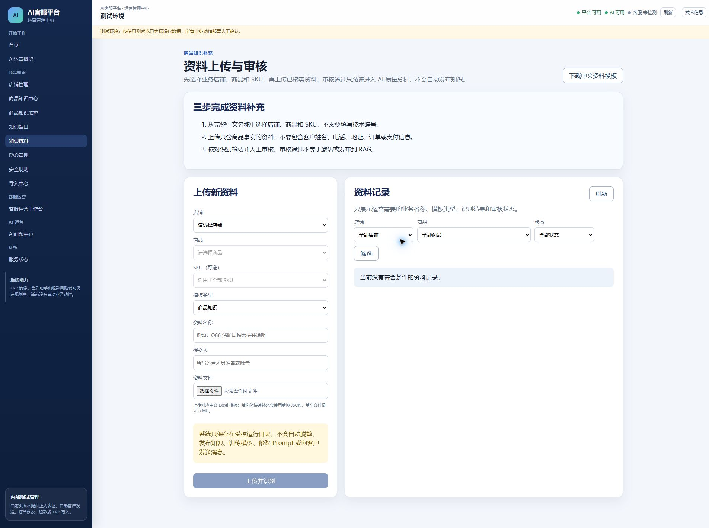

# AI-CS R009 Browser Acceptance Report V1

日期：2026-07-30

任务：R009 Release Candidate Phase 5 浏览器验收

结论：`R009_BROWSER_ACCEPTANCE_BLOCKED_RUNTIME_AND_UPLOAD_PERMISSION`

## 1. 验收目标与保护边界

目标地址仅限 `http://127.0.0.1:5174/`。本轮允许启动配置有 ChatGPT Chrome Extension 的 Chrome Default Profile，并验证页面控制、点击、表单填写、Excel 文件选择和页面结果读取。

本轮没有修改 AI-CS 代码、Runtime、数据库、contracts、A/B/RAG/Prompt，没有执行 `0009`，也没有部署 R009 RC。浏览器操作在任何可能触发数据库写入之前停止。

## 2. 浏览器环境

| 检查项 | 结果 |
| --- | --- |
| Google Chrome | `151.0.7922.71`，已安装并成功启动 |
| ChatGPT Chrome Extension | 已安装、已注册、已启用，版本 `1.2.27221.15725_0` |
| Native Messaging Host | manifest、注册表、host name、allowed origin 全部正确 |
| Codex Chrome 控制 | PASS，已建立 extension-backed 控制会话 |
| Playwright Chromium 独立安装 | 未安装；本轮使用受控 Chrome 内置 Playwright API，不使用独立 CLI |
| Chrome remote debugging | 未启用；extension-backed 控制已可用，不需要扩大调试端口 |

Chrome 启动前可控浏览器列表为空；经用户明确授权启动 Default Profile 后，Codex 成功取得 Chrome 控制并读取完整浏览器文档。

## 3. Runtime 身份

实际正式 Runtime 仍为：

- Repository：`C:\Users\EDY\Documents\Codex\2026-07-21\AI-CS`
- Branch：`control/runtime-identity-alignment-v1`
- SHA：`4edf131cb341993b12a0143b0388d932b29faf84`
- C API 8011、A 8000、B 5173、Admin 5174：运行中
- `runtimeMode=standard`、`networkMode=LAN`
- 数据库 revision：`0008_customer_feedback_loop_v1`

只读数据库核验：仅存在 `import_batches`、`import_rows`、`knowledge_materials`，三表记录数均为 0；R009 的 `import_change_sets`、`import_field_changes`、`import_review_records` 不存在。这与“未部署 R009、未执行 0009”一致。

## 4. 浏览器操作过程

### 4.1 打开 C Admin

浏览器成功打开 `http://127.0.0.1:5174/overview`，标题为“木木小栈管理平台”。DOM 与截图均显示测试环境、平台可用、AI 可用。

### 4.2 进入资料上传与审核

通过页面可见链接进入 `http://127.0.0.1:5174/knowledge-materials`，点击和页面结果读取均通过。

实际页面不是 R009 RC 三步流程。当前页面要求：

`店铺 → 商品 → SKU → 模板类型 → 资料名称 → 提交人 → 文件`

R009 期望流程应为：

`店铺 → 商品知识采集模板 → Excel 上传 → 预检/Merge/审核`

### 4.3 点击、选择与填写

以下受控浏览器操作成功：

- 选择店铺“玩趣乐园积木店”；
- 选择模板“商品知识”；
- 填写资料名称“R009 浏览器验收（不提交）”；
- 填写提交人“browser-acceptance-v1”；
- 读取选择后页面状态。

所选店铺在当前旧页面没有可选商品，因此“上传并识别”保持禁用。以上操作只改变浏览器表单状态，没有提交请求。

### 4.4 Excel 文件

目标文件：`C:\Users\EDY\Desktop\商品知识采集模板V1(1)(1).xlsx`

只读 Parser 预检确认：

- 四个 Sheet 均存在、可见且有效：填写说明、数据填写、示例数据、字段说明；
- 数据填写表头位于第 5 行；
- 商品记录 19 条；
- 店铺名称为“玩趣乐园积木店”；
- blocking issue 为 0。

该只读预检只用于确认测试文件，不替代浏览器业务验收。

浏览器文件选择器可以打开，但 `setFiles` 被 Chrome Extension 权限拒绝。需要用户在扩展详情中启用文件 URL 访问，Agent 不得自行修改该扩展权限。

## 5. R009 验收场景结果

| 场景 | 结果 | 证据/原因 |
| --- | --- | --- |
| 打开 5174 | PASS | 受控 Chrome 实际打开并读取页面 |
| 点击进入资料上传与审核 | PASS | 实际到达 `/knowledge-materials` |
| 店铺选择 | PASS | “玩趣乐园积木店”已选中 |
| 模板选择 | PASS | “商品知识”已选中 |
| 表单填写 | PASS | 两个文本字段成功填写 |
| Excel 文件选择 | BLOCKED | Chrome Extension 未允许 file URL access |
| R009 三步页面 | FAIL | 正式 5174 仍是 4edf131 旧页面 |
| 四 Sheet 浏览器解析 | BLOCKED | 文件未能选择，且正式 Runtime 无 R009 Parser/API |
| 商品识别 | BLOCKED | 正式 Runtime 无 R009 API/0009 |
| Merge 预览 | BLOCKED | 页面无 R009 Merge 区域 |
| ADD/UPDATE/KEEP/NO_CHANGE | BLOCKED | 页面与数据库均无 R009 能力 |
| 审核流程 | BLOCKED | 不允许在旧页面触发正式数据库写入 |

## 6. 数据零写入证据

- 未点击“上传并识别”；
- 未点击任何审核按钮；
- 正式数据库仍为 revision 0008；
- `import_batches=0`、`import_rows=0`、`knowledge_materials=0`；
- R009 三张新增表不存在；
- 正式四服务未停止、未重启、未切换 SHA。

## 7. 阻塞与下一步

阻塞 1：Chrome 文件上传权限。

To enable file upload, go to chrome://extensions in Chrome, click Details under the ChatGPT Chrome Extension, and enable "Allow access to file URLs." See [here](https://developers.openai.com/codex/app/chrome-extension#upload-files) for details.

阻塞 2：R009 尚未进入 5174/8011，数据库仍为 0008。即使解除文件权限，当前页面也无法产生四 Sheet 解析、商品识别、Merge 和 R009 审核证据。

因此不能声明用户要求的 `R009_BROWSER_ACCEPTANCE_COMPLETE`。下一步必须先：

1. 由用户启用 ChatGPT Chrome Extension 的文件 URL 访问；
2. 另行授权受控 R009 Runtime/0009 部署或提供独立 R009 验收 Runtime；
3. 在正确 SHA/revision 上重新执行完整 Phase 5。

在此之前，不得为了通过浏览器 Gate 而绕过数据库、API 或 Runtime 身份约束。
