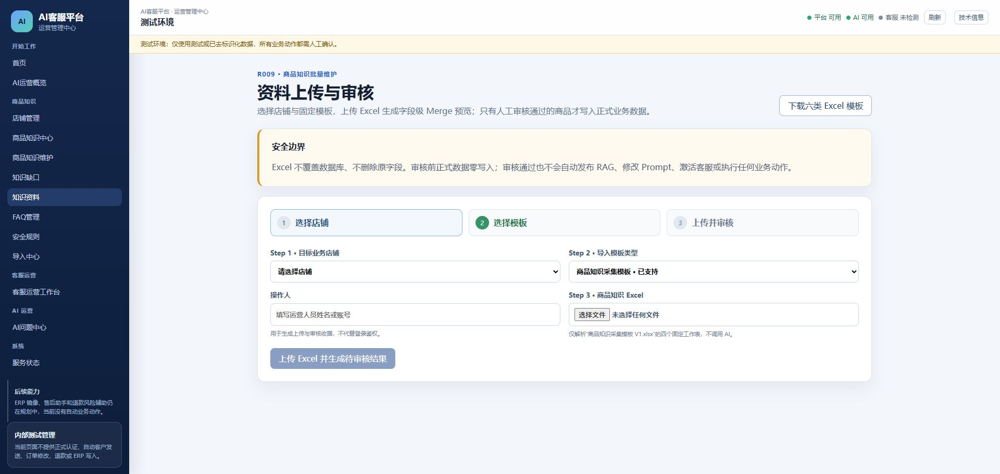

# AI-CS R009 Acceptance Runtime Ready Report V1

执行时间：2026-07-30
最终状态：`R009_ACCEPTANCE_RUNTIME_READY`

## 1. 目标与隔离边界

本次只为 R009 浏览器验收建立独立运行环境，没有部署或切换正式 Pilot。

- R009 RC 源码目录：`C:\Users\EDY\Documents\Codex\2026-07-21\AI-CS-r009-release-candidate-v1`
- 分支：`release/r009-product-knowledge-import-v1-rc1`
- RC SHA：`8b83a20bf834ed917d2f166dd4aaa42577bf1f33`
- RC Git 状态：clean
- 隔离 Runtime：RC 目录下 Git 忽略的 `.runtime/r009-acceptance-runtime-v1`
- 正式 Runtime：继续使用 `C:\Users\EDY\Documents\Codex\2026-07-21\AI-CS@4edf131`
- 正式数据库：继续保持 `0008_customer_feedback_loop_v1`

旧 19011 监听器已确认属于此前 Feature 隔离验收，不属于正式 8011。仅该旧隔离进程被停止以释放指定端口；其旧数据库文件保留，没有删除。正式四服务没有停止或重启。

## 2. 隔离数据与迁移

使用 SQLite 在线备份 API，以只读 URI 从正式 0008 数据库生成一致性副本：

`AI-CS-r009-release-candidate-v1/.runtime/r009-acceptance-runtime-v1/data/platform.sqlite3`

迁移只在该副本执行：

`0008_customer_feedback_loop_v1 → 0009_product_knowledge_import_v1`

验证结果：

- 隔离库 revision：`0009_product_knowledge_import_v1`
- `PRAGMA integrity_check`：`ok`
- R009 表：`import_change_sets`、`import_field_changes`、`import_review_records`
- 隔离目录包含 2 个可用于页面选择的测试店铺
- 正式库复核：仍为 `0008_customer_feedback_loop_v1`，完整性 `ok`

知识库与 Chroma 数据复制到独立 RAG 路径；C 上传资料目录和三服务日志也都位于隔离 `.runtime`。没有共享正式可写数据库、向量目录、资料目录或日志目录。

## 3. 启动身份

| 服务 | 地址 | Listener PID | 代码工作目录 | 结果 |
| --- | --- | ---: | --- | --- |
| Admin | `http://127.0.0.1:5179/` | 2876 | RC `admin_web` | RUNNING |
| C API | `http://127.0.0.1:19011/` | 29764 | RC `platform_backend` | RUNNING |
| A | `http://127.0.0.1:19000/` | 21100 | RC `backend` | RUNNING |

依赖工具链为已冻结版本：C 使用 Python 3.12.13，A 使用 Python 3.11.9，Admin 使用 Node 22.23.1。依赖解释器只作执行工具；源码加载、工作目录、端口和所有可写 Runtime 路径均属于 RC 隔离环境。

运行身份记录位于：

`AI-CS-r009-release-candidate-v1/.runtime/r009-acceptance-runtime-v1/runtime-record.json`

该文件、数据库、知识副本、日志和启动辅助文件均受 Git 忽略，不可提交。

## 4. R009 与服务验证

### Admin

- `GET http://127.0.0.1:5179/knowledge-materials`：HTTP 200。
- 受控 Chrome 实际打开页面成功。
- 页面真实显示 R009 三步流程：
  1. 选择店铺
  2. 选择模板
  3. 上传并审核
- 页面显示“商品知识采集模板 · 已支持”，其余五类模板为“开发中”。
- 店铺下拉已从隔离 C API 加载两个店铺，证明页面不是仅打开静态空壳。
- 页面顶部显示“平台 可用、AI 可用”。

浏览器证据：

### C API

- `GET /health`：HTTP 200。
- `GET /openapi.json`：HTTP 200。
- OpenAPI 包含四条 R009 路由：
  - `POST /api/v1/admin/product-knowledge-imports`
  - `GET /api/v1/admin/product-knowledge-imports/{batch_id}/preflight`
  - `GET /api/v1/admin/product-knowledge-imports/{batch_id}/merge-preview`
  - `POST /api/v1/admin/product-knowledge-imports/{batch_id}/change-sets/{change_set_id}/reviews`
- 对 5179 返回明确 CORS 允许来源。

### A

- `GET /api/health`：HTTP 200。
- `GET /api/status`：`ready=true`、`model_configured=true`。
- 活跃 collection：`test_knowledge_v031`。
- 活跃 chunks：47。
- available collections：`documents=0`、`test_knowledge_v031=47`。
- A 的 Platform Provider 指向隔离 `http://127.0.0.1:19011`。

## 5. 正式 Pilot 保护复核

正式仓库仍为 `4edf131cb341993b12a0143b0388d932b29faf84`，Git clean。

| 正式服务 | 端口 | Listener PID | 状态 |
| --- | ---: | ---: | --- |
| B | 5173 | 21416 | 保持运行 |
| C Admin | 5174 | 25796 | 保持运行 |
| A | 8000 | 22384 | 保持运行 |
| C API | 8011 | 22656 | 保持运行 |

正式数据库仍为 0008 且完整性正常。没有执行正式 0009、没有切换 Runtime、没有修改 A/B/RAG/Prompt/contracts，也没有停止正式服务。

## 6. 本阶段未执行

- 未上传 Excel。
- 未生成导入批次、Merge 预览或审核收据。
- 未对隔离库执行 R009 业务写入。
- 未执行正式数据库迁移。
- 未验收 B 客服或 RAG 发布。

Chrome 的文件选择仍需要在 ChatGPT Chrome Extension 中启用 “Allow access to file URLs”。这是下一阶段文件上传自动化的浏览器权限前置项，不影响本报告对隔离 Runtime 已就绪的结论。

## 7. 下一阶段入口

浏览器验收应只访问：

`http://127.0.0.1:5179/knowledge-materials`

后续可在该隔离 0009 环境完成真实 Excel 的上传、四 Sheet 解析、商品识别、Merge、审核和异常场景，不得改用正式 5174/8011，也不得把隔离验收结果当作正式生产部署。

最终状态：`R009_ACCEPTANCE_RUNTIME_READY`
