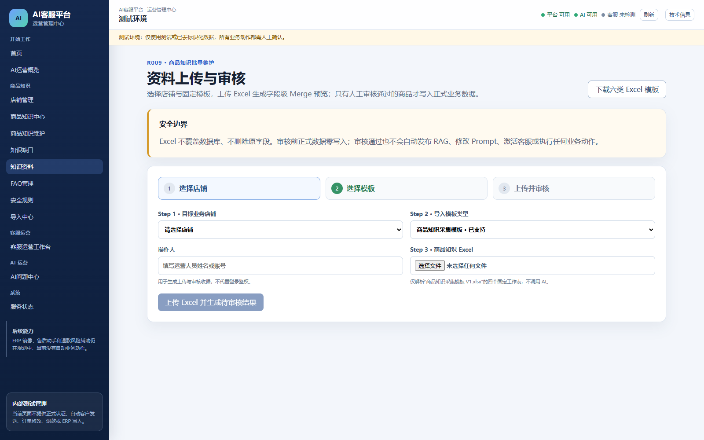
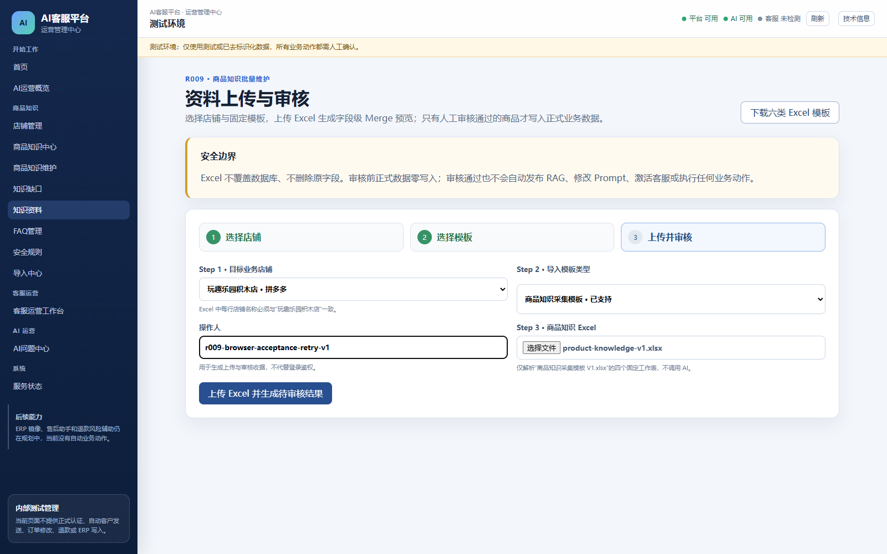
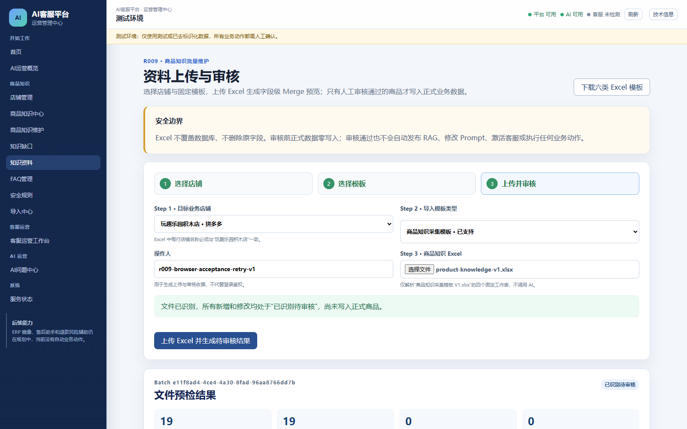
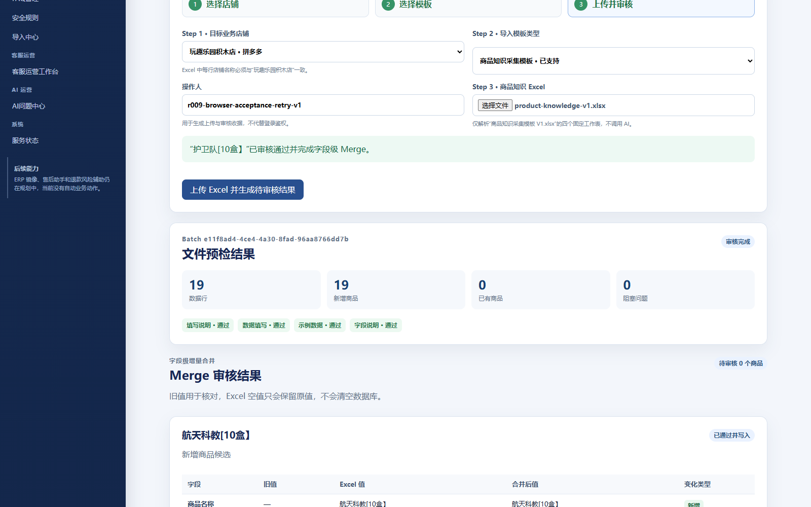
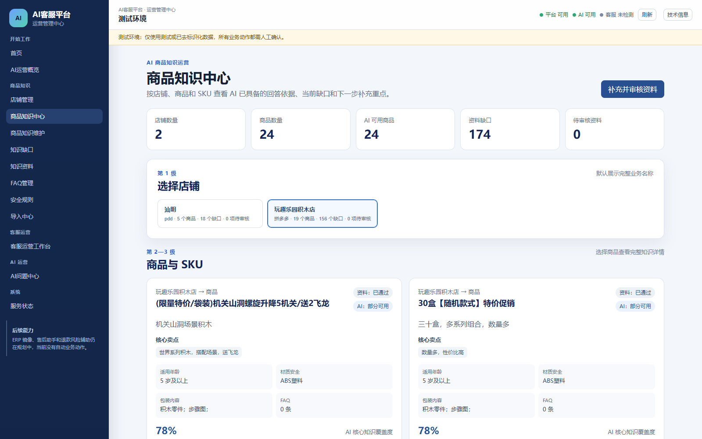

# AI-CS R009 Browser Acceptance Retry Report V1

执行日期：2026-07-30

验收入口：`http://127.0.0.1:5179/knowledge-materials`

最终状态：`R009_BROWSER_ACCEPTANCE_COMPLETE`

## 1. 结论

R009 商品知识导入在独立 RC 验收 Runtime 完成真实浏览器闭环：选择店铺、选择商品知识模板、上传桌面 Excel 的字节级一致副本、四 Sheet 解析、商品识别、Merge 预览、19 个商品逐条人工审核，以及商品知识中心生效复核均通过。

本次没有用 API 代替浏览器上传或审核，没有直接写数据库模拟业务结果。API 响应仅由浏览器监听用于留证；数据库仅通过只读连接核对页面操作前后的状态。

## 2. 浏览器方案

### 2.1 Chrome Extension 权限尝试

已先尝试在现有受控 Chrome 中打开 `chrome://extensions/`，以自动开启 ChatGPT Chrome Extension 的 “Allow access to file URLs” 并重新加载扩展。该内部页面被浏览器安全策略拒绝访问，自动化会话不能修改扩展权限；本次没有绕过该安全边界。

### 2.2 独立 Playwright 环境

随后切换到隔离 Playwright 环境：

- Playwright：`1.62.0`；
- BrowserType：`chromium`；
- 浏览器可执行文件：本机 Google Chrome `151.0.7922.71`；
- Profile：全新隔离上下文，不加载 Chrome Default Profile 或 ChatGPT Extension；
- 访问范围：仅 `127.0.0.1:5179` 页面，以及页面自身请求的隔离 C API `127.0.0.1:19011`；
- 验收完成后自动化浏览器已关闭，5179/19011/19000 验收服务继续保留。

## 3. Runtime 身份与保护边界

验收环境：

- Repository：`C:\Users\EDY\Documents\Codex\2026-07-21\AI-CS-r009-release-candidate-v1`；
- Branch：`release/r009-product-knowledge-import-v1-rc1`；
- SHA：`8b83a20bf834ed917d2f166dd4aaa42577bf1f33`；
- Admin：5179，PID 2876；
- C API：19011，PID 29764；
- A：19000，PID 21100；
- SQLite：Git 忽略的 `.runtime/r009-acceptance-runtime-v1/data/platform.sqlite3`；
- Revision：`0009_product_knowledge_import_v1`。

正式 Pilot 全程保持：

- Repository：`C:\Users\EDY\Documents\Codex\2026-07-21\AI-CS`；
- SHA：`4edf131cb341993b12a0143b0388d932b29faf84`；
- B 5173、Admin 5174、A 8000、C API 8011 的原 PID 均未变化；
- 正式数据库仍为 `0008_customer_feedback_loop_v1`，商品数 5，`import_batches=0`，完整性 `ok`；
- 未执行正式 0009、未切换 Runtime、未停止正式服务。

## 4. 测试文件与真实上传

桌面源文件：

`C:\Users\EDY\Desktop\商品知识采集模板V1(1)(1).xlsx`

桌面文件被 Excel/其他进程以共享方式占用，自动化无法直接取得普通独占文件句柄。验收从该文件读取原始字节，在 RC 的 Git 忽略 Runtime 中生成上传副本：

`.runtime/r009-browser-acceptance-retry-v1/uploads/product-knowledge-v1.xlsx`

源文件与上传副本的 SHA-256 均为：

`C569BF7D1269F2B3A8E08B92387E178DDBE741AC290C6B42D2A73DB358B13DFD`

Playwright 通过真实页面的 `input[type=file]` 选择该字节级一致副本，页面显示文件名 `product-knowledge-v1.xlsx`，再点击“上传 Excel 并生成待审核结果”。这是真实浏览器 multipart 上传，不是 API 代替。

## 5. 浏览器操作与页面证据

### 5.1 三步页面

页面实际展示并可操作：

1. 选择店铺；
2. 选择模板；
3. 上传并审核。

### 5.2 选择店铺、模板与文件

- 店铺：`玩趣乐园积木店 · 拼多多`；
- 模板：`商品知识采集模板 · 已支持`；
- 操作人：`r009-browser-acceptance-retry-v1`；
- 文件输入框显示：`product-knowledge-v1.xlsx`；
- 上传按钮在完成选择后变为可用。

### 5.3 解析与 Merge 预览

浏览器实际提交返回 HTTP 201，生成批次：

`e11f8ad4-4ce4-4a30-8fad-96aa8766dd7b`

页面结果：

- 批次状态：`IDENTIFIED_PENDING_REVIEW`；
- 填写说明：通过；
- 数据填写：通过；
- 示例数据：通过；
- 字段说明：通过；
- 数据行：19；
- 新增商品：19；
- 已有商品：0；
- 阻塞问题：0；
- 待审商品：19。

本次隔离快照中没有与 Excel 商品名匹配的现有商品，因此实际字段变化为 `ADD=205`、`KEEP=4`；本数据集没有产生 `UPDATE` 或 `NO_CHANGE`。页面成功展示商品、字段、旧值、Excel 值、合并后值和变化类型，证明 Merge 预览链路可用；未虚构本轮未出现的变化类型。

## 6. 审核与数据结果

上传后、审核前只读数据库核对：

- `import_batches=1`；
- `import_rows=19`；
- `import_change_sets=19`；
- `import_field_changes=209`；
- `import_review_records=0`；
- 正式商品表仍为 5 条；
- 19 个 change set 均为 `IDENTIFIED_PENDING_REVIEW`。

这证明上传与 Merge 预览阶段没有直接写入正式商品。

随后通过页面逐一点击 19 个“通过并 Merge”按钮。浏览器共观察到 19 个 review POST，全部 HTTP 201；没有直接调用 API。审核后：

- 批次状态：`COMPLETED`；
- change set：`APPROVED_APPLIED=19`；
- review decision：`APPROVE=19`；
- review outcome：`APPLIED=19`；
- 审核收据：19；
- 正式商品：5 → 24；
- 页面待审核：0；
- 页面“已通过并写入”：19；
- SQLite 完整性：`ok`。

## 7. 商品知识页面生效复核

通过同一隔离浏览器进入 `http://127.0.0.1:5179/knowledge-center`，选择“玩趣乐园积木店”。页面显示：

- 店铺商品：19；
- 待审核：0；
- 19 个导入商品均为“资料：已通过”；
- 页面可读取商品名称、简介、核心卖点、适用年龄、材质安全和包装内容；
- 页面明确提示资料生效不等于发布到 RAG。

## 8. 验收矩阵

| 场景 | 结果 | 证据 |
| --- | --- | --- |
| 自动开启 Chrome Extension file URL 权限 | BLOCKED | `chrome://extensions/` 被浏览器安全策略拒绝；未绕过 |
| 切换独立 Playwright 浏览器 | PASS | Playwright chromium 隔离上下文成功打开 5179 |
| R009 三步页面 | PASS | 店铺、模板、Excel 上传均可操作 |
| 真实浏览器文件上传 | PASS | 文件输入、页面按钮、HTTP 201 和批次 ID |
| 四 Sheet 解析 | PASS | 四个 Sheet 均显示“通过” |
| 商品识别 | PASS | 19 行、19 个新增、0 个阻塞 |
| Merge 预览 | PASS | 209 个字段变化，实际 `ADD=205`、`KEEP=4` |
| 审核前正式数据零写入 | PASS | 上传后商品仍为 5，review receipt 为 0 |
| 页面人工审核 | PASS | 19 次页面点击、19 个 HTTP 201 收据 |
| 审核后商品知识生效 | PASS | 商品 5→24，玩趣乐园店铺显示 19 个已通过商品 |
| 正式 Pilot 保护 | PASS | 正式 4edf131/0008、四服务 PID 和数据均未变化 |

## 9. 遗留说明

- 本轮完成的是隔离 RC 浏览器业务验收，不代表 R009 已部署到正式 5174/8011。
- 当前真实数据只产生 `ADD/KEEP`；`UPDATE/NO_CHANGE` 已有代码测试与先前隔离集成验收，但不是本次浏览器数据集的实际结果。
- RAG 发布和 B 客服消费不属于 R009，本轮未执行。
- 其余五类模板仍未开放。
- 正式发布仍需单独的数据库备份、0009 正式迁移、Runtime 切换与正式端口部署授权。

最终状态：`R009_BROWSER_ACCEPTANCE_COMPLETE`
