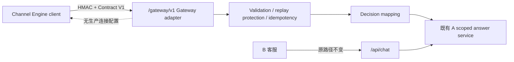

# 《AI-CS Gateway Server Foundation V1》

> 日期：2026-08-04
> 需求：R011
> 实现基线：`release/product-reliability-hardening-v1@0b3367f85999f1dc840accf23742c290eb53746b`（任务开始锚点）
> Gate：`PASS / AI_CS_GATEWAY_SERVER_READY`

## 1. 新增接口

| 方法与路径 | 认证 | 成功结果 | 失败结果 |
| --- | --- | --- | --- |
| `POST /gateway/v1/decisions` | HMAC-SHA256，timestamp、nonce、body hash、request/correlation/idempotency identity | Gateway Contract V1 `DecisionResponse` | 非 2xx `ErrorEnvelope` |
| `GET /gateway/v1/health` | 同一 HMAC 机制，空 body 参与签名 | `GatewayHealth`，显式报告 AI/模型与生产连接状态 | 非 2xx `ErrorEnvelope` |

Gateway 默认 `GATEWAY_ENABLED=false`。未提供至少 32 bytes 的运行时 HMAC secret 时不会形成可匿名使用的 Gateway；既有 A 初始化与 `/api/*` 路由保持独立。

冻结 wire schema 使用 `contract_version=1.0`、`idempotency_key`、`customer_message`。Mission Brief 中的 `schema_version`、`request_key`、`message` 不作为别名接受，防止 AI-CS 与 Channel Engine 出现两套 V1。

## 2. 架构变化

Gateway 是 A 进程内的独立 adapter：只调用既有 `rag_service.query(question, context=FrozenChatContext)`，不复制或修改检索、Prompt、模型和商品知识规则。`context.ai_cs_scope` 必填，避免 Channel Engine 请求退回 legacy 无范围回答路径。

现有 A action 映射如下：

| A action | Gateway action | proposed_content |
| --- | --- | --- |
| `DIRECT_ANSWER`、`CONTROLLED_ANSWER`、`ASK_CLARIFY` | `SUGGEST_REPLY` | 既有 A answer |
| `REQUIRE_LOOKUP`、`TRANSFER_HUMAN`、`REFUSE` | `NO_ACTION` | `null` |

所有成功 Decision 固定 `requires_approval=true`；Gateway 不执行发送或任何客户业务动作。模型/RAG不可用返回 `503 SERVICE_UNAVAILABLE`，不包装成 HTTP 200。

## 3. 安全设计

- HMAC canonical string 与 Gateway Contract V1 一致，包含 method、path、contract version、client/key、timestamp、nonce、三类 identity 与 raw-body SHA-256。
- timestamp 默认允许 ±300 秒；nonce 格式受限并持久化 600 秒；签名与 body hash 使用 constant-time comparison；未知 credential 与错误签名使用相同外部错误。
- Gateway 两个有效路由禁止匿名调用。错误响应不返回 secret、Authorization、签名、Prompt、source excerpt、异常原文或内部路径。
- 私有 SQLite 只存 client/key 标识、nonce、canonical payload hash、幂等状态和完成的 Decision；不存 HMAC secret、Authorization、RAG vectors、知识源正文或 Prompt。
- 幂等 claim 使用租约 owner token；租约过期后，旧执行者不能删除或覆盖新执行者结果。
- request body 应用层上限为 64 KiB；正式部署仍必须在反向代理设置等价上限、TLS、私有网络、secret manager、轮换和文件 ACL。这些是后续 Deployment Gate，不在本 Foundation 中伪报完成。

## 4. Contract 与兼容治理

- 共享 contracts 从 `0.5.0` additive 升级为 `0.6.0`。
- 新增 checked-in Phase 1 schema：`DecisionRequest | DecisionResponse | ErrorEnvelope | GatewayHealth`；runtime schema 与文件内容由 drift test 锁定。
- vendor media type 为 `application/vnd.ai-cs.channel-engine.gateway-v1+json`。为兼容当前 Gateway Client 的已签名请求，服务端在记录的兼容窗口内同时接受 `application/json`，响应始终返回 vendor media type。
- 外部当前 Decision client 的模型、canonical body、HMAC signer 与本实现一致；但其 `health_check()` 仍使用未签名`GET /health`。本任务按明确安全要求只提供签名`GET /gateway/v1/health`，不会新增匿名alias；外部adapter必须在独立非生产集成任务中修正后才能完成端到端健康探测。
- Phase 1 只包含 Decision 与 authenticated Health；Receipt/Event 不在本轮范围，未被误报为完整执行闭环。
- B 无接口、source、代理或配置变更；C/Admin 无变更；A `/api/chat` envelope 和语义未变。

## 5. 测试结果

| 证据 | 结果 | 覆盖 |
| --- | --- | --- |
| Gateway 专项 | `24 passed` | Contract drift/strict schema、六 action mapping、HMAC、timestamp、nonce replay、ErrorEnvelope、media/body limit、持久化幂等、restart replay、租约 owner、health、unknown route/method、disabled/enabled integration、chat regression |
| A 全量 | `133 passed, 3 skipped` | Gateway 新增测试 + 既有 A/RAG/API 回归；3 项为显式 opt-in 的真实模型 E2E |
| Shared contracts | `6 passed` | contracts 0.6.0 与 Gateway schema |
| JSON Schema parse | `16 valid` | 仓库全部 `contracts/schemas/*.json` |
| B | `127 passed` | B 既有客服回归 |
| B typecheck/build | `PASS / PASS` | B TypeScript 与 production bundle |

测试只使用合成请求、stub answer provider 和临时 SQLite；没有调用真实 Channel Engine、没有写正式数据库/知识库/向量库，也没有启动真实模型验证。

## 6. B 兼容证明

1. `frontend/**` 与 `docs/customer/**` 零修改。
2. `/api/chat` router、request/response model 与 handler 未修改；Gateway 使用独立 `/gateway/v1` router。
3. Gateway 关闭、开启、成功调用前后，既有 `/api/health` 与 `/api/chat` regression 均通过。
4. B 全量 127 项、typecheck、production build 均通过。
5. Gateway 配置失败只将 Gateway 标记为不可用，不阻塞 A/B 原有启动链；关闭 Gateway 即可回滚，无数据库迁移、RAG rebuild 或 B/C 回滚。

## 7. 风险与后续部署 Gate

| 风险 | 当前控制 | 后续要求 |
| --- | --- | --- |
| secret 泄露/弱密钥 | secret 不入 Git、不入 repr，少于 32 bytes fail closed | secret manager、ACL、轮换与双 key 过渡 |
| 网络窃听 | Foundation 不声称 TLS | 反向代理 TLS/mTLS 或等价私网控制 |
| 应用层读取 body 后才判断 64 KiB | 业务校验已拒绝超限 | ingress/server 同步限制 request body |
| SQLite 多实例共享 | 同文件事务与 owner token 防本机竞争 | 多主机部署前改用受控共享幂等存储并做故障测试 |
| Engine adapter 健康路径/认证/media 差异 | Decision/HMAC模型兼容；明确提供签名`/gateway/v1/health`并记录JSON兼容窗口，不开放匿名alias | Engine非生产集成前将当前未签名`GET /health`改为签名`GET /gateway/v1/health`并验收 |
| Receipt/Event 尚未实现 | 明确排除，不连接生产 | 独立 Phase 2 task/contract Gate |

## 8. Gate 结论

需求定义的 Gateway Server Foundation 已完成，B 客服链路保持不变，源码与合成/离线契约证据满足：

`AI_CS_GATEWAY_SERVER_READY`

该状态不等于生产部署、生产安全认证或 Channel Engine 生产联通完成。
